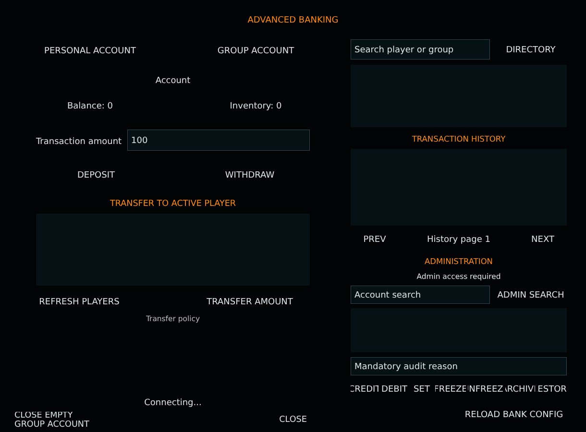


# BankingMenu.layout — Old banking menu (unused)

**Mod:** Advanced Banking  
**File:** `Advanced_Banking/gui/BankingMenu.layout`  
**Root:** `PanelWidget` `Root`, size 1220 × 900  
**Widgets:** 41

Earlier single-page banking layout. Not loaded by any script; kept for reference.

## Preview

Wireframe drawn straight from the layout file: positions, sizes, colours and default text are exact. Image widgets appear as dashed placeholders, and anything hidden at start inside the root is left out.

## Loaded by

- Not loaded by any script (kept for reference).

## Widget tree

Positions and sizes are in pixels when the widget uses exact sizing, otherwise they are fractions of the parent (0–1).

| Widget | Type | Position | Size | Text / notes |
|---|---|---|---|---|
| `Root` | PanelWidget | 0 0 | 1220 × 900 | style DayZDefaultPanel |
| &nbsp;&nbsp;└ `Title` | TextWidget | 20 18 | 1180 × 46 | "ADVANCED BANKING" |
| &nbsp;&nbsp;└ `PersonalButton` | ButtonWidget | 30 82 | 315 × 46 | "PERSONAL ACCOUNT" |
| &nbsp;&nbsp;└ `GroupButton` | ButtonWidget | 375 82 | 315 × 46 | "GROUP ACCOUNT" |
| &nbsp;&nbsp;└ `AccountName` | TextWidget | 30 150 | 660 × 34 | "Account" |
| &nbsp;&nbsp;└ `BalanceText` | TextWidget | 30 194 | 315 × 52 | "Balance: 0" |
| &nbsp;&nbsp;└ `CashText` | TextWidget | 375 194 | 315 × 52 | "Inventory: 0" |
| &nbsp;&nbsp;└ `AmountLabel` | TextWidget | 75 275 | 180 × 38 | "Transaction amount" |
| &nbsp;&nbsp;└ `AmountInput` | EditBoxWidget | 265 270 | 380 × 44 | "100" |
| &nbsp;&nbsp;└ `DepositButton` | ButtonWidget | 75 340 | 250 × 48 | "DEPOSIT" |
| &nbsp;&nbsp;└ `WithdrawButton` | ButtonWidget | 395 340 | 250 × 48 | "WITHDRAW" |
| &nbsp;&nbsp;└ `TransferLabel` | TextWidget | 30 408 | 660 × 32 | "TRANSFER TO ACTIVE PLAYER" |
| &nbsp;&nbsp;└ `PlayerList` | TextListboxWidget | 75 445 | 570 × 150 | style Default |
| &nbsp;&nbsp;└ `RefreshPlayersButton` | ButtonWidget | 75 607 | 180 × 42 | "REFRESH PLAYERS" |
| &nbsp;&nbsp;└ `TransferButton` | ButtonWidget | 395 607 | 250 × 42 | "TRANSFER AMOUNT" |
| &nbsp;&nbsp;└ `FeeText` | TextWidget | 30 650 | 660 × 28 | "Transfer policy" |
| &nbsp;&nbsp;└ `SearchInput` | EditBoxWidget | 730 82 | 290 × 42 | "Search player or group" |
| &nbsp;&nbsp;└ `SearchButton` | ButtonWidget | 1030 82 | 150 × 42 | "DIRECTORY" |
| &nbsp;&nbsp;└ `AccountList` | TextListboxWidget | 730 135 | 450 × 130 | style Default |
| &nbsp;&nbsp;└ `HistoryTitle` | TextWidget | 730 275 | 450 × 30 | "TRANSACTION HISTORY" |
| &nbsp;&nbsp;└ `HistoryList` | TextListboxWidget | 730 310 | 450 × 160 | style Default |
| &nbsp;&nbsp;└ `HistoryPrev` | ButtonWidget | 730 480 | 100 × 35 | "PREV" |
| &nbsp;&nbsp;└ `HistoryPage` | TextWidget | 840 480 | 230 × 35 | "History page 1" |
| &nbsp;&nbsp;└ `HistoryNext` | ButtonWidget | 1080 480 | 100 × 35 | "NEXT" |
| &nbsp;&nbsp;└ `AdminTitle` | TextWidget | 730 530 | 450 × 30 | "ADMINISTRATION" |
| &nbsp;&nbsp;└ `AdminStats` | TextWidget | 730 562 | 450 × 28 | "Admin access required" |
| &nbsp;&nbsp;└ `AdminSearchInput` | EditBoxWidget | 730 595 | 290 × 38 | "Account search" |
| &nbsp;&nbsp;└ `AdminSearchButton` | ButtonWidget | 1030 595 | 150 × 38 | "ADMIN SEARCH" |
| &nbsp;&nbsp;└ `AdminList` | TextListboxWidget | 730 642 | 450 × 92 | style Default |
| &nbsp;&nbsp;└ `AdminReasonInput` | EditBoxWidget | 730 744 | 450 × 38 | "Mandatory audit reason" |
| &nbsp;&nbsp;└ `AdminCredit` | ButtonWidget | 730 792 | 58 × 36 | "CREDIT" |
| &nbsp;&nbsp;└ `AdminDebit` | ButtonWidget | 792 792 | 58 × 36 | "DEBIT" |
| &nbsp;&nbsp;└ `AdminSet` | ButtonWidget | 854 792 | 48 × 36 | "SET" |
| &nbsp;&nbsp;└ `AdminFreeze` | ButtonWidget | 906 792 | 64 × 36 | "FREEZE" |
| &nbsp;&nbsp;└ `AdminUnfreeze` | ButtonWidget | 974 792 | 74 × 36 | "UNFREEZE" |
| &nbsp;&nbsp;└ `AdminArchive` | ButtonWidget | 1052 792 | 62 × 36 | "ARCHIVE" |
| &nbsp;&nbsp;└ `AdminRestore` | ButtonWidget | 1118 792 | 62 × 36 | "RESTORE" |
| &nbsp;&nbsp;└ `AdminReload` | ButtonWidget | 960 845 | 220 × 36 | "RELOAD BANK CONFIG" |
| &nbsp;&nbsp;└ `StatusText` | TextWidget | 30 820 | 660 × 35 | "Connecting..." |
| &nbsp;&nbsp;└ `CloseButton` | ButtonWidget | 530 858 | 160 × 32 | "CLOSE" |
| &nbsp;&nbsp;└ `CloseGroupButton` | ButtonWidget | 30 858 | 180 × 32 | "CLOSE EMPTY GROUP ACCOUNT" |


