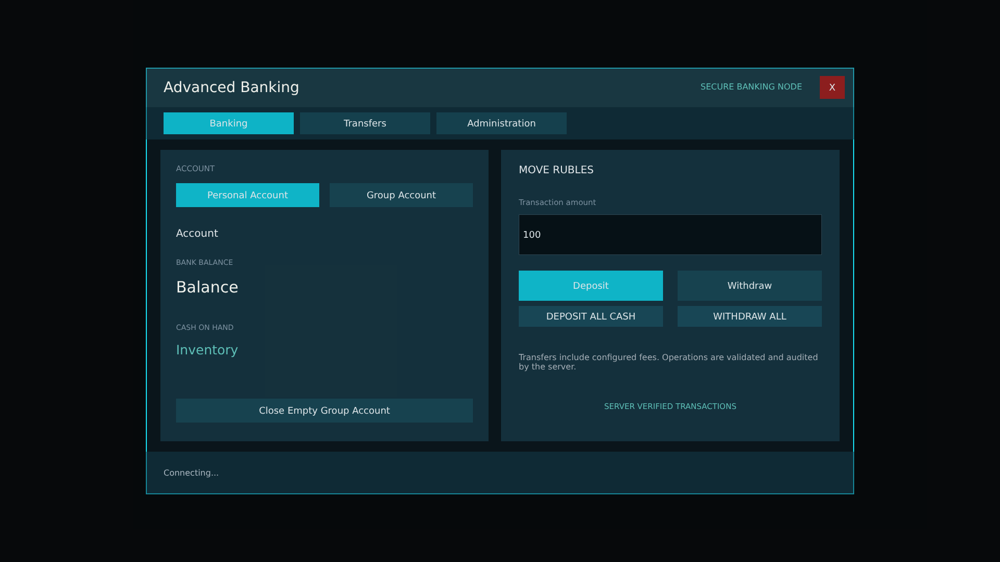
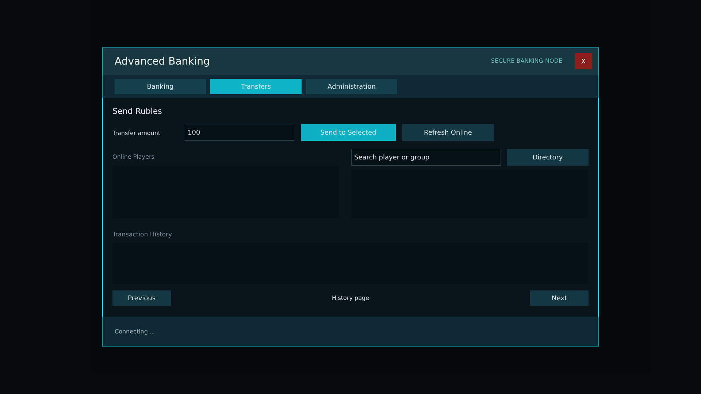
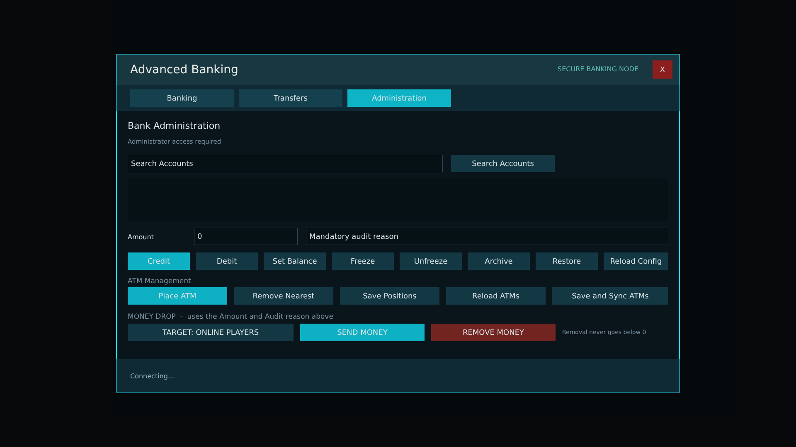


# BankingMenuTabbed.layout — Banking menu (ATM)

**Mod:** Advanced Banking  
**File:** `Advanced_Banking/gui/BankingMenuTabbed.layout`  
**Root:** `PanelWidget` `Root`, size 1 × 1  
**Widgets:** 81

The ATM menu: Banking tab (personal/group account, balance, cash, deposit/withdraw), Transfers tab (players, offline directory, history) and the Admin tab (account search, credit/debit/set, freeze, ATM tools, money drop).

## Preview

Wireframe drawn straight from the layout file: positions, sizes, colours and default text are exact. Image widgets appear as dashed placeholders, and anything hidden at start inside the root is left out.

**Tab: Banking**

**Tab: Transfers**

**Tab: Admin**

## Loaded by

- `Advanced_Banking/scripts/5_Mission/AdvancedBanking/IABMenuComplete.c` line 22
- `Advanced_Banking/scripts/5_Mission/AdvancedBanking/IABMenuComplete.c` line 25

## Widget tree

Positions and sizes are in pixels when the widget uses exact sizing, otherwise they are fractions of the parent (0–1).

| Widget | Type | Position | Size | Text / notes |
|---|---|---|---|---|
| `Root` | PanelWidget | 0 0 | 1 × 1 |  |
| &nbsp;&nbsp;└ `MainPanel` | PanelWidget | 0 0 | 1360 × 820 |  |
| &nbsp;&nbsp;&nbsp;&nbsp;└ `NeonTop` | PanelWidget | 0 0 | 1360 × 2 |  |
| &nbsp;&nbsp;&nbsp;&nbsp;└ `NeonBottom` | PanelWidget | 0 818 | 1360 × 2 |  |
| &nbsp;&nbsp;&nbsp;&nbsp;└ `NeonLeft` | PanelWidget | 0 0 | 2 × 820 |  |
| &nbsp;&nbsp;&nbsp;&nbsp;└ `NeonRight` | PanelWidget | 1358 0 | 2 × 820 |  |
| &nbsp;&nbsp;&nbsp;&nbsp;└ `Header` | PanelWidget | 0 0 | 1360 × 76 |  |
| &nbsp;&nbsp;&nbsp;&nbsp;&nbsp;&nbsp;└ `Title` | TextWidget | 34 17 | 650 × 42 | "#STR_IAB_TITLE" |
| &nbsp;&nbsp;&nbsp;&nbsp;&nbsp;&nbsp;└ `NodeLabel` | TextWidget | 900 22 | 360 × 30 | "SECURE BANKING NODE" |
| &nbsp;&nbsp;&nbsp;&nbsp;&nbsp;&nbsp;└ `CloseButton` | ButtonWidget | 1294 16 | 48 × 44 | "X", style DayZDefaultButton |
| &nbsp;&nbsp;&nbsp;&nbsp;└ `Navigation` | PanelWidget | 0 76 | 1360 × 62 |  |
| &nbsp;&nbsp;&nbsp;&nbsp;&nbsp;&nbsp;└ `BankingTab` | ButtonWidget | 34 10 | 250 × 42 | "#STR_IAB_TAB_BANKING", style DayZDefaultButton |
| &nbsp;&nbsp;&nbsp;&nbsp;&nbsp;&nbsp;└ `TransfersTab` | ButtonWidget | 296 10 | 250 × 42 | "#STR_IAB_TAB_TRANSFERS", style DayZDefaultButton |
| &nbsp;&nbsp;&nbsp;&nbsp;&nbsp;&nbsp;└ `AdminTab` | ButtonWidget | 558 10 | 250 × 42 | "#STR_IAB_TAB_ADMIN", style DayZDefaultButton |
| &nbsp;&nbsp;&nbsp;&nbsp;└ `BankingPage` | PanelWidget | 28 158 | 1304 × 560 |  |
| &nbsp;&nbsp;&nbsp;&nbsp;&nbsp;&nbsp;└ `AccountPanel` | PanelWidget | 0 0 | 630 × 560 |  |
| &nbsp;&nbsp;&nbsp;&nbsp;&nbsp;&nbsp;&nbsp;&nbsp;└ `SectionLabel` | TextWidget | 30 22 | 570 × 28 | "ACCOUNT" |
| &nbsp;&nbsp;&nbsp;&nbsp;&nbsp;&nbsp;&nbsp;&nbsp;└ `PersonalButton` | ButtonWidget | 30 64 | 275 × 46 | "#STR_IAB_PERSONAL_ACCOUNT", style DayZDefaultButton |
| &nbsp;&nbsp;&nbsp;&nbsp;&nbsp;&nbsp;&nbsp;&nbsp;└ `GroupButton` | ButtonWidget | 325 64 | 275 × 46 | "#STR_IAB_GROUP_ACCOUNT", style DayZDefaultButton |
| &nbsp;&nbsp;&nbsp;&nbsp;&nbsp;&nbsp;&nbsp;&nbsp;└ `AccountName` | TextWidget | 30 142 | 570 × 36 | "#STR_IAB_ACCOUNT" |
| &nbsp;&nbsp;&nbsp;&nbsp;&nbsp;&nbsp;&nbsp;&nbsp;└ `BalanceLabel` | TextWidget | 30 205 | 220 × 24 | "BANK BALANCE" |
| &nbsp;&nbsp;&nbsp;&nbsp;&nbsp;&nbsp;&nbsp;&nbsp;└ `BalanceText` | TextWidget | 30 236 | 570 × 54 | "#STR_IAB_BALANCE" |
| &nbsp;&nbsp;&nbsp;&nbsp;&nbsp;&nbsp;&nbsp;&nbsp;└ `CashLabel` | TextWidget | 30 330 | 220 × 24 | "CASH ON HAND" |
| &nbsp;&nbsp;&nbsp;&nbsp;&nbsp;&nbsp;&nbsp;&nbsp;└ `CashText` | TextWidget | 30 361 | 570 × 48 | "#STR_IAB_INVENTORY" |
| &nbsp;&nbsp;&nbsp;&nbsp;&nbsp;&nbsp;&nbsp;&nbsp;└ `CloseGroupButton` | ButtonWidget | 30 478 | 570 × 46 | "#STR_IAB_CLOSE_GROUP", style DayZDefaultButton |
| &nbsp;&nbsp;&nbsp;&nbsp;&nbsp;&nbsp;└ `TransactionPanel` | PanelWidget | 654 0 | 650 × 560 |  |
| &nbsp;&nbsp;&nbsp;&nbsp;&nbsp;&nbsp;&nbsp;&nbsp;└ `TransactionTitle` | TextWidget | 34 22 | 582 × 32 | "MOVE RUBLES" |
| &nbsp;&nbsp;&nbsp;&nbsp;&nbsp;&nbsp;&nbsp;&nbsp;└ `AmountLabel` | TextWidget | 34 88 | 582 × 26 | "#STR_IAB_TRANSACTION_AMOUNT" |
| &nbsp;&nbsp;&nbsp;&nbsp;&nbsp;&nbsp;&nbsp;&nbsp;└ `AmountInput` | EditBoxWidget | 34 124 | 582 × 78 | "100", style EditBox |
| &nbsp;&nbsp;&nbsp;&nbsp;&nbsp;&nbsp;&nbsp;&nbsp;└ `DepositButton` | ButtonWidget | 34 232 | 277 × 58 | "#STR_IAB_DEPOSIT", style DayZDefaultButton |
| &nbsp;&nbsp;&nbsp;&nbsp;&nbsp;&nbsp;&nbsp;&nbsp;└ `WithdrawButton` | ButtonWidget | 339 232 | 277 × 58 | "#STR_IAB_WITHDRAW", style DayZDefaultButton |
| &nbsp;&nbsp;&nbsp;&nbsp;&nbsp;&nbsp;&nbsp;&nbsp;└ `DepositAllButton` | ButtonWidget | 34 300 | 277 × 40 | "DEPOSIT ALL CASH", style DayZDefaultButton |
| &nbsp;&nbsp;&nbsp;&nbsp;&nbsp;&nbsp;&nbsp;&nbsp;└ `WithdrawAllButton` | ButtonWidget | 339 300 | 277 × 40 | "WITHDRAW ALL", style DayZDefaultButton |
| &nbsp;&nbsp;&nbsp;&nbsp;&nbsp;&nbsp;&nbsp;&nbsp;└ `FeeText` | MultilineTextWidget | 34 360 | 582 × 96 | "#STR_IAB_FEE_NOTICE" |
| &nbsp;&nbsp;&nbsp;&nbsp;&nbsp;&nbsp;&nbsp;&nbsp;└ `SecurityNotice` | TextWidget | 34 473 | 582 × 40 | "SERVER VERIFIED TRANSACTIONS" |
| &nbsp;&nbsp;&nbsp;&nbsp;└ `TransfersPage` | PanelWidget | 28 158 | 1304 × 560 |  |
| &nbsp;&nbsp;&nbsp;&nbsp;&nbsp;&nbsp;└ `TransferTitle` | TextWidget | 0 0 | 1304 × 34 | "#STR_IAB_SEND_RUBLES" |
| &nbsp;&nbsp;&nbsp;&nbsp;&nbsp;&nbsp;└ `TransferAmountLabel` | TextWidget | 0 56 | 190 × 42 | "#STR_IAB_TRANSFER_AMOUNT" |
| &nbsp;&nbsp;&nbsp;&nbsp;&nbsp;&nbsp;└ `TransferAmountInput` | EditBoxWidget | 198 52 | 300 × 46 | "100", style EditBox |
| &nbsp;&nbsp;&nbsp;&nbsp;&nbsp;&nbsp;└ `TransferButton` | ButtonWidget | 516 52 | 260 × 46 | "#STR_IAB_SEND_SELECTED", style DayZDefaultButton |
| &nbsp;&nbsp;&nbsp;&nbsp;&nbsp;&nbsp;└ `RefreshPlayersButton` | ButtonWidget | 794 52 | 250 × 46 | "#STR_IAB_REFRESH_ONLINE", style DayZDefaultButton |
| &nbsp;&nbsp;&nbsp;&nbsp;&nbsp;&nbsp;└ `ActivePlayersTitle` | TextWidget | 0 128 | 620 × 28 | "#STR_IAB_ONLINE_PLAYERS" |
| &nbsp;&nbsp;&nbsp;&nbsp;&nbsp;&nbsp;└ `PlayerList` | TextListboxWidget | 0 166 | 620 × 145 | style Default |
| &nbsp;&nbsp;&nbsp;&nbsp;&nbsp;&nbsp;└ `SearchInput` | EditBoxWidget | 654 120 | 410 × 46 | "#STR_IAB_SEARCH_ACCOUNT", style EditBox |
| &nbsp;&nbsp;&nbsp;&nbsp;&nbsp;&nbsp;└ `SearchButton` | ButtonWidget | 1080 120 | 224 × 46 | "#STR_IAB_DIRECTORY", style DayZDefaultButton |
| &nbsp;&nbsp;&nbsp;&nbsp;&nbsp;&nbsp;└ `AccountList` | TextListboxWidget | 654 178 | 650 × 133 | style Default |
| &nbsp;&nbsp;&nbsp;&nbsp;&nbsp;&nbsp;└ `HistoryTitle` | TextWidget | 0 340 | 1304 × 28 | "#STR_IAB_HISTORY" |
| &nbsp;&nbsp;&nbsp;&nbsp;&nbsp;&nbsp;└ `HistoryList` | TextListboxWidget | 0 378 | 1304 × 112 | style Default |
| &nbsp;&nbsp;&nbsp;&nbsp;&nbsp;&nbsp;└ `HistoryPrev` | ButtonWidget | 0 508 | 160 × 42 | "#STR_IAB_PREVIOUS", style DayZDefaultButton |
| &nbsp;&nbsp;&nbsp;&nbsp;&nbsp;&nbsp;└ `HistoryPage` | TextWidget | 472 512 | 360 × 34 | "#STR_IAB_HISTORY_PAGE" |
| &nbsp;&nbsp;&nbsp;&nbsp;&nbsp;&nbsp;└ `HistoryNext` | ButtonWidget | 1144 508 | 160 × 42 | "#STR_IAB_NEXT", style DayZDefaultButton |
| &nbsp;&nbsp;&nbsp;&nbsp;└ `AdminPage` | PanelWidget | 28 158 | 1304 × 560 |  |
| &nbsp;&nbsp;&nbsp;&nbsp;&nbsp;&nbsp;└ `AdminTitle` | TextWidget | 0 0 | 1304 × 32 | "#STR_IAB_ADMIN_TITLE" |
| &nbsp;&nbsp;&nbsp;&nbsp;&nbsp;&nbsp;└ `AdminStats` | TextWidget | 0 40 | 1304 × 28 | "#STR_IAB_ADMIN_REQUIRED" |
| &nbsp;&nbsp;&nbsp;&nbsp;&nbsp;&nbsp;└ `AdminSearchInput` | EditBoxWidget | 0 86 | 760 × 42 | "#STR_IAB_SEARCH_ACCOUNTS", style EditBox |
| &nbsp;&nbsp;&nbsp;&nbsp;&nbsp;&nbsp;└ `AdminSearchButton` | ButtonWidget | 780 86 | 250 × 42 | "#STR_IAB_SEARCH_ACCOUNTS", style DayZDefaultButton |
| &nbsp;&nbsp;&nbsp;&nbsp;&nbsp;&nbsp;└ `AdminList` | TextListboxWidget | 0 142 | 1304 × 105 | style Default |
| &nbsp;&nbsp;&nbsp;&nbsp;&nbsp;&nbsp;└ `AdminAmountLabel` | TextWidget | 0 267 | 150 × 36 | "#STR_IAB_AMOUNT" |
| &nbsp;&nbsp;&nbsp;&nbsp;&nbsp;&nbsp;└ `AdminAmountInput` | EditBoxWidget | 160 262 | 250 × 42 | "0", style EditBox |
| &nbsp;&nbsp;&nbsp;&nbsp;&nbsp;&nbsp;└ `AdminReasonInput` | EditBoxWidget | 430 262 | 874 × 42 | "#STR_IAB_AUDIT_REASON", style EditBox |
| &nbsp;&nbsp;&nbsp;&nbsp;&nbsp;&nbsp;└ `AdminCredit` | ButtonWidget | 0 322 | 150 × 42 | "#STR_IAB_CREDIT", style DayZDefaultButton |
| &nbsp;&nbsp;&nbsp;&nbsp;&nbsp;&nbsp;└ `AdminDebit` | ButtonWidget | 164 322 | 150 × 42 | "#STR_IAB_DEBIT", style DayZDefaultButton |
| &nbsp;&nbsp;&nbsp;&nbsp;&nbsp;&nbsp;└ `AdminSet` | ButtonWidget | 328 322 | 150 × 42 | "#STR_IAB_SET_BALANCE", style DayZDefaultButton |
| &nbsp;&nbsp;&nbsp;&nbsp;&nbsp;&nbsp;└ `AdminFreeze` | ButtonWidget | 492 322 | 150 × 42 | "#STR_IAB_FREEZE", style DayZDefaultButton |
| &nbsp;&nbsp;&nbsp;&nbsp;&nbsp;&nbsp;└ `AdminUnfreeze` | ButtonWidget | 656 322 | 150 × 42 | "#STR_IAB_UNFREEZE", style DayZDefaultButton |
| &nbsp;&nbsp;&nbsp;&nbsp;&nbsp;&nbsp;└ `AdminArchive` | ButtonWidget | 820 322 | 150 × 42 | "#STR_IAB_ARCHIVE", style DayZDefaultButton |
| &nbsp;&nbsp;&nbsp;&nbsp;&nbsp;&nbsp;└ `AdminRestore` | ButtonWidget | 984 322 | 150 × 42 | "#STR_IAB_RESTORE", style DayZDefaultButton |
| &nbsp;&nbsp;&nbsp;&nbsp;&nbsp;&nbsp;└ `AdminReload` | ButtonWidget | 1148 322 | 156 × 42 | "#STR_IAB_RELOAD_CONFIG", style DayZDefaultButton |
| &nbsp;&nbsp;&nbsp;&nbsp;&nbsp;&nbsp;└ `ATMToolsTitle` | TextWidget | 0 376 | 1304 × 28 | "#STR_IAB_ATM_MANAGEMENT" |
| &nbsp;&nbsp;&nbsp;&nbsp;&nbsp;&nbsp;└ `AdminPlaceATM` | ButtonWidget | 0 406 | 240 × 42 | "#STR_IAB_PLACE_ATM", style DayZDefaultButton |
| &nbsp;&nbsp;&nbsp;&nbsp;&nbsp;&nbsp;└ `AdminRemoveATM` | ButtonWidget | 256 406 | 240 × 42 | "#STR_IAB_REMOVE_ATM", style DayZDefaultButton |
| &nbsp;&nbsp;&nbsp;&nbsp;&nbsp;&nbsp;└ `AdminSaveATMs` | ButtonWidget | 512 406 | 240 × 42 | "#STR_IAB_SAVE_POSITIONS", style DayZDefaultButton |
| &nbsp;&nbsp;&nbsp;&nbsp;&nbsp;&nbsp;└ `AdminReloadATMs` | ButtonWidget | 768 406 | 240 × 42 | "#STR_IAB_RELOAD_ATMS", style DayZDefaultButton |
| &nbsp;&nbsp;&nbsp;&nbsp;&nbsp;&nbsp;└ `AdminSyncATMs` | ButtonWidget | 1024 406 | 280 × 42 | "#STR_IAB_SAVE_SYNC", style DayZDefaultButton |
| &nbsp;&nbsp;&nbsp;&nbsp;&nbsp;&nbsp;└ `MoneyDropTitle` | TextWidget | 0 462 | 1304 × 28 | "MONEY DROP  -  uses the Amount and Audit reason above" |
| &nbsp;&nbsp;&nbsp;&nbsp;&nbsp;&nbsp;└ `AdminDropTarget` | ButtonWidget | 0 494 | 400 × 42 | "TARGET: ONLINE PLAYERS", style DayZDefaultButton |
| &nbsp;&nbsp;&nbsp;&nbsp;&nbsp;&nbsp;└ `AdminDropGive` | ButtonWidget | 416 494 | 300 × 42 | "SEND MONEY", style DayZDefaultButton |
| &nbsp;&nbsp;&nbsp;&nbsp;&nbsp;&nbsp;└ `AdminDropTake` | ButtonWidget | 732 494 | 300 × 42 | "REMOVE MONEY", style DayZDefaultButton |
| &nbsp;&nbsp;&nbsp;&nbsp;&nbsp;&nbsp;└ `AdminDropHint` | TextWidget | 1048 494 | 256 × 42 | "Removal never goes below 0" |
| &nbsp;&nbsp;&nbsp;&nbsp;└ `Footer` | PanelWidget | 0 738 | 1360 × 82 |  |
| &nbsp;&nbsp;&nbsp;&nbsp;&nbsp;&nbsp;└ `StatusText` | TextWidget | 34 17 | 1030 × 48 | "#STR_IAB_CONNECTING" |


