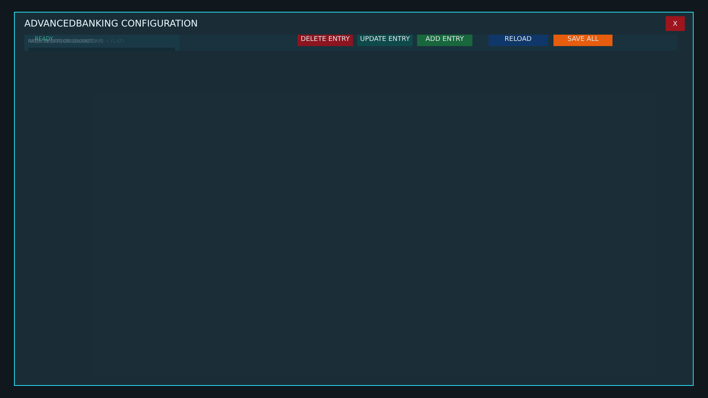


# ab_suite_config_editor.layout — Legacy banking config editor (fallback)

**Mod:** Advanced Banking  
**File:** `Advanced_Banking/gui/ab_suite_config_editor.layout`  
**Root:** `FrameWidget` `AdvancedBankingConfigRoot`, size 1 × 1  
**Widgets:** 316

Standalone Advanced Banking config editor, used only when the Control Room is not available.

## Preview

Wireframe drawn straight from the layout file: positions, sizes, colours and default text are exact. Image widgets appear as dashed placeholders, and anything hidden at start inside the root is left out.

## Loaded by

- `Advanced_Banking/scripts/5_Mission/AdvancedBanking/IABConfigEditorMenu.c` line 19

## Widget tree

Positions and sizes are in pixels when the widget uses exact sizing, otherwise they are fractions of the parent (0–1).

| Widget | Type | Position | Size | Text / notes |
|---|---|---|---|---|
| `AdvancedBankingConfigRoot` | FrameWidget | 0 0 | 1 × 1 |  |
| &nbsp;&nbsp;└ `BlurTint` | PanelWidget | 0 0 | 1 × 1 |  |
| &nbsp;&nbsp;└ `ConfigGlass` | PanelWidget | 0 0 | 0.96 × 0.94 | style DayZDefaultPanel |
| &nbsp;&nbsp;&nbsp;&nbsp;└ `NeonTop` | PanelWidget | 0 0 | 1 × 2 |  |
| &nbsp;&nbsp;&nbsp;&nbsp;└ `NeonBottom` | PanelWidget | 0 0 | 1 × 2 |  |
| &nbsp;&nbsp;&nbsp;&nbsp;└ `NeonLeft` | PanelWidget | 0 0 | 2 × 1 |  |
| &nbsp;&nbsp;&nbsp;&nbsp;└ `NeonRight` | PanelWidget | 0 0 | 2 × 1 |  |
| &nbsp;&nbsp;&nbsp;&nbsp;└ `ConfigTitle` | TextWidget | 28 14 | 600 × 36 | "ADVANCEDBANKING CONFIGURATION" |
| &nbsp;&nbsp;&nbsp;&nbsp;└ `ConfigCloseButton` | ButtonWidget | 24 12 | 52 × 40 | "X", style DayZDefaultButton |
| &nbsp;&nbsp;&nbsp;&nbsp;└ `ModuleTabs` | GridSpacerWidget | 28 62 | 0.96 × 44 |  |
| &nbsp;&nbsp;&nbsp;&nbsp;&nbsp;&nbsp;└ `ConfigTab0` | ButtonWidget |  | 190 × 40 | "ACCOUNTS", style DayZDefaultButton |
| &nbsp;&nbsp;&nbsp;&nbsp;&nbsp;&nbsp;└ `ConfigTab1` | ButtonWidget |  | 190 × 40 | "TRANSACTIONS", style DayZDefaultButton |
| &nbsp;&nbsp;&nbsp;&nbsp;&nbsp;&nbsp;└ `ConfigTab2` | ButtonWidget |  | 190 × 40 | "SCHEDULED", style DayZDefaultButton |
| &nbsp;&nbsp;&nbsp;&nbsp;&nbsp;&nbsp;└ `ConfigTab3` | ButtonWidget |  | 190 × 40 | "ATM / ROBBERY", style DayZDefaultButton |
| &nbsp;&nbsp;&nbsp;&nbsp;&nbsp;&nbsp;└ `ConfigTab4` | ButtonWidget |  | 190 × 40 | "CURRENCY", style DayZDefaultButton |
| &nbsp;&nbsp;&nbsp;&nbsp;&nbsp;&nbsp;└ `ConfigTab5` | ButtonWidget |  | 190 × 40 | "INTEGRATION", style DayZDefaultButton |
| &nbsp;&nbsp;&nbsp;&nbsp;&nbsp;&nbsp;└ `ConfigTab6` | ButtonWidget |  | 190 × 40 | "ROBBERY EVENTS", style DayZDefaultButton |
| &nbsp;&nbsp;&nbsp;&nbsp;&nbsp;&nbsp;└ `ConfigTab7` | ButtonWidget |  | 190 × 40 | "PERKS / IMPORT", style DayZDefaultButton |
| &nbsp;&nbsp;&nbsp;&nbsp;&nbsp;&nbsp;└ `ConfigPages` | FrameWidget | 0 0 | 1 × 1 |  |
| &nbsp;&nbsp;&nbsp;&nbsp;&nbsp;&nbsp;&nbsp;&nbsp;└ `CategoryPanel0` | WrapSpacerWidget | 0 0 | 1 × 1 |  |
| &nbsp;&nbsp;&nbsp;&nbsp;&nbsp;&nbsp;&nbsp;&nbsp;&nbsp;&nbsp;└ `Field_AB_ConfigVersionValue` | PanelWidget |  | 420 × 82 | style DayZDefaultPanel |
| &nbsp;&nbsp;&nbsp;&nbsp;&nbsp;&nbsp;&nbsp;&nbsp;&nbsp;&nbsp;&nbsp;&nbsp;└ `Label_AB_ConfigVersionValue` | TextWidget | 10 7 | 400 × 22 | "CONFIG VERSION" |
| &nbsp;&nbsp;&nbsp;&nbsp;&nbsp;&nbsp;&nbsp;&nbsp;&nbsp;&nbsp;&nbsp;&nbsp;└ `AB_ConfigVersionValue` | TextWidget | 12 38 | 394 × 30 | "READ ONLY" |
| &nbsp;&nbsp;&nbsp;&nbsp;&nbsp;&nbsp;&nbsp;&nbsp;&nbsp;&nbsp;└ `Field_AB_EnabledToggle` | PanelWidget |  | 420 × 82 | style DayZDefaultPanel |
| &nbsp;&nbsp;&nbsp;&nbsp;&nbsp;&nbsp;&nbsp;&nbsp;&nbsp;&nbsp;&nbsp;&nbsp;└ `Label_AB_EnabledToggle` | TextWidget | 10 7 | 400 × 22 | "ENABLED" |
| &nbsp;&nbsp;&nbsp;&nbsp;&nbsp;&nbsp;&nbsp;&nbsp;&nbsp;&nbsp;&nbsp;&nbsp;└ `AB_EnabledToggle` | CheckBoxWidget | 16 36 | 32 × 32 |  |
| &nbsp;&nbsp;&nbsp;&nbsp;&nbsp;&nbsp;&nbsp;&nbsp;&nbsp;&nbsp;└ `Field_AB_GroupDepositRankSelect` | PanelWidget |  | 420 × 82 | style DayZDefaultPanel |
| &nbsp;&nbsp;&nbsp;&nbsp;&nbsp;&nbsp;&nbsp;&nbsp;&nbsp;&nbsp;&nbsp;&nbsp;└ `Label_AB_GroupDepositRankSelect` | TextWidget | 10 7 | 400 × 22 | "GROUP DEPOSIT RANK" |
| &nbsp;&nbsp;&nbsp;&nbsp;&nbsp;&nbsp;&nbsp;&nbsp;&nbsp;&nbsp;&nbsp;&nbsp;└ `AB_GroupDepositRankSelect` | EditBoxWidget | 10 34 | 400 × 38 | style EditBox |
| &nbsp;&nbsp;&nbsp;&nbsp;&nbsp;&nbsp;&nbsp;&nbsp;&nbsp;&nbsp;└ `Field_AB_GroupMaximumBalanceInput` | PanelWidget |  | 420 × 82 | style DayZDefaultPanel |
| &nbsp;&nbsp;&nbsp;&nbsp;&nbsp;&nbsp;&nbsp;&nbsp;&nbsp;&nbsp;&nbsp;&nbsp;└ `Label_AB_GroupMaximumBalanceInput` | TextWidget | 10 7 | 400 × 22 | "GROUP MAXIMUM BALANCE" |
| &nbsp;&nbsp;&nbsp;&nbsp;&nbsp;&nbsp;&nbsp;&nbsp;&nbsp;&nbsp;&nbsp;&nbsp;└ `AB_GroupMaximumBalanceInput` | EditBoxWidget | 10 34 | 400 × 38 | style EditBox |
| &nbsp;&nbsp;&nbsp;&nbsp;&nbsp;&nbsp;&nbsp;&nbsp;&nbsp;&nbsp;└ `Field_AB_GroupMinimumMembersInput` | PanelWidget |  | 420 × 82 | style DayZDefaultPanel |
| &nbsp;&nbsp;&nbsp;&nbsp;&nbsp;&nbsp;&nbsp;&nbsp;&nbsp;&nbsp;&nbsp;&nbsp;└ `Label_AB_GroupMinimumMembersInput` | TextWidget | 10 7 | 400 × 22 | "GROUP MINIMUM MEMBERS" |
| &nbsp;&nbsp;&nbsp;&nbsp;&nbsp;&nbsp;&nbsp;&nbsp;&nbsp;&nbsp;&nbsp;&nbsp;└ `AB_GroupMinimumMembersInput` | EditBoxWidget | 10 34 | 400 × 38 | style EditBox |
| &nbsp;&nbsp;&nbsp;&nbsp;&nbsp;&nbsp;&nbsp;&nbsp;&nbsp;&nbsp;└ `Field_AB_GroupStartBalanceInput` | PanelWidget |  | 420 × 82 | style DayZDefaultPanel |
| &nbsp;&nbsp;&nbsp;&nbsp;&nbsp;&nbsp;&nbsp;&nbsp;&nbsp;&nbsp;&nbsp;&nbsp;└ `Label_AB_GroupStartBalanceInput` | TextWidget | 10 7 | 400 × 22 | "GROUP START BALANCE" |
| &nbsp;&nbsp;&nbsp;&nbsp;&nbsp;&nbsp;&nbsp;&nbsp;&nbsp;&nbsp;&nbsp;&nbsp;└ `AB_GroupStartBalanceInput` | EditBoxWidget | 10 34 | 400 × 38 | style EditBox |
| &nbsp;&nbsp;&nbsp;&nbsp;&nbsp;&nbsp;&nbsp;&nbsp;&nbsp;&nbsp;└ `Field_AB_GroupWithdrawRankSelect` | PanelWidget |  | 420 × 82 | style DayZDefaultPanel |
| &nbsp;&nbsp;&nbsp;&nbsp;&nbsp;&nbsp;&nbsp;&nbsp;&nbsp;&nbsp;&nbsp;&nbsp;└ `Label_AB_GroupWithdrawRankSelect` | TextWidget | 10 7 | 400 × 22 | "GROUP WITHDRAW RANK" |
| &nbsp;&nbsp;&nbsp;&nbsp;&nbsp;&nbsp;&nbsp;&nbsp;&nbsp;&nbsp;&nbsp;&nbsp;└ `AB_GroupWithdrawRankSelect` | EditBoxWidget | 10 34 | 400 × 38 | style EditBox |
| &nbsp;&nbsp;&nbsp;&nbsp;&nbsp;&nbsp;&nbsp;&nbsp;&nbsp;&nbsp;└ `Field_AB_PersonalMaximumBalanceInput` | PanelWidget |  | 420 × 82 | style DayZDefaultPanel |
| &nbsp;&nbsp;&nbsp;&nbsp;&nbsp;&nbsp;&nbsp;&nbsp;&nbsp;&nbsp;&nbsp;&nbsp;└ `Label_AB_PersonalMaximumBalanceInput` | TextWidget | 10 7 | 400 × 22 | "PERSONAL MAXIMUM BALANCE" |
| &nbsp;&nbsp;&nbsp;&nbsp;&nbsp;&nbsp;&nbsp;&nbsp;&nbsp;&nbsp;&nbsp;&nbsp;└ `AB_PersonalMaximumBalanceInput` | EditBoxWidget | 10 34 | 400 × 38 | style EditBox |
| &nbsp;&nbsp;&nbsp;&nbsp;&nbsp;&nbsp;&nbsp;&nbsp;&nbsp;&nbsp;└ `Field_AB_PersonalStartBalanceInput` | PanelWidget |  | 420 × 82 | style DayZDefaultPanel |
| &nbsp;&nbsp;&nbsp;&nbsp;&nbsp;&nbsp;&nbsp;&nbsp;&nbsp;&nbsp;&nbsp;&nbsp;└ `Label_AB_PersonalStartBalanceInput` | TextWidget | 10 7 | 400 × 22 | "PERSONAL START BALANCE" |
| &nbsp;&nbsp;&nbsp;&nbsp;&nbsp;&nbsp;&nbsp;&nbsp;&nbsp;&nbsp;&nbsp;&nbsp;└ `AB_PersonalStartBalanceInput` | EditBoxWidget | 10 34 | 400 × 38 | style EditBox |
| &nbsp;&nbsp;&nbsp;&nbsp;&nbsp;&nbsp;&nbsp;&nbsp;└ `CategoryPanel1` | WrapSpacerWidget | 0 0 | 1 × 1 | hidden at start |
| &nbsp;&nbsp;&nbsp;&nbsp;&nbsp;&nbsp;&nbsp;&nbsp;&nbsp;&nbsp;└ `Field_AB_AllowGroupTransfersToggle` | PanelWidget |  | 420 × 82 | style DayZDefaultPanel |
| &nbsp;&nbsp;&nbsp;&nbsp;&nbsp;&nbsp;&nbsp;&nbsp;&nbsp;&nbsp;&nbsp;&nbsp;└ `Label_AB_AllowGroupTransfersToggle` | TextWidget | 10 7 | 400 × 22 | "ALLOW GROUP TRANSFERS" |
| &nbsp;&nbsp;&nbsp;&nbsp;&nbsp;&nbsp;&nbsp;&nbsp;&nbsp;&nbsp;&nbsp;&nbsp;└ `AB_AllowGroupTransfersToggle` | CheckBoxWidget | 16 36 | 32 × 32 |  |
| &nbsp;&nbsp;&nbsp;&nbsp;&nbsp;&nbsp;&nbsp;&nbsp;&nbsp;&nbsp;└ `Field_AB_AllowPlayerTransfersToggle` | PanelWidget |  | 420 × 82 | style DayZDefaultPanel |
| &nbsp;&nbsp;&nbsp;&nbsp;&nbsp;&nbsp;&nbsp;&nbsp;&nbsp;&nbsp;&nbsp;&nbsp;└ `Label_AB_AllowPlayerTransfersToggle` | TextWidget | 10 7 | 400 × 22 | "ALLOW PLAYER TRANSFERS" |
| &nbsp;&nbsp;&nbsp;&nbsp;&nbsp;&nbsp;&nbsp;&nbsp;&nbsp;&nbsp;&nbsp;&nbsp;└ `AB_AllowPlayerTransfersToggle` | CheckBoxWidget | 16 36 | 32 × 32 |  |
| &nbsp;&nbsp;&nbsp;&nbsp;&nbsp;&nbsp;&nbsp;&nbsp;&nbsp;&nbsp;└ `Field_AB_DailyDepositLimitInput` | PanelWidget |  | 420 × 82 | style DayZDefaultPanel |
| &nbsp;&nbsp;&nbsp;&nbsp;&nbsp;&nbsp;&nbsp;&nbsp;&nbsp;&nbsp;&nbsp;&nbsp;└ `Label_AB_DailyDepositLimitInput` | TextWidget | 10 7 | 400 × 22 | "DAILY DEPOSIT LIMIT" |
| &nbsp;&nbsp;&nbsp;&nbsp;&nbsp;&nbsp;&nbsp;&nbsp;&nbsp;&nbsp;&nbsp;&nbsp;└ `AB_DailyDepositLimitInput` | EditBoxWidget | 10 34 | 400 × 38 | style EditBox |
| &nbsp;&nbsp;&nbsp;&nbsp;&nbsp;&nbsp;&nbsp;&nbsp;&nbsp;&nbsp;└ `Field_AB_DailyTransferLimitInput` | PanelWidget |  | 420 × 82 | style DayZDefaultPanel |
| &nbsp;&nbsp;&nbsp;&nbsp;&nbsp;&nbsp;&nbsp;&nbsp;&nbsp;&nbsp;&nbsp;&nbsp;└ `Label_AB_DailyTransferLimitInput` | TextWidget | 10 7 | 400 × 22 | "DAILY TRANSFER LIMIT" |
| &nbsp;&nbsp;&nbsp;&nbsp;&nbsp;&nbsp;&nbsp;&nbsp;&nbsp;&nbsp;&nbsp;&nbsp;└ `AB_DailyTransferLimitInput` | EditBoxWidget | 10 34 | 400 × 38 | style EditBox |
| &nbsp;&nbsp;&nbsp;&nbsp;&nbsp;&nbsp;&nbsp;&nbsp;&nbsp;&nbsp;└ `Field_AB_DailyWithdrawalLimitInput` | PanelWidget |  | 420 × 82 | style DayZDefaultPanel |
| &nbsp;&nbsp;&nbsp;&nbsp;&nbsp;&nbsp;&nbsp;&nbsp;&nbsp;&nbsp;&nbsp;&nbsp;└ `Label_AB_DailyWithdrawalLimitInput` | TextWidget | 10 7 | 400 × 22 | "DAILY WITHDRAWAL LIMIT" |
| &nbsp;&nbsp;&nbsp;&nbsp;&nbsp;&nbsp;&nbsp;&nbsp;&nbsp;&nbsp;&nbsp;&nbsp;└ `AB_DailyWithdrawalLimitInput` | EditBoxWidget | 10 34 | 400 × 38 | style EditBox |
| &nbsp;&nbsp;&nbsp;&nbsp;&nbsp;&nbsp;&nbsp;&nbsp;&nbsp;&nbsp;└ `Field_AB_GroupTransferRankSelect` | PanelWidget |  | 420 × 82 | style DayZDefaultPanel |
| &nbsp;&nbsp;&nbsp;&nbsp;&nbsp;&nbsp;&nbsp;&nbsp;&nbsp;&nbsp;&nbsp;&nbsp;└ `Label_AB_GroupTransferRankSelect` | TextWidget | 10 7 | 400 × 22 | "GROUP TRANSFER RANK" |
| &nbsp;&nbsp;&nbsp;&nbsp;&nbsp;&nbsp;&nbsp;&nbsp;&nbsp;&nbsp;&nbsp;&nbsp;└ `AB_GroupTransferRankSelect` | EditBoxWidget | 10 34 | 400 × 38 | style EditBox |
| &nbsp;&nbsp;&nbsp;&nbsp;&nbsp;&nbsp;&nbsp;&nbsp;&nbsp;&nbsp;└ `Field_AB_HistoryLimitInput` | PanelWidget |  | 420 × 82 | style DayZDefaultPanel |
| &nbsp;&nbsp;&nbsp;&nbsp;&nbsp;&nbsp;&nbsp;&nbsp;&nbsp;&nbsp;&nbsp;&nbsp;└ `Label_AB_HistoryLimitInput` | TextWidget | 10 7 | 400 × 22 | "HISTORY LIMIT" |
| &nbsp;&nbsp;&nbsp;&nbsp;&nbsp;&nbsp;&nbsp;&nbsp;&nbsp;&nbsp;&nbsp;&nbsp;└ `AB_HistoryLimitInput` | EditBoxWidget | 10 34 | 400 × 38 | style EditBox |
| &nbsp;&nbsp;&nbsp;&nbsp;&nbsp;&nbsp;&nbsp;&nbsp;&nbsp;&nbsp;└ `Field_AB_MaximumTransactionInput` | PanelWidget |  | 420 × 82 | style DayZDefaultPanel |
| &nbsp;&nbsp;&nbsp;&nbsp;&nbsp;&nbsp;&nbsp;&nbsp;&nbsp;&nbsp;&nbsp;&nbsp;└ `Label_AB_MaximumTransactionInput` | TextWidget | 10 7 | 400 × 22 | "MAXIMUM TRANSACTION" |
| &nbsp;&nbsp;&nbsp;&nbsp;&nbsp;&nbsp;&nbsp;&nbsp;&nbsp;&nbsp;&nbsp;&nbsp;└ `AB_MaximumTransactionInput` | EditBoxWidget | 10 34 | 400 × 38 | style EditBox |
| &nbsp;&nbsp;&nbsp;&nbsp;&nbsp;&nbsp;&nbsp;&nbsp;&nbsp;&nbsp;└ `Field_AB_MinimumTransactionInput` | PanelWidget |  | 420 × 82 | style DayZDefaultPanel |
| &nbsp;&nbsp;&nbsp;&nbsp;&nbsp;&nbsp;&nbsp;&nbsp;&nbsp;&nbsp;&nbsp;&nbsp;└ `Label_AB_MinimumTransactionInput` | TextWidget | 10 7 | 400 × 22 | "MINIMUM TRANSACTION" |
| &nbsp;&nbsp;&nbsp;&nbsp;&nbsp;&nbsp;&nbsp;&nbsp;&nbsp;&nbsp;&nbsp;&nbsp;└ `AB_MinimumTransactionInput` | EditBoxWidget | 10 34 | 400 × 38 | style EditBox |
| &nbsp;&nbsp;&nbsp;&nbsp;&nbsp;&nbsp;&nbsp;&nbsp;&nbsp;&nbsp;└ `Field_AB_OperationCooldownInput` | PanelWidget |  | 420 × 82 | style DayZDefaultPanel |
| &nbsp;&nbsp;&nbsp;&nbsp;&nbsp;&nbsp;&nbsp;&nbsp;&nbsp;&nbsp;&nbsp;&nbsp;└ `Label_AB_OperationCooldownInput` | TextWidget | 10 7 | 400 × 22 | "OPERATION COOLDOWN" |
| &nbsp;&nbsp;&nbsp;&nbsp;&nbsp;&nbsp;&nbsp;&nbsp;&nbsp;&nbsp;&nbsp;&nbsp;└ `AB_OperationCooldownInput` | EditBoxWidget | 10 34 | 400 × 38 | style EditBox |
| &nbsp;&nbsp;&nbsp;&nbsp;&nbsp;&nbsp;&nbsp;&nbsp;&nbsp;&nbsp;└ `Field_AB_ProcessedRequestLimitInput` | PanelWidget |  | 420 × 82 | style DayZDefaultPanel |
| &nbsp;&nbsp;&nbsp;&nbsp;&nbsp;&nbsp;&nbsp;&nbsp;&nbsp;&nbsp;&nbsp;&nbsp;└ `Label_AB_ProcessedRequestLimitInput` | TextWidget | 10 7 | 400 × 22 | "PROCESSED REQUEST LIMIT" |
| &nbsp;&nbsp;&nbsp;&nbsp;&nbsp;&nbsp;&nbsp;&nbsp;&nbsp;&nbsp;&nbsp;&nbsp;└ `AB_ProcessedRequestLimitInput` | EditBoxWidget | 10 34 | 400 × 38 | style EditBox |
| &nbsp;&nbsp;&nbsp;&nbsp;&nbsp;&nbsp;&nbsp;&nbsp;&nbsp;&nbsp;└ `Field_AB_TransferFlatFeeInput` | PanelWidget |  | 420 × 82 | style DayZDefaultPanel |
| &nbsp;&nbsp;&nbsp;&nbsp;&nbsp;&nbsp;&nbsp;&nbsp;&nbsp;&nbsp;&nbsp;&nbsp;└ `Label_AB_TransferFlatFeeInput` | TextWidget | 10 7 | 400 × 22 | "TRANSFER FLAT FEE" |
| &nbsp;&nbsp;&nbsp;&nbsp;&nbsp;&nbsp;&nbsp;&nbsp;&nbsp;&nbsp;&nbsp;&nbsp;└ `AB_TransferFlatFeeInput` | EditBoxWidget | 10 34 | 400 × 38 | style EditBox |
| &nbsp;&nbsp;&nbsp;&nbsp;&nbsp;&nbsp;&nbsp;&nbsp;&nbsp;&nbsp;└ `Field_AB_TransferPercentFeeInput` | PanelWidget |  | 420 × 82 | style DayZDefaultPanel |
| &nbsp;&nbsp;&nbsp;&nbsp;&nbsp;&nbsp;&nbsp;&nbsp;&nbsp;&nbsp;&nbsp;&nbsp;└ `Label_AB_TransferPercentFeeInput` | TextWidget | 10 7 | 400 × 22 | "TRANSFER PERCENT FEE" |
| &nbsp;&nbsp;&nbsp;&nbsp;&nbsp;&nbsp;&nbsp;&nbsp;&nbsp;&nbsp;&nbsp;&nbsp;└ `AB_TransferPercentFeeInput` | EditBoxWidget | 10 34 | 400 × 38 | style EditBox |
| &nbsp;&nbsp;&nbsp;&nbsp;&nbsp;&nbsp;&nbsp;&nbsp;└ `CategoryPanel2` | WrapSpacerWidget | 0 0 | 1 × 1 | hidden at start |
| &nbsp;&nbsp;&nbsp;&nbsp;&nbsp;&nbsp;&nbsp;&nbsp;&nbsp;&nbsp;└ `Field_AB_EnableInterestToggle` | PanelWidget |  | 420 × 82 | style DayZDefaultPanel |
| &nbsp;&nbsp;&nbsp;&nbsp;&nbsp;&nbsp;&nbsp;&nbsp;&nbsp;&nbsp;&nbsp;&nbsp;└ `Label_AB_EnableInterestToggle` | TextWidget | 10 7 | 400 × 22 | "ENABLE INTEREST" |
| &nbsp;&nbsp;&nbsp;&nbsp;&nbsp;&nbsp;&nbsp;&nbsp;&nbsp;&nbsp;&nbsp;&nbsp;└ `AB_EnableInterestToggle` | CheckBoxWidget | 16 36 | 32 × 32 |  |
| &nbsp;&nbsp;&nbsp;&nbsp;&nbsp;&nbsp;&nbsp;&nbsp;&nbsp;&nbsp;└ `Field_AB_EnablePaychecksToggle` | PanelWidget |  | 420 × 82 | style DayZDefaultPanel |
| &nbsp;&nbsp;&nbsp;&nbsp;&nbsp;&nbsp;&nbsp;&nbsp;&nbsp;&nbsp;&nbsp;&nbsp;└ `Label_AB_EnablePaychecksToggle` | TextWidget | 10 7 | 400 × 22 | "ENABLE PAYCHECKS" |
| &nbsp;&nbsp;&nbsp;&nbsp;&nbsp;&nbsp;&nbsp;&nbsp;&nbsp;&nbsp;&nbsp;&nbsp;└ `AB_EnablePaychecksToggle` | CheckBoxWidget | 16 36 | 32 × 32 |  |
| &nbsp;&nbsp;&nbsp;&nbsp;&nbsp;&nbsp;&nbsp;&nbsp;&nbsp;&nbsp;└ `Field_AB_InterestIntervalInput` | PanelWidget |  | 420 × 82 | style DayZDefaultPanel |
| &nbsp;&nbsp;&nbsp;&nbsp;&nbsp;&nbsp;&nbsp;&nbsp;&nbsp;&nbsp;&nbsp;&nbsp;└ `Label_AB_InterestIntervalInput` | TextWidget | 10 7 | 400 × 22 | "INTEREST INTERVAL" |
| &nbsp;&nbsp;&nbsp;&nbsp;&nbsp;&nbsp;&nbsp;&nbsp;&nbsp;&nbsp;&nbsp;&nbsp;└ `AB_InterestIntervalInput` | EditBoxWidget | 10 34 | 400 × 38 | style EditBox |
| &nbsp;&nbsp;&nbsp;&nbsp;&nbsp;&nbsp;&nbsp;&nbsp;&nbsp;&nbsp;└ `Field_AB_InterestMaximumInput` | PanelWidget |  | 420 × 82 | style DayZDefaultPanel |
| &nbsp;&nbsp;&nbsp;&nbsp;&nbsp;&nbsp;&nbsp;&nbsp;&nbsp;&nbsp;&nbsp;&nbsp;└ `Label_AB_InterestMaximumInput` | TextWidget | 10 7 | 400 × 22 | "INTEREST MAXIMUM" |
| &nbsp;&nbsp;&nbsp;&nbsp;&nbsp;&nbsp;&nbsp;&nbsp;&nbsp;&nbsp;&nbsp;&nbsp;└ `AB_InterestMaximumInput` | EditBoxWidget | 10 34 | 400 × 38 | style EditBox |
| &nbsp;&nbsp;&nbsp;&nbsp;&nbsp;&nbsp;&nbsp;&nbsp;&nbsp;&nbsp;└ `Field_AB_InterestPercentInput` | PanelWidget |  | 420 × 82 | style DayZDefaultPanel |
| &nbsp;&nbsp;&nbsp;&nbsp;&nbsp;&nbsp;&nbsp;&nbsp;&nbsp;&nbsp;&nbsp;&nbsp;└ `Label_AB_InterestPercentInput` | TextWidget | 10 7 | 400 × 22 | "INTEREST PERCENT" |
| &nbsp;&nbsp;&nbsp;&nbsp;&nbsp;&nbsp;&nbsp;&nbsp;&nbsp;&nbsp;&nbsp;&nbsp;└ `AB_InterestPercentInput` | EditBoxWidget | 10 34 | 400 × 38 | style EditBox |
| &nbsp;&nbsp;&nbsp;&nbsp;&nbsp;&nbsp;&nbsp;&nbsp;&nbsp;&nbsp;└ `Field_AB_PaycheckAmountInput` | PanelWidget |  | 420 × 82 | style DayZDefaultPanel |
| &nbsp;&nbsp;&nbsp;&nbsp;&nbsp;&nbsp;&nbsp;&nbsp;&nbsp;&nbsp;&nbsp;&nbsp;└ `Label_AB_PaycheckAmountInput` | TextWidget | 10 7 | 400 × 22 | "PAYCHECK AMOUNT" |
| &nbsp;&nbsp;&nbsp;&nbsp;&nbsp;&nbsp;&nbsp;&nbsp;&nbsp;&nbsp;&nbsp;&nbsp;└ `AB_PaycheckAmountInput` | EditBoxWidget | 10 34 | 400 × 38 | style EditBox |
| &nbsp;&nbsp;&nbsp;&nbsp;&nbsp;&nbsp;&nbsp;&nbsp;&nbsp;&nbsp;└ `Field_AB_PaycheckIntervalInput` | PanelWidget |  | 420 × 82 | style DayZDefaultPanel |
| &nbsp;&nbsp;&nbsp;&nbsp;&nbsp;&nbsp;&nbsp;&nbsp;&nbsp;&nbsp;&nbsp;&nbsp;└ `Label_AB_PaycheckIntervalInput` | TextWidget | 10 7 | 400 × 22 | "PAYCHECK INTERVAL" |
| &nbsp;&nbsp;&nbsp;&nbsp;&nbsp;&nbsp;&nbsp;&nbsp;&nbsp;&nbsp;&nbsp;&nbsp;└ `AB_PaycheckIntervalInput` | EditBoxWidget | 10 34 | 400 × 38 | style EditBox |
| &nbsp;&nbsp;&nbsp;&nbsp;&nbsp;&nbsp;&nbsp;&nbsp;└ `Field_AB_PaycheckIncrementInput` | PanelWidget |  | 420 × 82 | style DayZDefaultPanel |
| &nbsp;&nbsp;&nbsp;&nbsp;&nbsp;&nbsp;&nbsp;&nbsp;&nbsp;&nbsp;└ `Label_AB_PaycheckIncrementInput` | TextWidget | 10 7 | 400 × 22 | "RAISE PER PAYOUT IN A ROW (0 = FLAT)" |
| &nbsp;&nbsp;&nbsp;&nbsp;&nbsp;&nbsp;&nbsp;&nbsp;&nbsp;&nbsp;└ `AB_PaycheckIncrementInput` | EditBoxWidget | 10 34 | 400 × 38 | style EditBox |
| &nbsp;&nbsp;&nbsp;&nbsp;&nbsp;&nbsp;&nbsp;&nbsp;└ `Field_AB_PaycheckMaximumInput` | PanelWidget |  | 420 × 82 | style DayZDefaultPanel |
| &nbsp;&nbsp;&nbsp;&nbsp;&nbsp;&nbsp;&nbsp;&nbsp;&nbsp;&nbsp;└ `Label_AB_PaycheckMaximumInput` | TextWidget | 10 7 | 400 × 22 | "HIGHEST PAYOUT (0 = NO CAP)" |
| &nbsp;&nbsp;&nbsp;&nbsp;&nbsp;&nbsp;&nbsp;&nbsp;&nbsp;&nbsp;└ `AB_PaycheckMaximumInput` | EditBoxWidget | 10 34 | 400 × 38 | style EditBox |
| &nbsp;&nbsp;&nbsp;&nbsp;&nbsp;&nbsp;&nbsp;&nbsp;└ `Field_AB_PaycheckResetOnLogoutToggle` | PanelWidget |  | 420 × 82 | style DayZDefaultPanel |
| &nbsp;&nbsp;&nbsp;&nbsp;&nbsp;&nbsp;&nbsp;&nbsp;&nbsp;&nbsp;└ `Label_AB_PaycheckResetOnLogoutToggle` | TextWidget | 10 7 | 400 × 22 | "RAISE RESETS ON LOGOUT" |
| &nbsp;&nbsp;&nbsp;&nbsp;&nbsp;&nbsp;&nbsp;&nbsp;&nbsp;&nbsp;└ `AB_PaycheckResetOnLogoutToggle` | CheckBoxWidget | 16 36 | 32 × 32 |  |
| &nbsp;&nbsp;&nbsp;&nbsp;&nbsp;&nbsp;&nbsp;&nbsp;└ `CategoryPanel3` | WrapSpacerWidget | 0 0 | 1 × 1 | hidden at start |
| &nbsp;&nbsp;&nbsp;&nbsp;&nbsp;&nbsp;&nbsp;&nbsp;&nbsp;&nbsp;└ `Field_AB_ATMInteractionDistanceInput` | PanelWidget |  | 420 × 82 | style DayZDefaultPanel |
| &nbsp;&nbsp;&nbsp;&nbsp;&nbsp;&nbsp;&nbsp;&nbsp;&nbsp;&nbsp;&nbsp;&nbsp;└ `Label_AB_ATMInteractionDistanceInput` | TextWidget | 10 7 | 400 × 22 | "ATMINTERACTION DISTANCE" |
| &nbsp;&nbsp;&nbsp;&nbsp;&nbsp;&nbsp;&nbsp;&nbsp;&nbsp;&nbsp;&nbsp;&nbsp;└ `AB_ATMInteractionDistanceInput` | EditBoxWidget | 10 34 | 400 × 38 | style EditBox |
| &nbsp;&nbsp;&nbsp;&nbsp;&nbsp;&nbsp;&nbsp;&nbsp;&nbsp;&nbsp;└ `Field_AB_ATMNameInput` | PanelWidget |  | 420 × 82 | style DayZDefaultPanel |
| &nbsp;&nbsp;&nbsp;&nbsp;&nbsp;&nbsp;&nbsp;&nbsp;&nbsp;&nbsp;&nbsp;&nbsp;└ `Label_AB_ATMNameInput` | TextWidget | 10 7 | 400 × 22 | "ATMNAME" |
| &nbsp;&nbsp;&nbsp;&nbsp;&nbsp;&nbsp;&nbsp;&nbsp;&nbsp;&nbsp;&nbsp;&nbsp;└ `AB_ATMNameInput` | EditBoxWidget | 10 34 | 400 × 38 | style EditBox |
| &nbsp;&nbsp;&nbsp;&nbsp;&nbsp;&nbsp;&nbsp;&nbsp;&nbsp;&nbsp;└ `Field_AB_ATMPitchInput` | PanelWidget |  | 420 × 82 | style DayZDefaultPanel |
| &nbsp;&nbsp;&nbsp;&nbsp;&nbsp;&nbsp;&nbsp;&nbsp;&nbsp;&nbsp;&nbsp;&nbsp;└ `Label_AB_ATMPitchInput` | TextWidget | 10 7 | 400 × 22 | "ATMPITCH" |
| &nbsp;&nbsp;&nbsp;&nbsp;&nbsp;&nbsp;&nbsp;&nbsp;&nbsp;&nbsp;&nbsp;&nbsp;└ `AB_ATMPitchInput` | EditBoxWidget | 10 34 | 400 × 38 | style EditBox |
| &nbsp;&nbsp;&nbsp;&nbsp;&nbsp;&nbsp;&nbsp;&nbsp;&nbsp;&nbsp;└ `Field_AB_ATMPositionInspector` | PanelWidget |  | 420 × 140 | style DayZDefaultPanel |
| &nbsp;&nbsp;&nbsp;&nbsp;&nbsp;&nbsp;&nbsp;&nbsp;&nbsp;&nbsp;&nbsp;&nbsp;└ `Label_AB_ATMPositionInspector` | TextWidget | 10 7 | 400 × 22 | "ATMPOSITION" |
| &nbsp;&nbsp;&nbsp;&nbsp;&nbsp;&nbsp;&nbsp;&nbsp;&nbsp;&nbsp;&nbsp;&nbsp;└ `AB_ATMPositionInspector` | PanelWidget | 10 34 | 400 × 96 | style DayZDefaultPanel |
| &nbsp;&nbsp;&nbsp;&nbsp;&nbsp;&nbsp;&nbsp;&nbsp;&nbsp;&nbsp;└ `Field_AB_ATMPositionList` | PanelWidget |  | 420 × 140 | style DayZDefaultPanel |
| &nbsp;&nbsp;&nbsp;&nbsp;&nbsp;&nbsp;&nbsp;&nbsp;&nbsp;&nbsp;&nbsp;&nbsp;└ `Label_AB_ATMPositionList` | TextWidget | 10 7 | 400 × 22 | "ATMPOSITION" |
| &nbsp;&nbsp;&nbsp;&nbsp;&nbsp;&nbsp;&nbsp;&nbsp;&nbsp;&nbsp;&nbsp;&nbsp;└ `AB_ATMPositionList` | TextListboxWidget | 10 34 | 400 × 96 | style Default |
| &nbsp;&nbsp;&nbsp;&nbsp;&nbsp;&nbsp;&nbsp;&nbsp;&nbsp;&nbsp;└ `Field_AB_ATMRollInput` | PanelWidget |  | 420 × 82 | style DayZDefaultPanel |
| &nbsp;&nbsp;&nbsp;&nbsp;&nbsp;&nbsp;&nbsp;&nbsp;&nbsp;&nbsp;&nbsp;&nbsp;└ `Label_AB_ATMRollInput` | TextWidget | 10 7 | 400 × 22 | "ATMROLL" |
| &nbsp;&nbsp;&nbsp;&nbsp;&nbsp;&nbsp;&nbsp;&nbsp;&nbsp;&nbsp;&nbsp;&nbsp;└ `AB_ATMRollInput` | EditBoxWidget | 10 34 | 400 × 38 | style EditBox |
| &nbsp;&nbsp;&nbsp;&nbsp;&nbsp;&nbsp;&nbsp;&nbsp;&nbsp;&nbsp;└ `Field_AB_ATMAllowDepositToggle` | PanelWidget |  | 420 × 82 | style DayZDefaultPanel |
| &nbsp;&nbsp;&nbsp;&nbsp;&nbsp;&nbsp;&nbsp;&nbsp;&nbsp;&nbsp;&nbsp;&nbsp;└ `Label_AB_ATMAllowDepositToggle` | TextWidget | 10 7 | 400 × 22 | "ATM ALLOWS DEPOSITS" |
| &nbsp;&nbsp;&nbsp;&nbsp;&nbsp;&nbsp;&nbsp;&nbsp;&nbsp;&nbsp;&nbsp;&nbsp;└ `AB_ATMAllowDepositToggle` | CheckBoxWidget | 16 36 | 32 × 32 |  |
| &nbsp;&nbsp;&nbsp;&nbsp;&nbsp;&nbsp;&nbsp;&nbsp;&nbsp;&nbsp;└ `Field_AB_ATMAllowWithdrawToggle` | PanelWidget |  | 420 × 82 | style DayZDefaultPanel |
| &nbsp;&nbsp;&nbsp;&nbsp;&nbsp;&nbsp;&nbsp;&nbsp;&nbsp;&nbsp;&nbsp;&nbsp;└ `Label_AB_ATMAllowWithdrawToggle` | TextWidget | 10 7 | 400 × 22 | "ATM ALLOWS WITHDRAWALS" |
| &nbsp;&nbsp;&nbsp;&nbsp;&nbsp;&nbsp;&nbsp;&nbsp;&nbsp;&nbsp;&nbsp;&nbsp;└ `AB_ATMAllowWithdrawToggle` | CheckBoxWidget | 16 36 | 32 × 32 |  |
| &nbsp;&nbsp;&nbsp;&nbsp;&nbsp;&nbsp;&nbsp;&nbsp;&nbsp;&nbsp;└ `Field_AB_ATMCanBeRobbedToggle` | PanelWidget |  | 420 × 82 | style DayZDefaultPanel |
| &nbsp;&nbsp;&nbsp;&nbsp;&nbsp;&nbsp;&nbsp;&nbsp;&nbsp;&nbsp;&nbsp;&nbsp;└ `Label_AB_ATMCanBeRobbedToggle` | TextWidget | 10 7 | 400 × 22 | "ATM CAN BE ROBBED" |
| &nbsp;&nbsp;&nbsp;&nbsp;&nbsp;&nbsp;&nbsp;&nbsp;&nbsp;&nbsp;&nbsp;&nbsp;└ `AB_ATMCanBeRobbedToggle` | CheckBoxWidget | 16 36 | 32 × 32 |  |
| &nbsp;&nbsp;&nbsp;&nbsp;&nbsp;&nbsp;&nbsp;&nbsp;&nbsp;&nbsp;└ `Field_AB_ATMXInput` | PanelWidget |  | 420 × 82 | style DayZDefaultPanel |
| &nbsp;&nbsp;&nbsp;&nbsp;&nbsp;&nbsp;&nbsp;&nbsp;&nbsp;&nbsp;&nbsp;&nbsp;└ `Label_AB_ATMXInput` | TextWidget | 10 7 | 400 × 22 | "ATMX" |
| &nbsp;&nbsp;&nbsp;&nbsp;&nbsp;&nbsp;&nbsp;&nbsp;&nbsp;&nbsp;&nbsp;&nbsp;└ `AB_ATMXInput` | EditBoxWidget | 10 34 | 400 × 38 | style EditBox |
| &nbsp;&nbsp;&nbsp;&nbsp;&nbsp;&nbsp;&nbsp;&nbsp;&nbsp;&nbsp;└ `Field_AB_ATMYInput` | PanelWidget |  | 420 × 82 | style DayZDefaultPanel |
| &nbsp;&nbsp;&nbsp;&nbsp;&nbsp;&nbsp;&nbsp;&nbsp;&nbsp;&nbsp;&nbsp;&nbsp;└ `Label_AB_ATMYInput` | TextWidget | 10 7 | 400 × 22 | "ATMY" |
| &nbsp;&nbsp;&nbsp;&nbsp;&nbsp;&nbsp;&nbsp;&nbsp;&nbsp;&nbsp;&nbsp;&nbsp;└ `AB_ATMYInput` | EditBoxWidget | 10 34 | 400 × 38 | style EditBox |
| &nbsp;&nbsp;&nbsp;&nbsp;&nbsp;&nbsp;&nbsp;&nbsp;&nbsp;&nbsp;└ `Field_AB_ATMYawInput` | PanelWidget |  | 420 × 82 | style DayZDefaultPanel |
| &nbsp;&nbsp;&nbsp;&nbsp;&nbsp;&nbsp;&nbsp;&nbsp;&nbsp;&nbsp;&nbsp;&nbsp;└ `Label_AB_ATMYawInput` | TextWidget | 10 7 | 400 × 22 | "ATMYAW" |
| &nbsp;&nbsp;&nbsp;&nbsp;&nbsp;&nbsp;&nbsp;&nbsp;&nbsp;&nbsp;&nbsp;&nbsp;└ `AB_ATMYawInput` | EditBoxWidget | 10 34 | 400 × 38 | style EditBox |
| &nbsp;&nbsp;&nbsp;&nbsp;&nbsp;&nbsp;&nbsp;&nbsp;&nbsp;&nbsp;└ `Field_AB_ATMZInput` | PanelWidget |  | 420 × 82 | style DayZDefaultPanel |
| &nbsp;&nbsp;&nbsp;&nbsp;&nbsp;&nbsp;&nbsp;&nbsp;&nbsp;&nbsp;&nbsp;&nbsp;└ `Label_AB_ATMZInput` | TextWidget | 10 7 | 400 × 22 | "ATMZ" |
| &nbsp;&nbsp;&nbsp;&nbsp;&nbsp;&nbsp;&nbsp;&nbsp;&nbsp;&nbsp;&nbsp;&nbsp;└ `AB_ATMZInput` | EditBoxWidget | 10 34 | 400 × 38 | style EditBox |
| &nbsp;&nbsp;&nbsp;&nbsp;&nbsp;&nbsp;&nbsp;&nbsp;&nbsp;&nbsp;└ `Field_AB_EnableRobberyToggle` | PanelWidget |  | 420 × 82 | style DayZDefaultPanel |
| &nbsp;&nbsp;&nbsp;&nbsp;&nbsp;&nbsp;&nbsp;&nbsp;&nbsp;&nbsp;&nbsp;&nbsp;└ `Label_AB_EnableRobberyToggle` | TextWidget | 10 7 | 400 × 22 | "ENABLE ROBBERY" |
| &nbsp;&nbsp;&nbsp;&nbsp;&nbsp;&nbsp;&nbsp;&nbsp;&nbsp;&nbsp;&nbsp;&nbsp;└ `AB_EnableRobberyToggle` | CheckBoxWidget | 16 36 | 32 × 32 |  |
| &nbsp;&nbsp;&nbsp;&nbsp;&nbsp;&nbsp;&nbsp;&nbsp;&nbsp;&nbsp;└ `Field_AB_RobberyCooldownInput` | PanelWidget |  | 420 × 82 | style DayZDefaultPanel |
| &nbsp;&nbsp;&nbsp;&nbsp;&nbsp;&nbsp;&nbsp;&nbsp;&nbsp;&nbsp;&nbsp;&nbsp;└ `Label_AB_RobberyCooldownInput` | TextWidget | 10 7 | 400 × 22 | "ROBBERY COOLDOWN" |
| &nbsp;&nbsp;&nbsp;&nbsp;&nbsp;&nbsp;&nbsp;&nbsp;&nbsp;&nbsp;&nbsp;&nbsp;└ `AB_RobberyCooldownInput` | EditBoxWidget | 10 34 | 400 × 38 | style EditBox |
| &nbsp;&nbsp;&nbsp;&nbsp;&nbsp;&nbsp;&nbsp;&nbsp;&nbsp;&nbsp;└ `Field_AB_RobberyDurationInput` | PanelWidget |  | 420 × 82 | style DayZDefaultPanel |
| &nbsp;&nbsp;&nbsp;&nbsp;&nbsp;&nbsp;&nbsp;&nbsp;&nbsp;&nbsp;&nbsp;&nbsp;└ `Label_AB_RobberyDurationInput` | TextWidget | 10 7 | 400 × 22 | "ROBBERY DURATION" |
| &nbsp;&nbsp;&nbsp;&nbsp;&nbsp;&nbsp;&nbsp;&nbsp;&nbsp;&nbsp;&nbsp;&nbsp;└ `AB_RobberyDurationInput` | EditBoxWidget | 10 34 | 400 × 38 | style EditBox |
| &nbsp;&nbsp;&nbsp;&nbsp;&nbsp;&nbsp;&nbsp;&nbsp;&nbsp;&nbsp;└ `Field_AB_RobberyMaximumInput` | PanelWidget |  | 420 × 82 | style DayZDefaultPanel |
| &nbsp;&nbsp;&nbsp;&nbsp;&nbsp;&nbsp;&nbsp;&nbsp;&nbsp;&nbsp;&nbsp;&nbsp;└ `Label_AB_RobberyMaximumInput` | TextWidget | 10 7 | 400 × 22 | "ROBBERY MAXIMUM" |
| &nbsp;&nbsp;&nbsp;&nbsp;&nbsp;&nbsp;&nbsp;&nbsp;&nbsp;&nbsp;&nbsp;&nbsp;└ `AB_RobberyMaximumInput` | EditBoxWidget | 10 34 | 400 × 38 | style EditBox |
| &nbsp;&nbsp;&nbsp;&nbsp;&nbsp;&nbsp;&nbsp;&nbsp;&nbsp;&nbsp;└ `Field_AB_RobberyMinimumInput` | PanelWidget |  | 420 × 82 | style DayZDefaultPanel |
| &nbsp;&nbsp;&nbsp;&nbsp;&nbsp;&nbsp;&nbsp;&nbsp;&nbsp;&nbsp;&nbsp;&nbsp;└ `Label_AB_RobberyMinimumInput` | TextWidget | 10 7 | 400 × 22 | "ROBBERY MINIMUM" |
| &nbsp;&nbsp;&nbsp;&nbsp;&nbsp;&nbsp;&nbsp;&nbsp;&nbsp;&nbsp;&nbsp;&nbsp;└ `AB_RobberyMinimumInput` | EditBoxWidget | 10 34 | 400 × 38 | style EditBox |
| &nbsp;&nbsp;&nbsp;&nbsp;&nbsp;&nbsp;&nbsp;&nbsp;└ `CategoryPanel4` | WrapSpacerWidget | 0 0 | 1 × 1 | hidden at start |
| &nbsp;&nbsp;&nbsp;&nbsp;&nbsp;&nbsp;&nbsp;&nbsp;&nbsp;&nbsp;└ `Field_AB_CurrencyClassnameInput` | PanelWidget |  | 420 × 82 | style DayZDefaultPanel |
| &nbsp;&nbsp;&nbsp;&nbsp;&nbsp;&nbsp;&nbsp;&nbsp;&nbsp;&nbsp;&nbsp;&nbsp;└ `Label_AB_CurrencyClassnameInput` | TextWidget | 10 7 | 400 × 22 | "CURRENCY CLASSNAME" |
| &nbsp;&nbsp;&nbsp;&nbsp;&nbsp;&nbsp;&nbsp;&nbsp;&nbsp;&nbsp;&nbsp;&nbsp;└ `AB_CurrencyClassnameInput` | EditBoxWidget | 10 34 | 400 × 38 | style EditBox |
| &nbsp;&nbsp;&nbsp;&nbsp;&nbsp;&nbsp;&nbsp;&nbsp;&nbsp;&nbsp;└ `Field_AB_CurrencyDepositOnlyToggle` | PanelWidget |  | 420 × 82 | style DayZDefaultPanel |
| &nbsp;&nbsp;&nbsp;&nbsp;&nbsp;&nbsp;&nbsp;&nbsp;&nbsp;&nbsp;&nbsp;&nbsp;└ `Label_AB_CurrencyDepositOnlyToggle` | TextWidget | 10 7 | 400 × 22 | "CURRENCY DEPOSIT ONLY" |
| &nbsp;&nbsp;&nbsp;&nbsp;&nbsp;&nbsp;&nbsp;&nbsp;&nbsp;&nbsp;&nbsp;&nbsp;└ `AB_CurrencyDepositOnlyToggle` | CheckBoxWidget | 16 36 | 32 × 32 |  |
| &nbsp;&nbsp;&nbsp;&nbsp;&nbsp;&nbsp;&nbsp;&nbsp;&nbsp;&nbsp;└ `Field_AB_CurrencyInspector` | PanelWidget |  | 420 × 140 | style DayZDefaultPanel |
| &nbsp;&nbsp;&nbsp;&nbsp;&nbsp;&nbsp;&nbsp;&nbsp;&nbsp;&nbsp;&nbsp;&nbsp;└ `Label_AB_CurrencyInspector` | TextWidget | 10 7 | 400 × 22 | "CURRENCY" |
| &nbsp;&nbsp;&nbsp;&nbsp;&nbsp;&nbsp;&nbsp;&nbsp;&nbsp;&nbsp;&nbsp;&nbsp;└ `AB_CurrencyInspector` | PanelWidget | 10 34 | 400 × 96 | style DayZDefaultPanel |
| &nbsp;&nbsp;&nbsp;&nbsp;&nbsp;&nbsp;&nbsp;&nbsp;&nbsp;&nbsp;└ `Field_AB_CurrencyList` | PanelWidget |  | 420 × 140 | style DayZDefaultPanel |
| &nbsp;&nbsp;&nbsp;&nbsp;&nbsp;&nbsp;&nbsp;&nbsp;&nbsp;&nbsp;&nbsp;&nbsp;└ `Label_AB_CurrencyList` | TextWidget | 10 7 | 400 × 22 | "CURRENCY" |
| &nbsp;&nbsp;&nbsp;&nbsp;&nbsp;&nbsp;&nbsp;&nbsp;&nbsp;&nbsp;&nbsp;&nbsp;└ `AB_CurrencyList` | TextListboxWidget | 10 34 | 400 × 96 | style Default |
| &nbsp;&nbsp;&nbsp;&nbsp;&nbsp;&nbsp;&nbsp;&nbsp;&nbsp;&nbsp;└ `Field_AB_CurrencyValueInput` | PanelWidget |  | 420 × 82 | style DayZDefaultPanel |
| &nbsp;&nbsp;&nbsp;&nbsp;&nbsp;&nbsp;&nbsp;&nbsp;&nbsp;&nbsp;&nbsp;&nbsp;└ `Label_AB_CurrencyValueInput` | TextWidget | 10 7 | 400 × 22 | "CURRENCY VALUE" |
| &nbsp;&nbsp;&nbsp;&nbsp;&nbsp;&nbsp;&nbsp;&nbsp;&nbsp;&nbsp;&nbsp;&nbsp;└ `AB_CurrencyValueInput` | EditBoxWidget | 10 34 | 400 × 38 | style EditBox |
| &nbsp;&nbsp;&nbsp;&nbsp;&nbsp;&nbsp;&nbsp;&nbsp;└ `CategoryPanel5` | WrapSpacerWidget | 0 0 | 1 × 1 | hidden at start |
| &nbsp;&nbsp;&nbsp;&nbsp;&nbsp;&nbsp;&nbsp;&nbsp;&nbsp;&nbsp;└ `Field_AB_AdminSteamIdInput` | PanelWidget |  | 420 × 82 | style DayZDefaultPanel |
| &nbsp;&nbsp;&nbsp;&nbsp;&nbsp;&nbsp;&nbsp;&nbsp;&nbsp;&nbsp;&nbsp;&nbsp;└ `Label_AB_AdminSteamIdInput` | TextWidget | 10 7 | 400 × 22 | "ADMIN STEAM ID" |
| &nbsp;&nbsp;&nbsp;&nbsp;&nbsp;&nbsp;&nbsp;&nbsp;&nbsp;&nbsp;&nbsp;&nbsp;└ `AB_AdminSteamIdInput` | EditBoxWidget | 10 34 | 400 × 38 | style EditBox |
| &nbsp;&nbsp;&nbsp;&nbsp;&nbsp;&nbsp;&nbsp;&nbsp;&nbsp;&nbsp;└ `Field_AB_AdminSteamIdList` | PanelWidget |  | 420 × 140 | style DayZDefaultPanel |
| &nbsp;&nbsp;&nbsp;&nbsp;&nbsp;&nbsp;&nbsp;&nbsp;&nbsp;&nbsp;&nbsp;&nbsp;└ `Label_AB_AdminSteamIdList` | TextWidget | 10 7 | 400 × 22 | "ADMIN STEAM ID" |
| &nbsp;&nbsp;&nbsp;&nbsp;&nbsp;&nbsp;&nbsp;&nbsp;&nbsp;&nbsp;&nbsp;&nbsp;└ `AB_AdminSteamIdList` | TextListboxWidget | 10 34 | 400 × 96 | style Default |
| &nbsp;&nbsp;&nbsp;&nbsp;&nbsp;&nbsp;&nbsp;&nbsp;&nbsp;&nbsp;└ `Field_AB_DiscordWebhookInput` | PanelWidget |  | 420 × 82 | style DayZDefaultPanel |
| &nbsp;&nbsp;&nbsp;&nbsp;&nbsp;&nbsp;&nbsp;&nbsp;&nbsp;&nbsp;&nbsp;&nbsp;└ `Label_AB_DiscordWebhookInput` | TextWidget | 10 7 | 400 × 22 | "DISCORD WEBHOOK" |
| &nbsp;&nbsp;&nbsp;&nbsp;&nbsp;&nbsp;&nbsp;&nbsp;&nbsp;&nbsp;&nbsp;&nbsp;└ `AB_DiscordWebhookInput` | EditBoxWidget | 10 34 | 400 × 38 | style EditBox |
| &nbsp;&nbsp;&nbsp;&nbsp;&nbsp;&nbsp;&nbsp;&nbsp;&nbsp;&nbsp;└ `Field_AB_DiscordWebhookToggle` | PanelWidget |  | 420 × 82 | style DayZDefaultPanel |
| &nbsp;&nbsp;&nbsp;&nbsp;&nbsp;&nbsp;&nbsp;&nbsp;&nbsp;&nbsp;&nbsp;&nbsp;└ `Label_AB_DiscordWebhookToggle` | TextWidget | 10 7 | 400 × 22 | "DISCORD WEBHOOK" |
| &nbsp;&nbsp;&nbsp;&nbsp;&nbsp;&nbsp;&nbsp;&nbsp;&nbsp;&nbsp;&nbsp;&nbsp;└ `AB_DiscordWebhookToggle` | CheckBoxWidget | 16 36 | 32 × 32 |  |
| &nbsp;&nbsp;&nbsp;&nbsp;&nbsp;&nbsp;&nbsp;&nbsp;└ `CategoryPanel6` | WrapSpacerWidget | 0 0 | 1 × 1 | hidden at start |
| &nbsp;&nbsp;&nbsp;&nbsp;&nbsp;&nbsp;&nbsp;&nbsp;&nbsp;&nbsp;└ `Field_AB_RobberyMinPlayersInput` | PanelWidget |  | 420 × 82 | style DayZDefaultPanel |
| &nbsp;&nbsp;&nbsp;&nbsp;&nbsp;&nbsp;&nbsp;&nbsp;&nbsp;&nbsp;&nbsp;&nbsp;└ `Label_AB_RobberyMinPlayersInput` | TextWidget | 10 7 | 400 × 22 | "PLAYERS ONLINE BEFORE ROBBING" |
| &nbsp;&nbsp;&nbsp;&nbsp;&nbsp;&nbsp;&nbsp;&nbsp;&nbsp;&nbsp;&nbsp;&nbsp;└ `AB_RobberyMinPlayersInput` | EditBoxWidget | 10 34 | 400 × 38 | style EditBox |
| &nbsp;&nbsp;&nbsp;&nbsp;&nbsp;&nbsp;&nbsp;&nbsp;&nbsp;&nbsp;└ `Field_AB_RobberyMaxConcurrentInput` | PanelWidget |  | 420 × 82 | style DayZDefaultPanel |
| &nbsp;&nbsp;&nbsp;&nbsp;&nbsp;&nbsp;&nbsp;&nbsp;&nbsp;&nbsp;&nbsp;&nbsp;└ `Label_AB_RobberyMaxConcurrentInput` | TextWidget | 10 7 | 400 × 22 | "ROBBERIES AT THE SAME TIME" |
| &nbsp;&nbsp;&nbsp;&nbsp;&nbsp;&nbsp;&nbsp;&nbsp;&nbsp;&nbsp;&nbsp;&nbsp;└ `AB_RobberyMaxConcurrentInput` | EditBoxWidget | 10 34 | 400 × 38 | style EditBox |
| &nbsp;&nbsp;&nbsp;&nbsp;&nbsp;&nbsp;&nbsp;&nbsp;&nbsp;&nbsp;└ `Field_AB_RobberyRobberCooldownInput` | PanelWidget |  | 420 × 82 | style DayZDefaultPanel |
| &nbsp;&nbsp;&nbsp;&nbsp;&nbsp;&nbsp;&nbsp;&nbsp;&nbsp;&nbsp;&nbsp;&nbsp;└ `Label_AB_RobberyRobberCooldownInput` | TextWidget | 10 7 | 400 × 22 | "ROBBER COOLDOWN (MINUTES)" |
| &nbsp;&nbsp;&nbsp;&nbsp;&nbsp;&nbsp;&nbsp;&nbsp;&nbsp;&nbsp;&nbsp;&nbsp;└ `AB_RobberyRobberCooldownInput` | EditBoxWidget | 10 34 | 400 × 38 | style EditBox |
| &nbsp;&nbsp;&nbsp;&nbsp;&nbsp;&nbsp;&nbsp;&nbsp;&nbsp;&nbsp;└ `Field_AB_RobberyAnnounceToggle` | PanelWidget |  | 420 × 82 | style DayZDefaultPanel |
| &nbsp;&nbsp;&nbsp;&nbsp;&nbsp;&nbsp;&nbsp;&nbsp;&nbsp;&nbsp;&nbsp;&nbsp;└ `Label_AB_RobberyAnnounceToggle` | TextWidget | 10 7 | 400 × 22 | "ANNOUNCE IN CHAT" |
| &nbsp;&nbsp;&nbsp;&nbsp;&nbsp;&nbsp;&nbsp;&nbsp;&nbsp;&nbsp;&nbsp;&nbsp;└ `AB_RobberyAnnounceToggle` | CheckBoxWidget | 16 36 | 32 × 32 |  |
| &nbsp;&nbsp;&nbsp;&nbsp;&nbsp;&nbsp;&nbsp;&nbsp;&nbsp;&nbsp;└ `Field_AB_RobberyPaysCashToggle` | PanelWidget |  | 420 × 82 | style DayZDefaultPanel |
| &nbsp;&nbsp;&nbsp;&nbsp;&nbsp;&nbsp;&nbsp;&nbsp;&nbsp;&nbsp;&nbsp;&nbsp;└ `Label_AB_RobberyPaysCashToggle` | TextWidget | 10 7 | 400 × 22 | "PAY REWARD AS CASH IN HAND" |
| &nbsp;&nbsp;&nbsp;&nbsp;&nbsp;&nbsp;&nbsp;&nbsp;&nbsp;&nbsp;&nbsp;&nbsp;└ `AB_RobberyPaysCashToggle` | CheckBoxWidget | 16 36 | 32 × 32 |  |
| &nbsp;&nbsp;&nbsp;&nbsp;&nbsp;&nbsp;&nbsp;&nbsp;&nbsp;&nbsp;└ `Field_AB_RobberyMapMarkerToggle` | PanelWidget |  | 420 × 82 | style DayZDefaultPanel |
| &nbsp;&nbsp;&nbsp;&nbsp;&nbsp;&nbsp;&nbsp;&nbsp;&nbsp;&nbsp;&nbsp;&nbsp;└ `Label_AB_RobberyMapMarkerToggle` | TextWidget | 10 7 | 400 × 22 | "MAP MARKER (NEEDS ADVANCED GROUPS)" |
| &nbsp;&nbsp;&nbsp;&nbsp;&nbsp;&nbsp;&nbsp;&nbsp;&nbsp;&nbsp;&nbsp;&nbsp;└ `AB_RobberyMapMarkerToggle` | CheckBoxWidget | 16 36 | 32 × 32 |  |
| &nbsp;&nbsp;&nbsp;&nbsp;&nbsp;&nbsp;&nbsp;&nbsp;&nbsp;&nbsp;└ `Field_AB_RobberyAlarmRadiusInput` | PanelWidget |  | 420 × 82 | style DayZDefaultPanel |
| &nbsp;&nbsp;&nbsp;&nbsp;&nbsp;&nbsp;&nbsp;&nbsp;&nbsp;&nbsp;&nbsp;&nbsp;└ `Label_AB_RobberyAlarmRadiusInput` | TextWidget | 10 7 | 400 × 22 | "ALARM RADIUS (M)" |
| &nbsp;&nbsp;&nbsp;&nbsp;&nbsp;&nbsp;&nbsp;&nbsp;&nbsp;&nbsp;&nbsp;&nbsp;└ `AB_RobberyAlarmRadiusInput` | EditBoxWidget | 10 34 | 400 × 38 | style EditBox |
| &nbsp;&nbsp;&nbsp;&nbsp;&nbsp;&nbsp;&nbsp;&nbsp;&nbsp;&nbsp;└ `Field_AB_RobberyAlarmSoundInput` | PanelWidget |  | 420 × 82 | style DayZDefaultPanel |
| &nbsp;&nbsp;&nbsp;&nbsp;&nbsp;&nbsp;&nbsp;&nbsp;&nbsp;&nbsp;&nbsp;&nbsp;└ `Label_AB_RobberyAlarmSoundInput` | TextWidget | 10 7 | 400 × 22 | "ALARM SOUND SET (EMPTY = SILENT)" |
| &nbsp;&nbsp;&nbsp;&nbsp;&nbsp;&nbsp;&nbsp;&nbsp;&nbsp;&nbsp;&nbsp;&nbsp;└ `AB_RobberyAlarmSoundInput` | EditBoxWidget | 10 34 | 400 × 38 | style EditBox |
| &nbsp;&nbsp;&nbsp;&nbsp;&nbsp;&nbsp;&nbsp;&nbsp;&nbsp;&nbsp;└ `Field_AB_RobberyPoliceIdsInput` | PanelWidget |  | 420 × 82 | style DayZDefaultPanel |
| &nbsp;&nbsp;&nbsp;&nbsp;&nbsp;&nbsp;&nbsp;&nbsp;&nbsp;&nbsp;&nbsp;&nbsp;└ `Label_AB_RobberyPoliceIdsInput` | TextWidget | 10 7 | 400 × 22 | "POLICE STEAMID64S (COMMA SEPARATED)" |
| &nbsp;&nbsp;&nbsp;&nbsp;&nbsp;&nbsp;&nbsp;&nbsp;&nbsp;&nbsp;&nbsp;&nbsp;└ `AB_RobberyPoliceIdsInput` | EditBoxWidget | 10 34 | 400 × 38 | style EditBox |
| &nbsp;&nbsp;&nbsp;&nbsp;&nbsp;&nbsp;&nbsp;&nbsp;&nbsp;&nbsp;└ `Field_AB_RobberyPoliceGroupsInput` | PanelWidget |  | 420 × 82 | style DayZDefaultPanel |
| &nbsp;&nbsp;&nbsp;&nbsp;&nbsp;&nbsp;&nbsp;&nbsp;&nbsp;&nbsp;&nbsp;&nbsp;└ `Label_AB_RobberyPoliceGroupsInput` | TextWidget | 10 7 | 400 × 22 | "POLICE GROUP NAMES (COMMA SEPARATED)" |
| &nbsp;&nbsp;&nbsp;&nbsp;&nbsp;&nbsp;&nbsp;&nbsp;&nbsp;&nbsp;&nbsp;&nbsp;└ `AB_RobberyPoliceGroupsInput` | EditBoxWidget | 10 34 | 400 × 38 | style EditBox |
| &nbsp;&nbsp;&nbsp;&nbsp;&nbsp;&nbsp;&nbsp;&nbsp;&nbsp;&nbsp;└ `Field_AB_RobberyWavesToggle` | PanelWidget |  | 420 × 82 | style DayZDefaultPanel |
| &nbsp;&nbsp;&nbsp;&nbsp;&nbsp;&nbsp;&nbsp;&nbsp;&nbsp;&nbsp;&nbsp;&nbsp;└ `Label_AB_RobberyWavesToggle` | TextWidget | 10 7 | 400 × 22 | "PVE DEFENCE WAVES" |
| &nbsp;&nbsp;&nbsp;&nbsp;&nbsp;&nbsp;&nbsp;&nbsp;&nbsp;&nbsp;&nbsp;&nbsp;└ `AB_RobberyWavesToggle` | CheckBoxWidget | 16 36 | 32 × 32 |  |
| &nbsp;&nbsp;&nbsp;&nbsp;&nbsp;&nbsp;&nbsp;&nbsp;&nbsp;&nbsp;└ `Field_AB_RobberyWaveClassesInput` | PanelWidget |  | 420 × 82 | style DayZDefaultPanel |
| &nbsp;&nbsp;&nbsp;&nbsp;&nbsp;&nbsp;&nbsp;&nbsp;&nbsp;&nbsp;&nbsp;&nbsp;└ `Label_AB_RobberyWaveClassesInput` | TextWidget | 10 7 | 400 × 22 | "WAVE AI CLASSNAMES (COMMA SEPARATED)" |
| &nbsp;&nbsp;&nbsp;&nbsp;&nbsp;&nbsp;&nbsp;&nbsp;&nbsp;&nbsp;&nbsp;&nbsp;└ `AB_RobberyWaveClassesInput` | EditBoxWidget | 10 34 | 400 × 38 | style EditBox |
| &nbsp;&nbsp;&nbsp;&nbsp;&nbsp;&nbsp;&nbsp;&nbsp;&nbsp;&nbsp;└ `Field_AB_RobberyFirstWaveInput` | PanelWidget |  | 420 × 82 | style DayZDefaultPanel |
| &nbsp;&nbsp;&nbsp;&nbsp;&nbsp;&nbsp;&nbsp;&nbsp;&nbsp;&nbsp;&nbsp;&nbsp;└ `Label_AB_RobberyFirstWaveInput` | TextWidget | 10 7 | 400 × 22 | "FIRST WAVE AFTER (SECONDS)" |
| &nbsp;&nbsp;&nbsp;&nbsp;&nbsp;&nbsp;&nbsp;&nbsp;&nbsp;&nbsp;&nbsp;&nbsp;└ `AB_RobberyFirstWaveInput` | EditBoxWidget | 10 34 | 400 × 38 | style EditBox |
| &nbsp;&nbsp;&nbsp;&nbsp;&nbsp;&nbsp;&nbsp;&nbsp;&nbsp;&nbsp;└ `Field_AB_RobberyWaveIntervalInput` | PanelWidget |  | 420 × 82 | style DayZDefaultPanel |
| &nbsp;&nbsp;&nbsp;&nbsp;&nbsp;&nbsp;&nbsp;&nbsp;&nbsp;&nbsp;&nbsp;&nbsp;└ `Label_AB_RobberyWaveIntervalInput` | TextWidget | 10 7 | 400 × 22 | "WAVE INTERVAL (SECONDS)" |
| &nbsp;&nbsp;&nbsp;&nbsp;&nbsp;&nbsp;&nbsp;&nbsp;&nbsp;&nbsp;&nbsp;&nbsp;└ `AB_RobberyWaveIntervalInput` | EditBoxWidget | 10 34 | 400 × 38 | style EditBox |
| &nbsp;&nbsp;&nbsp;&nbsp;&nbsp;&nbsp;&nbsp;&nbsp;&nbsp;&nbsp;└ `Field_AB_RobberyWaveSizeInput` | PanelWidget |  | 420 × 82 | style DayZDefaultPanel |
| &nbsp;&nbsp;&nbsp;&nbsp;&nbsp;&nbsp;&nbsp;&nbsp;&nbsp;&nbsp;&nbsp;&nbsp;└ `Label_AB_RobberyWaveSizeInput` | TextWidget | 10 7 | 400 × 22 | "AI PER WAVE" |
| &nbsp;&nbsp;&nbsp;&nbsp;&nbsp;&nbsp;&nbsp;&nbsp;&nbsp;&nbsp;&nbsp;&nbsp;└ `AB_RobberyWaveSizeInput` | EditBoxWidget | 10 34 | 400 × 38 | style EditBox |
| &nbsp;&nbsp;&nbsp;&nbsp;&nbsp;&nbsp;&nbsp;&nbsp;&nbsp;&nbsp;└ `Field_AB_RobberyWaveMaxAliveInput` | PanelWidget |  | 420 × 82 | style DayZDefaultPanel |
| &nbsp;&nbsp;&nbsp;&nbsp;&nbsp;&nbsp;&nbsp;&nbsp;&nbsp;&nbsp;&nbsp;&nbsp;└ `Label_AB_RobberyWaveMaxAliveInput` | TextWidget | 10 7 | 400 × 22 | "MAX AI ALIVE" |
| &nbsp;&nbsp;&nbsp;&nbsp;&nbsp;&nbsp;&nbsp;&nbsp;&nbsp;&nbsp;&nbsp;&nbsp;└ `AB_RobberyWaveMaxAliveInput` | EditBoxWidget | 10 34 | 400 × 38 | style EditBox |
| &nbsp;&nbsp;&nbsp;&nbsp;&nbsp;&nbsp;&nbsp;&nbsp;&nbsp;&nbsp;└ `Field_AB_RobberyWaveRadiusMinInput` | PanelWidget |  | 420 × 82 | style DayZDefaultPanel |
| &nbsp;&nbsp;&nbsp;&nbsp;&nbsp;&nbsp;&nbsp;&nbsp;&nbsp;&nbsp;&nbsp;&nbsp;└ `Label_AB_RobberyWaveRadiusMinInput` | TextWidget | 10 7 | 400 × 22 | "SPAWN DISTANCE MIN (M)" |
| &nbsp;&nbsp;&nbsp;&nbsp;&nbsp;&nbsp;&nbsp;&nbsp;&nbsp;&nbsp;&nbsp;&nbsp;└ `AB_RobberyWaveRadiusMinInput` | EditBoxWidget | 10 34 | 400 × 38 | style EditBox |
| &nbsp;&nbsp;&nbsp;&nbsp;&nbsp;&nbsp;&nbsp;&nbsp;&nbsp;&nbsp;└ `Field_AB_RobberyWaveRadiusMaxInput` | PanelWidget |  | 420 × 82 | style DayZDefaultPanel |
| &nbsp;&nbsp;&nbsp;&nbsp;&nbsp;&nbsp;&nbsp;&nbsp;&nbsp;&nbsp;&nbsp;&nbsp;└ `Label_AB_RobberyWaveRadiusMaxInput` | TextWidget | 10 7 | 400 × 22 | "SPAWN DISTANCE MAX (M)" |
| &nbsp;&nbsp;&nbsp;&nbsp;&nbsp;&nbsp;&nbsp;&nbsp;&nbsp;&nbsp;&nbsp;&nbsp;└ `AB_RobberyWaveRadiusMaxInput` | EditBoxWidget | 10 34 | 400 × 38 | style EditBox |
| &nbsp;&nbsp;&nbsp;&nbsp;&nbsp;&nbsp;&nbsp;&nbsp;&nbsp;&nbsp;└ `Field_AB_RobberyWaveCleanupInput` | PanelWidget |  | 420 × 82 | style DayZDefaultPanel |
| &nbsp;&nbsp;&nbsp;&nbsp;&nbsp;&nbsp;&nbsp;&nbsp;&nbsp;&nbsp;&nbsp;&nbsp;└ `Label_AB_RobberyWaveCleanupInput` | TextWidget | 10 7 | 400 × 22 | "CLEAN UP LEFTOVER AI AFTER (MINUTES)" |
| &nbsp;&nbsp;&nbsp;&nbsp;&nbsp;&nbsp;&nbsp;&nbsp;&nbsp;&nbsp;&nbsp;&nbsp;└ `AB_RobberyWaveCleanupInput` | EditBoxWidget | 10 34 | 400 × 38 | style EditBox |
| &nbsp;&nbsp;&nbsp;&nbsp;&nbsp;&nbsp;&nbsp;&nbsp;&nbsp;&nbsp;└ `Field_AB_CashPoolsToggle` | PanelWidget |  | 420 × 82 | style DayZDefaultPanel |
| &nbsp;&nbsp;&nbsp;&nbsp;&nbsp;&nbsp;&nbsp;&nbsp;&nbsp;&nbsp;&nbsp;&nbsp;└ `Label_AB_CashPoolsToggle` | TextWidget | 10 7 | 400 × 22 | "CASH POOLS (LOOT = MONEY IN THE ATM)" |
| &nbsp;&nbsp;&nbsp;&nbsp;&nbsp;&nbsp;&nbsp;&nbsp;&nbsp;&nbsp;&nbsp;&nbsp;└ `AB_CashPoolsToggle` | CheckBoxWidget | 16 36 | 32 × 32 |  |
| &nbsp;&nbsp;&nbsp;&nbsp;&nbsp;&nbsp;&nbsp;&nbsp;&nbsp;&nbsp;└ `Field_AB_CashPoolTrickleInput` | PanelWidget |  | 420 × 82 | style DayZDefaultPanel |
| &nbsp;&nbsp;&nbsp;&nbsp;&nbsp;&nbsp;&nbsp;&nbsp;&nbsp;&nbsp;&nbsp;&nbsp;└ `Label_AB_CashPoolTrickleInput` | TextWidget | 10 7 | 400 × 22 | "POOL TRICKLE PER HOUR" |
| &nbsp;&nbsp;&nbsp;&nbsp;&nbsp;&nbsp;&nbsp;&nbsp;&nbsp;&nbsp;&nbsp;&nbsp;└ `AB_CashPoolTrickleInput` | EditBoxWidget | 10 34 | 400 × 38 | style EditBox |
| &nbsp;&nbsp;&nbsp;&nbsp;&nbsp;&nbsp;&nbsp;&nbsp;&nbsp;&nbsp;└ `Field_AB_CashPoolStealPercentInput` | PanelWidget |  | 420 × 82 | style DayZDefaultPanel |
| &nbsp;&nbsp;&nbsp;&nbsp;&nbsp;&nbsp;&nbsp;&nbsp;&nbsp;&nbsp;&nbsp;&nbsp;└ `Label_AB_CashPoolStealPercentInput` | TextWidget | 10 7 | 400 × 22 | "POOL SHARE STOLEN (%)" |
| &nbsp;&nbsp;&nbsp;&nbsp;&nbsp;&nbsp;&nbsp;&nbsp;&nbsp;&nbsp;&nbsp;&nbsp;└ `AB_CashPoolStealPercentInput` | EditBoxWidget | 10 34 | 400 × 38 | style EditBox |
| &nbsp;&nbsp;&nbsp;&nbsp;&nbsp;&nbsp;&nbsp;&nbsp;&nbsp;&nbsp;└ `Field_AB_CashPoolMaxStealInput` | PanelWidget |  | 420 × 82 | style DayZDefaultPanel |
| &nbsp;&nbsp;&nbsp;&nbsp;&nbsp;&nbsp;&nbsp;&nbsp;&nbsp;&nbsp;&nbsp;&nbsp;└ `Label_AB_CashPoolMaxStealInput` | TextWidget | 10 7 | 400 × 22 | "POOL MAXIMUM STOLEN" |
| &nbsp;&nbsp;&nbsp;&nbsp;&nbsp;&nbsp;&nbsp;&nbsp;&nbsp;&nbsp;&nbsp;&nbsp;└ `AB_CashPoolMaxStealInput` | EditBoxWidget | 10 34 | 400 × 38 | style EditBox |
| &nbsp;&nbsp;&nbsp;&nbsp;&nbsp;&nbsp;&nbsp;&nbsp;└ `CategoryPanel7` | WrapSpacerWidget | 0 0 | 1 × 1 | hidden at start |
| &nbsp;&nbsp;&nbsp;&nbsp;&nbsp;&nbsp;&nbsp;&nbsp;&nbsp;&nbsp;└ `Field_AB_GroupOpeningCostInput` | PanelWidget |  | 420 × 82 | style DayZDefaultPanel |
| &nbsp;&nbsp;&nbsp;&nbsp;&nbsp;&nbsp;&nbsp;&nbsp;&nbsp;&nbsp;&nbsp;&nbsp;└ `Label_AB_GroupOpeningCostInput` | TextWidget | 10 7 | 400 × 22 | "GROUP ACCOUNT OPENING COST (0 = FREE)" |
| &nbsp;&nbsp;&nbsp;&nbsp;&nbsp;&nbsp;&nbsp;&nbsp;&nbsp;&nbsp;&nbsp;&nbsp;└ `AB_GroupOpeningCostInput` | EditBoxWidget | 10 34 | 400 × 38 | style EditBox |
| &nbsp;&nbsp;&nbsp;&nbsp;&nbsp;&nbsp;&nbsp;&nbsp;&nbsp;&nbsp;└ `Field_AB_GroupPerMemberInput` | PanelWidget |  | 420 × 82 | style DayZDefaultPanel |
| &nbsp;&nbsp;&nbsp;&nbsp;&nbsp;&nbsp;&nbsp;&nbsp;&nbsp;&nbsp;&nbsp;&nbsp;└ `Label_AB_GroupPerMemberInput` | TextWidget | 10 7 | 400 × 22 | "GROUP CAP BONUS PER MEMBER" |
| &nbsp;&nbsp;&nbsp;&nbsp;&nbsp;&nbsp;&nbsp;&nbsp;&nbsp;&nbsp;&nbsp;&nbsp;└ `AB_GroupPerMemberInput` | EditBoxWidget | 10 34 | 400 × 38 | style EditBox |
| &nbsp;&nbsp;&nbsp;&nbsp;&nbsp;&nbsp;&nbsp;&nbsp;&nbsp;&nbsp;└ `Field_AB_PaycheckEventPercentInput` | PanelWidget |  | 420 × 82 | style DayZDefaultPanel |
| &nbsp;&nbsp;&nbsp;&nbsp;&nbsp;&nbsp;&nbsp;&nbsp;&nbsp;&nbsp;&nbsp;&nbsp;└ `Label_AB_PaycheckEventPercentInput` | TextWidget | 10 7 | 400 × 22 | "PAYCHECK EVENT (%)" |
| &nbsp;&nbsp;&nbsp;&nbsp;&nbsp;&nbsp;&nbsp;&nbsp;&nbsp;&nbsp;&nbsp;&nbsp;└ `AB_PaycheckEventPercentInput` | EditBoxWidget | 10 34 | 400 × 38 | style EditBox |
| &nbsp;&nbsp;&nbsp;&nbsp;&nbsp;&nbsp;&nbsp;&nbsp;&nbsp;&nbsp;└ `Field_AB_PaycheckEventEndsInput` | PanelWidget |  | 420 × 82 | style DayZDefaultPanel |
| &nbsp;&nbsp;&nbsp;&nbsp;&nbsp;&nbsp;&nbsp;&nbsp;&nbsp;&nbsp;&nbsp;&nbsp;└ `Label_AB_PaycheckEventEndsInput` | TextWidget | 10 7 | 400 × 22 | "EVENT ENDS (YYYY-MM-DD HH:MM)" |
| &nbsp;&nbsp;&nbsp;&nbsp;&nbsp;&nbsp;&nbsp;&nbsp;&nbsp;&nbsp;&nbsp;&nbsp;└ `AB_PaycheckEventEndsInput` | EditBoxWidget | 10 34 | 400 × 38 | style EditBox |
| &nbsp;&nbsp;&nbsp;&nbsp;&nbsp;&nbsp;&nbsp;&nbsp;&nbsp;&nbsp;└ `Field_AB_ImportBalancesToggle` | PanelWidget |  | 420 × 82 | style DayZDefaultPanel |
| &nbsp;&nbsp;&nbsp;&nbsp;&nbsp;&nbsp;&nbsp;&nbsp;&nbsp;&nbsp;&nbsp;&nbsp;└ `Label_AB_ImportBalancesToggle` | TextWidget | 10 7 | 400 × 22 | "IMPORT TRADERPLUS BALANCES" |
| &nbsp;&nbsp;&nbsp;&nbsp;&nbsp;&nbsp;&nbsp;&nbsp;&nbsp;&nbsp;&nbsp;&nbsp;└ `AB_ImportBalancesToggle` | CheckBoxWidget | 16 36 | 32 × 32 |  |
| &nbsp;&nbsp;&nbsp;&nbsp;&nbsp;&nbsp;&nbsp;&nbsp;&nbsp;&nbsp;└ `Field_AB_ImportCurrenciesToggle` | PanelWidget |  | 420 × 82 | style DayZDefaultPanel |
| &nbsp;&nbsp;&nbsp;&nbsp;&nbsp;&nbsp;&nbsp;&nbsp;&nbsp;&nbsp;&nbsp;&nbsp;└ `Label_AB_ImportCurrenciesToggle` | TextWidget | 10 7 | 400 × 22 | "IMPORT TRADERPLUS CURRENCIES" |
| &nbsp;&nbsp;&nbsp;&nbsp;&nbsp;&nbsp;&nbsp;&nbsp;&nbsp;&nbsp;&nbsp;&nbsp;└ `AB_ImportCurrenciesToggle` | CheckBoxWidget | 16 36 | 32 × 32 |  |
| &nbsp;&nbsp;&nbsp;&nbsp;&nbsp;&nbsp;&nbsp;&nbsp;&nbsp;&nbsp;└ `Field_AB_VipTierList` | PanelWidget |  | 420 × 140 | style DayZDefaultPanel |
| &nbsp;&nbsp;&nbsp;&nbsp;&nbsp;&nbsp;&nbsp;&nbsp;&nbsp;&nbsp;&nbsp;&nbsp;└ `Label_AB_VipTierList` | TextWidget | 10 7 | 400 × 22 | "VIP TIERS" |
| &nbsp;&nbsp;&nbsp;&nbsp;&nbsp;&nbsp;&nbsp;&nbsp;&nbsp;&nbsp;&nbsp;&nbsp;└ `AB_VipTierList` | TextListboxWidget | 10 34 | 400 × 96 | style Default |
| &nbsp;&nbsp;&nbsp;&nbsp;&nbsp;&nbsp;&nbsp;&nbsp;&nbsp;&nbsp;└ `Field_AB_VipNameInput` | PanelWidget |  | 420 × 82 | style DayZDefaultPanel |
| &nbsp;&nbsp;&nbsp;&nbsp;&nbsp;&nbsp;&nbsp;&nbsp;&nbsp;&nbsp;&nbsp;&nbsp;└ `Label_AB_VipNameInput` | TextWidget | 10 7 | 400 × 22 | "TIER NAME" |
| &nbsp;&nbsp;&nbsp;&nbsp;&nbsp;&nbsp;&nbsp;&nbsp;&nbsp;&nbsp;&nbsp;&nbsp;└ `AB_VipNameInput` | EditBoxWidget | 10 34 | 400 × 38 | style EditBox |
| &nbsp;&nbsp;&nbsp;&nbsp;&nbsp;&nbsp;&nbsp;&nbsp;&nbsp;&nbsp;└ `Field_AB_VipSteamIdsInput` | PanelWidget |  | 420 × 82 | style DayZDefaultPanel |
| &nbsp;&nbsp;&nbsp;&nbsp;&nbsp;&nbsp;&nbsp;&nbsp;&nbsp;&nbsp;&nbsp;&nbsp;└ `Label_AB_VipSteamIdsInput` | TextWidget | 10 7 | 400 × 22 | "TIER STEAMID64S (COMMA SEPARATED)" |
| &nbsp;&nbsp;&nbsp;&nbsp;&nbsp;&nbsp;&nbsp;&nbsp;&nbsp;&nbsp;&nbsp;&nbsp;└ `AB_VipSteamIdsInput` | EditBoxWidget | 10 34 | 400 × 38 | style EditBox |
| &nbsp;&nbsp;&nbsp;&nbsp;&nbsp;&nbsp;&nbsp;&nbsp;&nbsp;&nbsp;└ `Field_AB_VipBonusMaxInput` | PanelWidget |  | 420 × 82 | style DayZDefaultPanel |
| &nbsp;&nbsp;&nbsp;&nbsp;&nbsp;&nbsp;&nbsp;&nbsp;&nbsp;&nbsp;&nbsp;&nbsp;└ `Label_AB_VipBonusMaxInput` | TextWidget | 10 7 | 400 × 22 | "BONUS BALANCE CAP" |
| &nbsp;&nbsp;&nbsp;&nbsp;&nbsp;&nbsp;&nbsp;&nbsp;&nbsp;&nbsp;&nbsp;&nbsp;└ `AB_VipBonusMaxInput` | EditBoxWidget | 10 34 | 400 × 38 | style EditBox |
| &nbsp;&nbsp;&nbsp;&nbsp;&nbsp;&nbsp;&nbsp;&nbsp;&nbsp;&nbsp;└ `Field_AB_VipBonusPaycheckInput` | PanelWidget |  | 420 × 82 | style DayZDefaultPanel |
| &nbsp;&nbsp;&nbsp;&nbsp;&nbsp;&nbsp;&nbsp;&nbsp;&nbsp;&nbsp;&nbsp;&nbsp;└ `Label_AB_VipBonusPaycheckInput` | TextWidget | 10 7 | 400 × 22 | "BONUS PAYCHECK" |
| &nbsp;&nbsp;&nbsp;&nbsp;&nbsp;&nbsp;&nbsp;&nbsp;&nbsp;&nbsp;&nbsp;&nbsp;└ `AB_VipBonusPaycheckInput` | EditBoxWidget | 10 34 | 400 × 38 | style EditBox |
| &nbsp;&nbsp;&nbsp;&nbsp;&nbsp;&nbsp;&nbsp;&nbsp;&nbsp;&nbsp;└ `Field_AB_VipFeeFreeToggle` | PanelWidget |  | 420 × 82 | style DayZDefaultPanel |
| &nbsp;&nbsp;&nbsp;&nbsp;&nbsp;&nbsp;&nbsp;&nbsp;&nbsp;&nbsp;&nbsp;&nbsp;└ `Label_AB_VipFeeFreeToggle` | TextWidget | 10 7 | 400 × 22 | "NO TRANSFER FEES" |
| &nbsp;&nbsp;&nbsp;&nbsp;&nbsp;&nbsp;&nbsp;&nbsp;&nbsp;&nbsp;&nbsp;&nbsp;└ `AB_VipFeeFreeToggle` | CheckBoxWidget | 16 36 | 32 × 32 |  |
| &nbsp;&nbsp;&nbsp;&nbsp;&nbsp;&nbsp;└ `Footer` | PanelWidget | 0 0 | 1 × 66 | style DayZDefaultPanel |
| &nbsp;&nbsp;&nbsp;&nbsp;&nbsp;&nbsp;&nbsp;&nbsp;└ `ConfigStatus` | TextWidget | 28 18 | 560 × 30 | "READY" |
| &nbsp;&nbsp;&nbsp;&nbsp;&nbsp;&nbsp;&nbsp;&nbsp;└ `ConfigDeleteButton` | ButtonWidget | 878 13 | 150 × 40 | "DELETE ENTRY", style DayZDefaultButton |
| &nbsp;&nbsp;&nbsp;&nbsp;&nbsp;&nbsp;&nbsp;&nbsp;└ `ConfigUpdateButton` | ButtonWidget | 716 13 | 150 × 40 | "UPDATE ENTRY", style DayZDefaultButton |
| &nbsp;&nbsp;&nbsp;&nbsp;&nbsp;&nbsp;&nbsp;&nbsp;└ `ConfigAddButton` | ButtonWidget | 554 13 | 150 × 40 | "ADD ENTRY", style DayZDefaultButton |
| &nbsp;&nbsp;&nbsp;&nbsp;&nbsp;&nbsp;&nbsp;&nbsp;└ `ConfigReloadButton` | ButtonWidget | 350 13 | 160 × 40 | "RELOAD", style DayZDefaultButton |
| &nbsp;&nbsp;&nbsp;&nbsp;&nbsp;&nbsp;&nbsp;&nbsp;└ `ConfigSaveButton` | ButtonWidget | 174 13 | 160 × 40 | "SAVE ALL", style DayZDefaultButton |


