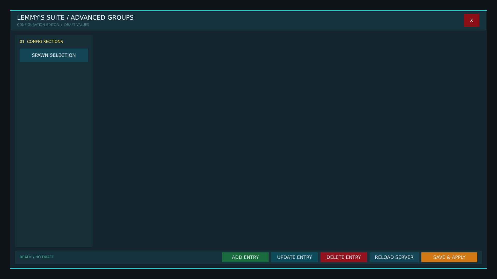


# ag_suite_config_editor.layout — Legacy AG config editor shell (fallback)

**Mod:** Advanced Groups  
**File:** `AdvancedGroups/gui/layouts/admin/ag_suite_config_editor.layout`  
**Root:** `FrameWidget` `AdvancedGroupsConfigRoot`, size 1 × 1  
**Widgets:** 32

Standalone Advanced Groups config editor. Only used as a fallback when Lemmy's Core is not running; the Control Room replaces it.

## Preview

Wireframe drawn straight from the layout file: positions, sizes, colours and default text are exact. Image widgets appear as dashed placeholders, and anything hidden at start inside the root is left out.

## Loaded by

- `AdvancedGroups/scripts/5_Mission/AdvancedGroups/GUI/AGConfigEditorMenu.c` line 22

## Widget tree

Positions and sizes are in pixels when the widget uses exact sizing, otherwise they are fractions of the parent (0–1).

| Widget | Type | Position | Size | Text / notes |
|---|---|---|---|---|
| `AdvancedGroupsConfigRoot` | FrameWidget | 0 0 | 1 × 1 |  |
| &nbsp;&nbsp;└ `BlurTint` | PanelWidget | 0 0 | 1 × 1 |  |
| &nbsp;&nbsp;└ `ConfigGlass` | PanelWidget | 0 0 | 1840 × 1000 |  |
| &nbsp;&nbsp;&nbsp;&nbsp;└ `NeonTop` | PanelWidget | 0 0 | 1840 × 2 |  |
| &nbsp;&nbsp;&nbsp;&nbsp;└ `NeonBottom` | PanelWidget | 0 998 | 1840 × 2 |  |
| &nbsp;&nbsp;&nbsp;&nbsp;└ `Header` | PanelWidget | 2 2 | 1836 × 76 |  |
| &nbsp;&nbsp;&nbsp;&nbsp;&nbsp;&nbsp;└ `ConfigTitle` | TextWidget | 24 10 | 720 × 32 | "LEMMY'S SUITE / ADVANCED GROUPS" |
| &nbsp;&nbsp;&nbsp;&nbsp;&nbsp;&nbsp;└ `HeaderSubtitle` | TextWidget | 24 44 | 720 × 20 | "CONFIGURATION EDITOR  /  DRAFT VALUES" |
| &nbsp;&nbsp;&nbsp;&nbsp;&nbsp;&nbsp;└ `ConfigCloseButton` | ButtonWidget | 1750 12 | 60 × 50 | "X", style DayZDefaultButton |
| &nbsp;&nbsp;&nbsp;&nbsp;└ `SectionRail` | PanelWidget | 18 94 | 300 × 822 |  |
| &nbsp;&nbsp;&nbsp;&nbsp;&nbsp;&nbsp;└ `SectionTitle` | TextWidget | 18 14 | 264 × 26 | "01  CONFIG SECTIONS" |
| &nbsp;&nbsp;&nbsp;&nbsp;&nbsp;&nbsp;└ `ModuleTabs` | GridSpacerWidget | 18 54 | 264 × 620 |  |
| &nbsp;&nbsp;&nbsp;&nbsp;&nbsp;&nbsp;&nbsp;&nbsp;└ `ConfigTab0` | ButtonWidget |  | 264 × 52 | "GENERAL", style DayZDefaultButton |
| &nbsp;&nbsp;&nbsp;&nbsp;&nbsp;&nbsp;&nbsp;&nbsp;└ `ConfigTab1` | ButtonWidget |  | 264 × 52 | "CHAT", style DayZDefaultButton |
| &nbsp;&nbsp;&nbsp;&nbsp;&nbsp;&nbsp;&nbsp;&nbsp;└ `ConfigTab2` | ButtonWidget |  | 264 × 52 | "PROTECTION / GPS", style DayZDefaultButton |
| &nbsp;&nbsp;&nbsp;&nbsp;&nbsp;&nbsp;&nbsp;&nbsp;└ `ConfigTab3` | ButtonWidget |  | 264 × 52 | "DISPLAY", style DayZDefaultButton |
| &nbsp;&nbsp;&nbsp;&nbsp;&nbsp;&nbsp;&nbsp;&nbsp;└ `ConfigTab4` | ButtonWidget |  | 264 × 52 | "MARKERS", style DayZDefaultButton |
| &nbsp;&nbsp;&nbsp;&nbsp;&nbsp;&nbsp;&nbsp;&nbsp;└ `ConfigTab5` | ButtonWidget |  | 264 × 52 | "WEBHOOKS / LOGS", style DayZDefaultButton |
| &nbsp;&nbsp;&nbsp;&nbsp;&nbsp;&nbsp;&nbsp;&nbsp;└ `ConfigTab6` | ButtonWidget |  | 264 × 52 | "ACCESS CONTROL", style DayZDefaultButton |
| &nbsp;&nbsp;&nbsp;&nbsp;&nbsp;&nbsp;&nbsp;&nbsp;└ `ConfigTab7` | ButtonWidget |  | 264 × 52 | "SERVER INFO", style DayZDefaultButton |
| &nbsp;&nbsp;&nbsp;&nbsp;&nbsp;&nbsp;&nbsp;&nbsp;└ `ConfigTab8` | ButtonWidget |  | 264 × 52 | "EVENT MARKERS", style DayZDefaultButton |
| &nbsp;&nbsp;&nbsp;&nbsp;&nbsp;&nbsp;&nbsp;&nbsp;└ `ConfigTab9` | ButtonWidget |  | 264 × 52 | "SPAWN SELECTION", style DayZDefaultButton |
| &nbsp;&nbsp;&nbsp;&nbsp;└ `EditorStage` | PanelWidget | 334 94 | 1488 × 822 |  |
| &nbsp;&nbsp;&nbsp;&nbsp;&nbsp;&nbsp;└ `ConfigPageHost` | FrameWidget | 14 14 | 1460 × 794 |  |
| &nbsp;&nbsp;&nbsp;&nbsp;&nbsp;&nbsp;&nbsp;&nbsp;└ `ActiveCategoryPanel` | WrapSpacerWidget | 0 0 | 1 × 1 | hidden at start |
| &nbsp;&nbsp;&nbsp;&nbsp;└ `Footer` | PanelWidget | 18 930 | 1804 × 52 |  |
| &nbsp;&nbsp;&nbsp;&nbsp;&nbsp;&nbsp;└ `ConfigStatus` | TextWidget | 18 0 | 760 × 52 | "READY / NO DRAFT" |
| &nbsp;&nbsp;&nbsp;&nbsp;&nbsp;&nbsp;└ `ConfigAddButton` | ButtonWidget | 800 7 | 180 × 38 | "ADD ENTRY", style DayZDefaultButton |
| &nbsp;&nbsp;&nbsp;&nbsp;&nbsp;&nbsp;└ `ConfigUpdateButton` | ButtonWidget | 990 7 | 180 × 38 | "UPDATE ENTRY", style DayZDefaultButton |
| &nbsp;&nbsp;&nbsp;&nbsp;&nbsp;&nbsp;└ `ConfigDeleteButton` | ButtonWidget | 1180 7 | 180 × 38 | "DELETE ENTRY", style DayZDefaultButton |
| &nbsp;&nbsp;&nbsp;&nbsp;&nbsp;&nbsp;└ `ConfigReloadButton` | ButtonWidget | 1370 7 | 190 × 38 | "RELOAD SERVER", style DayZDefaultButton |
| &nbsp;&nbsp;&nbsp;&nbsp;&nbsp;&nbsp;└ `ConfigSaveButton` | ButtonWidget | 1570 7 | 216 × 38 | "SAVE & APPLY", style DayZDefaultButton |


