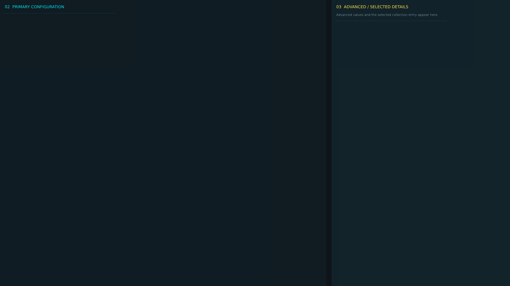


# ag_config_page_0.layout — Legacy config page 0

**Mod:** Advanced Groups  
**File:** `AdvancedGroups/gui/layouts/admin/config_pages/ag_config_page_0.layout`  
**Root:** `FrameWidget` `ConfigCategoryPage`, size 1 × 1  
**Widgets:** 70

Page of the legacy AG config editor (fallback only).

## Preview

Wireframe drawn straight from the layout file: positions, sizes, colours and default text are exact. Image widgets appear as dashed placeholders, and anything hidden at start inside the root is left out.

## Loaded by

- `AdvancedGroups/scripts/5_Mission/AdvancedGroups/GUI/AGConfigEditorMenu.c` line 302

## Widget tree

Positions and sizes are in pixels when the widget uses exact sizing, otherwise they are fractions of the parent (0–1).

| Widget | Type | Position | Size | Text / notes |
|---|---|---|---|---|
| `ConfigCategoryPage` | FrameWidget | 0 0 | 1 × 1 |  |
| &nbsp;&nbsp;└ `PrimaryColumn` | PanelWidget | 0 0 | 0.64 × 1 |  |
| &nbsp;&nbsp;&nbsp;&nbsp;└ `PrimaryColumnTitle` | TextWidget | 18 12 | 0.92 × 28 | "02  PRIMARY CONFIGURATION" |
| &nbsp;&nbsp;&nbsp;&nbsp;└ `PrimaryScroll` | ScrollWidget | 14 50 | 0.96 × 0.93 |  |
| &nbsp;&nbsp;&nbsp;&nbsp;&nbsp;&nbsp;└ `ActiveCategoryPanel` | WrapSpacerWidget | 0 0 | 1 × 0 |  |
| &nbsp;&nbsp;&nbsp;&nbsp;&nbsp;&nbsp;&nbsp;&nbsp;└ `Field_AG_CategoryBypassInviteToggle` | PanelWidget |  | 420 × 82 | style DayZDefaultPanel |
| &nbsp;&nbsp;&nbsp;&nbsp;&nbsp;&nbsp;&nbsp;&nbsp;&nbsp;&nbsp;└ `Label_AG_CategoryBypassInviteToggle` | TextWidget | 10 7 | 400 × 22 | "CATEGORY BYPASS INVITE" |
| &nbsp;&nbsp;&nbsp;&nbsp;&nbsp;&nbsp;&nbsp;&nbsp;&nbsp;&nbsp;└ `AG_CategoryBypassInviteToggle` | CheckBoxWidget | 16 36 | 32 × 32 |  |
| &nbsp;&nbsp;&nbsp;&nbsp;&nbsp;&nbsp;&nbsp;&nbsp;└ `Field_AG_CategoryMaxGroupInput` | PanelWidget |  | 420 × 82 | style DayZDefaultPanel |
| &nbsp;&nbsp;&nbsp;&nbsp;&nbsp;&nbsp;&nbsp;&nbsp;&nbsp;&nbsp;└ `Label_AG_CategoryMaxGroupInput` | TextWidget | 10 7 | 400 × 22 | "CATEGORY MAX GROUP" |
| &nbsp;&nbsp;&nbsp;&nbsp;&nbsp;&nbsp;&nbsp;&nbsp;&nbsp;&nbsp;└ `AG_CategoryMaxGroupInput` | EditBoxWidget | 10 34 | 400 × 38 | style EditBox |
| &nbsp;&nbsp;&nbsp;&nbsp;&nbsp;&nbsp;&nbsp;&nbsp;└ `Field_AG_CategoryNameInput` | PanelWidget |  | 420 × 82 | style DayZDefaultPanel |
| &nbsp;&nbsp;&nbsp;&nbsp;&nbsp;&nbsp;&nbsp;&nbsp;&nbsp;&nbsp;└ `Label_AG_CategoryNameInput` | TextWidget | 10 7 | 400 × 22 | "CATEGORY NAME" |
| &nbsp;&nbsp;&nbsp;&nbsp;&nbsp;&nbsp;&nbsp;&nbsp;&nbsp;&nbsp;└ `AG_CategoryNameInput` | EditBoxWidget | 10 34 | 400 × 38 | style EditBox |
| &nbsp;&nbsp;&nbsp;&nbsp;&nbsp;&nbsp;&nbsp;&nbsp;└ `Field_AG_CleanupIntervalInput` | PanelWidget |  | 420 × 82 | style DayZDefaultPanel |
| &nbsp;&nbsp;&nbsp;&nbsp;&nbsp;&nbsp;&nbsp;&nbsp;&nbsp;&nbsp;└ `Label_AG_CleanupIntervalInput` | TextWidget | 10 7 | 400 × 22 | "CLEANUP INTERVAL" |
| &nbsp;&nbsp;&nbsp;&nbsp;&nbsp;&nbsp;&nbsp;&nbsp;&nbsp;&nbsp;└ `AG_CleanupIntervalInput` | EditBoxWidget | 10 34 | 400 × 38 | style EditBox |
| &nbsp;&nbsp;&nbsp;&nbsp;&nbsp;&nbsp;&nbsp;&nbsp;└ `Field_AG_ConfigVersionValue` | PanelWidget |  | 420 × 82 | style DayZDefaultPanel |
| &nbsp;&nbsp;&nbsp;&nbsp;&nbsp;&nbsp;&nbsp;&nbsp;&nbsp;&nbsp;└ `Label_AG_ConfigVersionValue` | TextWidget | 10 7 | 400 × 22 | "CONFIG VERSION" |
| &nbsp;&nbsp;&nbsp;&nbsp;&nbsp;&nbsp;&nbsp;&nbsp;&nbsp;&nbsp;└ `AG_ConfigVersionValue` | TextWidget | 12 38 | 394 × 30 | "READ ONLY" |
| &nbsp;&nbsp;&nbsp;&nbsp;&nbsp;&nbsp;&nbsp;&nbsp;└ `Field_AG_InviteTimeoutInput` | PanelWidget |  | 420 × 82 | style DayZDefaultPanel |
| &nbsp;&nbsp;&nbsp;&nbsp;&nbsp;&nbsp;&nbsp;&nbsp;&nbsp;&nbsp;└ `Label_AG_InviteTimeoutInput` | TextWidget | 10 7 | 400 × 22 | "INVITE TIMEOUT" |
| &nbsp;&nbsp;&nbsp;&nbsp;&nbsp;&nbsp;&nbsp;&nbsp;&nbsp;&nbsp;└ `AG_InviteTimeoutInput` | EditBoxWidget | 10 34 | 400 × 38 | style EditBox |
| &nbsp;&nbsp;&nbsp;&nbsp;&nbsp;&nbsp;&nbsp;&nbsp;└ `Field_AG_MaxGroupSizeInput` | PanelWidget |  | 420 × 82 | style DayZDefaultPanel |
| &nbsp;&nbsp;&nbsp;&nbsp;&nbsp;&nbsp;&nbsp;&nbsp;&nbsp;&nbsp;└ `Label_AG_MaxGroupSizeInput` | TextWidget | 10 7 | 400 × 22 | "MAX GROUP SIZE" |
| &nbsp;&nbsp;&nbsp;&nbsp;&nbsp;&nbsp;&nbsp;&nbsp;&nbsp;&nbsp;└ `AG_MaxGroupSizeInput` | EditBoxWidget | 10 34 | 400 × 38 | style EditBox |
| &nbsp;&nbsp;&nbsp;&nbsp;&nbsp;&nbsp;&nbsp;&nbsp;└ `Field_AG_NoBuildNameInput` | PanelWidget |  | 420 × 82 | style DayZDefaultPanel |
| &nbsp;&nbsp;&nbsp;&nbsp;&nbsp;&nbsp;&nbsp;&nbsp;&nbsp;&nbsp;└ `Label_AG_NoBuildNameInput` | TextWidget | 10 7 | 400 × 22 | "NO BUILD NAME" |
| &nbsp;&nbsp;&nbsp;&nbsp;&nbsp;&nbsp;&nbsp;&nbsp;&nbsp;&nbsp;└ `AG_NoBuildNameInput` | EditBoxWidget | 10 34 | 400 × 38 | style EditBox |
| &nbsp;&nbsp;&nbsp;&nbsp;&nbsp;&nbsp;&nbsp;&nbsp;└ `Field_AG_NoBuildRadiusInput` | PanelWidget |  | 420 × 82 | style DayZDefaultPanel |
| &nbsp;&nbsp;&nbsp;&nbsp;&nbsp;&nbsp;&nbsp;&nbsp;&nbsp;&nbsp;└ `Label_AG_NoBuildRadiusInput` | TextWidget | 10 7 | 400 × 22 | "NO BUILD RADIUS" |
| &nbsp;&nbsp;&nbsp;&nbsp;&nbsp;&nbsp;&nbsp;&nbsp;&nbsp;&nbsp;└ `AG_NoBuildRadiusInput` | EditBoxWidget | 10 34 | 400 × 38 | style EditBox |
| &nbsp;&nbsp;&nbsp;&nbsp;&nbsp;&nbsp;&nbsp;&nbsp;└ `Field_AG_NoBuildZInput` | PanelWidget |  | 420 × 82 | style DayZDefaultPanel |
| &nbsp;&nbsp;&nbsp;&nbsp;&nbsp;&nbsp;&nbsp;&nbsp;&nbsp;&nbsp;└ `Label_AG_NoBuildZInput` | TextWidget | 10 7 | 400 × 22 | "NO BUILD Z" |
| &nbsp;&nbsp;&nbsp;&nbsp;&nbsp;&nbsp;&nbsp;&nbsp;&nbsp;&nbsp;└ `AG_NoBuildZInput` | EditBoxWidget | 10 34 | 400 × 38 | style EditBox |
| &nbsp;&nbsp;&nbsp;&nbsp;&nbsp;&nbsp;&nbsp;&nbsp;└ `Field_AG_StorageDirectoryInput` | PanelWidget |  | 420 × 82 | style DayZDefaultPanel |
| &nbsp;&nbsp;&nbsp;&nbsp;&nbsp;&nbsp;&nbsp;&nbsp;&nbsp;&nbsp;└ `Label_AG_StorageDirectoryInput` | TextWidget | 10 7 | 400 × 22 | "STORAGE DIRECTORY" |
| &nbsp;&nbsp;&nbsp;&nbsp;&nbsp;&nbsp;&nbsp;&nbsp;&nbsp;&nbsp;└ `AG_StorageDirectoryInput` | EditBoxWidget | 10 34 | 400 × 38 | style EditBox |
| &nbsp;&nbsp;└ `AdvancedColumn` | PanelWidget | 0.65 0 | 0.35 × 1 |  |
| &nbsp;&nbsp;&nbsp;&nbsp;└ `AdvancedColumnTitle` | TextWidget | 18 12 | 0.88 × 28 | "03  ADVANCED / SELECTED DETAILS" |
| &nbsp;&nbsp;&nbsp;&nbsp;└ `AdvancedColumnHint` | TextWidget | 18 38 | 0.88 × 38 | "Advanced values and the selected collection entry appear here." |
| &nbsp;&nbsp;&nbsp;&nbsp;└ `AdvancedScroll` | ScrollWidget | 14 78 | 0.94 × 0.89 |  |
| &nbsp;&nbsp;&nbsp;&nbsp;&nbsp;&nbsp;└ `AdvancedCategoryPanel` | WrapSpacerWidget | 0 0 | 1 × 0 |  |
| &nbsp;&nbsp;&nbsp;&nbsp;&nbsp;&nbsp;&nbsp;&nbsp;└ `Field_AG_CategoryDisplayColorInput` | PanelWidget |  | 420 × 82 | style DayZDefaultPanel |
| &nbsp;&nbsp;&nbsp;&nbsp;&nbsp;&nbsp;&nbsp;&nbsp;&nbsp;&nbsp;└ `Label_AG_CategoryDisplayColorInput` | TextWidget | 10 7 | 400 × 22 | "CATEGORY DISPLAY COLOR" |
| &nbsp;&nbsp;&nbsp;&nbsp;&nbsp;&nbsp;&nbsp;&nbsp;&nbsp;&nbsp;└ `AG_CategoryDisplayColorInput` | EditBoxWidget | 10 34 | 400 × 38 | style EditBox |
| &nbsp;&nbsp;&nbsp;&nbsp;&nbsp;&nbsp;&nbsp;&nbsp;└ `Field_AG_CategoryInspector` | PanelWidget |  | 420 × 140 | style DayZDefaultPanel |
| &nbsp;&nbsp;&nbsp;&nbsp;&nbsp;&nbsp;&nbsp;&nbsp;&nbsp;&nbsp;└ `Label_AG_CategoryInspector` | TextWidget | 10 7 | 400 × 22 | "CATEGORY" |
| &nbsp;&nbsp;&nbsp;&nbsp;&nbsp;&nbsp;&nbsp;&nbsp;&nbsp;&nbsp;└ `AG_CategoryInspector` | PanelWidget | 10 34 | 400 × 96 | style DayZDefaultPanel |
| &nbsp;&nbsp;&nbsp;&nbsp;&nbsp;&nbsp;&nbsp;&nbsp;└ `Field_AG_CategoryList` | PanelWidget |  | 420 × 140 | style DayZDefaultPanel |
| &nbsp;&nbsp;&nbsp;&nbsp;&nbsp;&nbsp;&nbsp;&nbsp;&nbsp;&nbsp;└ `Label_AG_CategoryList` | TextWidget | 10 7 | 400 × 22 | "CATEGORY" |
| &nbsp;&nbsp;&nbsp;&nbsp;&nbsp;&nbsp;&nbsp;&nbsp;&nbsp;&nbsp;└ `AG_CategoryList` | TextListboxWidget | 10 34 | 400 × 96 | style Default |
| &nbsp;&nbsp;&nbsp;&nbsp;&nbsp;&nbsp;&nbsp;&nbsp;└ `Field_AG_CategoryMaxSubgroupsInput` | PanelWidget |  | 420 × 82 | style DayZDefaultPanel |
| &nbsp;&nbsp;&nbsp;&nbsp;&nbsp;&nbsp;&nbsp;&nbsp;&nbsp;&nbsp;└ `Label_AG_CategoryMaxSubgroupsInput` | TextWidget | 10 7 | 400 × 22 | "CATEGORY MAX SUBGROUPS" |
| &nbsp;&nbsp;&nbsp;&nbsp;&nbsp;&nbsp;&nbsp;&nbsp;&nbsp;&nbsp;└ `AG_CategoryMaxSubgroupsInput` | EditBoxWidget | 10 34 | 400 × 38 | style EditBox |
| &nbsp;&nbsp;&nbsp;&nbsp;&nbsp;&nbsp;&nbsp;&nbsp;└ `Field_AG_CategoryPlayerColorInput` | PanelWidget |  | 420 × 82 | style DayZDefaultPanel |
| &nbsp;&nbsp;&nbsp;&nbsp;&nbsp;&nbsp;&nbsp;&nbsp;&nbsp;&nbsp;└ `Label_AG_CategoryPlayerColorInput` | TextWidget | 10 7 | 400 × 22 | "CATEGORY PLAYER COLOR" |
| &nbsp;&nbsp;&nbsp;&nbsp;&nbsp;&nbsp;&nbsp;&nbsp;&nbsp;&nbsp;└ `AG_CategoryPlayerColorInput` | EditBoxWidget | 10 34 | 400 × 38 | style EditBox |
| &nbsp;&nbsp;&nbsp;&nbsp;&nbsp;&nbsp;&nbsp;&nbsp;└ `Field_AG_CategoryShowAdminToggle` | PanelWidget |  | 420 × 82 | style DayZDefaultPanel |
| &nbsp;&nbsp;&nbsp;&nbsp;&nbsp;&nbsp;&nbsp;&nbsp;&nbsp;&nbsp;└ `Label_AG_CategoryShowAdminToggle` | TextWidget | 10 7 | 400 × 22 | "CATEGORY SHOW ADMIN" |
| &nbsp;&nbsp;&nbsp;&nbsp;&nbsp;&nbsp;&nbsp;&nbsp;&nbsp;&nbsp;└ `AG_CategoryShowAdminToggle` | CheckBoxWidget | 16 36 | 32 × 32 |  |
| &nbsp;&nbsp;&nbsp;&nbsp;&nbsp;&nbsp;&nbsp;&nbsp;└ `Field_AG_InactiveCleanupDaysInput` | PanelWidget |  | 420 × 82 | style DayZDefaultPanel |
| &nbsp;&nbsp;&nbsp;&nbsp;&nbsp;&nbsp;&nbsp;&nbsp;&nbsp;&nbsp;└ `Label_AG_InactiveCleanupDaysInput` | TextWidget | 10 7 | 400 × 22 | "INACTIVE CLEANUP DAYS" |
| &nbsp;&nbsp;&nbsp;&nbsp;&nbsp;&nbsp;&nbsp;&nbsp;&nbsp;&nbsp;└ `AG_InactiveCleanupDaysInput` | EditBoxWidget | 10 34 | 400 × 38 | style EditBox |
| &nbsp;&nbsp;&nbsp;&nbsp;&nbsp;&nbsp;&nbsp;&nbsp;└ `Field_AG_MaxSubgroupsInput` | PanelWidget |  | 420 × 82 | style DayZDefaultPanel |
| &nbsp;&nbsp;&nbsp;&nbsp;&nbsp;&nbsp;&nbsp;&nbsp;&nbsp;&nbsp;└ `Label_AG_MaxSubgroupsInput` | TextWidget | 10 7 | 400 × 22 | "MAX SUBGROUPS" |
| &nbsp;&nbsp;&nbsp;&nbsp;&nbsp;&nbsp;&nbsp;&nbsp;&nbsp;&nbsp;└ `AG_MaxSubgroupsInput` | EditBoxWidget | 10 34 | 400 × 38 | style EditBox |
| &nbsp;&nbsp;&nbsp;&nbsp;&nbsp;&nbsp;&nbsp;&nbsp;└ `Field_AG_NoBuildXInput` | PanelWidget |  | 420 × 82 | style DayZDefaultPanel |
| &nbsp;&nbsp;&nbsp;&nbsp;&nbsp;&nbsp;&nbsp;&nbsp;&nbsp;&nbsp;└ `Label_AG_NoBuildXInput` | TextWidget | 10 7 | 400 × 22 | "NO BUILD X" |
| &nbsp;&nbsp;&nbsp;&nbsp;&nbsp;&nbsp;&nbsp;&nbsp;&nbsp;&nbsp;└ `AG_NoBuildXInput` | EditBoxWidget | 10 34 | 400 × 38 | style EditBox |


