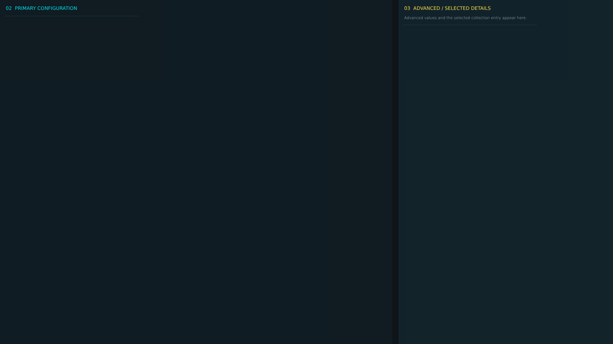


# ag_config_page_1.layout — Legacy config page 1

**Mod:** Advanced Groups  
**File:** `AdvancedGroups/gui/layouts/admin/config_pages/ag_config_page_1.layout`  
**Root:** `FrameWidget` `ConfigCategoryPage`, size 1 × 1  
**Widgets:** 67

Page of the legacy AG config editor (fallback only).

## Preview

Wireframe drawn straight from the layout file: positions, sizes, colours and default text are exact. Image widgets appear as dashed placeholders, and anything hidden at start inside the root is left out.

## Loaded by

- `AdvancedGroups/scripts/5_Mission/AdvancedGroups/GUI/AGConfigEditorMenu.c` line 302

## Widget tree

Positions and sizes are in pixels when the widget uses exact sizing, otherwise they are fractions of the parent (0–1).

| Widget | Type | Position | Size | Text / notes |
|---|---|---|---|---|
| `ConfigCategoryPage` | FrameWidget | 0 0 | 1 × 1 |  |
| &nbsp;&nbsp;└ `PrimaryColumn` | PanelWidget | 0 0 | 0.64 × 1 |  |
| &nbsp;&nbsp;&nbsp;&nbsp;└ `PrimaryColumnTitle` | TextWidget | 18 12 | 0.92 × 28 | "02  PRIMARY CONFIGURATION" |
| &nbsp;&nbsp;&nbsp;&nbsp;└ `PrimaryScroll` | ScrollWidget | 14 50 | 0.96 × 0.93 |  |
| &nbsp;&nbsp;&nbsp;&nbsp;&nbsp;&nbsp;└ `ActiveCategoryPanel` | WrapSpacerWidget | 0 0 | 1 × 0 |  |
| &nbsp;&nbsp;&nbsp;&nbsp;&nbsp;&nbsp;&nbsp;&nbsp;└ `Field_AG_AllowGlobalChatToggle` | PanelWidget |  | 420 × 82 | style DayZDefaultPanel |
| &nbsp;&nbsp;&nbsp;&nbsp;&nbsp;&nbsp;&nbsp;&nbsp;&nbsp;&nbsp;└ `Label_AG_AllowGlobalChatToggle` | TextWidget | 10 7 | 400 × 22 | "ALLOW GLOBAL CHAT" |
| &nbsp;&nbsp;&nbsp;&nbsp;&nbsp;&nbsp;&nbsp;&nbsp;&nbsp;&nbsp;└ `AG_AllowGlobalChatToggle` | CheckBoxWidget | 16 36 | 32 × 32 |  |
| &nbsp;&nbsp;&nbsp;&nbsp;&nbsp;&nbsp;&nbsp;&nbsp;└ `Field_AG_AnnounceJoinToggle` | PanelWidget |  | 420 × 82 | style DayZDefaultPanel |
| &nbsp;&nbsp;&nbsp;&nbsp;&nbsp;&nbsp;&nbsp;&nbsp;&nbsp;&nbsp;└ `Label_AG_AnnounceJoinToggle` | TextWidget | 10 7 | 400 × 22 | "ANNOUNCE JOIN" |
| &nbsp;&nbsp;&nbsp;&nbsp;&nbsp;&nbsp;&nbsp;&nbsp;&nbsp;&nbsp;└ `AG_AnnounceJoinToggle` | CheckBoxWidget | 16 36 | 32 × 32 |  |
| &nbsp;&nbsp;&nbsp;&nbsp;&nbsp;&nbsp;&nbsp;&nbsp;└ `Field_AG_BadWordFilterToggle` | PanelWidget |  | 420 × 82 | style DayZDefaultPanel |
| &nbsp;&nbsp;&nbsp;&nbsp;&nbsp;&nbsp;&nbsp;&nbsp;&nbsp;&nbsp;└ `Label_AG_BadWordFilterToggle` | TextWidget | 10 7 | 400 × 22 | "BAD WORD FILTER" |
| &nbsp;&nbsp;&nbsp;&nbsp;&nbsp;&nbsp;&nbsp;&nbsp;&nbsp;&nbsp;└ `AG_BadWordFilterToggle` | CheckBoxWidget | 16 36 | 32 × 32 |  |
| &nbsp;&nbsp;&nbsp;&nbsp;&nbsp;&nbsp;&nbsp;&nbsp;└ `Field_AG_BadWordInput` | PanelWidget |  | 420 × 82 | style DayZDefaultPanel |
| &nbsp;&nbsp;&nbsp;&nbsp;&nbsp;&nbsp;&nbsp;&nbsp;&nbsp;&nbsp;└ `Label_AG_BadWordInput` | TextWidget | 10 7 | 400 × 22 | "BAD WORD" |
| &nbsp;&nbsp;&nbsp;&nbsp;&nbsp;&nbsp;&nbsp;&nbsp;&nbsp;&nbsp;└ `AG_BadWordInput` | EditBoxWidget | 10 34 | 400 × 38 | style EditBox |
| &nbsp;&nbsp;&nbsp;&nbsp;&nbsp;&nbsp;&nbsp;&nbsp;└ `Field_AG_ChatIdentitySteamIdInput` | PanelWidget |  | 420 × 82 | style DayZDefaultPanel |
| &nbsp;&nbsp;&nbsp;&nbsp;&nbsp;&nbsp;&nbsp;&nbsp;&nbsp;&nbsp;└ `Label_AG_ChatIdentitySteamIdInput` | TextWidget | 10 7 | 400 × 22 | "CHAT IDENTITY STEAM ID" |
| &nbsp;&nbsp;&nbsp;&nbsp;&nbsp;&nbsp;&nbsp;&nbsp;&nbsp;&nbsp;└ `AG_ChatIdentitySteamIdInput` | EditBoxWidget | 10 34 | 400 × 38 | style EditBox |
| &nbsp;&nbsp;&nbsp;&nbsp;&nbsp;&nbsp;&nbsp;&nbsp;└ `Field_AG_ChatIdentityTagInput` | PanelWidget |  | 420 × 82 | style DayZDefaultPanel |
| &nbsp;&nbsp;&nbsp;&nbsp;&nbsp;&nbsp;&nbsp;&nbsp;&nbsp;&nbsp;└ `Label_AG_ChatIdentityTagInput` | TextWidget | 10 7 | 400 × 22 | "CHAT IDENTITY TAG" |
| &nbsp;&nbsp;&nbsp;&nbsp;&nbsp;&nbsp;&nbsp;&nbsp;&nbsp;&nbsp;└ `AG_ChatIdentityTagInput` | EditBoxWidget | 10 34 | 400 × 38 | style EditBox |
| &nbsp;&nbsp;&nbsp;&nbsp;&nbsp;&nbsp;&nbsp;&nbsp;└ `Field_AG_PublicGroupDescriptionInput` | PanelWidget |  | 420 × 82 | style DayZDefaultPanel |
| &nbsp;&nbsp;&nbsp;&nbsp;&nbsp;&nbsp;&nbsp;&nbsp;&nbsp;&nbsp;└ `Label_AG_PublicGroupDescriptionInput` | TextWidget | 10 7 | 400 × 22 | "PUBLIC GROUP DESCRIPTION" |
| &nbsp;&nbsp;&nbsp;&nbsp;&nbsp;&nbsp;&nbsp;&nbsp;&nbsp;&nbsp;└ `AG_PublicGroupDescriptionInput` | EditBoxWidget | 10 34 | 400 × 38 | style EditBox |
| &nbsp;&nbsp;&nbsp;&nbsp;&nbsp;&nbsp;&nbsp;&nbsp;└ `Field_AG_PublicGroupNameInput` | PanelWidget |  | 420 × 82 | style DayZDefaultPanel |
| &nbsp;&nbsp;&nbsp;&nbsp;&nbsp;&nbsp;&nbsp;&nbsp;&nbsp;&nbsp;└ `Label_AG_PublicGroupNameInput` | TextWidget | 10 7 | 400 × 22 | "PUBLIC GROUP NAME" |
| &nbsp;&nbsp;&nbsp;&nbsp;&nbsp;&nbsp;&nbsp;&nbsp;&nbsp;&nbsp;└ `AG_PublicGroupNameInput` | EditBoxWidget | 10 34 | 400 × 38 | style EditBox |
| &nbsp;&nbsp;&nbsp;&nbsp;&nbsp;&nbsp;&nbsp;&nbsp;└ `Field_AG_VicinityRangeInput` | PanelWidget |  | 420 × 82 | style DayZDefaultPanel |
| &nbsp;&nbsp;&nbsp;&nbsp;&nbsp;&nbsp;&nbsp;&nbsp;&nbsp;&nbsp;└ `Label_AG_VicinityRangeInput` | TextWidget | 10 7 | 400 × 22 | "VICINITY RANGE" |
| &nbsp;&nbsp;&nbsp;&nbsp;&nbsp;&nbsp;&nbsp;&nbsp;&nbsp;&nbsp;└ `AG_VicinityRangeInput` | EditBoxWidget | 10 34 | 400 × 38 | style EditBox |
| &nbsp;&nbsp;└ `AdvancedColumn` | PanelWidget | 0.65 0 | 0.35 × 1 |  |
| &nbsp;&nbsp;&nbsp;&nbsp;└ `AdvancedColumnTitle` | TextWidget | 18 12 | 0.88 × 28 | "03  ADVANCED / SELECTED DETAILS" |
| &nbsp;&nbsp;&nbsp;&nbsp;└ `AdvancedColumnHint` | TextWidget | 18 38 | 0.88 × 38 | "Advanced values and the selected collection entry appear here." |
| &nbsp;&nbsp;&nbsp;&nbsp;└ `AdvancedScroll` | ScrollWidget | 14 78 | 0.94 × 0.89 |  |
| &nbsp;&nbsp;&nbsp;&nbsp;&nbsp;&nbsp;└ `AdvancedCategoryPanel` | WrapSpacerWidget | 0 0 | 1 × 0 |  |
| &nbsp;&nbsp;&nbsp;&nbsp;&nbsp;&nbsp;&nbsp;&nbsp;└ `Field_AG_AnnounceLeaveToggle` | PanelWidget |  | 420 × 82 | style DayZDefaultPanel |
| &nbsp;&nbsp;&nbsp;&nbsp;&nbsp;&nbsp;&nbsp;&nbsp;&nbsp;&nbsp;└ `Label_AG_AnnounceLeaveToggle` | TextWidget | 10 7 | 400 × 22 | "ANNOUNCE LEAVE" |
| &nbsp;&nbsp;&nbsp;&nbsp;&nbsp;&nbsp;&nbsp;&nbsp;&nbsp;&nbsp;└ `AG_AnnounceLeaveToggle` | CheckBoxWidget | 16 36 | 32 × 32 |  |
| &nbsp;&nbsp;&nbsp;&nbsp;&nbsp;&nbsp;&nbsp;&nbsp;└ `Field_AG_BadWordsList` | PanelWidget |  | 420 × 140 | style DayZDefaultPanel |
| &nbsp;&nbsp;&nbsp;&nbsp;&nbsp;&nbsp;&nbsp;&nbsp;&nbsp;&nbsp;└ `Label_AG_BadWordsList` | TextWidget | 10 7 | 400 × 22 | "BAD WORDS" |
| &nbsp;&nbsp;&nbsp;&nbsp;&nbsp;&nbsp;&nbsp;&nbsp;&nbsp;&nbsp;└ `AG_BadWordsList` | TextListboxWidget | 10 34 | 400 × 96 | style Default |
| &nbsp;&nbsp;&nbsp;&nbsp;&nbsp;&nbsp;&nbsp;&nbsp;└ `Field_AG_ChatIdentityColorInput` | PanelWidget |  | 420 × 82 | style DayZDefaultPanel |
| &nbsp;&nbsp;&nbsp;&nbsp;&nbsp;&nbsp;&nbsp;&nbsp;&nbsp;&nbsp;└ `Label_AG_ChatIdentityColorInput` | TextWidget | 10 7 | 400 × 22 | "CHAT IDENTITY COLOR" |
| &nbsp;&nbsp;&nbsp;&nbsp;&nbsp;&nbsp;&nbsp;&nbsp;&nbsp;&nbsp;└ `AG_ChatIdentityColorInput` | EditBoxWidget | 10 34 | 400 × 38 | style EditBox |
| &nbsp;&nbsp;&nbsp;&nbsp;&nbsp;&nbsp;&nbsp;&nbsp;└ `Field_AG_ChatIdentityInspector` | PanelWidget |  | 420 × 140 | style DayZDefaultPanel |
| &nbsp;&nbsp;&nbsp;&nbsp;&nbsp;&nbsp;&nbsp;&nbsp;&nbsp;&nbsp;└ `Label_AG_ChatIdentityInspector` | TextWidget | 10 7 | 400 × 22 | "CHAT IDENTITY" |
| &nbsp;&nbsp;&nbsp;&nbsp;&nbsp;&nbsp;&nbsp;&nbsp;&nbsp;&nbsp;└ `AG_ChatIdentityInspector` | PanelWidget | 10 34 | 400 × 96 | style DayZDefaultPanel |
| &nbsp;&nbsp;&nbsp;&nbsp;&nbsp;&nbsp;&nbsp;&nbsp;└ `Field_AG_ChatIdentityList` | PanelWidget |  | 420 × 140 | style DayZDefaultPanel |
| &nbsp;&nbsp;&nbsp;&nbsp;&nbsp;&nbsp;&nbsp;&nbsp;&nbsp;&nbsp;└ `Label_AG_ChatIdentityList` | TextWidget | 10 7 | 400 × 22 | "CHAT IDENTITY" |
| &nbsp;&nbsp;&nbsp;&nbsp;&nbsp;&nbsp;&nbsp;&nbsp;&nbsp;&nbsp;└ `AG_ChatIdentityList` | TextListboxWidget | 10 34 | 400 × 96 | style Default |
| &nbsp;&nbsp;&nbsp;&nbsp;&nbsp;&nbsp;&nbsp;&nbsp;└ `Field_AG_MuteSystemToggle` | PanelWidget |  | 420 × 82 | style DayZDefaultPanel |
| &nbsp;&nbsp;&nbsp;&nbsp;&nbsp;&nbsp;&nbsp;&nbsp;&nbsp;&nbsp;└ `Label_AG_MuteSystemToggle` | TextWidget | 10 7 | 400 × 22 | "MUTE SYSTEM" |
| &nbsp;&nbsp;&nbsp;&nbsp;&nbsp;&nbsp;&nbsp;&nbsp;&nbsp;&nbsp;└ `AG_MuteSystemToggle` | CheckBoxWidget | 16 36 | 32 × 32 |  |
| &nbsp;&nbsp;&nbsp;&nbsp;&nbsp;&nbsp;&nbsp;&nbsp;└ `Field_AG_PublicGroupColorInput` | PanelWidget |  | 420 × 82 | style DayZDefaultPanel |
| &nbsp;&nbsp;&nbsp;&nbsp;&nbsp;&nbsp;&nbsp;&nbsp;&nbsp;&nbsp;└ `Label_AG_PublicGroupColorInput` | TextWidget | 10 7 | 400 × 22 | "PUBLIC GROUP COLOR" |
| &nbsp;&nbsp;&nbsp;&nbsp;&nbsp;&nbsp;&nbsp;&nbsp;&nbsp;&nbsp;└ `AG_PublicGroupColorInput` | EditBoxWidget | 10 34 | 400 × 38 | style EditBox |
| &nbsp;&nbsp;&nbsp;&nbsp;&nbsp;&nbsp;&nbsp;&nbsp;└ `Field_AG_PublicGroupInspector` | PanelWidget |  | 420 × 140 | style DayZDefaultPanel |
| &nbsp;&nbsp;&nbsp;&nbsp;&nbsp;&nbsp;&nbsp;&nbsp;&nbsp;&nbsp;└ `Label_AG_PublicGroupInspector` | TextWidget | 10 7 | 400 × 22 | "PUBLIC GROUP" |
| &nbsp;&nbsp;&nbsp;&nbsp;&nbsp;&nbsp;&nbsp;&nbsp;&nbsp;&nbsp;└ `AG_PublicGroupInspector` | PanelWidget | 10 34 | 400 × 96 | style DayZDefaultPanel |
| &nbsp;&nbsp;&nbsp;&nbsp;&nbsp;&nbsp;&nbsp;&nbsp;└ `Field_AG_PublicGroupList` | PanelWidget |  | 420 × 140 | style DayZDefaultPanel |
| &nbsp;&nbsp;&nbsp;&nbsp;&nbsp;&nbsp;&nbsp;&nbsp;&nbsp;&nbsp;└ `Label_AG_PublicGroupList` | TextWidget | 10 7 | 400 × 22 | "PUBLIC GROUP" |
| &nbsp;&nbsp;&nbsp;&nbsp;&nbsp;&nbsp;&nbsp;&nbsp;&nbsp;&nbsp;└ `AG_PublicGroupList` | TextListboxWidget | 10 34 | 400 × 96 | style Default |
| &nbsp;&nbsp;&nbsp;&nbsp;&nbsp;&nbsp;&nbsp;&nbsp;└ `Field_AG_ShowOfflinePositionsToggle` | PanelWidget |  | 420 × 82 | style DayZDefaultPanel |
| &nbsp;&nbsp;&nbsp;&nbsp;&nbsp;&nbsp;&nbsp;&nbsp;&nbsp;&nbsp;└ `Label_AG_ShowOfflinePositionsToggle` | TextWidget | 10 7 | 400 × 22 | "SHOW OFFLINE POSITIONS" |
| &nbsp;&nbsp;&nbsp;&nbsp;&nbsp;&nbsp;&nbsp;&nbsp;&nbsp;&nbsp;└ `AG_ShowOfflinePositionsToggle` | CheckBoxWidget | 16 36 | 32 × 32 |  |


