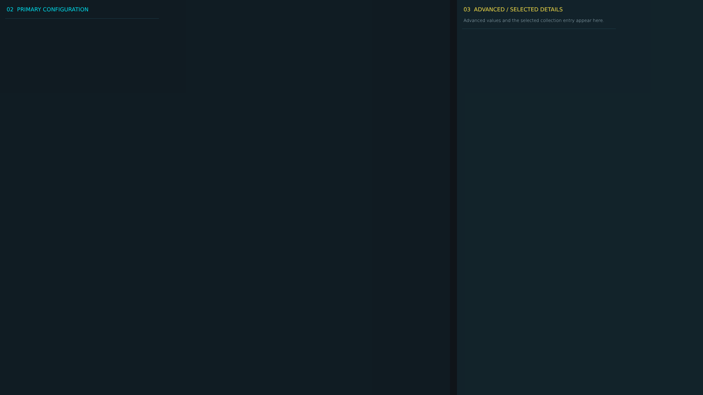


# ag_config_page_3.layout — Legacy config page 3

**Mod:** Advanced Groups  
**File:** `AdvancedGroups/gui/layouts/admin/config_pages/ag_config_page_3.layout`  
**Root:** `FrameWidget` `ConfigCategoryPage`, size 1 × 1  
**Widgets:** 40

Page of the legacy AG config editor (fallback only).

## Preview

Wireframe drawn straight from the layout file: positions, sizes, colours and default text are exact. Image widgets appear as dashed placeholders, and anything hidden at start inside the root is left out.

## Loaded by

- `AdvancedGroups/scripts/5_Mission/AdvancedGroups/GUI/AGConfigEditorMenu.c` line 302

## Widget tree

Positions and sizes are in pixels when the widget uses exact sizing, otherwise they are fractions of the parent (0–1).

| Widget | Type | Position | Size | Text / notes |
|---|---|---|---|---|
| `ConfigCategoryPage` | FrameWidget | 0 0 | 1 × 1 |  |
| &nbsp;&nbsp;└ `PrimaryColumn` | PanelWidget | 0 0 | 0.64 × 1 |  |
| &nbsp;&nbsp;&nbsp;&nbsp;└ `PrimaryColumnTitle` | TextWidget | 18 12 | 0.92 × 28 | "02  PRIMARY CONFIGURATION" |
| &nbsp;&nbsp;&nbsp;&nbsp;└ `PrimaryScroll` | ScrollWidget | 14 50 | 0.96 × 0.93 |  |
| &nbsp;&nbsp;&nbsp;&nbsp;&nbsp;&nbsp;└ `ActiveCategoryPanel` | WrapSpacerWidget | 0 0 | 1 × 0 |  |
| &nbsp;&nbsp;&nbsp;&nbsp;&nbsp;&nbsp;&nbsp;&nbsp;└ `Field_AG_Default3DDistanceToggle` | PanelWidget |  | 420 × 82 | style DayZDefaultPanel |
| &nbsp;&nbsp;&nbsp;&nbsp;&nbsp;&nbsp;&nbsp;&nbsp;&nbsp;&nbsp;└ `Label_AG_Default3DDistanceToggle` | TextWidget | 10 7 | 400 × 22 | "DEFAULT3 DDISTANCE" |
| &nbsp;&nbsp;&nbsp;&nbsp;&nbsp;&nbsp;&nbsp;&nbsp;&nbsp;&nbsp;└ `AG_Default3DDistanceToggle` | CheckBoxWidget | 16 36 | 32 × 32 |  |
| &nbsp;&nbsp;&nbsp;&nbsp;&nbsp;&nbsp;&nbsp;&nbsp;└ `Field_AG_Default3DIconToggle` | PanelWidget |  | 420 × 82 | style DayZDefaultPanel |
| &nbsp;&nbsp;&nbsp;&nbsp;&nbsp;&nbsp;&nbsp;&nbsp;&nbsp;&nbsp;└ `Label_AG_Default3DIconToggle` | TextWidget | 10 7 | 400 × 22 | "DEFAULT3 DICON" |
| &nbsp;&nbsp;&nbsp;&nbsp;&nbsp;&nbsp;&nbsp;&nbsp;&nbsp;&nbsp;└ `AG_Default3DIconToggle` | CheckBoxWidget | 16 36 | 32 × 32 |  |
| &nbsp;&nbsp;&nbsp;&nbsp;&nbsp;&nbsp;&nbsp;&nbsp;└ `Field_AG_DefaultCompassToggle` | PanelWidget |  | 420 × 82 | style DayZDefaultPanel |
| &nbsp;&nbsp;&nbsp;&nbsp;&nbsp;&nbsp;&nbsp;&nbsp;&nbsp;&nbsp;└ `Label_AG_DefaultCompassToggle` | TextWidget | 10 7 | 400 × 22 | "DEFAULT COMPASS" |
| &nbsp;&nbsp;&nbsp;&nbsp;&nbsp;&nbsp;&nbsp;&nbsp;&nbsp;&nbsp;└ `AG_DefaultCompassToggle` | CheckBoxWidget | 16 36 | 32 × 32 |  |
| &nbsp;&nbsp;&nbsp;&nbsp;&nbsp;&nbsp;&nbsp;&nbsp;└ `Field_AG_PlayerGroupTagModeSelect` | PanelWidget |  | 420 × 82 | style DayZDefaultPanel |
| &nbsp;&nbsp;&nbsp;&nbsp;&nbsp;&nbsp;&nbsp;&nbsp;&nbsp;&nbsp;└ `Label_AG_PlayerGroupTagModeSelect` | TextWidget | 10 7 | 400 × 22 | "PLAYER GROUP TAG MODE" |
| &nbsp;&nbsp;&nbsp;&nbsp;&nbsp;&nbsp;&nbsp;&nbsp;&nbsp;&nbsp;└ `AG_PlayerGroupTagModeSelect` | EditBoxWidget | 10 34 | 400 × 38 | style EditBox |
| &nbsp;&nbsp;&nbsp;&nbsp;&nbsp;&nbsp;&nbsp;&nbsp;└ `Field_AG_PlayerNameTagModeSelect` | PanelWidget |  | 420 × 82 | style DayZDefaultPanel |
| &nbsp;&nbsp;&nbsp;&nbsp;&nbsp;&nbsp;&nbsp;&nbsp;&nbsp;&nbsp;└ `Label_AG_PlayerNameTagModeSelect` | TextWidget | 10 7 | 400 × 22 | "PLAYER NAME TAG MODE" |
| &nbsp;&nbsp;&nbsp;&nbsp;&nbsp;&nbsp;&nbsp;&nbsp;&nbsp;&nbsp;└ `AG_PlayerNameTagModeSelect` | EditBoxWidget | 10 34 | 400 × 38 | style EditBox |
| &nbsp;&nbsp;└ `AdvancedColumn` | PanelWidget | 0.65 0 | 0.35 × 1 |  |
| &nbsp;&nbsp;&nbsp;&nbsp;└ `AdvancedColumnTitle` | TextWidget | 18 12 | 0.88 × 28 | "03  ADVANCED / SELECTED DETAILS" |
| &nbsp;&nbsp;&nbsp;&nbsp;└ `AdvancedColumnHint` | TextWidget | 18 38 | 0.88 × 38 | "Advanced values and the selected collection entry appear here." |
| &nbsp;&nbsp;&nbsp;&nbsp;└ `AdvancedScroll` | ScrollWidget | 14 78 | 0.94 × 0.89 |  |
| &nbsp;&nbsp;&nbsp;&nbsp;&nbsp;&nbsp;└ `AdvancedCategoryPanel` | WrapSpacerWidget | 0 0 | 1 × 0 |  |
| &nbsp;&nbsp;&nbsp;&nbsp;&nbsp;&nbsp;&nbsp;&nbsp;└ `Field_AG_Default3DNameToggle` | PanelWidget |  | 420 × 82 | style DayZDefaultPanel |
| &nbsp;&nbsp;&nbsp;&nbsp;&nbsp;&nbsp;&nbsp;&nbsp;&nbsp;&nbsp;└ `Label_AG_Default3DNameToggle` | TextWidget | 10 7 | 400 × 22 | "DEFAULT3 DNAME" |
| &nbsp;&nbsp;&nbsp;&nbsp;&nbsp;&nbsp;&nbsp;&nbsp;&nbsp;&nbsp;└ `AG_Default3DNameToggle` | CheckBoxWidget | 16 36 | 32 × 32 |  |
| &nbsp;&nbsp;&nbsp;&nbsp;&nbsp;&nbsp;&nbsp;&nbsp;└ `Field_AG_DefaultCompassColorInput` | PanelWidget |  | 420 × 82 | style DayZDefaultPanel |
| &nbsp;&nbsp;&nbsp;&nbsp;&nbsp;&nbsp;&nbsp;&nbsp;&nbsp;&nbsp;└ `Label_AG_DefaultCompassColorInput` | TextWidget | 10 7 | 400 × 22 | "DEFAULT COMPASS COLOR" |
| &nbsp;&nbsp;&nbsp;&nbsp;&nbsp;&nbsp;&nbsp;&nbsp;&nbsp;&nbsp;└ `AG_DefaultCompassColorInput` | EditBoxWidget | 10 34 | 400 × 38 | style EditBox |
| &nbsp;&nbsp;&nbsp;&nbsp;&nbsp;&nbsp;&nbsp;&nbsp;└ `Field_AG_DefaultPlayerListColorInput` | PanelWidget |  | 420 × 82 | style DayZDefaultPanel |
| &nbsp;&nbsp;&nbsp;&nbsp;&nbsp;&nbsp;&nbsp;&nbsp;&nbsp;&nbsp;└ `Label_AG_DefaultPlayerListColorInput` | TextWidget | 10 7 | 400 × 22 | "DEFAULT PLAYER LIST COLOR" |
| &nbsp;&nbsp;&nbsp;&nbsp;&nbsp;&nbsp;&nbsp;&nbsp;&nbsp;&nbsp;└ `AG_DefaultPlayerListColorInput` | EditBoxWidget | 10 34 | 400 × 38 | style EditBox |
| &nbsp;&nbsp;&nbsp;&nbsp;&nbsp;&nbsp;&nbsp;&nbsp;└ `Field_AG_DefaultPlayerListToggle` | PanelWidget |  | 420 × 82 | style DayZDefaultPanel |
| &nbsp;&nbsp;&nbsp;&nbsp;&nbsp;&nbsp;&nbsp;&nbsp;&nbsp;&nbsp;└ `Label_AG_DefaultPlayerListToggle` | TextWidget | 10 7 | 400 × 22 | "DEFAULT PLAYER LIST" |
| &nbsp;&nbsp;&nbsp;&nbsp;&nbsp;&nbsp;&nbsp;&nbsp;&nbsp;&nbsp;└ `AG_DefaultPlayerListToggle` | CheckBoxWidget | 16 36 | 32 × 32 |  |
| &nbsp;&nbsp;&nbsp;&nbsp;&nbsp;&nbsp;&nbsp;&nbsp;└ `Field_AG_PlayerNameIconModeSelect` | PanelWidget |  | 420 × 82 | style DayZDefaultPanel |
| &nbsp;&nbsp;&nbsp;&nbsp;&nbsp;&nbsp;&nbsp;&nbsp;&nbsp;&nbsp;└ `Label_AG_PlayerNameIconModeSelect` | TextWidget | 10 7 | 400 × 22 | "PLAYER NAME ICON MODE" |
| &nbsp;&nbsp;&nbsp;&nbsp;&nbsp;&nbsp;&nbsp;&nbsp;&nbsp;&nbsp;└ `AG_PlayerNameIconModeSelect` | EditBoxWidget | 10 34 | 400 × 38 | style EditBox |


