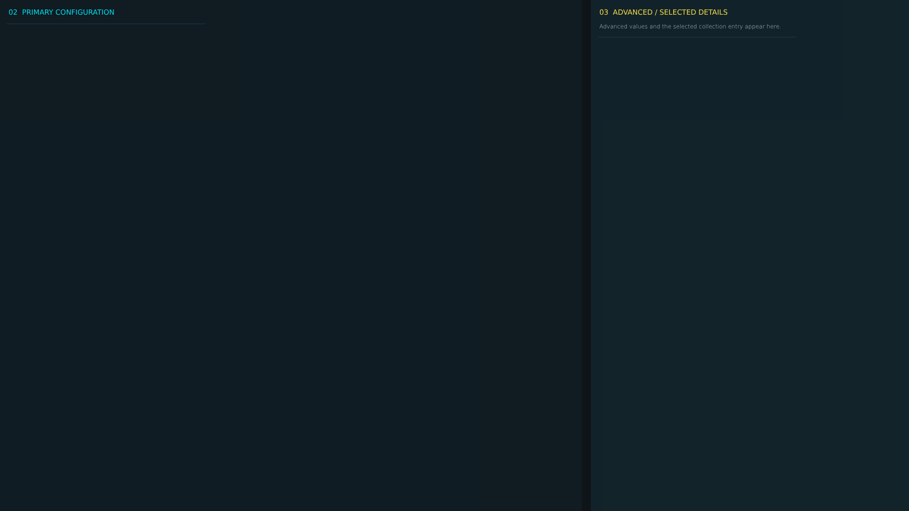


# ag_config_page_4.layout — Legacy config page 4

**Mod:** Advanced Groups  
**File:** `AdvancedGroups/gui/layouts/admin/config_pages/ag_config_page_4.layout`  
**Root:** `FrameWidget` `ConfigCategoryPage`, size 1 × 1  
**Widgets:** 181

Page of the legacy AG config editor (fallback only).

## Preview

Wireframe drawn straight from the layout file: positions, sizes, colours and default text are exact. Image widgets appear as dashed placeholders, and anything hidden at start inside the root is left out.

## Loaded by

- `AdvancedGroups/scripts/5_Mission/AdvancedGroups/GUI/AGConfigEditorMenu.c` line 302

## Widget tree

Positions and sizes are in pixels when the widget uses exact sizing, otherwise they are fractions of the parent (0–1).

| Widget | Type | Position | Size | Text / notes |
|---|---|---|---|---|
| `ConfigCategoryPage` | FrameWidget | 0 0 | 1 × 1 |  |
| &nbsp;&nbsp;└ `PrimaryColumn` | PanelWidget | 0 0 | 0.64 × 1 |  |
| &nbsp;&nbsp;&nbsp;&nbsp;└ `PrimaryColumnTitle` | TextWidget | 18 12 | 0.92 × 28 | "02  PRIMARY CONFIGURATION" |
| &nbsp;&nbsp;&nbsp;&nbsp;└ `PrimaryScroll` | ScrollWidget | 14 50 | 0.96 × 0.93 |  |
| &nbsp;&nbsp;&nbsp;&nbsp;&nbsp;&nbsp;└ `ActiveCategoryPanel` | WrapSpacerWidget | 0 0 | 1 × 0 |  |
| &nbsp;&nbsp;&nbsp;&nbsp;&nbsp;&nbsp;&nbsp;&nbsp;└ `Field_AG_CategoryMaxMarkersInput` | PanelWidget |  | 420 × 82 | style DayZDefaultPanel |
| &nbsp;&nbsp;&nbsp;&nbsp;&nbsp;&nbsp;&nbsp;&nbsp;&nbsp;&nbsp;└ `Label_AG_CategoryMaxMarkersInput` | TextWidget | 10 7 | 400 × 22 | "CATEGORY MAX MARKERS" |
| &nbsp;&nbsp;&nbsp;&nbsp;&nbsp;&nbsp;&nbsp;&nbsp;&nbsp;&nbsp;└ `AG_CategoryMaxMarkersInput` | EditBoxWidget | 10 34 | 400 × 38 | style EditBox |
| &nbsp;&nbsp;&nbsp;&nbsp;&nbsp;&nbsp;&nbsp;&nbsp;└ `Field_AG_DeathMarkerPrivateToggle` | PanelWidget |  | 420 × 82 | style DayZDefaultPanel |
| &nbsp;&nbsp;&nbsp;&nbsp;&nbsp;&nbsp;&nbsp;&nbsp;&nbsp;&nbsp;└ `Label_AG_DeathMarkerPrivateToggle` | TextWidget | 10 7 | 400 × 22 | "DEATH MARKER PRIVATE" |
| &nbsp;&nbsp;&nbsp;&nbsp;&nbsp;&nbsp;&nbsp;&nbsp;&nbsp;&nbsp;└ `AG_DeathMarkerPrivateToggle` | CheckBoxWidget | 16 36 | 32 × 32 |  |
| &nbsp;&nbsp;&nbsp;&nbsp;&nbsp;&nbsp;&nbsp;&nbsp;└ `Field_AG_MarkerTypeMax3DInput` | PanelWidget |  | 420 × 82 | style DayZDefaultPanel |
| &nbsp;&nbsp;&nbsp;&nbsp;&nbsp;&nbsp;&nbsp;&nbsp;&nbsp;&nbsp;└ `Label_AG_MarkerTypeMax3DInput` | TextWidget | 10 7 | 400 × 22 | "MARKER TYPE MAX3 D" |
| &nbsp;&nbsp;&nbsp;&nbsp;&nbsp;&nbsp;&nbsp;&nbsp;&nbsp;&nbsp;└ `AG_MarkerTypeMax3DInput` | EditBoxWidget | 10 34 | 400 × 38 | style EditBox |
| &nbsp;&nbsp;&nbsp;&nbsp;&nbsp;&nbsp;&nbsp;&nbsp;└ `Field_AG_MarkerTypeScaleInput` | PanelWidget |  | 420 × 82 | style DayZDefaultPanel |
| &nbsp;&nbsp;&nbsp;&nbsp;&nbsp;&nbsp;&nbsp;&nbsp;&nbsp;&nbsp;└ `Label_AG_MarkerTypeScaleInput` | TextWidget | 10 7 | 400 × 22 | "MARKER TYPE SCALE" |
| &nbsp;&nbsp;&nbsp;&nbsp;&nbsp;&nbsp;&nbsp;&nbsp;&nbsp;&nbsp;└ `AG_MarkerTypeScaleInput` | EditBoxWidget | 10 34 | 400 × 38 | style EditBox |
| &nbsp;&nbsp;&nbsp;&nbsp;&nbsp;&nbsp;&nbsp;&nbsp;└ `Field_AG_MarkerTypeSelect` | PanelWidget |  | 420 × 82 | style DayZDefaultPanel |
| &nbsp;&nbsp;&nbsp;&nbsp;&nbsp;&nbsp;&nbsp;&nbsp;&nbsp;&nbsp;└ `Label_AG_MarkerTypeSelect` | TextWidget | 10 7 | 400 × 22 | "MARKER TYPE" |
| &nbsp;&nbsp;&nbsp;&nbsp;&nbsp;&nbsp;&nbsp;&nbsp;&nbsp;&nbsp;└ `AG_MarkerTypeSelect` | EditBoxWidget | 10 34 | 400 × 38 | style EditBox |
| &nbsp;&nbsp;&nbsp;&nbsp;&nbsp;&nbsp;&nbsp;&nbsp;└ `Field_AG_MarkerTypeShowMapToggle` | PanelWidget |  | 420 × 82 | style DayZDefaultPanel |
| &nbsp;&nbsp;&nbsp;&nbsp;&nbsp;&nbsp;&nbsp;&nbsp;&nbsp;&nbsp;└ `Label_AG_MarkerTypeShowMapToggle` | TextWidget | 10 7 | 400 × 22 | "MARKER TYPE SHOW MAP" |
| &nbsp;&nbsp;&nbsp;&nbsp;&nbsp;&nbsp;&nbsp;&nbsp;&nbsp;&nbsp;└ `AG_MarkerTypeShowMapToggle` | CheckBoxWidget | 16 36 | 32 × 32 |  |
| &nbsp;&nbsp;&nbsp;&nbsp;&nbsp;&nbsp;&nbsp;&nbsp;└ `Field_AG_MarkerTypeShowMinimapToggle` | PanelWidget |  | 420 × 82 | style DayZDefaultPanel |
| &nbsp;&nbsp;&nbsp;&nbsp;&nbsp;&nbsp;&nbsp;&nbsp;&nbsp;&nbsp;└ `Label_AG_MarkerTypeShowMinimapToggle` | TextWidget | 10 7 | 400 × 22 | "MARKER TYPE SHOW MINIMAP" |
| &nbsp;&nbsp;&nbsp;&nbsp;&nbsp;&nbsp;&nbsp;&nbsp;&nbsp;&nbsp;└ `AG_MarkerTypeShowMinimapToggle` | CheckBoxWidget | 16 36 | 32 × 32 |  |
| &nbsp;&nbsp;&nbsp;&nbsp;&nbsp;&nbsp;&nbsp;&nbsp;└ `Field_AG_MarkerTypeVisibilityVersionValue` | PanelWidget |  | 420 × 82 | style DayZDefaultPanel |
| &nbsp;&nbsp;&nbsp;&nbsp;&nbsp;&nbsp;&nbsp;&nbsp;&nbsp;&nbsp;└ `Label_AG_MarkerTypeVisibilityVersionValue` | TextWidget | 10 7 | 400 × 22 | "MARKER TYPE VISIBILITY VERSION" |
| &nbsp;&nbsp;&nbsp;&nbsp;&nbsp;&nbsp;&nbsp;&nbsp;&nbsp;&nbsp;└ `AG_MarkerTypeVisibilityVersionValue` | TextWidget | 12 38 | 394 × 30 | "READ ONLY" |
| &nbsp;&nbsp;&nbsp;&nbsp;&nbsp;&nbsp;&nbsp;&nbsp;└ `Field_AG_MaxMarkersInput` | PanelWidget |  | 420 × 82 | style DayZDefaultPanel |
| &nbsp;&nbsp;&nbsp;&nbsp;&nbsp;&nbsp;&nbsp;&nbsp;&nbsp;&nbsp;└ `Label_AG_MaxMarkersInput` | TextWidget | 10 7 | 400 × 22 | "MAX MARKERS" |
| &nbsp;&nbsp;&nbsp;&nbsp;&nbsp;&nbsp;&nbsp;&nbsp;&nbsp;&nbsp;└ `AG_MaxMarkersInput` | EditBoxWidget | 10 34 | 400 × 38 | style EditBox |
| &nbsp;&nbsp;&nbsp;&nbsp;&nbsp;&nbsp;&nbsp;&nbsp;└ `Field_AG_SafeZoneNameInput` | PanelWidget |  | 420 × 82 | style DayZDefaultPanel |
| &nbsp;&nbsp;&nbsp;&nbsp;&nbsp;&nbsp;&nbsp;&nbsp;&nbsp;&nbsp;└ `Label_AG_SafeZoneNameInput` | TextWidget | 10 7 | 400 × 22 | "SAFE ZONE NAME" |
| &nbsp;&nbsp;&nbsp;&nbsp;&nbsp;&nbsp;&nbsp;&nbsp;&nbsp;&nbsp;└ `AG_SafeZoneNameInput` | EditBoxWidget | 10 34 | 400 × 38 | style EditBox |
| &nbsp;&nbsp;&nbsp;&nbsp;&nbsp;&nbsp;&nbsp;&nbsp;└ `Field_AG_SafeZoneRadiusInput` | PanelWidget |  | 420 × 82 | style DayZDefaultPanel |
| &nbsp;&nbsp;&nbsp;&nbsp;&nbsp;&nbsp;&nbsp;&nbsp;&nbsp;&nbsp;└ `Label_AG_SafeZoneRadiusInput` | TextWidget | 10 7 | 400 × 22 | "SAFE ZONE RADIUS" |
| &nbsp;&nbsp;&nbsp;&nbsp;&nbsp;&nbsp;&nbsp;&nbsp;&nbsp;&nbsp;└ `AG_SafeZoneRadiusInput` | EditBoxWidget | 10 34 | 400 × 38 | style EditBox |
| &nbsp;&nbsp;&nbsp;&nbsp;&nbsp;&nbsp;&nbsp;&nbsp;└ `Field_AG_SafeZoneZInput` | PanelWidget |  | 420 × 82 | style DayZDefaultPanel |
| &nbsp;&nbsp;&nbsp;&nbsp;&nbsp;&nbsp;&nbsp;&nbsp;&nbsp;&nbsp;└ `Label_AG_SafeZoneZInput` | TextWidget | 10 7 | 400 × 22 | "SAFE ZONE Z" |
| &nbsp;&nbsp;&nbsp;&nbsp;&nbsp;&nbsp;&nbsp;&nbsp;&nbsp;&nbsp;└ `AG_SafeZoneZInput` | EditBoxWidget | 10 34 | 400 × 38 | style EditBox |
| &nbsp;&nbsp;&nbsp;&nbsp;&nbsp;&nbsp;&nbsp;&nbsp;└ `Field_AG_ServerMarkerDisplayModeSelect` | PanelWidget |  | 420 × 82 | style DayZDefaultPanel |
| &nbsp;&nbsp;&nbsp;&nbsp;&nbsp;&nbsp;&nbsp;&nbsp;&nbsp;&nbsp;└ `Label_AG_ServerMarkerDisplayModeSelect` | TextWidget | 10 7 | 400 × 22 | "SERVER MARKER DISPLAY MODE" |
| &nbsp;&nbsp;&nbsp;&nbsp;&nbsp;&nbsp;&nbsp;&nbsp;&nbsp;&nbsp;└ `AG_ServerMarkerDisplayModeSelect` | EditBoxWidget | 10 34 | 400 × 38 | style EditBox |
| &nbsp;&nbsp;&nbsp;&nbsp;&nbsp;&nbsp;&nbsp;&nbsp;└ `Field_AG_ServerMarkerIdValue` | PanelWidget |  | 420 × 82 | style DayZDefaultPanel |
| &nbsp;&nbsp;&nbsp;&nbsp;&nbsp;&nbsp;&nbsp;&nbsp;&nbsp;&nbsp;└ `Label_AG_ServerMarkerIdValue` | TextWidget | 10 7 | 400 × 22 | "SERVER MARKER ID" |
| &nbsp;&nbsp;&nbsp;&nbsp;&nbsp;&nbsp;&nbsp;&nbsp;&nbsp;&nbsp;└ `AG_ServerMarkerIdValue` | TextWidget | 12 38 | 394 × 30 | "READ ONLY" |
| &nbsp;&nbsp;&nbsp;&nbsp;&nbsp;&nbsp;&nbsp;&nbsp;└ `Field_AG_ServerMarkerLabelInput` | PanelWidget |  | 420 × 82 | style DayZDefaultPanel |
| &nbsp;&nbsp;&nbsp;&nbsp;&nbsp;&nbsp;&nbsp;&nbsp;&nbsp;&nbsp;└ `Label_AG_ServerMarkerLabelInput` | TextWidget | 10 7 | 400 × 22 | "SERVER MARKER LABEL" |
| &nbsp;&nbsp;&nbsp;&nbsp;&nbsp;&nbsp;&nbsp;&nbsp;&nbsp;&nbsp;└ `AG_ServerMarkerLabelInput` | EditBoxWidget | 10 34 | 400 × 38 | style EditBox |
| &nbsp;&nbsp;&nbsp;&nbsp;&nbsp;&nbsp;&nbsp;&nbsp;└ `Field_AG_ServerMarkerRadiusInput` | PanelWidget |  | 420 × 82 | style DayZDefaultPanel |
| &nbsp;&nbsp;&nbsp;&nbsp;&nbsp;&nbsp;&nbsp;&nbsp;&nbsp;&nbsp;└ `Label_AG_ServerMarkerRadiusInput` | TextWidget | 10 7 | 400 × 22 | "SERVER MARKER RADIUS" |
| &nbsp;&nbsp;&nbsp;&nbsp;&nbsp;&nbsp;&nbsp;&nbsp;&nbsp;&nbsp;└ `AG_ServerMarkerRadiusInput` | EditBoxWidget | 10 34 | 400 × 38 | style EditBox |
| &nbsp;&nbsp;&nbsp;&nbsp;&nbsp;&nbsp;&nbsp;&nbsp;└ `Field_AG_ServerMarkerTypeSelect` | PanelWidget |  | 420 × 82 | style DayZDefaultPanel |
| &nbsp;&nbsp;&nbsp;&nbsp;&nbsp;&nbsp;&nbsp;&nbsp;&nbsp;&nbsp;└ `Label_AG_ServerMarkerTypeSelect` | TextWidget | 10 7 | 400 × 22 | "SERVER MARKER TYPE" |
| &nbsp;&nbsp;&nbsp;&nbsp;&nbsp;&nbsp;&nbsp;&nbsp;&nbsp;&nbsp;└ `AG_ServerMarkerTypeSelect` | EditBoxWidget | 10 34 | 400 × 38 | style EditBox |
| &nbsp;&nbsp;&nbsp;&nbsp;&nbsp;&nbsp;&nbsp;&nbsp;└ `Field_AG_ServerMarkerXInput` | PanelWidget |  | 420 × 82 | style DayZDefaultPanel |
| &nbsp;&nbsp;&nbsp;&nbsp;&nbsp;&nbsp;&nbsp;&nbsp;&nbsp;&nbsp;└ `Label_AG_ServerMarkerXInput` | TextWidget | 10 7 | 400 × 22 | "SERVER MARKER X" |
| &nbsp;&nbsp;&nbsp;&nbsp;&nbsp;&nbsp;&nbsp;&nbsp;&nbsp;&nbsp;└ `AG_ServerMarkerXInput` | EditBoxWidget | 10 34 | 400 × 38 | style EditBox |
| &nbsp;&nbsp;&nbsp;&nbsp;&nbsp;&nbsp;&nbsp;&nbsp;└ `Field_AG_ServerMarkerZInput` | PanelWidget |  | 420 × 82 | style DayZDefaultPanel |
| &nbsp;&nbsp;&nbsp;&nbsp;&nbsp;&nbsp;&nbsp;&nbsp;&nbsp;&nbsp;└ `Label_AG_ServerMarkerZInput` | TextWidget | 10 7 | 400 × 22 | "SERVER MARKER Z" |
| &nbsp;&nbsp;&nbsp;&nbsp;&nbsp;&nbsp;&nbsp;&nbsp;&nbsp;&nbsp;└ `AG_ServerMarkerZInput` | EditBoxWidget | 10 34 | 400 × 38 | style EditBox |
| &nbsp;&nbsp;&nbsp;&nbsp;&nbsp;&nbsp;&nbsp;&nbsp;└ `Field_AG_ZoneCenterXInput` | PanelWidget |  | 420 × 82 | style DayZDefaultPanel |
| &nbsp;&nbsp;&nbsp;&nbsp;&nbsp;&nbsp;&nbsp;&nbsp;&nbsp;&nbsp;└ `Label_AG_ZoneCenterXInput` | TextWidget | 10 7 | 400 × 22 | "ZONE CENTER X" |
| &nbsp;&nbsp;&nbsp;&nbsp;&nbsp;&nbsp;&nbsp;&nbsp;&nbsp;&nbsp;└ `AG_ZoneCenterXInput` | EditBoxWidget | 10 34 | 400 × 38 | style EditBox |
| &nbsp;&nbsp;&nbsp;&nbsp;&nbsp;&nbsp;&nbsp;&nbsp;└ `Field_AG_ZoneCenterZInput` | PanelWidget |  | 420 × 82 | style DayZDefaultPanel |
| &nbsp;&nbsp;&nbsp;&nbsp;&nbsp;&nbsp;&nbsp;&nbsp;&nbsp;&nbsp;└ `Label_AG_ZoneCenterZInput` | TextWidget | 10 7 | 400 × 22 | "ZONE CENTER Z" |
| &nbsp;&nbsp;&nbsp;&nbsp;&nbsp;&nbsp;&nbsp;&nbsp;&nbsp;&nbsp;└ `AG_ZoneCenterZInput` | EditBoxWidget | 10 34 | 400 × 38 | style EditBox |
| &nbsp;&nbsp;&nbsp;&nbsp;&nbsp;&nbsp;&nbsp;&nbsp;└ `Field_AG_ZoneFriendlyFireSelect` | PanelWidget |  | 420 × 82 | style DayZDefaultPanel |
| &nbsp;&nbsp;&nbsp;&nbsp;&nbsp;&nbsp;&nbsp;&nbsp;&nbsp;&nbsp;└ `Label_AG_ZoneFriendlyFireSelect` | TextWidget | 10 7 | 400 × 22 | "ZONE FRIENDLY FIRE" |
| &nbsp;&nbsp;&nbsp;&nbsp;&nbsp;&nbsp;&nbsp;&nbsp;&nbsp;&nbsp;└ `AG_ZoneFriendlyFireSelect` | EditBoxWidget | 10 34 | 400 × 38 | style EditBox |
| &nbsp;&nbsp;&nbsp;&nbsp;&nbsp;&nbsp;&nbsp;&nbsp;└ `Field_AG_ZoneIdValue` | PanelWidget |  | 420 × 82 | style DayZDefaultPanel |
| &nbsp;&nbsp;&nbsp;&nbsp;&nbsp;&nbsp;&nbsp;&nbsp;&nbsp;&nbsp;└ `Label_AG_ZoneIdValue` | TextWidget | 10 7 | 400 × 22 | "ZONE ID" |
| &nbsp;&nbsp;&nbsp;&nbsp;&nbsp;&nbsp;&nbsp;&nbsp;&nbsp;&nbsp;└ `AG_ZoneIdValue` | TextWidget | 12 38 | 394 × 30 | "READ ONLY" |
| &nbsp;&nbsp;&nbsp;&nbsp;&nbsp;&nbsp;&nbsp;&nbsp;└ `Field_AG_ZoneNameInput` | PanelWidget |  | 420 × 82 | style DayZDefaultPanel |
| &nbsp;&nbsp;&nbsp;&nbsp;&nbsp;&nbsp;&nbsp;&nbsp;&nbsp;&nbsp;└ `Label_AG_ZoneNameInput` | TextWidget | 10 7 | 400 × 22 | "ZONE NAME" |
| &nbsp;&nbsp;&nbsp;&nbsp;&nbsp;&nbsp;&nbsp;&nbsp;&nbsp;&nbsp;└ `AG_ZoneNameInput` | EditBoxWidget | 10 34 | 400 × 38 | style EditBox |
| &nbsp;&nbsp;&nbsp;&nbsp;&nbsp;&nbsp;&nbsp;&nbsp;└ `Field_AG_ZoneRadiusInput` | PanelWidget |  | 420 × 82 | style DayZDefaultPanel |
| &nbsp;&nbsp;&nbsp;&nbsp;&nbsp;&nbsp;&nbsp;&nbsp;&nbsp;&nbsp;└ `Label_AG_ZoneRadiusInput` | TextWidget | 10 7 | 400 × 22 | "ZONE RADIUS" |
| &nbsp;&nbsp;&nbsp;&nbsp;&nbsp;&nbsp;&nbsp;&nbsp;&nbsp;&nbsp;└ `AG_ZoneRadiusInput` | EditBoxWidget | 10 34 | 400 × 38 | style EditBox |
| &nbsp;&nbsp;&nbsp;&nbsp;&nbsp;&nbsp;&nbsp;&nbsp;└ `Field_AG_ZoneShapeSelect` | PanelWidget |  | 420 × 82 | style DayZDefaultPanel |
| &nbsp;&nbsp;&nbsp;&nbsp;&nbsp;&nbsp;&nbsp;&nbsp;&nbsp;&nbsp;└ `Label_AG_ZoneShapeSelect` | TextWidget | 10 7 | 400 × 22 | "ZONE SHAPE" |
| &nbsp;&nbsp;&nbsp;&nbsp;&nbsp;&nbsp;&nbsp;&nbsp;&nbsp;&nbsp;└ `AG_ZoneShapeSelect` | EditBoxWidget | 10 34 | 400 × 38 | style EditBox |
| &nbsp;&nbsp;&nbsp;&nbsp;&nbsp;&nbsp;&nbsp;&nbsp;└ `Field_AG_ZoneTypeSelect` | PanelWidget |  | 420 × 82 | style DayZDefaultPanel |
| &nbsp;&nbsp;&nbsp;&nbsp;&nbsp;&nbsp;&nbsp;&nbsp;&nbsp;&nbsp;└ `Label_AG_ZoneTypeSelect` | TextWidget | 10 7 | 400 × 22 | "ZONE TYPE" |
| &nbsp;&nbsp;&nbsp;&nbsp;&nbsp;&nbsp;&nbsp;&nbsp;&nbsp;&nbsp;└ `AG_ZoneTypeSelect` | EditBoxWidget | 10 34 | 400 × 38 | style EditBox |
| &nbsp;&nbsp;└ `AdvancedColumn` | PanelWidget | 0.65 0 | 0.35 × 1 |  |
| &nbsp;&nbsp;&nbsp;&nbsp;└ `AdvancedColumnTitle` | TextWidget | 18 12 | 0.88 × 28 | "03  ADVANCED / SELECTED DETAILS" |
| &nbsp;&nbsp;&nbsp;&nbsp;└ `AdvancedColumnHint` | TextWidget | 18 38 | 0.88 × 38 | "Advanced values and the selected collection entry appear here." |
| &nbsp;&nbsp;&nbsp;&nbsp;└ `AdvancedScroll` | ScrollWidget | 14 78 | 0.94 × 0.89 |  |
| &nbsp;&nbsp;&nbsp;&nbsp;&nbsp;&nbsp;└ `AdvancedCategoryPanel` | WrapSpacerWidget | 0 0 | 1 × 0 |  |
| &nbsp;&nbsp;&nbsp;&nbsp;&nbsp;&nbsp;&nbsp;&nbsp;└ `Field_AG_Default3DMarkersToggle` | PanelWidget |  | 420 × 82 | style DayZDefaultPanel |
| &nbsp;&nbsp;&nbsp;&nbsp;&nbsp;&nbsp;&nbsp;&nbsp;&nbsp;&nbsp;└ `Label_AG_Default3DMarkersToggle` | TextWidget | 10 7 | 400 × 22 | "DEFAULT3 DMARKERS" |
| &nbsp;&nbsp;&nbsp;&nbsp;&nbsp;&nbsp;&nbsp;&nbsp;&nbsp;&nbsp;└ `AG_Default3DMarkersToggle` | CheckBoxWidget | 16 36 | 32 × 32 |  |
| &nbsp;&nbsp;&nbsp;&nbsp;&nbsp;&nbsp;&nbsp;&nbsp;└ `Field_AG_DefaultPlayerMarkerColorInput` | PanelWidget |  | 420 × 82 | style DayZDefaultPanel |
| &nbsp;&nbsp;&nbsp;&nbsp;&nbsp;&nbsp;&nbsp;&nbsp;&nbsp;&nbsp;└ `Label_AG_DefaultPlayerMarkerColorInput` | TextWidget | 10 7 | 400 × 22 | "DEFAULT PLAYER MARKER COLOR" |
| &nbsp;&nbsp;&nbsp;&nbsp;&nbsp;&nbsp;&nbsp;&nbsp;&nbsp;&nbsp;└ `AG_DefaultPlayerMarkerColorInput` | EditBoxWidget | 10 34 | 400 × 38 | style EditBox |
| &nbsp;&nbsp;&nbsp;&nbsp;&nbsp;&nbsp;&nbsp;&nbsp;└ `Field_AG_MarkerTypeColorInput` | PanelWidget |  | 420 × 82 | style DayZDefaultPanel |
| &nbsp;&nbsp;&nbsp;&nbsp;&nbsp;&nbsp;&nbsp;&nbsp;&nbsp;&nbsp;└ `Label_AG_MarkerTypeColorInput` | TextWidget | 10 7 | 400 × 22 | "MARKER TYPE COLOR" |
| &nbsp;&nbsp;&nbsp;&nbsp;&nbsp;&nbsp;&nbsp;&nbsp;&nbsp;&nbsp;└ `AG_MarkerTypeColorInput` | EditBoxWidget | 10 34 | 400 × 38 | style EditBox |
| &nbsp;&nbsp;&nbsp;&nbsp;&nbsp;&nbsp;&nbsp;&nbsp;└ `Field_AG_MarkerTypeInspector` | PanelWidget |  | 420 × 140 | style DayZDefaultPanel |
| &nbsp;&nbsp;&nbsp;&nbsp;&nbsp;&nbsp;&nbsp;&nbsp;&nbsp;&nbsp;└ `Label_AG_MarkerTypeInspector` | TextWidget | 10 7 | 400 × 22 | "MARKER TYPE" |
| &nbsp;&nbsp;&nbsp;&nbsp;&nbsp;&nbsp;&nbsp;&nbsp;&nbsp;&nbsp;└ `AG_MarkerTypeInspector` | PanelWidget | 10 34 | 400 × 96 | style DayZDefaultPanel |
| &nbsp;&nbsp;&nbsp;&nbsp;&nbsp;&nbsp;&nbsp;&nbsp;└ `Field_AG_MarkerTypeList` | PanelWidget |  | 420 × 140 | style DayZDefaultPanel |
| &nbsp;&nbsp;&nbsp;&nbsp;&nbsp;&nbsp;&nbsp;&nbsp;&nbsp;&nbsp;└ `Label_AG_MarkerTypeList` | TextWidget | 10 7 | 400 × 22 | "MARKER TYPE" |
| &nbsp;&nbsp;&nbsp;&nbsp;&nbsp;&nbsp;&nbsp;&nbsp;&nbsp;&nbsp;└ `AG_MarkerTypeList` | TextListboxWidget | 10 34 | 400 × 96 | style Default |
| &nbsp;&nbsp;&nbsp;&nbsp;&nbsp;&nbsp;&nbsp;&nbsp;└ `Field_AG_MarkerTypeNameInput` | PanelWidget |  | 420 × 82 | style DayZDefaultPanel |
| &nbsp;&nbsp;&nbsp;&nbsp;&nbsp;&nbsp;&nbsp;&nbsp;&nbsp;&nbsp;└ `Label_AG_MarkerTypeNameInput` | TextWidget | 10 7 | 400 × 22 | "MARKER TYPE NAME" |
| &nbsp;&nbsp;&nbsp;&nbsp;&nbsp;&nbsp;&nbsp;&nbsp;&nbsp;&nbsp;└ `AG_MarkerTypeNameInput` | EditBoxWidget | 10 34 | 400 × 38 | style EditBox |
| &nbsp;&nbsp;&nbsp;&nbsp;&nbsp;&nbsp;&nbsp;&nbsp;└ `Field_AG_MarkerTypeShow3DToggle` | PanelWidget |  | 420 × 82 | style DayZDefaultPanel |
| &nbsp;&nbsp;&nbsp;&nbsp;&nbsp;&nbsp;&nbsp;&nbsp;&nbsp;&nbsp;└ `Label_AG_MarkerTypeShow3DToggle` | TextWidget | 10 7 | 400 × 22 | "MARKER TYPE SHOW3 D" |
| &nbsp;&nbsp;&nbsp;&nbsp;&nbsp;&nbsp;&nbsp;&nbsp;&nbsp;&nbsp;└ `AG_MarkerTypeShow3DToggle` | CheckBoxWidget | 16 36 | 32 × 32 |  |
| &nbsp;&nbsp;&nbsp;&nbsp;&nbsp;&nbsp;&nbsp;&nbsp;└ `Field_AG_MarkerTypeShowRangeToggle` | PanelWidget |  | 420 × 82 | style DayZDefaultPanel |
| &nbsp;&nbsp;&nbsp;&nbsp;&nbsp;&nbsp;&nbsp;&nbsp;&nbsp;&nbsp;└ `Label_AG_MarkerTypeShowRangeToggle` | TextWidget | 10 7 | 400 × 22 | "MARKER TYPE SHOW RANGE" |
| &nbsp;&nbsp;&nbsp;&nbsp;&nbsp;&nbsp;&nbsp;&nbsp;&nbsp;&nbsp;└ `AG_MarkerTypeShowRangeToggle` | CheckBoxWidget | 16 36 | 32 × 32 |  |
| &nbsp;&nbsp;&nbsp;&nbsp;&nbsp;&nbsp;&nbsp;&nbsp;└ `Field_AG_NoBuildZoneInspector` | PanelWidget |  | 420 × 140 | style DayZDefaultPanel |
| &nbsp;&nbsp;&nbsp;&nbsp;&nbsp;&nbsp;&nbsp;&nbsp;&nbsp;&nbsp;└ `Label_AG_NoBuildZoneInspector` | TextWidget | 10 7 | 400 × 22 | "NO BUILD ZONE" |
| &nbsp;&nbsp;&nbsp;&nbsp;&nbsp;&nbsp;&nbsp;&nbsp;&nbsp;&nbsp;└ `AG_NoBuildZoneInspector` | PanelWidget | 10 34 | 400 × 96 | style DayZDefaultPanel |
| &nbsp;&nbsp;&nbsp;&nbsp;&nbsp;&nbsp;&nbsp;&nbsp;└ `Field_AG_NoBuildZoneList` | PanelWidget |  | 420 × 140 | style DayZDefaultPanel |
| &nbsp;&nbsp;&nbsp;&nbsp;&nbsp;&nbsp;&nbsp;&nbsp;&nbsp;&nbsp;└ `Label_AG_NoBuildZoneList` | TextWidget | 10 7 | 400 × 22 | "NO BUILD ZONE" |
| &nbsp;&nbsp;&nbsp;&nbsp;&nbsp;&nbsp;&nbsp;&nbsp;&nbsp;&nbsp;└ `AG_NoBuildZoneList` | TextListboxWidget | 10 34 | 400 × 96 | style Default |
| &nbsp;&nbsp;&nbsp;&nbsp;&nbsp;&nbsp;&nbsp;&nbsp;└ `Field_AG_SafeZoneInspector` | PanelWidget |  | 420 × 140 | style DayZDefaultPanel |
| &nbsp;&nbsp;&nbsp;&nbsp;&nbsp;&nbsp;&nbsp;&nbsp;&nbsp;&nbsp;└ `Label_AG_SafeZoneInspector` | TextWidget | 10 7 | 400 × 22 | "SAFE ZONE" |
| &nbsp;&nbsp;&nbsp;&nbsp;&nbsp;&nbsp;&nbsp;&nbsp;&nbsp;&nbsp;└ `AG_SafeZoneInspector` | PanelWidget | 10 34 | 400 × 96 | style DayZDefaultPanel |
| &nbsp;&nbsp;&nbsp;&nbsp;&nbsp;&nbsp;&nbsp;&nbsp;└ `Field_AG_SafeZoneList` | PanelWidget |  | 420 × 140 | style DayZDefaultPanel |
| &nbsp;&nbsp;&nbsp;&nbsp;&nbsp;&nbsp;&nbsp;&nbsp;&nbsp;&nbsp;└ `Label_AG_SafeZoneList` | TextWidget | 10 7 | 400 × 22 | "SAFE ZONE" |
| &nbsp;&nbsp;&nbsp;&nbsp;&nbsp;&nbsp;&nbsp;&nbsp;&nbsp;&nbsp;└ `AG_SafeZoneList` | TextListboxWidget | 10 34 | 400 × 96 | style Default |
| &nbsp;&nbsp;&nbsp;&nbsp;&nbsp;&nbsp;&nbsp;&nbsp;└ `Field_AG_SafeZoneXInput` | PanelWidget |  | 420 × 82 | style DayZDefaultPanel |
| &nbsp;&nbsp;&nbsp;&nbsp;&nbsp;&nbsp;&nbsp;&nbsp;&nbsp;&nbsp;└ `Label_AG_SafeZoneXInput` | TextWidget | 10 7 | 400 × 22 | "SAFE ZONE X" |
| &nbsp;&nbsp;&nbsp;&nbsp;&nbsp;&nbsp;&nbsp;&nbsp;&nbsp;&nbsp;└ `AG_SafeZoneXInput` | EditBoxWidget | 10 34 | 400 × 38 | style EditBox |
| &nbsp;&nbsp;&nbsp;&nbsp;&nbsp;&nbsp;&nbsp;&nbsp;└ `Field_AG_ServerMarkerCircleColorInput` | PanelWidget |  | 420 × 82 | style DayZDefaultPanel |
| &nbsp;&nbsp;&nbsp;&nbsp;&nbsp;&nbsp;&nbsp;&nbsp;&nbsp;&nbsp;└ `Label_AG_ServerMarkerCircleColorInput` | TextWidget | 10 7 | 400 × 22 | "SERVER MARKER CIRCLE COLOR" |
| &nbsp;&nbsp;&nbsp;&nbsp;&nbsp;&nbsp;&nbsp;&nbsp;&nbsp;&nbsp;└ `AG_ServerMarkerCircleColorInput` | EditBoxWidget | 10 34 | 400 × 38 | style EditBox |
| &nbsp;&nbsp;&nbsp;&nbsp;&nbsp;&nbsp;&nbsp;&nbsp;└ `Field_AG_ServerMarkerColorInput` | PanelWidget |  | 420 × 82 | style DayZDefaultPanel |
| &nbsp;&nbsp;&nbsp;&nbsp;&nbsp;&nbsp;&nbsp;&nbsp;&nbsp;&nbsp;└ `Label_AG_ServerMarkerColorInput` | TextWidget | 10 7 | 400 × 22 | "SERVER MARKER COLOR" |
| &nbsp;&nbsp;&nbsp;&nbsp;&nbsp;&nbsp;&nbsp;&nbsp;&nbsp;&nbsp;└ `AG_ServerMarkerColorInput` | EditBoxWidget | 10 34 | 400 × 38 | style EditBox |
| &nbsp;&nbsp;&nbsp;&nbsp;&nbsp;&nbsp;&nbsp;&nbsp;└ `Field_AG_ServerMarkerInspector` | PanelWidget |  | 420 × 140 | style DayZDefaultPanel |
| &nbsp;&nbsp;&nbsp;&nbsp;&nbsp;&nbsp;&nbsp;&nbsp;&nbsp;&nbsp;└ `Label_AG_ServerMarkerInspector` | TextWidget | 10 7 | 400 × 22 | "SERVER MARKER" |
| &nbsp;&nbsp;&nbsp;&nbsp;&nbsp;&nbsp;&nbsp;&nbsp;&nbsp;&nbsp;└ `AG_ServerMarkerInspector` | PanelWidget | 10 34 | 400 × 96 | style DayZDefaultPanel |
| &nbsp;&nbsp;&nbsp;&nbsp;&nbsp;&nbsp;&nbsp;&nbsp;└ `Field_AG_ServerMarkerList` | PanelWidget |  | 420 × 140 | style DayZDefaultPanel |
| &nbsp;&nbsp;&nbsp;&nbsp;&nbsp;&nbsp;&nbsp;&nbsp;&nbsp;&nbsp;└ `Label_AG_ServerMarkerList` | TextWidget | 10 7 | 400 × 22 | "SERVER MARKER" |
| &nbsp;&nbsp;&nbsp;&nbsp;&nbsp;&nbsp;&nbsp;&nbsp;&nbsp;&nbsp;└ `AG_ServerMarkerList` | TextListboxWidget | 10 34 | 400 × 96 | style Default |
| &nbsp;&nbsp;&nbsp;&nbsp;&nbsp;&nbsp;&nbsp;&nbsp;└ `Field_AG_ServerMarkerPlacedByValue` | PanelWidget |  | 420 × 82 | style DayZDefaultPanel |
| &nbsp;&nbsp;&nbsp;&nbsp;&nbsp;&nbsp;&nbsp;&nbsp;&nbsp;&nbsp;└ `Label_AG_ServerMarkerPlacedByValue` | TextWidget | 10 7 | 400 × 22 | "SERVER MARKER PLACED BY" |
| &nbsp;&nbsp;&nbsp;&nbsp;&nbsp;&nbsp;&nbsp;&nbsp;&nbsp;&nbsp;└ `AG_ServerMarkerPlacedByValue` | TextWidget | 12 38 | 394 × 30 | "READ ONLY" |
| &nbsp;&nbsp;&nbsp;&nbsp;&nbsp;&nbsp;&nbsp;&nbsp;└ `Field_AG_ServerMarkerStrikeColorInput` | PanelWidget |  | 420 × 82 | style DayZDefaultPanel |
| &nbsp;&nbsp;&nbsp;&nbsp;&nbsp;&nbsp;&nbsp;&nbsp;&nbsp;&nbsp;└ `Label_AG_ServerMarkerStrikeColorInput` | TextWidget | 10 7 | 400 × 22 | "SERVER MARKER STRIKE COLOR" |
| &nbsp;&nbsp;&nbsp;&nbsp;&nbsp;&nbsp;&nbsp;&nbsp;&nbsp;&nbsp;└ `AG_ServerMarkerStrikeColorInput` | EditBoxWidget | 10 34 | 400 × 38 | style EditBox |
| &nbsp;&nbsp;&nbsp;&nbsp;&nbsp;&nbsp;&nbsp;&nbsp;└ `Field_AG_ServerMarkerStrikeToggle` | PanelWidget |  | 420 × 82 | style DayZDefaultPanel |
| &nbsp;&nbsp;&nbsp;&nbsp;&nbsp;&nbsp;&nbsp;&nbsp;&nbsp;&nbsp;└ `Label_AG_ServerMarkerStrikeToggle` | TextWidget | 10 7 | 400 × 22 | "SERVER MARKER STRIKE" |
| &nbsp;&nbsp;&nbsp;&nbsp;&nbsp;&nbsp;&nbsp;&nbsp;&nbsp;&nbsp;└ `AG_ServerMarkerStrikeToggle` | CheckBoxWidget | 16 36 | 32 × 32 |  |
| &nbsp;&nbsp;&nbsp;&nbsp;&nbsp;&nbsp;&nbsp;&nbsp;└ `Field_AG_ServerMarkerYInput` | PanelWidget |  | 420 × 82 | style DayZDefaultPanel |
| &nbsp;&nbsp;&nbsp;&nbsp;&nbsp;&nbsp;&nbsp;&nbsp;&nbsp;&nbsp;└ `Label_AG_ServerMarkerYInput` | TextWidget | 10 7 | 400 × 22 | "SERVER MARKER Y" |
| &nbsp;&nbsp;&nbsp;&nbsp;&nbsp;&nbsp;&nbsp;&nbsp;&nbsp;&nbsp;└ `AG_ServerMarkerYInput` | EditBoxWidget | 10 34 | 400 × 38 | style EditBox |
| &nbsp;&nbsp;&nbsp;&nbsp;&nbsp;&nbsp;&nbsp;&nbsp;└ `Field_AG_ZoneCenterYInput` | PanelWidget |  | 420 × 82 | style DayZDefaultPanel |
| &nbsp;&nbsp;&nbsp;&nbsp;&nbsp;&nbsp;&nbsp;&nbsp;&nbsp;&nbsp;└ `Label_AG_ZoneCenterYInput` | TextWidget | 10 7 | 400 × 22 | "ZONE CENTER Y" |
| &nbsp;&nbsp;&nbsp;&nbsp;&nbsp;&nbsp;&nbsp;&nbsp;&nbsp;&nbsp;└ `AG_ZoneCenterYInput` | EditBoxWidget | 10 34 | 400 × 38 | style EditBox |
| &nbsp;&nbsp;&nbsp;&nbsp;&nbsp;&nbsp;&nbsp;&nbsp;└ `Field_AG_ZoneColorInput` | PanelWidget |  | 420 × 82 | style DayZDefaultPanel |
| &nbsp;&nbsp;&nbsp;&nbsp;&nbsp;&nbsp;&nbsp;&nbsp;&nbsp;&nbsp;└ `Label_AG_ZoneColorInput` | TextWidget | 10 7 | 400 × 22 | "ZONE COLOR" |
| &nbsp;&nbsp;&nbsp;&nbsp;&nbsp;&nbsp;&nbsp;&nbsp;&nbsp;&nbsp;└ `AG_ZoneColorInput` | EditBoxWidget | 10 34 | 400 × 38 | style EditBox |
| &nbsp;&nbsp;&nbsp;&nbsp;&nbsp;&nbsp;&nbsp;&nbsp;└ `Field_AG_ZoneEnabledToggle` | PanelWidget |  | 420 × 82 | style DayZDefaultPanel |
| &nbsp;&nbsp;&nbsp;&nbsp;&nbsp;&nbsp;&nbsp;&nbsp;&nbsp;&nbsp;└ `Label_AG_ZoneEnabledToggle` | TextWidget | 10 7 | 400 × 22 | "ZONE ENABLED" |
| &nbsp;&nbsp;&nbsp;&nbsp;&nbsp;&nbsp;&nbsp;&nbsp;&nbsp;&nbsp;└ `AG_ZoneEnabledToggle` | CheckBoxWidget | 16 36 | 32 × 32 |  |
| &nbsp;&nbsp;&nbsp;&nbsp;&nbsp;&nbsp;&nbsp;&nbsp;└ `Field_AG_ZoneInspector` | PanelWidget |  | 420 × 140 | style DayZDefaultPanel |
| &nbsp;&nbsp;&nbsp;&nbsp;&nbsp;&nbsp;&nbsp;&nbsp;&nbsp;&nbsp;└ `Label_AG_ZoneInspector` | TextWidget | 10 7 | 400 × 22 | "ZONE" |
| &nbsp;&nbsp;&nbsp;&nbsp;&nbsp;&nbsp;&nbsp;&nbsp;&nbsp;&nbsp;└ `AG_ZoneInspector` | PanelWidget | 10 34 | 400 × 96 | style DayZDefaultPanel |
| &nbsp;&nbsp;&nbsp;&nbsp;&nbsp;&nbsp;&nbsp;&nbsp;└ `Field_AG_ZoneList` | PanelWidget |  | 420 × 140 | style DayZDefaultPanel |
| &nbsp;&nbsp;&nbsp;&nbsp;&nbsp;&nbsp;&nbsp;&nbsp;&nbsp;&nbsp;└ `Label_AG_ZoneList` | TextWidget | 10 7 | 400 × 22 | "ZONE" |
| &nbsp;&nbsp;&nbsp;&nbsp;&nbsp;&nbsp;&nbsp;&nbsp;&nbsp;&nbsp;└ `AG_ZoneList` | TextListboxWidget | 10 34 | 400 × 96 | style Default |
| &nbsp;&nbsp;&nbsp;&nbsp;&nbsp;&nbsp;&nbsp;&nbsp;└ `Field_AG_ZonePriorityInput` | PanelWidget |  | 420 × 82 | style DayZDefaultPanel |
| &nbsp;&nbsp;&nbsp;&nbsp;&nbsp;&nbsp;&nbsp;&nbsp;&nbsp;&nbsp;└ `Label_AG_ZonePriorityInput` | TextWidget | 10 7 | 400 × 22 | "ZONE PRIORITY" |
| &nbsp;&nbsp;&nbsp;&nbsp;&nbsp;&nbsp;&nbsp;&nbsp;&nbsp;&nbsp;└ `AG_ZonePriorityInput` | EditBoxWidget | 10 34 | 400 × 38 | style EditBox |
| &nbsp;&nbsp;&nbsp;&nbsp;&nbsp;&nbsp;&nbsp;&nbsp;└ `Field_AG_ZoneShowMapToggle` | PanelWidget |  | 420 × 82 | style DayZDefaultPanel |
| &nbsp;&nbsp;&nbsp;&nbsp;&nbsp;&nbsp;&nbsp;&nbsp;&nbsp;&nbsp;└ `Label_AG_ZoneShowMapToggle` | TextWidget | 10 7 | 400 × 22 | "ZONE SHOW MAP" |
| &nbsp;&nbsp;&nbsp;&nbsp;&nbsp;&nbsp;&nbsp;&nbsp;&nbsp;&nbsp;└ `AG_ZoneShowMapToggle` | CheckBoxWidget | 16 36 | 32 × 32 |  |
| &nbsp;&nbsp;&nbsp;&nbsp;&nbsp;&nbsp;&nbsp;&nbsp;└ `Field_AG_ZoneVertexInspector` | PanelWidget |  | 420 × 140 | style DayZDefaultPanel |
| &nbsp;&nbsp;&nbsp;&nbsp;&nbsp;&nbsp;&nbsp;&nbsp;&nbsp;&nbsp;└ `Label_AG_ZoneVertexInspector` | TextWidget | 10 7 | 400 × 22 | "ZONE VERTEX (X Y Z)" |
| &nbsp;&nbsp;&nbsp;&nbsp;&nbsp;&nbsp;&nbsp;&nbsp;&nbsp;&nbsp;└ `AG_ZoneVertexInspector` | EditBoxWidget | 10 34 | 400 × 44 | "0 0 0", style EditBox |
| &nbsp;&nbsp;&nbsp;&nbsp;&nbsp;&nbsp;&nbsp;&nbsp;└ `Field_AG_ZoneVertexList` | PanelWidget |  | 420 × 140 | style DayZDefaultPanel |
| &nbsp;&nbsp;&nbsp;&nbsp;&nbsp;&nbsp;&nbsp;&nbsp;&nbsp;&nbsp;└ `Label_AG_ZoneVertexList` | TextWidget | 10 7 | 400 × 22 | "ZONE VERTEX" |
| &nbsp;&nbsp;&nbsp;&nbsp;&nbsp;&nbsp;&nbsp;&nbsp;&nbsp;&nbsp;└ `AG_ZoneVertexList` | TextListboxWidget | 10 34 | 400 × 96 | style Default |


