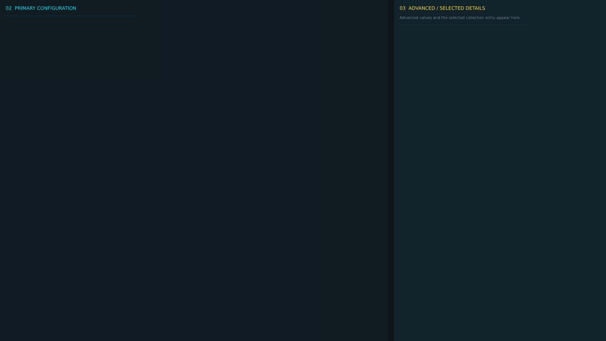


# ag_config_page_5.layout — Legacy config page 5

**Mod:** Advanced Groups  
**File:** `AdvancedGroups/gui/layouts/admin/config_pages/ag_config_page_5.layout`  
**Root:** `FrameWidget` `ConfigCategoryPage`, size 1 × 1  
**Widgets:** 49

Page of the legacy AG config editor (fallback only).

## Preview

Wireframe drawn straight from the layout file: positions, sizes, colours and default text are exact. Image widgets appear as dashed placeholders, and anything hidden at start inside the root is left out.

## Loaded by

- `AdvancedGroups/scripts/5_Mission/AdvancedGroups/GUI/AGConfigEditorMenu.c` line 302

## Widget tree

Positions and sizes are in pixels when the widget uses exact sizing, otherwise they are fractions of the parent (0–1).

| Widget | Type | Position | Size | Text / notes |
|---|---|---|---|---|
| `ConfigCategoryPage` | FrameWidget | 0 0 | 1 × 1 |  |
| &nbsp;&nbsp;└ `PrimaryColumn` | PanelWidget | 0 0 | 0.64 × 1 |  |
| &nbsp;&nbsp;&nbsp;&nbsp;└ `PrimaryColumnTitle` | TextWidget | 18 12 | 0.92 × 28 | "02  PRIMARY CONFIGURATION" |
| &nbsp;&nbsp;&nbsp;&nbsp;└ `PrimaryScroll` | ScrollWidget | 14 50 | 0.96 × 0.93 |  |
| &nbsp;&nbsp;&nbsp;&nbsp;&nbsp;&nbsp;└ `ActiveCategoryPanel` | WrapSpacerWidget | 0 0 | 1 × 0 |  |
| &nbsp;&nbsp;&nbsp;&nbsp;&nbsp;&nbsp;&nbsp;&nbsp;└ `Field_AG_LogGroupEventsToggle` | PanelWidget |  | 420 × 82 | style DayZDefaultPanel |
| &nbsp;&nbsp;&nbsp;&nbsp;&nbsp;&nbsp;&nbsp;&nbsp;&nbsp;&nbsp;└ `Label_AG_LogGroupEventsToggle` | TextWidget | 10 7 | 400 × 22 | "LOG GROUP EVENTS" |
| &nbsp;&nbsp;&nbsp;&nbsp;&nbsp;&nbsp;&nbsp;&nbsp;&nbsp;&nbsp;└ `AG_LogGroupEventsToggle` | CheckBoxWidget | 16 36 | 32 × 32 |  |
| &nbsp;&nbsp;&nbsp;&nbsp;&nbsp;&nbsp;&nbsp;&nbsp;└ `Field_AG_WebhookChatGlobalInput` | PanelWidget |  | 420 × 82 | style DayZDefaultPanel |
| &nbsp;&nbsp;&nbsp;&nbsp;&nbsp;&nbsp;&nbsp;&nbsp;&nbsp;&nbsp;└ `Label_AG_WebhookChatGlobalInput` | TextWidget | 10 7 | 400 × 22 | "WEBHOOK CHAT GLOBAL" |
| &nbsp;&nbsp;&nbsp;&nbsp;&nbsp;&nbsp;&nbsp;&nbsp;&nbsp;&nbsp;└ `AG_WebhookChatGlobalInput` | EditBoxWidget | 10 34 | 400 × 38 | style EditBox |
| &nbsp;&nbsp;&nbsp;&nbsp;&nbsp;&nbsp;&nbsp;&nbsp;└ `Field_AG_WebhookChatSubgroupInput` | PanelWidget |  | 420 × 82 | style DayZDefaultPanel |
| &nbsp;&nbsp;&nbsp;&nbsp;&nbsp;&nbsp;&nbsp;&nbsp;&nbsp;&nbsp;└ `Label_AG_WebhookChatSubgroupInput` | TextWidget | 10 7 | 400 × 22 | "WEBHOOK CHAT SUBGROUP" |
| &nbsp;&nbsp;&nbsp;&nbsp;&nbsp;&nbsp;&nbsp;&nbsp;&nbsp;&nbsp;└ `AG_WebhookChatSubgroupInput` | EditBoxWidget | 10 34 | 400 × 38 | style EditBox |
| &nbsp;&nbsp;&nbsp;&nbsp;&nbsp;&nbsp;&nbsp;&nbsp;└ `Field_AG_WebhookChatVicinityInput` | PanelWidget |  | 420 × 82 | style DayZDefaultPanel |
| &nbsp;&nbsp;&nbsp;&nbsp;&nbsp;&nbsp;&nbsp;&nbsp;&nbsp;&nbsp;└ `Label_AG_WebhookChatVicinityInput` | TextWidget | 10 7 | 400 × 22 | "WEBHOOK CHAT VICINITY" |
| &nbsp;&nbsp;&nbsp;&nbsp;&nbsp;&nbsp;&nbsp;&nbsp;&nbsp;&nbsp;└ `AG_WebhookChatVicinityInput` | EditBoxWidget | 10 34 | 400 × 38 | style EditBox |
| &nbsp;&nbsp;&nbsp;&nbsp;&nbsp;&nbsp;&nbsp;&nbsp;└ `Field_AG_WebhookGroupCreatedInput` | PanelWidget |  | 420 × 82 | style DayZDefaultPanel |
| &nbsp;&nbsp;&nbsp;&nbsp;&nbsp;&nbsp;&nbsp;&nbsp;&nbsp;&nbsp;└ `Label_AG_WebhookGroupCreatedInput` | TextWidget | 10 7 | 400 × 22 | "WEBHOOK GROUP CREATED" |
| &nbsp;&nbsp;&nbsp;&nbsp;&nbsp;&nbsp;&nbsp;&nbsp;&nbsp;&nbsp;└ `AG_WebhookGroupCreatedInput` | EditBoxWidget | 10 34 | 400 × 38 | style EditBox |
| &nbsp;&nbsp;&nbsp;&nbsp;&nbsp;&nbsp;&nbsp;&nbsp;└ `Field_AG_WebhookGroupDisbandedInput` | PanelWidget |  | 420 × 82 | style DayZDefaultPanel |
| &nbsp;&nbsp;&nbsp;&nbsp;&nbsp;&nbsp;&nbsp;&nbsp;&nbsp;&nbsp;└ `Label_AG_WebhookGroupDisbandedInput` | TextWidget | 10 7 | 400 × 22 | "WEBHOOK GROUP DISBANDED" |
| &nbsp;&nbsp;&nbsp;&nbsp;&nbsp;&nbsp;&nbsp;&nbsp;&nbsp;&nbsp;└ `AG_WebhookGroupDisbandedInput` | EditBoxWidget | 10 34 | 400 × 38 | style EditBox |
| &nbsp;&nbsp;&nbsp;&nbsp;&nbsp;&nbsp;&nbsp;&nbsp;└ `Field_AG_WebhookMemberJoinedInput` | PanelWidget |  | 420 × 82 | style DayZDefaultPanel |
| &nbsp;&nbsp;&nbsp;&nbsp;&nbsp;&nbsp;&nbsp;&nbsp;&nbsp;&nbsp;└ `Label_AG_WebhookMemberJoinedInput` | TextWidget | 10 7 | 400 × 22 | "WEBHOOK MEMBER JOINED" |
| &nbsp;&nbsp;&nbsp;&nbsp;&nbsp;&nbsp;&nbsp;&nbsp;&nbsp;&nbsp;└ `AG_WebhookMemberJoinedInput` | EditBoxWidget | 10 34 | 400 × 38 | style EditBox |
| &nbsp;&nbsp;&nbsp;&nbsp;&nbsp;&nbsp;&nbsp;&nbsp;└ `Field_AG_WebhookMemberKickedInput` | PanelWidget |  | 420 × 82 | style DayZDefaultPanel |
| &nbsp;&nbsp;&nbsp;&nbsp;&nbsp;&nbsp;&nbsp;&nbsp;&nbsp;&nbsp;└ `Label_AG_WebhookMemberKickedInput` | TextWidget | 10 7 | 400 × 22 | "WEBHOOK MEMBER KICKED" |
| &nbsp;&nbsp;&nbsp;&nbsp;&nbsp;&nbsp;&nbsp;&nbsp;&nbsp;&nbsp;└ `AG_WebhookMemberKickedInput` | EditBoxWidget | 10 34 | 400 × 38 | style EditBox |
| &nbsp;&nbsp;&nbsp;&nbsp;&nbsp;&nbsp;&nbsp;&nbsp;└ `Field_AG_WebhooksEnabledToggle` | PanelWidget |  | 420 × 82 | style DayZDefaultPanel |
| &nbsp;&nbsp;&nbsp;&nbsp;&nbsp;&nbsp;&nbsp;&nbsp;&nbsp;&nbsp;└ `Label_AG_WebhooksEnabledToggle` | TextWidget | 10 7 | 400 × 22 | "WEBHOOKS ENABLED" |
| &nbsp;&nbsp;&nbsp;&nbsp;&nbsp;&nbsp;&nbsp;&nbsp;&nbsp;&nbsp;└ `AG_WebhooksEnabledToggle` | CheckBoxWidget | 16 36 | 32 × 32 |  |
| &nbsp;&nbsp;└ `AdvancedColumn` | PanelWidget | 0.65 0 | 0.35 × 1 |  |
| &nbsp;&nbsp;&nbsp;&nbsp;└ `AdvancedColumnTitle` | TextWidget | 18 12 | 0.88 × 28 | "03  ADVANCED / SELECTED DETAILS" |
| &nbsp;&nbsp;&nbsp;&nbsp;└ `AdvancedColumnHint` | TextWidget | 18 38 | 0.88 × 38 | "Advanced values and the selected collection entry appear here." |
| &nbsp;&nbsp;&nbsp;&nbsp;└ `AdvancedScroll` | ScrollWidget | 14 78 | 0.94 × 0.89 |  |
| &nbsp;&nbsp;&nbsp;&nbsp;&nbsp;&nbsp;└ `AdvancedCategoryPanel` | WrapSpacerWidget | 0 0 | 1 × 0 |  |
| &nbsp;&nbsp;&nbsp;&nbsp;&nbsp;&nbsp;&nbsp;&nbsp;└ `Field_AG_WebhookChatGroupInput` | PanelWidget |  | 420 × 82 | style DayZDefaultPanel |
| &nbsp;&nbsp;&nbsp;&nbsp;&nbsp;&nbsp;&nbsp;&nbsp;&nbsp;&nbsp;└ `Label_AG_WebhookChatGroupInput` | TextWidget | 10 7 | 400 × 22 | "WEBHOOK CHAT GROUP" |
| &nbsp;&nbsp;&nbsp;&nbsp;&nbsp;&nbsp;&nbsp;&nbsp;&nbsp;&nbsp;└ `AG_WebhookChatGroupInput` | EditBoxWidget | 10 34 | 400 × 38 | style EditBox |
| &nbsp;&nbsp;&nbsp;&nbsp;&nbsp;&nbsp;&nbsp;&nbsp;└ `Field_AG_WebhookDefaultInput` | PanelWidget |  | 420 × 82 | style DayZDefaultPanel |
| &nbsp;&nbsp;&nbsp;&nbsp;&nbsp;&nbsp;&nbsp;&nbsp;&nbsp;&nbsp;└ `Label_AG_WebhookDefaultInput` | TextWidget | 10 7 | 400 × 22 | "WEBHOOK DEFAULT" |
| &nbsp;&nbsp;&nbsp;&nbsp;&nbsp;&nbsp;&nbsp;&nbsp;&nbsp;&nbsp;└ `AG_WebhookDefaultInput` | EditBoxWidget | 10 34 | 400 × 38 | style EditBox |
| &nbsp;&nbsp;&nbsp;&nbsp;&nbsp;&nbsp;&nbsp;&nbsp;└ `Field_AG_WebhookMarkerPlacedInput` | PanelWidget |  | 420 × 82 | style DayZDefaultPanel |
| &nbsp;&nbsp;&nbsp;&nbsp;&nbsp;&nbsp;&nbsp;&nbsp;&nbsp;&nbsp;└ `Label_AG_WebhookMarkerPlacedInput` | TextWidget | 10 7 | 400 × 22 | "WEBHOOK MARKER PLACED" |
| &nbsp;&nbsp;&nbsp;&nbsp;&nbsp;&nbsp;&nbsp;&nbsp;&nbsp;&nbsp;└ `AG_WebhookMarkerPlacedInput` | EditBoxWidget | 10 34 | 400 × 38 | style EditBox |
| &nbsp;&nbsp;&nbsp;&nbsp;&nbsp;&nbsp;&nbsp;&nbsp;└ `Field_AG_WebhookMemberLeftInput` | PanelWidget |  | 420 × 82 | style DayZDefaultPanel |
| &nbsp;&nbsp;&nbsp;&nbsp;&nbsp;&nbsp;&nbsp;&nbsp;&nbsp;&nbsp;└ `Label_AG_WebhookMemberLeftInput` | TextWidget | 10 7 | 400 × 22 | "WEBHOOK MEMBER LEFT" |
| &nbsp;&nbsp;&nbsp;&nbsp;&nbsp;&nbsp;&nbsp;&nbsp;&nbsp;&nbsp;└ `AG_WebhookMemberLeftInput` | EditBoxWidget | 10 34 | 400 × 38 | style EditBox |


