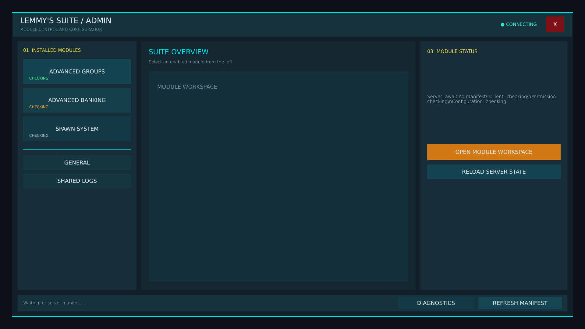


# lemmy_suite_admin.layout — Legacy suite admin hub (fallback)

**Mod:** Advanced Groups  
**File:** `AdvancedGroups/gui/layouts/admin/lemmy_suite_admin.layout`  
**Root:** `FrameWidget` `LMSSuiteRoot`, size 1 × 1  
**Widgets:** 35

Old admin hub with module buttons. Only used when the Control Room is not available.

## Preview

Wireframe drawn straight from the layout file: positions, sizes, colours and default text are exact. Image widgets appear as dashed placeholders, and anything hidden at start inside the root is left out.

## Loaded by

- `AdvancedGroups/scripts/5_Mission/AdvancedGroups/GUI/AGSuiteAdminMenu.c` line 66
- `Advanced_Banking/scripts/5_Mission/AdvancedBanking/IABSuiteAdminMenu.c` line 66

## Widget tree

Positions and sizes are in pixels when the widget uses exact sizing, otherwise they are fractions of the parent (0–1).

| Widget | Type | Position | Size | Text / notes |
|---|---|---|---|---|
| `LMSSuiteRoot` | FrameWidget | 0 0 | 1 × 1 |  |
| &nbsp;&nbsp;└ `ScreenDim` | PanelWidget | 0 0 | 1 × 1 |  |
| &nbsp;&nbsp;└ `SuiteShell` | PanelWidget | 0 0 | 1840 × 1000 |  |
| &nbsp;&nbsp;&nbsp;&nbsp;└ `NeonTop` | PanelWidget | 0 0 | 1840 × 2 |  |
| &nbsp;&nbsp;&nbsp;&nbsp;└ `NeonBottom` | PanelWidget | 0 998 | 1840 × 2 |  |
| &nbsp;&nbsp;&nbsp;&nbsp;└ `Header` | PanelWidget | 2 2 | 1836 × 78 |  |
| &nbsp;&nbsp;&nbsp;&nbsp;&nbsp;&nbsp;└ `BrandTitle` | TextWidget | 24 10 | 500 × 32 | "LEMMY'S SUITE / ADMIN" |
| &nbsp;&nbsp;&nbsp;&nbsp;&nbsp;&nbsp;└ `AdminModeLabel` | TextWidget | 24 44 | 500 × 22 | "MODULE CONTROL AND CONFIGURATION" |
| &nbsp;&nbsp;&nbsp;&nbsp;&nbsp;&nbsp;└ `ConnectionState` | TextWidget | 1240 12 | 480 × 52 | "● CONNECTING" |
| &nbsp;&nbsp;&nbsp;&nbsp;&nbsp;&nbsp;└ `CloseButton` | ButtonWidget | 1750 12 | 60 × 52 | "X", style DayZDefaultButton |
| &nbsp;&nbsp;&nbsp;&nbsp;└ `LeftRail` | PanelWidget | 18 96 | 390 × 816 |  |
| &nbsp;&nbsp;&nbsp;&nbsp;&nbsp;&nbsp;└ `ModulesHeader` | TextWidget | 18 16 | 350 × 26 | "01  INSTALLED MODULES" |
| &nbsp;&nbsp;&nbsp;&nbsp;&nbsp;&nbsp;└ `GroupsModuleButton` | ButtonWidget | 18 58 | 354 × 82 | "ADVANCED GROUPS", style DayZDefaultButton |
| &nbsp;&nbsp;&nbsp;&nbsp;&nbsp;&nbsp;└ `GroupsModuleState` | TextWidget | 38 112 | 310 × 20 | "CHECKING" |
| &nbsp;&nbsp;&nbsp;&nbsp;&nbsp;&nbsp;└ `BankingModuleButton` | ButtonWidget | 18 152 | 354 × 82 | "ADVANCED BANKING", style DayZDefaultButton |
| &nbsp;&nbsp;&nbsp;&nbsp;&nbsp;&nbsp;└ `BankingModuleState` | TextWidget | 38 206 | 310 × 20 | "CHECKING" |
| &nbsp;&nbsp;&nbsp;&nbsp;&nbsp;&nbsp;└ `SpawnModuleButton` | ButtonWidget | 18 246 | 354 × 82 | "SPAWN SYSTEM", style DayZDefaultButton |
| &nbsp;&nbsp;&nbsp;&nbsp;&nbsp;&nbsp;└ `SpawnModuleState` | TextWidget | 38 300 | 310 × 20 | "CHECKING" |
| &nbsp;&nbsp;&nbsp;&nbsp;&nbsp;&nbsp;└ `RailRule` | PanelWidget | 18 354 | 354 × 2 |  |
| &nbsp;&nbsp;&nbsp;&nbsp;&nbsp;&nbsp;└ `GeneralButton` | ButtonWidget | 18 374 | 354 × 48 | "GENERAL", style DayZDefaultButton |
| &nbsp;&nbsp;&nbsp;&nbsp;&nbsp;&nbsp;└ `LogsButton` | ButtonWidget | 18 434 | 354 × 48 | "SHARED LOGS", style DayZDefaultButton |
| &nbsp;&nbsp;&nbsp;&nbsp;└ `WorkspacePanel` | PanelWidget | 424 96 | 900 × 816 |  |
| &nbsp;&nbsp;&nbsp;&nbsp;&nbsp;&nbsp;└ `WorkspaceTitle` | TextWidget | 24 18 | 850 × 34 | "SUITE OVERVIEW" |
| &nbsp;&nbsp;&nbsp;&nbsp;&nbsp;&nbsp;└ `WorkspaceSubtitle` | TextWidget | 24 56 | 850 × 24 | "Select an enabled module from the left." |
| &nbsp;&nbsp;&nbsp;&nbsp;&nbsp;&nbsp;└ `PageMount` | PanelWidget | 24 98 | 852 × 690 |  |
| &nbsp;&nbsp;&nbsp;&nbsp;&nbsp;&nbsp;&nbsp;&nbsp;└ `EmptyPageText` | TextWidget | 28 26 | 796 × 50 | "MODULE WORKSPACE" |
| &nbsp;&nbsp;&nbsp;&nbsp;└ `DetailPanel` | PanelWidget | 1340 96 | 482 × 816 |  |
| &nbsp;&nbsp;&nbsp;&nbsp;&nbsp;&nbsp;└ `DetailHeader` | TextWidget | 22 18 | 438 × 30 | "03  MODULE STATUS" |
| &nbsp;&nbsp;&nbsp;&nbsp;&nbsp;&nbsp;└ `DetailBody` | TextWidget | 22 66 | 438 × 246 | "Server: awaiting manifest\nClient: checking\nPermission: checking\nConfiguration: checking" |
| &nbsp;&nbsp;&nbsp;&nbsp;&nbsp;&nbsp;└ `OpenModuleButton` | ButtonWidget | 22 336 | 438 × 54 | "OPEN MODULE WORKSPACE", style DayZDefaultButton |
| &nbsp;&nbsp;&nbsp;&nbsp;&nbsp;&nbsp;└ `ReloadModuleButton` | ButtonWidget | 22 404 | 438 × 48 | "RELOAD SERVER STATE", style DayZDefaultButton |
| &nbsp;&nbsp;&nbsp;&nbsp;└ `Footer` | PanelWidget | 18 928 | 1804 × 54 |  |
| &nbsp;&nbsp;&nbsp;&nbsp;&nbsp;&nbsp;└ `FooterStatus` | TextWidget | 18 0 | 1180 × 54 | "Waiting for server manifest..." |
| &nbsp;&nbsp;&nbsp;&nbsp;&nbsp;&nbsp;└ `DiagnosticsButton` | ButtonWidget | 1248 8 | 250 × 38 | "DIAGNOSTICS", style DayZDefaultButton |
| &nbsp;&nbsp;&nbsp;&nbsp;&nbsp;&nbsp;└ `RefreshManifestButton` | ButtonWidget | 1512 8 | 274 × 38 | "REFRESH MANIFEST", style DayZDefaultButton |


