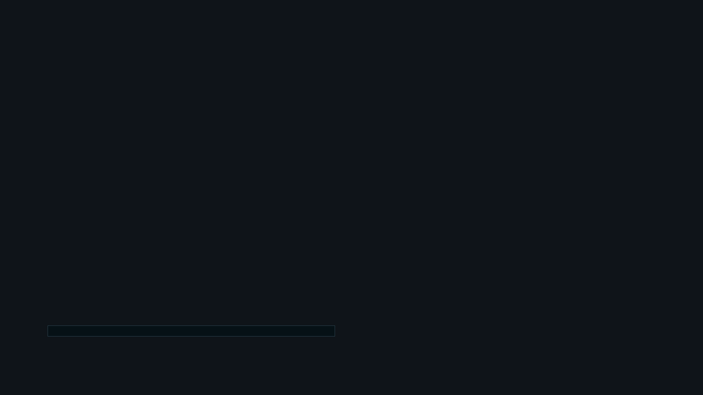


# ag_chat_input.layout — Chat input bar

**Mod:** Advanced Groups  
**File:** `AdvancedGroups/gui/layouts/hud/ag_chat_input.layout`  
**Root:** `FrameWidget` `rootFrame`, size 1 × 1  
**Widgets:** 5

The input line with the channel label (Global, Group, Subgroup, Vicinity) and the edit box.

## Preview

Wireframe drawn straight from the layout file: positions, sizes, colours and default text are exact. Image widgets appear as dashed placeholders, and anything hidden at start inside the root is left out.

## Loaded by

- `AdvancedGroups/scripts/5_Mission/AdvancedGroups/GUI/Chat/AGChatInputMenu.c` line 13

## Widget tree

Positions and sizes are in pixels when the widget uses exact sizing, otherwise they are fractions of the parent (0–1).

| Widget | Type | Position | Size | Text / notes |
|---|---|---|---|---|
| `rootFrame` | FrameWidget | 0 0 | 1 × 1 |  |
| &nbsp;&nbsp;└ `InputPanel` | PanelWidget | 20 160 | 900 × 30 |  |
| &nbsp;&nbsp;&nbsp;&nbsp;└ `ChannelText` | TextWidget | 5 0 | 100 × 1 |  |
| &nbsp;&nbsp;&nbsp;&nbsp;└ `InputEditBoxWidgetBg` | PanelWidget | 110 0 | 785 × 1 |  |
| &nbsp;&nbsp;&nbsp;&nbsp;└ `InputEditBoxWidget` | EditBoxWidget | 110 0 | 785 × 1 |  |


