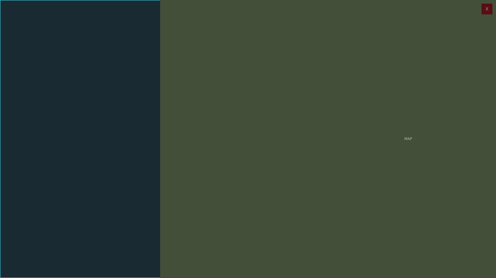


# ag_main_menu.layout — Advanced Groups main menu shell

**Mod:** Advanced Groups  
**File:** `AdvancedGroups/gui/layouts/hud/ag_main_menu.layout`  
**Root:** `FrameWidget` `rootFrame`, size 1 × 1  
**Widgets:** 22

The full-screen group menu: top tab bar, the content panel that hosts every page, and the shared map (map widget, marker layer and draw canvas) used by the Markers, Zone Editor and Admin pages.

## Preview

Wireframe drawn straight from the layout file: positions, sizes, colours and default text are exact. Image widgets appear as dashed placeholders, and anything hidden at start inside the root is left out.

## Loaded by

- `AdvancedGroups/scripts/5_Mission/AdvancedGroups/GUI/AGMainMenu.c` line 48

## Widget tree

Positions and sizes are in pixels when the widget uses exact sizing, otherwise they are fractions of the parent (0–1).

| Widget | Type | Position | Size | Text / notes |
|---|---|---|---|---|
| `rootFrame` | FrameWidget | 0 0 | 1 × 1 |  |
| &nbsp;&nbsp;└ `NeonTop` | PanelWidget | 0 0 | 1 × 2 |  |
| &nbsp;&nbsp;└ `NeonBottom` | PanelWidget | 0 0 | 1 × 2 |  |
| &nbsp;&nbsp;└ `NeonLeft` | PanelWidget | 0 0 | 2 × 1 |  |
| &nbsp;&nbsp;└ `NeonRight` | PanelWidget | 0 0 | 2 × 1 |  |
| &nbsp;&nbsp;└ `SidebarIcons` | PanelWidget | 0 0 | 60 × 1 | style DayZDefaultPanel |
| &nbsp;&nbsp;&nbsp;&nbsp;└ `TabButtonContainer` | PanelWidget | 0 10 | 60 × 1 |  |
| &nbsp;&nbsp;└ `ContentPanel` | PanelWidget | 60 0 | 560 × 1 |  |
| &nbsp;&nbsp;└ `MapParent` | PanelWidget | 620 0 | 1 × 1 |  |
| &nbsp;&nbsp;&nbsp;&nbsp;└ `Map` | MapWidget | 0 0 | 1 × 1 |  |
| &nbsp;&nbsp;&nbsp;&nbsp;&nbsp;&nbsp;└ `MarkerLayer` | PanelWidget | 0 0 | 1 × 1 |  |
| &nbsp;&nbsp;&nbsp;&nbsp;&nbsp;&nbsp;└ `MapDrawCanvas` | CanvasWidget | 0 0 | 1 × 1 |  |
| &nbsp;&nbsp;&nbsp;&nbsp;└ `ServerInfoScroll` | ScrollWidget | 20 20 | 0.95 × 0.95 | hidden at start |
| &nbsp;&nbsp;&nbsp;&nbsp;&nbsp;&nbsp;└ `ServerInfoText` | RichTextWidget | 0 0 | 1 × 1 |  |
| &nbsp;&nbsp;└ `CloseBtn` | ButtonWidget | 14 14 | 42 × 42 | "X", style Default |
| &nbsp;&nbsp;└ `CloseGuard` | PanelWidget | 0 0 | 1 × 1 | hidden at start |
| &nbsp;&nbsp;&nbsp;&nbsp;└ `CloseGuardCard` | PanelWidget | 0 0 | 520 × 210 |  |
| &nbsp;&nbsp;&nbsp;&nbsp;&nbsp;&nbsp;└ `CloseGuardAccent` | PanelWidget | 0 0 | 520 × 4 |  |
| &nbsp;&nbsp;&nbsp;&nbsp;&nbsp;&nbsp;└ `CloseGuardTitle` | TextWidget | 28 24 | 464 × 34 | "UNSAVED CONFIG CHANGES" |
| &nbsp;&nbsp;&nbsp;&nbsp;&nbsp;&nbsp;└ `CloseGuardMessage` | MultilineTextWidget | 38 70 | 444 × 52 | "Your server configuration edits have not been saved. Keep editing or discard them and close the menu." |
| &nbsp;&nbsp;&nbsp;&nbsp;&nbsp;&nbsp;└ `CloseGuardStay` | ButtonWidget | 52 146 | 190 × 42 | "Keep editing", style Default |
| &nbsp;&nbsp;&nbsp;&nbsp;&nbsp;&nbsp;└ `CloseGuardDiscard` | ButtonWidget | 278 146 | 190 × 42 | "Discard and close", style Default |


