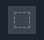


# ag_marker_icon_button.layout — Marker icon button

**Mod:** Advanced Groups  
**File:** `AdvancedGroups/gui/layouts/hud/ag_marker_icon_button.layout`  
**Root:** `ButtonWidget` `IconButton`, size 44 × 40  
**Widgets:** 2

One icon in the marker icon picker grid.

## Preview

Wireframe drawn straight from the layout file: positions, sizes, colours and default text are exact. Image widgets appear as dashed placeholders, and anything hidden at start inside the root is left out.

## Loaded by

- `AdvancedGroups/scripts/5_Mission/AdvancedGroups/GUI/Pages/AGPageMarkers.c` line 612

## Widget tree

Positions and sizes are in pixels when the widget uses exact sizing, otherwise they are fractions of the parent (0–1).

| Widget | Type | Position | Size | Text / notes |
|---|---|---|---|---|
| `IconButton` | ButtonWidget | 0 0 | 44 × 40 | style Default |
| &nbsp;&nbsp;└ `IconImage` | ImageWidget | 8 6 | 28 × 28 |  |


