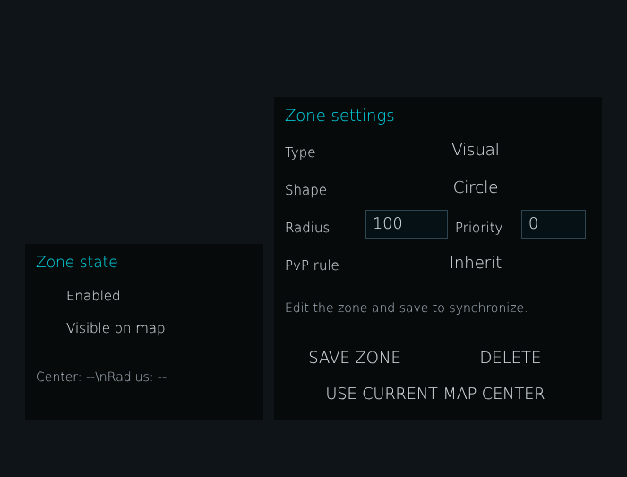


# ag_marker_zone_panel.layout — Zone panel on the map

**Mod:** Advanced Groups  
**File:** `AdvancedGroups/gui/layouts/hud/ag_marker_zone_panel.layout`  
**Root:** `PanelWidget` `ZonePopupLayer`, size 700 × 532  
**Widgets:** 24

Side panel listing zones while the map is open, with visibility toggles.

## Preview

Wireframe drawn straight from the layout file: positions, sizes, colours and default text are exact. Image widgets appear as dashed placeholders, and anything hidden at start inside the root is left out.

## Loaded by

- `AdvancedGroups/scripts/5_Mission/AdvancedGroups/GUI/Pages/AGPageMarkers.c` line 186

## Widget tree

Positions and sizes are in pixels when the widget uses exact sizing, otherwise they are fractions of the parent (0–1).

| Widget | Type | Position | Size | Text / notes |
|---|---|---|---|---|
| `ZonePopupLayer` | PanelWidget | 0 0 | 700 × 532 | hidden at start |
| &nbsp;&nbsp;└ `ZoneLeftCard` | PanelWidget | 28 272 | 266 × 196 |  |
| &nbsp;&nbsp;&nbsp;&nbsp;└ `ZoneVisibilityTitle` | TextWidget | 12 8 | 238 × 24 | "Zone state" |
| &nbsp;&nbsp;&nbsp;&nbsp;└ `ZoneEnabled` | CheckBoxWidget | 12 44 | 28 × 28 |  |
| &nbsp;&nbsp;&nbsp;&nbsp;└ `ZoneEnabledLabel` | TextWidget | 46 44 | 190 × 28 | "Enabled" |
| &nbsp;&nbsp;&nbsp;&nbsp;└ `ZoneShowMap` | CheckBoxWidget | 12 80 | 28 × 28 |  |
| &nbsp;&nbsp;&nbsp;&nbsp;└ `ZoneShowMapLabel` | TextWidget | 46 80 | 190 × 28 | "Visible on map" |
| &nbsp;&nbsp;&nbsp;&nbsp;└ `ZoneGeometryStatus` | TextWidget | 12 120 | 238 × 58 | "Center: --\nRadius: --" |
| &nbsp;&nbsp;└ `ZoneOptionsCard` | PanelWidget | 306 108 | 366 × 360 |  |
| &nbsp;&nbsp;&nbsp;&nbsp;└ `ZoneOptionsTitle` | TextWidget | 12 8 | 330 × 26 | "Zone settings" |
| &nbsp;&nbsp;&nbsp;&nbsp;└ `ZoneTypeLabel` | TextWidget | 12 48 | 82 × 28 | "Type" |
| &nbsp;&nbsp;&nbsp;&nbsp;└ `ZoneTypeButton` | ButtonWidget | 102 42 | 246 × 34 | "Visual", style Default |
| &nbsp;&nbsp;&nbsp;&nbsp;└ `ZoneShapeLabel` | TextWidget | 12 90 | 82 × 28 | "Shape" |
| &nbsp;&nbsp;&nbsp;&nbsp;└ `ZoneShapeButton` | ButtonWidget | 102 84 | 246 × 34 | "Circle", style Default |
| &nbsp;&nbsp;&nbsp;&nbsp;└ `ZoneRadiusLabel` | TextWidget | 12 132 | 82 × 28 | "Radius" |
| &nbsp;&nbsp;&nbsp;&nbsp;└ `ZoneRadiusInput` | EditBoxWidget | 102 126 | 92 × 32 | "100", style ServerBrowser |
| &nbsp;&nbsp;&nbsp;&nbsp;└ `ZonePriorityLabel` | TextWidget | 202 132 | 70 × 28 | "Priority" |
| &nbsp;&nbsp;&nbsp;&nbsp;└ `ZonePriorityInput` | EditBoxWidget | 276 126 | 72 × 32 | "0", style ServerBrowser |
| &nbsp;&nbsp;&nbsp;&nbsp;└ `ZoneFFLabel` | TextWidget | 12 174 | 82 × 28 | "PvP rule" |
| &nbsp;&nbsp;&nbsp;&nbsp;└ `ZoneFFButton` | ButtonWidget | 102 168 | 246 × 34 | "Inherit", style Default |
| &nbsp;&nbsp;&nbsp;&nbsp;└ `ZonePopupStatus` | TextWidget | 12 214 | 336 × 44 | "Edit the zone and save to synchronize." |
| &nbsp;&nbsp;&nbsp;&nbsp;└ `ZoneSaveButton` | ButtonWidget | 12 274 | 156 × 34 | "SAVE ZONE", style Default |
| &nbsp;&nbsp;&nbsp;&nbsp;└ `ZoneDeleteButton` | ButtonWidget | 180 274 | 168 × 34 | "DELETE", style Default |
| &nbsp;&nbsp;&nbsp;&nbsp;└ `ZoneUseMapButton` | ButtonWidget | 12 316 | 336 × 32 | "USE CURRENT MAP CENTER", style Default |


