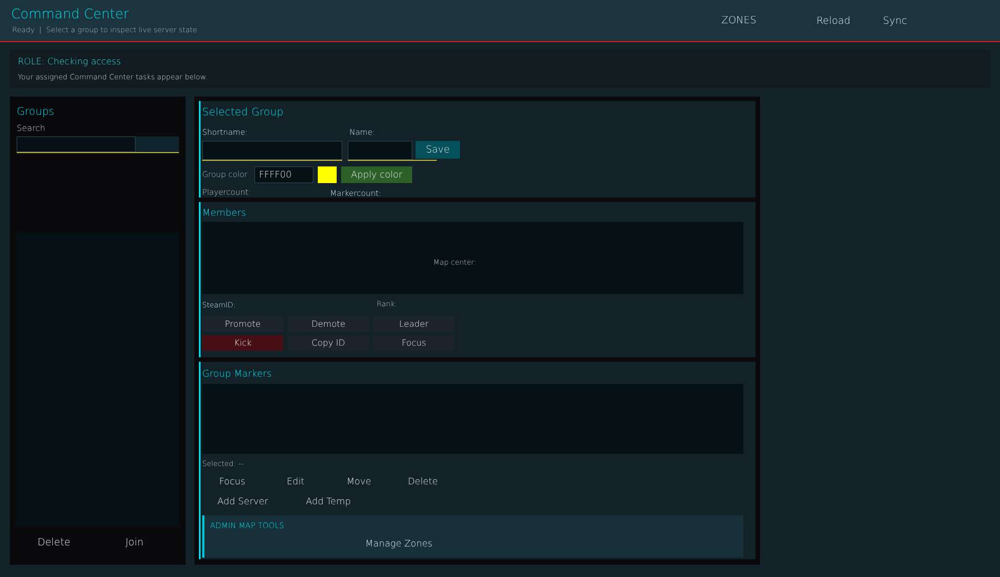


# ag_page_admin.layout — Admin page

**Mod:** Advanced Groups  
**File:** `AdvancedGroups/gui/layouts/hud/ag_page_admin.layout`  
**Root:** `PanelWidget` `rootFrame`, size 1800 × 1040  
**Widgets:** 90

Group administration for staff: list every group, inspect members, rename, change tier, transfer leadership, disband, teleport, server markers and status. Also used for the zone list in admin zone mode.

## Preview

Wireframe drawn straight from the layout file: positions, sizes, colours and default text are exact. Image widgets appear as dashed placeholders, and anything hidden at start inside the root is left out.

## Loaded by

- `AdvancedGroups/scripts/5_Mission/AdvancedGroups/GUI/Pages/AGPageAdmin.c` line 3
- `AdvancedGroups/scripts/5_Mission/AdvancedGroups/GUI/Pages/AGPageAdmin.c` line 158

## Widget tree

Positions and sizes are in pixels when the widget uses exact sizing, otherwise they are fractions of the parent (0–1).

| Widget | Type | Position | Size | Text / notes |
|---|---|---|---|---|
| `rootFrame` | PanelWidget | 60 0 | 1800 × 1040 |  |
| &nbsp;&nbsp;└ `Header` | PanelWidget | 0 0 | 1800 × 76 |  |
| &nbsp;&nbsp;&nbsp;&nbsp;└ `HeaderAccent` | PanelWidget | 0 74 | 1800 × 2 |  |
| &nbsp;&nbsp;&nbsp;&nbsp;└ `TitleAdmin` | TextWidget | 20 8 | 320 × 34 | "Command Center" |
| &nbsp;&nbsp;&nbsp;&nbsp;└ `HeaderHint` | TextWidget | 14 44 | 560 × 20 | "Groups, members, support actions, marker oversight, and tactical map context.", hidden at start |
| &nbsp;&nbsp;&nbsp;&nbsp;└ `CommandStatusText` | TextWidget | 22 44 | 520 × 20 | "Ready  \|  Select a group to inspect live server state" |
| &nbsp;&nbsp;&nbsp;&nbsp;└ `BtnRefresh` | ButtonWidget | 1450 18 | 100 × 38 | "Reload", style DayZDefaultButton |
| &nbsp;&nbsp;&nbsp;&nbsp;└ `BtnSync` | ButtonWidget | 1562 18 | 98 × 38 | "Sync", style DayZDefaultButton |
| &nbsp;&nbsp;&nbsp;&nbsp;└ `BtnOpenZonesHeader` | ButtonWidget | 1240 18 | 180 × 36 | "ZONES", style DayZDefaultButton |
| &nbsp;&nbsp;└ `AccessStrip` | PanelWidget | 18 90 | 1764 × 68 |  |
| &nbsp;&nbsp;&nbsp;&nbsp;└ `RoleLabel` | TextWidget | 14 9 | 710 × 23 | "ROLE: Checking access" |
| &nbsp;&nbsp;&nbsp;&nbsp;└ `AccessSummary` | TextWidget | 14 38 | 710 × 22 | "Your assigned Command Center tasks appear below." |
| &nbsp;&nbsp;└ `LeftListPanel` | PanelWidget | 18 174 | 316 × 844 |  |
| &nbsp;&nbsp;&nbsp;&nbsp;└ `GroupsTitle` | TextWidget | 12 14 | 214 × 24 | "Groups" |
| &nbsp;&nbsp;&nbsp;&nbsp;└ `SearchLabel` | TextWidget | 12 48 | 214 × 18 | "Search" |
| &nbsp;&nbsp;&nbsp;&nbsp;└ `SearchInputBg` | PanelWidget | 12 72 | 292 × 28 |  |
| &nbsp;&nbsp;&nbsp;&nbsp;└ `SearchInput` | EditBoxWidget | 12 72 | 214 × 28 | style ServerBrowser |
| &nbsp;&nbsp;&nbsp;&nbsp;└ `SearchInputRule` | PanelWidget | 12 100 | 292 × 2 |  |
| &nbsp;&nbsp;&nbsp;&nbsp;└ `ChkShortnames` | CheckBoxWidget | 12 116 | 214 × 26 | "Tag" |
| &nbsp;&nbsp;&nbsp;&nbsp;└ `ChkGroupNames` | CheckBoxWidget | 12 146 | 214 × 26 | "Group" |
| &nbsp;&nbsp;&nbsp;&nbsp;└ `ChkMemberNames` | CheckBoxWidget | 12 176 | 214 × 26 | "Member" |
| &nbsp;&nbsp;&nbsp;&nbsp;└ `ChkMemberSteamIDs` | CheckBoxWidget | 12 206 | 214 × 26 | "SteamID" |
| &nbsp;&nbsp;&nbsp;&nbsp;└ `GroupList` | TextListboxWidget | 12 246 | 292 × 528 | style Default |
| &nbsp;&nbsp;&nbsp;&nbsp;└ `BtnDeleteGroup` | ButtonWidget | 12 784 | 134 × 38 | "Delete", style DayZDefaultButton |
| &nbsp;&nbsp;&nbsp;&nbsp;└ `BtnJoin` | ButtonWidget | 156 784 | 136 × 38 | "Join", style DayZDefaultButton |
| &nbsp;&nbsp;└ `DetailsOverlay` | PanelWidget | 350 174 | 1018 × 844 |  |
| &nbsp;&nbsp;&nbsp;&nbsp;└ `IdentityCardBg` | PanelWidget | 8 8 | 1002 × 174 |  |
| &nbsp;&nbsp;&nbsp;&nbsp;&nbsp;&nbsp;└ `IdentityCardAccent` | PanelWidget | 0 0 | 3 × 174 |  |
| &nbsp;&nbsp;&nbsp;&nbsp;└ `MembersCardBg` | PanelWidget | 8 190 | 1002 × 280 |  |
| &nbsp;&nbsp;&nbsp;&nbsp;&nbsp;&nbsp;└ `MembersCardAccent` | PanelWidget | 0 0 | 3 × 280 |  |
| &nbsp;&nbsp;&nbsp;&nbsp;└ `MarkersCardBg` | PanelWidget | 8 478 | 1002 × 356 |  |
| &nbsp;&nbsp;&nbsp;&nbsp;&nbsp;&nbsp;└ `MarkersCardAccent` | PanelWidget | 0 0 | 3 × 356 |  |
| &nbsp;&nbsp;&nbsp;&nbsp;└ `DetailsTitle` | TextWidget | 14 14 | 464 × 26 | "Selected Group" |
| &nbsp;&nbsp;&nbsp;&nbsp;└ `TxtShortname` | TextWidget | 14 54 | 250 × 22 | "Shortname: " |
| &nbsp;&nbsp;&nbsp;&nbsp;└ `TxtName` | TextWidget | 279 54 | 199 × 22 | "Name: " |
| &nbsp;&nbsp;&nbsp;&nbsp;└ `InputAdminGroupNameBg` | PanelWidget | 14 80 | 252 × 34 |  |
| &nbsp;&nbsp;&nbsp;&nbsp;└ `InputAdminGroupName` | EditBoxWidget | 14 80 | 252 × 34 | style Default |
| &nbsp;&nbsp;&nbsp;&nbsp;└ `AdminGroupNameRule` | PanelWidget | 14 114 | 252 × 2 |  |
| &nbsp;&nbsp;&nbsp;&nbsp;└ `InputAdminGroupTagBg` | PanelWidget | 276 80 | 116 × 34 |  |
| &nbsp;&nbsp;&nbsp;&nbsp;└ `InputAdminGroupTag` | EditBoxWidget | 276 80 | 116 × 34 | style Default |
| &nbsp;&nbsp;&nbsp;&nbsp;└ `AdminGroupTagRule` | PanelWidget | 276 114 | 160 × 2 |  |
| &nbsp;&nbsp;&nbsp;&nbsp;└ `BtnChangeNames` | ButtonWidget | 398 80 | 80 × 32 | "Save", style DayZDefaultButton |
| &nbsp;&nbsp;&nbsp;&nbsp;└ `LblAdminGroupColor` | TextWidget | 14 126 | 92 × 30 | "Group color" |
| &nbsp;&nbsp;&nbsp;&nbsp;└ `InputAdminGroupColor` | EditBoxWidget | 108 126 | 106 × 30 | "FFFF00", style Default |
| &nbsp;&nbsp;&nbsp;&nbsp;└ `AdminGroupColorSwatch` | PanelWidget | 222 126 | 34 × 30 |  |
| &nbsp;&nbsp;&nbsp;&nbsp;└ `BtnApplyGroupColor` | ButtonWidget | 264 126 | 128 × 30 | "Apply color", style DayZDefaultButton |
| &nbsp;&nbsp;&nbsp;&nbsp;└ `TxtPlayerCount` | TextWidget | 14 164 | 218 × 18 | "Playercount: " |
| &nbsp;&nbsp;&nbsp;&nbsp;└ `TxtMarkerCount` | TextWidget | 244 164 | 234 × 22 | "Markercount: " |
| &nbsp;&nbsp;&nbsp;&nbsp;└ `TxtCreated` | TextWidget |  |  | "Created: ", hidden at start |
| &nbsp;&nbsp;&nbsp;&nbsp;└ `TxtLastActive` | TextWidget |  |  | "Last Active: ", hidden at start |
| &nbsp;&nbsp;&nbsp;&nbsp;└ `MembersTitle` | TextWidget | 14 198 | 220 × 22 | "Members" |
| &nbsp;&nbsp;&nbsp;&nbsp;└ `MemberList` | TextListboxWidget | 14 226 | 974 × 130 | style Default |
| &nbsp;&nbsp;&nbsp;&nbsp;└ `TxtSteamID` | TextWidget | 14 365 | 300 × 22 | "SteamID: " |
| &nbsp;&nbsp;&nbsp;&nbsp;└ `TxtRank` | TextWidget | 328 365 | 150 × 18 | "Rank: " |
| &nbsp;&nbsp;&nbsp;&nbsp;└ `BtnPromote` | ButtonWidget | 14 396 | 146 × 28 | "Promote", style DayZDefaultButton |
| &nbsp;&nbsp;&nbsp;&nbsp;└ `BtnDemote` | ButtonWidget | 168 396 | 146 × 28 | "Demote", style DayZDefaultButton |
| &nbsp;&nbsp;&nbsp;&nbsp;└ `BtnToLeader` | ButtonWidget | 322 396 | 146 × 28 | "Leader", style DayZDefaultButton |
| &nbsp;&nbsp;&nbsp;&nbsp;└ `BtnKick` | ButtonWidget | 14 430 | 146 × 28 | "Kick", style DayZDefaultButton |
| &nbsp;&nbsp;&nbsp;&nbsp;└ `BtnCopy` | ButtonWidget | 168 430 | 146 × 28 | "Copy ID", style DayZDefaultButton |
| &nbsp;&nbsp;&nbsp;&nbsp;└ `BtnFocusMember` | ButtonWidget | 322 430 | 146 × 28 | "Focus", style DayZDefaultButton |
| &nbsp;&nbsp;&nbsp;&nbsp;└ `MarkersTitle` | TextWidget | 14 488 | 220 × 22 | "Group Markers" |
| &nbsp;&nbsp;&nbsp;&nbsp;└ `GroupMarkerList` | TextListboxWidget | 14 518 | 974 × 126 | style Default |
| &nbsp;&nbsp;&nbsp;&nbsp;└ `TxtSelectedMap` | TextWidget | 14 653 | 464 × 18 | "Selected: --" |
| &nbsp;&nbsp;&nbsp;&nbsp;└ `BtnFocusMarker` | ButtonWidget | 14 679 | 108 × 30 | "Focus", style DayZDefaultButton |
| &nbsp;&nbsp;&nbsp;&nbsp;└ `BtnEditMarker` | ButtonWidget | 128 679 | 108 × 30 | "Edit", style DayZDefaultButton |
| &nbsp;&nbsp;&nbsp;&nbsp;└ `BtnMoveMarker` | ButtonWidget | 242 679 | 108 × 30 | "Move", style DayZDefaultButton |
| &nbsp;&nbsp;&nbsp;&nbsp;└ `BtnDeleteMarker` | ButtonWidget | 356 679 | 110 × 30 | "Delete", style DayZDefaultButton |
| &nbsp;&nbsp;&nbsp;&nbsp;└ `BtnAddServerMarker` | ButtonWidget | 14 715 | 146 × 30 | "Add Server", style DayZDefaultButton |
| &nbsp;&nbsp;&nbsp;&nbsp;└ `BtnAddTempMarker` | ButtonWidget | 168 715 | 146 × 30 | "Add Temp", style DayZDefaultButton |
| &nbsp;&nbsp;&nbsp;&nbsp;└ `BtnEditSelected` | ButtonWidget |  |  | hidden at start |
| &nbsp;&nbsp;&nbsp;&nbsp;└ `BtnDeleteSelected` | ButtonWidget |  |  | hidden at start |
| &nbsp;&nbsp;&nbsp;&nbsp;└ `AdminMapToolsCard` | PanelWidget | 14 755 | 974 × 76 |  |
| &nbsp;&nbsp;&nbsp;&nbsp;&nbsp;&nbsp;└ `AdminMapToolsAccent` | PanelWidget | 0 0 | 4 × 76 |  |
| &nbsp;&nbsp;&nbsp;&nbsp;&nbsp;&nbsp;└ `AdminMapToolsTitle` | TextWidget | 14 8 | 420 × 22 | "ADMIN MAP TOOLS" |
| &nbsp;&nbsp;&nbsp;&nbsp;&nbsp;&nbsp;└ `ChkShowTerritoryFlags` | CheckBoxWidget | 14 38 | 126 × 28 | "Flagpoles" |
| &nbsp;&nbsp;&nbsp;&nbsp;&nbsp;&nbsp;└ `ChkShowZones` | CheckBoxWidget | 150 38 | 104 × 28 | "Zones" |
| &nbsp;&nbsp;&nbsp;&nbsp;&nbsp;&nbsp;└ `BtnEditZones` | ButtonWidget | 274 36 | 160 × 30 | "Manage Zones", style DayZDefaultButton |
| &nbsp;&nbsp;&nbsp;&nbsp;└ `ChkCustomColor` | CheckBoxWidget |  |  | hidden at start |
| &nbsp;&nbsp;&nbsp;&nbsp;└ `BtnApplyColor` | ButtonWidget |  |  | hidden at start |
| &nbsp;&nbsp;&nbsp;&nbsp;└ `BtnColorRed` | ButtonWidget |  |  | hidden at start |
| &nbsp;&nbsp;&nbsp;&nbsp;└ `BtnColorGreen` | ButtonWidget |  |  | hidden at start |
| &nbsp;&nbsp;&nbsp;&nbsp;└ `BtnColorBlue` | ButtonWidget |  |  | hidden at start |
| &nbsp;&nbsp;&nbsp;&nbsp;└ `BtnCategoryAdmin` | ButtonWidget |  |  | "Admin", hidden at start |
| &nbsp;&nbsp;&nbsp;&nbsp;└ `BtnCategoryVIP` | ButtonWidget |  |  | "VIP", hidden at start |
| &nbsp;&nbsp;&nbsp;&nbsp;└ `BtnCategoryTier1` | ButtonWidget |  |  | "Tier1", hidden at start |
| &nbsp;&nbsp;&nbsp;&nbsp;└ `BtnCategoryTier2` | ButtonWidget |  |  | "Tier2", hidden at start |
| &nbsp;&nbsp;└ `OnlinePanel` | PanelWidget | 1384 174 | 398 × 844 | hidden at start |
| &nbsp;&nbsp;&nbsp;&nbsp;└ `OnlineTitle` | TextWidget | 10 14 | 370 × 24 | "Online Members" |
| &nbsp;&nbsp;&nbsp;&nbsp;└ `OnlineMemberList` | TextListboxWidget | 10 50 | 370 × 750 | style Default |
| &nbsp;&nbsp;└ `TxtCursorMap` | TextWidget | 780 464 | 192 × 18 | "Map center: " |


