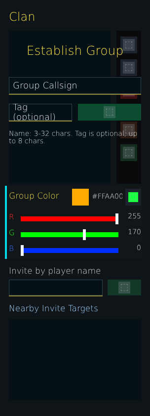


# ag_page_group.layout — Group page

**Mod:** Advanced Groups  
**File:** `AdvancedGroups/gui/layouts/hud/ag_page_group.layout`  
**Root:** `ScrollWidget` `"{000000003F474D07}"`, size 304 × 842  
**Widgets:** 60

The player's own group: create/rename, member list with ranks, invite, promote/demote, kick, leave, subgroups, group colour and tag.

## Preview

Wireframe drawn straight from the layout file: positions, sizes, colours and default text are exact. Image widgets appear as dashed placeholders, and anything hidden at start inside the root is left out.

## Loaded by

- `AdvancedGroups/scripts/5_Mission/AdvancedGroups/GUI/Pages/AGPageGroup.c` line 56

## Widget tree

Positions and sizes are in pixels when the widget uses exact sizing, otherwise they are fractions of the parent (0–1).

| Widget | Type | Position | Size | Text / notes |
|---|---|---|---|---|
| `"{000000003F474D07}"` | ScrollWidget | 18 22 | 304 × 842 |  |
| &nbsp;&nbsp;└ `"{000000000D6A528B}"` | TextWidget | 18 18 | 186 × 32 | "Clan" |
| &nbsp;&nbsp;└ `"{00000000D4F58B6D}"` | TextListboxWidget | 18 62 | 206 × 310 | style Default |
| &nbsp;&nbsp;└ `"{00000000606B55D6}"` | PanelWidget | 236 62 | 50 × 310 |  |
| &nbsp;&nbsp;&nbsp;&nbsp;└ `"{00000000085CE0E9}"` | ButtonWidget | 8 12 | 34 × 34 | style Default |
| &nbsp;&nbsp;&nbsp;&nbsp;&nbsp;&nbsp;└ `"{0000000087D46697}"` | ImageWidget | 5 5 | 24 × 24 |  |
| &nbsp;&nbsp;&nbsp;&nbsp;└ `"{00000000723A1982}"` | ButtonWidget | 8 58 | 34 × 34 | style Default |
| &nbsp;&nbsp;&nbsp;&nbsp;&nbsp;&nbsp;└ `"{0000000074E25424}"` | ImageWidget | 5 5 | 24 × 24 |  |
| &nbsp;&nbsp;&nbsp;&nbsp;└ `"{000000008F6401BA}"` | ButtonWidget | 8 104 | 34 × 34 | style Default |
| &nbsp;&nbsp;&nbsp;&nbsp;&nbsp;&nbsp;└ `"{0000000003E60997}"` | ImageWidget | 5 5 | 24 × 24 |  |
| &nbsp;&nbsp;&nbsp;&nbsp;└ `"{000000009A3B3EF8}"` | ButtonWidget | 8 184 | 34 × 34 | style Default |
| &nbsp;&nbsp;&nbsp;&nbsp;&nbsp;&nbsp;└ `"{00000000F984D531}"` | ImageWidget | 5 5 | 24 × 24 |  |
| &nbsp;&nbsp;&nbsp;&nbsp;└ `"{00000000F168371B}"` | ButtonWidget | 8 230 | 34 × 34 | style Default |
| &nbsp;&nbsp;&nbsp;&nbsp;&nbsp;&nbsp;└ `"{0000000004E4294A}"` | ImageWidget | 5 5 | 24 × 24 |  |
| &nbsp;&nbsp;└ `"{00000000DF5B91D3}"` | TextWidget | 18 536 | 268 × 24 | "Invite by player name" |
| &nbsp;&nbsp;└ `"{0000000089B17C2D}"` | PanelWidget | 18 566 | 190 × 32 |  |
| &nbsp;&nbsp;└ `"{000000007B5ED7DF}"` | EditBoxWidget | 18 566 | 190 × 32 | style ServerBrowser |
| &nbsp;&nbsp;└ `"{000000006F1E974A}"` | PanelWidget | 18 598 | 190 × 2 |  |
| &nbsp;&nbsp;└ `"{00000000F375DD8B}"` | ButtonWidget | 218 566 | 68 × 32 | style Default |
| &nbsp;&nbsp;&nbsp;&nbsp;└ `"{000000006796222C}"` | ImageWidget | 22 4 | 24 × 24 |  |
| &nbsp;&nbsp;└ `"{000000004A66C26A}"` | PanelWidget | 10 376 | 284 × 148 |  |
| &nbsp;&nbsp;&nbsp;&nbsp;└ `"{000000003E8C47C7}"` | PanelWidget | 0 0 | 4 × 148 |  |
| &nbsp;&nbsp;└ `"{00000000A3980AEC}"` | TextWidget | 18 384 | 130 × 24 | "Group Color" |
| &nbsp;&nbsp;└ `"{00000000CD4B28CB}"` | PanelWidget | 146 382 | 34 × 34 |  |
| &nbsp;&nbsp;└ `"{000000009238F1FD}"` | TextWidget | 186 386 | 62 × 24 | "#FFAA00" |
| &nbsp;&nbsp;└ `"{0000000049981B2B}"` | ButtonWidget | 254 382 | 32 × 34 | style Default |
| &nbsp;&nbsp;&nbsp;&nbsp;└ `"{00000000194524F1}"` | ImageWidget | 6 7 | 20 × 20 |  |
| &nbsp;&nbsp;└ `"{000000009FC748FC}"` | TextWidget | 18 428 | 18 × 22 | "R" |
| &nbsp;&nbsp;└ `"{000000004108C01D}"` | PanelWidget | 42 438 | 198 × 10 |  |
| &nbsp;&nbsp;└ `"{000000008068248B}"` | PanelWidget | 42 438 | 198 × 10 |  |
| &nbsp;&nbsp;└ `"{000000001CA1E05D}"` | PanelWidget | 234 432 | 6 × 22 |  |
| &nbsp;&nbsp;└ `"{0000000075D82587}"` | SliderWidget | 42 426 | 198 × 30 | style Default |
| &nbsp;&nbsp;└ `"{00000000C6FA046D}"` | TextWidget | 246 426 | 40 × 24 | "255" |
| &nbsp;&nbsp;└ `"{000000006E7AA06E}"` | TextWidget | 18 460 | 18 × 22 | "G" |
| &nbsp;&nbsp;└ `"{00000000FC07FE3A}"` | PanelWidget | 42 470 | 198 × 10 |  |
| &nbsp;&nbsp;└ `"{00000000B105D8C5}"` | PanelWidget | 42 470 | 198 × 10 |  |
| &nbsp;&nbsp;└ `"{00000000A1AEDE7A}"` | PanelWidget | 168 464 | 6 × 22 |  |
| &nbsp;&nbsp;└ `"{000000008465CD15}"` | SliderWidget | 42 458 | 198 × 30 | style Default |
| &nbsp;&nbsp;└ `"{000000003747ECFF}"` | TextWidget | 246 458 | 40 × 24 | "170" |
| &nbsp;&nbsp;└ `"{00000000290C88A6}"` | TextWidget | 18 492 | 18 × 22 | "B" |
| &nbsp;&nbsp;└ `"{00000000717D4AF5}"` | PanelWidget | 42 502 | 198 × 10 |  |
| &nbsp;&nbsp;└ `"{00000000F99A2CEC}"` | PanelWidget | 42 502 | 198 × 10 |  |
| &nbsp;&nbsp;└ `"{000000002CD46AB5}"` | PanelWidget | 42 496 | 6 × 22 |  |
| &nbsp;&nbsp;└ `"{00000000C313E5DD}"` | SliderWidget | 42 490 | 198 × 30 | style Default |
| &nbsp;&nbsp;└ `"{000000007031C437}"` | TextWidget | 246 490 | 40 × 24 | "0" |
| &nbsp;&nbsp;└ `"{000000007D39C288}"` | EditBoxWidget | 248 520 | 38 × 28 | "FFFF00", hidden at start, style ServerBrowser |
| &nbsp;&nbsp;└ `"{0000000061B328B7}"` | PanelWidget | 248 548 | 38 × 2 | hidden at start |
| &nbsp;&nbsp;└ `"{00000000932D464E}"` | TextWidget | 18 610 | 268 × 28 | "Nearby Invite Targets" |
| &nbsp;&nbsp;└ `"{000000005B3262C8}"` | TextListboxWidget | 18 646 | 268 × 164 | style Default |
| &nbsp;&nbsp;└ `"{0000000068094B88}"` | MultilineTextWidget | 18 706 | 268 × 124 | hidden at start |
| `"{000000006FBE0394}"` | ScrollWidget | 18 86 | 304 × 360 | hidden at start |
| &nbsp;&nbsp;└ `"{000000009074F074}"` | TextWidget | 18 22 | 268 × 34 | "Establish Group" |
| &nbsp;&nbsp;└ `"{00000000CADF64F3}"` | EditBoxWidget | 18 92 | 268 × 34 | "Group Callsign", style ServerBrowser |
| &nbsp;&nbsp;└ `"{000000000176166F}"` | PanelWidget | 18 126 | 268 × 2 |  |
| &nbsp;&nbsp;└ `"{000000005B7CD074}"` | EditBoxWidget | 18 146 | 128 × 34 | "Tag (optional)", style ServerBrowser |
| &nbsp;&nbsp;└ `"{000000006C3BFAC2}"` | PanelWidget | 18 180 | 128 × 2 |  |
| &nbsp;&nbsp;└ `"{0000000003094D2B}"` | TextWidget | 18 192 | 268 × 44 | "Name: 3-32 chars. Tag is optional, up to 8 chars." |
| &nbsp;&nbsp;└ `"{000000005547EF68}"` | ButtonWidget | 158 146 | 128 × 34 | style Default |
| &nbsp;&nbsp;&nbsp;&nbsp;└ `"{000000006EA5685C}"` | ImageWidget | 52 5 | 24 × 24 |  |
| &nbsp;&nbsp;└ `"{000000004574F2A5}"` | MultilineTextWidget | 18 214 | 268 × 110 | hidden at start |


