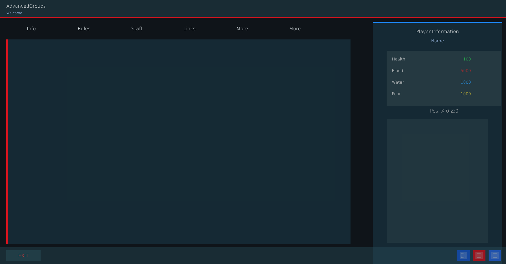


# ag_page_info.layout — Info page

**Mod:** Advanced Groups  
**File:** `AdvancedGroups/gui/layouts/hud/ag_page_info.layout`  
**Root:** `PanelWidget` `"{00000000351E8F23}"`, size 1 × 68  
**Widgets:** 39

Server information page: server name, rules and guide pages, links (Discord, website, store) configured under Server information.

## Preview

Wireframe drawn straight from the layout file: positions, sizes, colours and default text are exact. Image widgets appear as dashed placeholders, and anything hidden at start inside the root is left out.

## Loaded by

- `AdvancedGroups/scripts/5_Mission/AdvancedGroups/GUI/Pages/AGPageInfo.c` line 40
- `AdvancedGroups/scripts/5_Mission/AdvancedGroups/GUI/Pages/AGPageInfo.c` line 110

## Widget tree

Positions and sizes are in pixels when the widget uses exact sizing, otherwise they are fractions of the parent (0–1).

| Widget | Type | Position | Size | Text / notes |
|---|---|---|---|---|
| `"{00000000351E8F23}"` | PanelWidget | 0 0 | 1 × 68 |  |
| &nbsp;&nbsp;└ `"{000000002B808397}"` | PanelWidget | 0 64 | 1 × 4 |  |
| &nbsp;&nbsp;└ `"{00000000C19F871F}"` | TextWidget | 24 8 | 0.62 × 32 | "AdvancedGroups" |
| &nbsp;&nbsp;└ `"{0000000053960A56}"` | TextWidget | 24 38 | 0.62 × 24 | "Welcome" |
| `"{0000000017421805}"` | WrapSpacerWidget | 24 92 | 0.68 × 38 |  |
| &nbsp;&nbsp;└ `"{00000000FDD17E13}"` | ButtonWidget | 0 0 | 190 × 34 | "Info", style DayZDefaultButton |
| &nbsp;&nbsp;└ `"{000000007D41DE74}"` | ButtonWidget | 200 0 | 190 × 34 | "Rules", style DayZDefaultButton |
| &nbsp;&nbsp;└ `"{00000000F831236A}"` | ButtonWidget | 400 0 | 190 × 34 | "Staff", style DayZDefaultButton |
| &nbsp;&nbsp;└ `"{0000000078A1830D}"` | ButtonWidget | 600 0 | 190 × 34 | "Links", style DayZDefaultButton |
| &nbsp;&nbsp;└ `"{00000000F611C4E1}"` | ButtonWidget | 800 0 | 190 × 34 | "More", style DayZDefaultButton |
| &nbsp;&nbsp;└ `"{0000000076816486}"` | ButtonWidget | 1000 0 | 190 × 34 | "More", style DayZDefaultButton |
| `"{000000006BD629DA}"` | PanelWidget | 24 150 | 0.68 × 0.72 |  |
| &nbsp;&nbsp;└ `"{00000000EF437999}"` | PanelWidget | 0 0 | 5 × 1 |  |
| &nbsp;&nbsp;└ `"{0000000045D90717}"` | ScrollWidget | 24 24 | 0.94 × 0.92 |  |
| &nbsp;&nbsp;&nbsp;&nbsp;└ `"{00000000360E6957}"` | RichTextWidget | 0 0 | 1 × 1 |  |
| `"{00000000B52716E0}"` | PanelWidget | 14 83 | 0.256 × 0.852 |  |
| &nbsp;&nbsp;└ `"{000000002493ED83}"` | PanelWidget | 0 0 | 1 × 5 |  |
| &nbsp;&nbsp;└ `"{000000008225F524}"` | TextWidget | 0 22 | 1 × 32 | "Player Information" |
| &nbsp;&nbsp;└ `"{00000000D1180740}"` | TextWidget | 0 58 | 1 × 30 | "Name" |
| &nbsp;&nbsp;└ `"{0000000008482521}"` | PanelWidget | 24 110 | 0.88 × 210 |  |
| &nbsp;&nbsp;&nbsp;&nbsp;└ `"{0000000009C705CE}"` | TextWidget | 20 18 | 150 × 28 | "Health" |
| &nbsp;&nbsp;&nbsp;&nbsp;└ `"{00000000E70E27D2}"` | TextWidget | 190 18 | 130 × 28 | "100" |
| &nbsp;&nbsp;&nbsp;&nbsp;└ `"{00000000B10D577B}"` | TextWidget | 20 62 | 150 × 28 | "Blood" |
| &nbsp;&nbsp;&nbsp;&nbsp;└ `"{000000005FC47567}"` | TextWidget | 190 62 | 130 × 28 | "5000" |
| &nbsp;&nbsp;&nbsp;&nbsp;└ `"{00000000EBA16FC3}"` | TextWidget | 20 106 | 150 × 28 | "Water" |
| &nbsp;&nbsp;&nbsp;&nbsp;└ `"{0000000005684DDF}"` | TextWidget | 190 106 | 130 × 28 | "1000" |
| &nbsp;&nbsp;&nbsp;&nbsp;└ `"{00000000F7F9D6BA}"` | TextWidget | 20 150 | 150 × 28 | "Food" |
| &nbsp;&nbsp;&nbsp;&nbsp;└ `"{000000001930F4A6}"` | TextWidget | 190 150 | 130 × 28 | "1000" |
| &nbsp;&nbsp;└ `"{00000000C8578AEB}"` | TextWidget | 26 322 | 0.88 × 34 | "Pos: X:0 Z:0" |
| &nbsp;&nbsp;└ `"{00000000B461B208}"` | PanelWidget | 0 370 | 0.78 × 470 |  |
| &nbsp;&nbsp;&nbsp;&nbsp;└ `"{00000000B24B837C}"` | PlayerPreviewWidget | 0 0 | 1 × 1 |  |
| `"{00000000A584DD22}"` | PanelWidget | 0 76 | 1 × 64 |  |
| &nbsp;&nbsp;└ `"{0000000030158CF5}"` | ButtonWidget | 24 0 | 130 × 40 | "EXIT", style DayZDefaultButton |
| &nbsp;&nbsp;└ `"{00000000D7EEF749}"` | ButtonWidget | 18 0 | 48 × 40 | style DayZDefaultButton |
| &nbsp;&nbsp;&nbsp;&nbsp;└ `"{000000000BE54D3E}"` | ImageWidget | 10 6 | 28 × 28 |  |
| &nbsp;&nbsp;└ `"{000000004E8153E7}"` | ButtonWidget | 78 0 | 48 × 40 | style DayZDefaultButton |
| &nbsp;&nbsp;&nbsp;&nbsp;└ `"{0000000023DBC07B}"` | ImageWidget | 10 6 | 28 × 28 |  |
| &nbsp;&nbsp;└ `"{00000000CD679846}"` | ButtonWidget | 138 0 | 48 × 40 | style DayZDefaultButton |
| &nbsp;&nbsp;&nbsp;&nbsp;└ `"{000000004D92BAC4}"` | ImageWidget | 10 6 | 28 × 28 |  |


