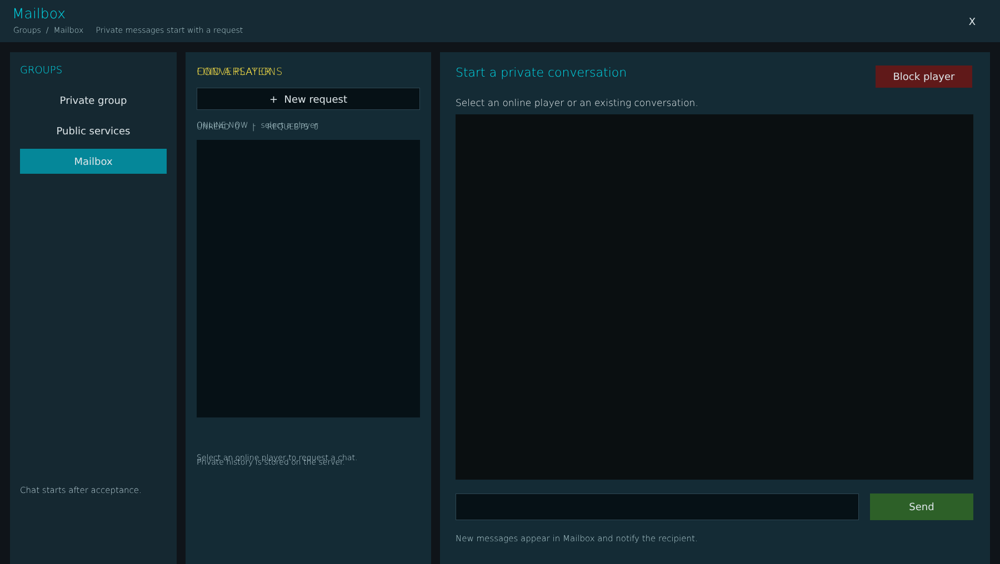


# ag_page_mailbox.layout — Mailbox page

**Mod:** Advanced Groups  
**File:** `AdvancedGroups/gui/layouts/hud/ag_page_mailbox.layout`  
**Root:** `PanelWidget` `"{0000000048FD1693}"`, size 1800 × 76  
**Widgets:** 43

Group mailbox: threads and messages between groups and staff, with unread alerts.

## Preview

Wireframe drawn straight from the layout file: positions, sizes, colours and default text are exact. Image widgets appear as dashed placeholders, and anything hidden at start inside the root is left out.

## Loaded by

- `AdvancedGroups/scripts/5_Mission/AdvancedGroups/GUI/Pages/AGPageMailbox.c` line 44

## Widget tree

Positions and sizes are in pixels when the widget uses exact sizing, otherwise they are fractions of the parent (0–1).

| Widget | Type | Position | Size | Text / notes |
|---|---|---|---|---|
| `"{0000000048FD1693}"` | PanelWidget | 0 0 | 1800 × 76 |  |
| `"{00000000980526E2}"` | TextWidget | 22 8 | 800 × 34 | "Mailbox" |
| `"{00000000DB5FE837}"` | TextWidget | 24 44 | 1100 × 22 | "Groups  /  Mailbox     Private messages start with a request" |
| `"{00000000967F4298}"` | ButtonWidget | 1724 18 | 52 × 42 | "X", style DayZDefaultButton |
| `"{00000000B08657A6}"` | PanelWidget | 18 94 | 300 × 922 |  |
| `"{0000000078715A3E}"` | TextWidget | 36 112 | 260 × 28 | "GROUPS" |
| `"{000000006D8EA43C}"` | ButtonWidget | 36 158 | 264 × 45 | "Private group", style DayZDefaultButton |
| `"{000000003A288665}"` | ButtonWidget | 36 213 | 264 × 45 | "Public services", style DayZDefaultButton |
| `"{00000000A3F9B2AF}"` | ButtonWidget | 36 268 | 264 × 45 | "Mailbox", style DayZDefaultButton |
| `"{000000005EB2FB64}"` | TextWidget | 36 836 | 260 × 95 | "Chat starts after acceptance." |
| `"{0000000091CD71AD}"` | PanelWidget | 334 94 | 442 × 922 |  |
| `"{00000000C02F2C0C}"` | TextWidget | 354 114 | 400 × 30 | "FIND A PLAYER" |
| `"{00000000A019971B}"` | EditBoxWidget | 354 158 | 402 × 40 | style ServerBrowser |
| `"{00000000133CD93C}"` | TextWidget | 354 215 | 390 × 22 | "ONLINE NOW  -  select a player" |
| `"{00000000473F5381}"` | TextListboxWidget | 354 252 | 402 × 500 | style Default |
| `"{000000002ABF7654}"` | TextWidget | 354 790 | 402 × 70 | "Select an online player to request a chat." |
| `"{0000000072BE7D6F}"` | TextWidget | 354 114 | 400 × 30 | "CONVERSATIONS", hidden at start |
| `"{000000002BA7668A}"` | ButtonWidget | 354 158 | 402 × 42 | "+  New request", hidden at start, style DayZDefaultButton |
| `"{0000000076407C35}"` | TextWidget | 354 217 | 400 × 24 | "UNREAD  0     \|     REQUESTS  0", hidden at start |
| `"{000000009B96D310}"` | TextListboxWidget | 354 252 | 402 × 500 | hidden at start, style Default |
| `"{00000000AF859E2B}"` | TextWidget | 354 790 | 402 × 86 | "Private history is stored on the server.", hidden at start |
| `"{0000000091158CB8}"` | PanelWidget | 792 94 | 990 × 922 |  |
| `"{00000000F708C2AA}"` | TextWidget | 820 114 | 900 × 34 | "Start a private conversation" |
| `"{00000000F45A8AAF}"` | TextWidget | 820 170 | 880 × 30 | "Select an online player or an existing conversation." |
| `"{00000000F45FCA30}"` | PanelWidget | 820 228 | 932 × 260 |  |
| `"{000000002ED1788E}"` | TextWidget | 840 246 | 880 × 26 | "CHAT REQUEST" |
| `"{00000000FE50DE3B}"` | TextWidget | 840 288 | 880 × 45 | "Introduce yourself. No conversation opens until they accept." |
| `"{00000000E35BC020}"` | EditBoxWidget | 840 340 | 890 × 42 | style ServerBrowser |
| `"{0000000020BC2982}"` | ButtonWidget | 1550 404 | 180 × 48 | "Send request", style DayZDefaultButton |
| `"{00000000E90CCC6D}"` | PanelWidget | 820 524 | 932 × 284 | hidden at start |
| `"{00000000000B782D}"` | TextWidget | 840 542 | 880 × 26 | "INCOMING REQUEST", hidden at start |
| `"{00000000EC1FD164}"` | TextWidget | 840 586 | 880 × 30 | hidden at start |
| `"{000000001162C6DD}"` | TextWidget | 840 632 | 880 × 50 | hidden at start |
| `"{00000000658598A1}"` | ButtonWidget | 840 725 | 168 × 46 | "Accept", hidden at start, style DayZDefaultButton |
| `"{00000000657AF7EF}"` | ButtonWidget | 1022 725 | 168 × 46 | "Decline", hidden at start, style DayZDefaultButton |
| `"{0000000092BE4F21}"` | ButtonWidget | 1576 118 | 174 × 40 | "Block player", hidden at start, style DayZDefaultButton |
| `"{00000000BF29A1D0}"` | PanelWidget | 820 206 | 932 × 658 | hidden at start |
| `"{00000000900E6E01}"` | ScrollWidget | 820 206 | 932 × 658 | hidden at start |
| &nbsp;&nbsp;└ `"{0000000014622256}"` | PanelWidget | 0 0 | 900 × 658 |  |
| &nbsp;&nbsp;&nbsp;&nbsp;└ `"{0000000055CB9E99}"` | MultilineTextWidget | 24 18 | 860 × 620 |  |
| `"{000000008B1277C7}"` | EditBoxWidget | 820 889 | 726 × 48 | hidden at start, style ServerBrowser |
| `"{00000000B8F9AEAE}"` | ButtonWidget | 1566 889 | 186 × 48 | "Send", hidden at start, style DayZDefaultButton |
| `"{0000000086435D47}"` | TextWidget | 820 958 | 930 × 25 | "New messages appear in Mailbox and notify the recipient." |


