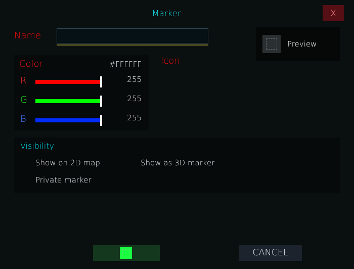


# ag_page_marker_popup.layout — Marker editor popup

**Mod:** Advanced Groups  
**File:** `AdvancedGroups/gui/layouts/hud/ag_page_marker_popup.layout`  
**Root:** `PanelWidget` `rootFrame`, size 700 × 532  
**Widgets:** 61

Floating editor opened when placing or editing a marker: name, icon, colour, visibility (group/private/server), circle radius and hatch options.

## Preview

Wireframe drawn straight from the layout file: positions, sizes, colours and default text are exact. Image widgets appear as dashed placeholders, and anything hidden at start inside the root is left out.

## Loaded by

- `AdvancedGroups/scripts/5_Mission/AdvancedGroups/GUI/Pages/AGPageMarkers.c` line 184

## Widget tree

Positions and sizes are in pixels when the widget uses exact sizing, otherwise they are fractions of the parent (0–1).

| Widget | Type | Position | Size | Text / notes |
|---|---|---|---|---|
| `rootFrame` | PanelWidget | 0 0 | 700 × 532 |  |
| &nbsp;&nbsp;└ `PopupDragHandle` | PanelWidget | 0 0 | 700 × 48 |  |
| &nbsp;&nbsp;└ `PopupTitle` | TextWidget | 44 12 | 570 × 30 | "Marker" |
| &nbsp;&nbsp;└ `BtnClosePopup` | ButtonWidget | 638 10 | 42 × 32 | style Default |
| &nbsp;&nbsp;└ `PopupCloseLabel` | TextWidget | 638 10 | 42 × 32 | "X" |
| &nbsp;&nbsp;└ `MarkerNameLabel` | TextWidget | 28 56 | 82 × 28 | "Name" |
| &nbsp;&nbsp;└ `MarkerLabelInput` | EditBoxWidget | 112 56 | 300 × 30 | style ServerBrowser |
| &nbsp;&nbsp;└ `MarkerLabelInputRule` | PanelWidget | 112 88 | 300 × 2 |  |
| &nbsp;&nbsp;└ `PreviewPanel` | PanelWidget | 506 54 | 166 × 66 |  |
| &nbsp;&nbsp;&nbsp;&nbsp;└ `PreviewSwatch` | PanelWidget | 10 12 | 42 × 42 |  |
| &nbsp;&nbsp;&nbsp;&nbsp;└ `PreviewIcon` | ImageWidget | 13 15 | 36 × 36 |  |
| &nbsp;&nbsp;&nbsp;&nbsp;└ `PreviewName` | TextWidget | 62 12 | 96 × 42 | "Preview" |
| &nbsp;&nbsp;└ `ColorPanel` | PanelWidget | 28 108 | 266 × 150 |  |
| &nbsp;&nbsp;&nbsp;&nbsp;└ `ColorTitle` | TextWidget | 10 6 | 236 × 24 | "Color" |
| &nbsp;&nbsp;&nbsp;&nbsp;└ `ColorHex` | TextWidget | 164 8 | 88 × 22 | "#FFFFFF" |
| &nbsp;&nbsp;&nbsp;&nbsp;└ `LabelR` | TextWidget | 12 40 | 24 × 22 | "R" |
| &nbsp;&nbsp;&nbsp;&nbsp;└ `SliderRTrack` | PanelWidget | 42 50 | 132 × 8 |  |
| &nbsp;&nbsp;&nbsp;&nbsp;└ `SliderRFill` | PanelWidget | 42 50 | 132 × 8 |  |
| &nbsp;&nbsp;&nbsp;&nbsp;└ `SliderRThumb` | PanelWidget | 170 43 | 4 × 22 |  |
| &nbsp;&nbsp;&nbsp;&nbsp;└ `SliderR` | SliderWidget | 42 36 | 132 × 30 | style Default |
| &nbsp;&nbsp;&nbsp;&nbsp;└ `ValueR` | TextWidget | 178 37 | 74 × 24 | "255" |
| &nbsp;&nbsp;&nbsp;&nbsp;└ `LabelG` | TextWidget | 12 78 | 24 × 22 | "G" |
| &nbsp;&nbsp;&nbsp;&nbsp;└ `SliderGTrack` | PanelWidget | 42 88 | 132 × 8 |  |
| &nbsp;&nbsp;&nbsp;&nbsp;└ `SliderGFill` | PanelWidget | 42 88 | 132 × 8 |  |
| &nbsp;&nbsp;&nbsp;&nbsp;└ `SliderGThumb` | PanelWidget | 170 81 | 4 × 22 |  |
| &nbsp;&nbsp;&nbsp;&nbsp;└ `SliderG` | SliderWidget | 42 74 | 132 × 30 | style Default |
| &nbsp;&nbsp;&nbsp;&nbsp;└ `ValueG` | TextWidget | 178 75 | 74 × 24 | "255" |
| &nbsp;&nbsp;&nbsp;&nbsp;└ `LabelB` | TextWidget | 12 116 | 24 × 22 | "B" |
| &nbsp;&nbsp;&nbsp;&nbsp;└ `SliderBTrack` | PanelWidget | 42 126 | 132 × 8 |  |
| &nbsp;&nbsp;&nbsp;&nbsp;└ `SliderBFill` | PanelWidget | 42 126 | 132 × 8 |  |
| &nbsp;&nbsp;&nbsp;&nbsp;└ `SliderBThumb` | PanelWidget | 170 119 | 4 × 22 |  |
| &nbsp;&nbsp;&nbsp;&nbsp;└ `SliderB` | SliderWidget | 42 112 | 132 × 30 | style Default |
| &nbsp;&nbsp;&nbsp;&nbsp;└ `ValueB` | TextWidget | 178 113 | 74 × 24 | "255" |
| &nbsp;&nbsp;└ `IconTitle` | TextWidget | 318 108 | 260 × 24 | "Icon" |
| &nbsp;&nbsp;└ `IconScroll` | ScrollWidget | 318 138 | 354 × 62 |  |
| &nbsp;&nbsp;&nbsp;&nbsp;└ `IconStrip` | PanelWidget | 0 0 | 44 × 42 |  |
| &nbsp;&nbsp;└ `VisibilityCard` | PanelWidget | 28 272 | 644 × 110 |  |
| &nbsp;&nbsp;&nbsp;&nbsp;└ `VisibilityTitle` | TextWidget | 12 6 | 180 × 22 | "Visibility" |
| &nbsp;&nbsp;&nbsp;&nbsp;└ `Chk2DMarker` | CheckBoxWidget | 12 36 | 190 × 28 |  |
| &nbsp;&nbsp;&nbsp;&nbsp;└ `Chk2DMarkerLabel` | TextWidget | 42 36 | 148 × 28 | "Show on 2D map" |
| &nbsp;&nbsp;&nbsp;&nbsp;└ `Chk3DMarker` | CheckBoxWidget | 220 36 | 220 × 28 |  |
| &nbsp;&nbsp;&nbsp;&nbsp;└ `Chk3DMarkerLabel` | TextWidget | 250 36 | 190 × 28 | "Show as 3D marker" |
| &nbsp;&nbsp;&nbsp;&nbsp;└ `ChkPrivateMarker` | CheckBoxWidget | 12 70 | 210 × 28 |  |
| &nbsp;&nbsp;&nbsp;&nbsp;└ `ChkPrivateMarkerLabel` | TextWidget | 42 70 | 174 × 28 | "Private marker" |
| &nbsp;&nbsp;└ `AdminPanel` | PanelWidget | 28 394 | 644 × 74 | hidden at start |
| &nbsp;&nbsp;&nbsp;&nbsp;└ `AdminTitle` | TextWidget | 10 3 | 110 × 24 | "Area" |
| &nbsp;&nbsp;&nbsp;&nbsp;└ `ChkServerMarker` | CheckBoxWidget | 120 3 | 170 × 24 |  |
| &nbsp;&nbsp;&nbsp;&nbsp;└ `ChkServerMarkerLabel` | TextWidget | 150 3 | 140 × 24 | "Server marker" |
| &nbsp;&nbsp;&nbsp;&nbsp;└ `BtnMyPos` | ButtonWidget | 300 2 | 150 × 26 | "MY POSITION", style Default |
| &nbsp;&nbsp;&nbsp;&nbsp;└ `BtnTPHere` | ButtonWidget | 460 2 | 174 × 26 | "TELEPORT HERE", style Default |
| &nbsp;&nbsp;&nbsp;&nbsp;└ `RadiusLabel` | TextWidget | 10 34 | 60 × 28 | "Radius" |
| &nbsp;&nbsp;&nbsp;&nbsp;└ `InputRadius` | EditBoxWidget | 72 33 | 70 × 28 | "0", style ServerBrowser |
| &nbsp;&nbsp;&nbsp;&nbsp;└ `InputRadiusRule` | PanelWidget | 72 61 | 70 × 2 |  |
| &nbsp;&nbsp;&nbsp;&nbsp;└ `RadiusHint` | TextWidget | 146 34 | 60 × 28 | "m" |
| &nbsp;&nbsp;&nbsp;&nbsp;└ `BtnStrikeStyle` | ButtonWidget | 210 34 | 200 × 28 | "STRIKE: NONE", style Default |
| &nbsp;&nbsp;&nbsp;&nbsp;└ `BtnStrikeColor` | ButtonWidget | 420 34 | 214 × 28 | "LINES: CIRCLE COLOUR", style Default |
| &nbsp;&nbsp;└ `BtnConfirm` | ButtonWidget | 184 484 | 131.669 × 32 | style Default |
| &nbsp;&nbsp;&nbsp;&nbsp;└ `IconConfirm` | ImageWidget | 53 4 | 24 × 24 |  |
| &nbsp;&nbsp;└ `BtnDelete` | ButtonWidget | 328 484 | 127.335 × 32 | hidden at start, style Default |
| &nbsp;&nbsp;&nbsp;&nbsp;└ `IconDelete` | ImageWidget | 52 4 | 24 × 24 |  |
| &nbsp;&nbsp;└ `BtnCancel` | ButtonWidget | 472 484 | 124.735 × 32 | "CANCEL", style Default |


