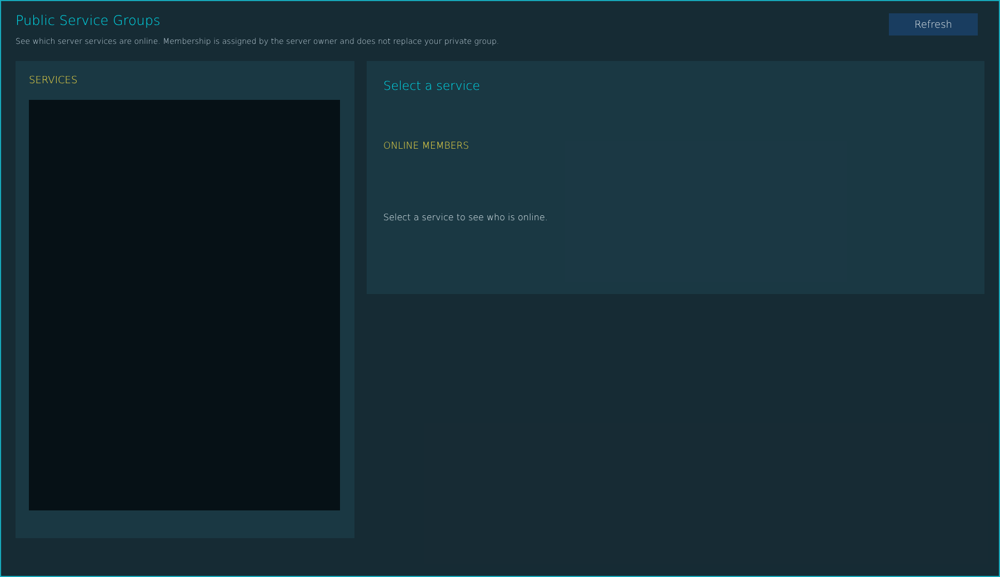


# ag_page_public_groups.layout — Public groups page

**Mod:** Advanced Groups  
**File:** `AdvancedGroups/gui/layouts/hud/ag_page_public_groups.layout`  
**Root:** `PanelWidget` `rootFrame`, size 1800 × 1040  
**Widgets:** 31

Public service groups (Taxi, Medic...) that any player can join next to their own group.

## Preview

Wireframe drawn straight from the layout file: positions, sizes, colours and default text are exact. Image widgets appear as dashed placeholders, and anything hidden at start inside the root is left out.

## Loaded by

- `AdvancedGroups/scripts/5_Mission/AdvancedGroups/GUI/Pages/AGPagePublicGroups.c` line 28

## Widget tree

Positions and sizes are in pixels when the widget uses exact sizing, otherwise they are fractions of the parent (0–1).

| Widget | Type | Position | Size | Text / notes |
|---|---|---|---|---|
| `rootFrame` | PanelWidget | 60 0 | 1800 × 1040 |  |
| &nbsp;&nbsp;└ `NeonTop` | PanelWidget | 0 0 | 1800 × 2 |  |
| &nbsp;&nbsp;└ `NeonBottom` | PanelWidget | 0 1038 | 1800 × 2 |  |
| &nbsp;&nbsp;└ `NeonLeft` | PanelWidget | 0 0 | 2 × 1040 |  |
| &nbsp;&nbsp;└ `NeonRight` | PanelWidget | 1798 0 | 2 × 1040 |  |
| &nbsp;&nbsp;└ `DirectoryBackdrop` | PanelWidget | 0 0 | 1800 × 1040 |  |
| &nbsp;&nbsp;└ `DirectoryTitle` | TextWidget | 28 18 | 900 × 38 | "Public Service Groups" |
| &nbsp;&nbsp;└ `DirectoryHint` | TextWidget | 28 60 | 1450 × 30 | "See which server services are online. Membership is assigned by the server owner and does not replace your private group." |
| &nbsp;&nbsp;└ `BtnPublicRefresh` | ButtonWidget | 1600 24 | 160 × 40 | "Refresh", style DayZDefaultButton |
| &nbsp;&nbsp;└ `DirectoryListCard` | PanelWidget | 28 110 | 610 × 860 |  |
| &nbsp;&nbsp;└ `DirectoryListTitle` | TextWidget | 52 130 | 550 × 28 | "SERVICES" |
| &nbsp;&nbsp;└ `PublicGroupList` | TextListboxWidget | 52 180 | 560 × 740 | style Default |
| &nbsp;&nbsp;└ `DirectoryDetailCard` | PanelWidget | 660 110 | 1112 × 420 |  |
| &nbsp;&nbsp;└ `PublicGroupName` | TextWidget | 690 138 | 1020 × 34 | "Select a service" |
| &nbsp;&nbsp;└ `PublicGroupDescription` | TextWidget | 690 188 | 1020 × 34 |  |
| &nbsp;&nbsp;└ `PublicGroupOnlineTitle` | TextWidget | 690 248 | 1020 × 28 | "ONLINE MEMBERS" |
| &nbsp;&nbsp;└ `PublicGroupOnline` | MultilineTextWidget | 690 292 | 1015 × 200 | "Select a service to see who is online." |
| &nbsp;&nbsp;└ `PublicGroupAdminPanel` | PanelWidget | 660 550 | 1112 × 420 | hidden at start |
| &nbsp;&nbsp;&nbsp;&nbsp;└ `PublicAdminTitle` | TextWidget | 28 16 | 1000 × 30 | "SERVER OWNER - CREATE / ASSIGN / EDIT" |
| &nbsp;&nbsp;&nbsp;&nbsp;└ `PublicNameLabel` | TextWidget | 28 68 | 180 × 24 | "Group name" |
| &nbsp;&nbsp;&nbsp;&nbsp;└ `PublicNameInput` | EditBoxWidget | 220 62 | 350 × 36 | style ServerBrowser |
| &nbsp;&nbsp;&nbsp;&nbsp;└ `PublicColorLabel` | TextWidget | 620 68 | 90 × 24 | "Color" |
| &nbsp;&nbsp;&nbsp;&nbsp;└ `PublicColorInput` | EditBoxWidget | 720 62 | 160 × 36 | "FFFFFF", style ServerBrowser |
| &nbsp;&nbsp;&nbsp;&nbsp;└ `PublicDescriptionLabel` | TextWidget | 28 126 | 180 × 24 | "Description" |
| &nbsp;&nbsp;&nbsp;&nbsp;└ `PublicDescriptionInput` | EditBoxWidget | 220 120 | 660 × 36 | style ServerBrowser |
| &nbsp;&nbsp;&nbsp;&nbsp;└ `PublicMembersLabel` | TextWidget | 28 186 | 1000 × 24 | "Assigned members - Steam64 IDs separated by commas (maximum 64)" |
| &nbsp;&nbsp;&nbsp;&nbsp;└ `PublicMembersInput` | EditBoxWidget | 28 220 | 1020 × 38 | style ServerBrowser |
| &nbsp;&nbsp;&nbsp;&nbsp;└ `BtnPublicNew` | ButtonWidget | 28 318 | 150 × 42 | "New", style DayZDefaultButton |
| &nbsp;&nbsp;&nbsp;&nbsp;└ `BtnPublicSave` | ButtonWidget | 190 318 | 150 × 42 | "Save", style DayZDefaultButton |
| &nbsp;&nbsp;&nbsp;&nbsp;└ `BtnPublicDelete` | ButtonWidget | 352 318 | 150 × 42 | "Delete", style DayZDefaultButton |
| &nbsp;&nbsp;&nbsp;&nbsp;└ `PublicAdminStatus` | TextWidget | 520 322 | 540 × 32 | "Only the server owner can change this directory." |


