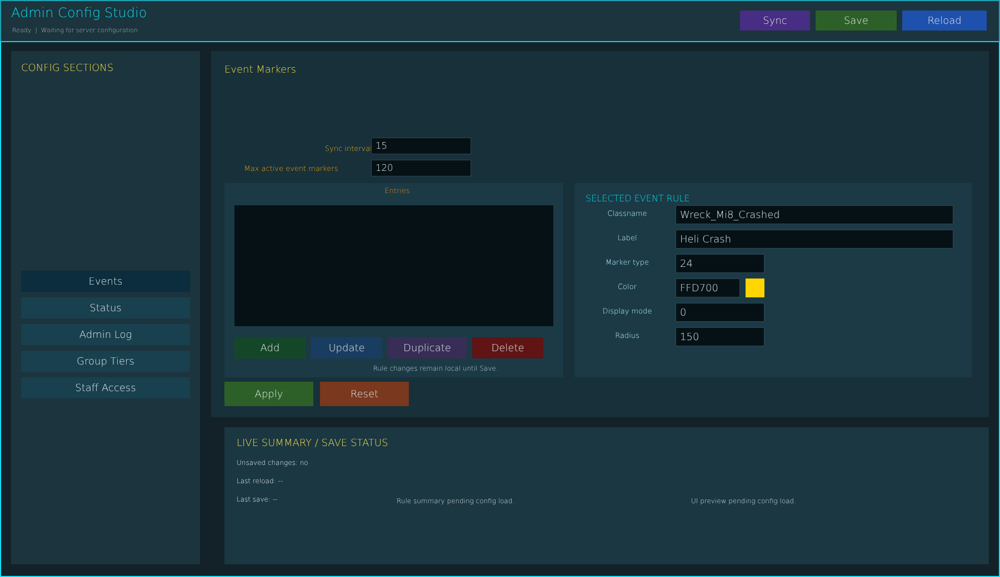


# ag_page_settings.layout — Settings page

**Mod:** Advanced Groups  
**File:** `AdvancedGroups/gui/layouts/hud/ag_page_settings.layout`  
**Root:** `PanelWidget` `rootFrame`, size 1800 × 1040  
**Widgets:** 352

Personal HUD and UI settings: compass, minimap, player list, 3D markers, name tags, colours, chat box, sizes and positions. Saved on the client.

## Preview

Wireframe drawn straight from the layout file: positions, sizes, colours and default text are exact. Image widgets appear as dashed placeholders, and anything hidden at start inside the root is left out.

## Loaded by

- `AdvancedGroups/scripts/5_Mission/AdvancedGroups/GUI/Pages/AGPageSettings.c` line 206

## Widget tree

Positions and sizes are in pixels when the widget uses exact sizing, otherwise they are fractions of the parent (0–1).

| Widget | Type | Position | Size | Text / notes |
|---|---|---|---|---|
| `rootFrame` | PanelWidget | 60 0 | 1800 × 1040 |  |
| &nbsp;&nbsp;└ `NeonTop` | PanelWidget | 0 0 | 1800 × 2 |  |
| &nbsp;&nbsp;└ `NeonBottom` | PanelWidget | 0 1038 | 1800 × 2 |  |
| &nbsp;&nbsp;└ `NeonLeft` | PanelWidget | 0 0 | 2 × 1040 |  |
| &nbsp;&nbsp;└ `NeonRight` | PanelWidget | 1798 0 | 2 × 1040 |  |
| &nbsp;&nbsp;└ `Header` | PanelWidget | 0 0 | 1800 × 76 |  |
| &nbsp;&nbsp;&nbsp;&nbsp;└ `HeaderAccent` | PanelWidget | 0 74 | 1800 × 2 |  |
| &nbsp;&nbsp;&nbsp;&nbsp;└ `PageTitle` | TextWidget | 20 6 | 500 × 34 | "Admin Config Studio" |
| &nbsp;&nbsp;&nbsp;&nbsp;└ `StatusText` | TextWidget | 22 44 | 960 × 22 | "Ready  \|  Waiting for server configuration" |
| &nbsp;&nbsp;&nbsp;&nbsp;└ `BtnReloadConfig` | ButtonWidget | 1624 19 | 152 × 36 | "Reload", style DayZDefaultButton |
| &nbsp;&nbsp;&nbsp;&nbsp;&nbsp;&nbsp;└ `IconReloadConfig` | ImageWidget | 24 8 | 28 × 28 | hidden at start |
| &nbsp;&nbsp;&nbsp;&nbsp;└ `BtnSaveConfig` | ButtonWidget | 1468 19 | 146 × 36 | "Save", style DayZDefaultButton |
| &nbsp;&nbsp;&nbsp;&nbsp;&nbsp;&nbsp;└ `IconSaveConfig` | ImageWidget | 24 8 | 28 × 28 | hidden at start |
| &nbsp;&nbsp;&nbsp;&nbsp;└ `BtnRefreshConfig` | ButtonWidget | 1332 19 | 126 × 36 | "Sync", style DayZDefaultButton |
| &nbsp;&nbsp;&nbsp;&nbsp;&nbsp;&nbsp;└ `IconRefreshConfig` | ImageWidget | 24 8 | 28 × 28 | hidden at start |
| &nbsp;&nbsp;└ `SectionPanel` | PanelWidget | 20 92 | 340 × 925 |  |
| &nbsp;&nbsp;&nbsp;&nbsp;└ `SectionBackdrop` | PanelWidget | 0 0 | 340 × 925 |  |
| &nbsp;&nbsp;&nbsp;&nbsp;└ `SectionsTitle` | TextWidget | 18 16 | 304 × 28 | "CONFIG SECTIONS" |
| &nbsp;&nbsp;&nbsp;&nbsp;└ `BtnSectionGeneral` | ButtonWidget | 18 60 | 304 × 38 | "General", hidden at start, style DayZDefaultButton |
| &nbsp;&nbsp;&nbsp;&nbsp;└ `BtnSectionGps` | ButtonWidget | 18 108 | 304 × 38 | "GPS / Minimap", hidden at start, style DayZDefaultButton |
| &nbsp;&nbsp;&nbsp;&nbsp;└ `BtnSectionChat` | ButtonWidget | 18 156 | 304 × 38 | "Chat", hidden at start, style DayZDefaultButton |
| &nbsp;&nbsp;&nbsp;&nbsp;└ `BtnSectionUi` | ButtonWidget | 18 204 | 304 × 38 | "UI Defaults", hidden at start, style DayZDefaultButton |
| &nbsp;&nbsp;&nbsp;&nbsp;└ `BtnSectionInfo` | ButtonWidget | 18 252 | 304 × 38 | "Info Buttons", hidden at start, style DayZDefaultButton |
| &nbsp;&nbsp;&nbsp;&nbsp;└ `BtnSectionPerms` | ButtonWidget | 18 300 | 304 × 38 | "Permissions", hidden at start, style DayZDefaultButton |
| &nbsp;&nbsp;&nbsp;&nbsp;└ `BtnSectionMaintenance` | ButtonWidget | 18 348 | 304 × 38 | "Maintenance", hidden at start, style DayZDefaultButton |
| &nbsp;&nbsp;&nbsp;&nbsp;└ `BtnSectionEvents` | ButtonWidget | 18 396 | 304 × 38 | "Events", style DayZDefaultButton |
| &nbsp;&nbsp;&nbsp;&nbsp;└ `BtnSectionStatus` | ButtonWidget | 18 444 | 304 × 38 | "Status", style DayZDefaultButton |
| &nbsp;&nbsp;&nbsp;&nbsp;└ `BtnSectionAdminLog` | ButtonWidget | 18 492 | 304 × 38 | "Admin Log", style DayZDefaultButton |
| &nbsp;&nbsp;&nbsp;&nbsp;└ `BtnSectionCategories` | ButtonWidget | 18 540 | 304 × 38 | "Group Tiers", style DayZDefaultButton |
| &nbsp;&nbsp;&nbsp;&nbsp;└ `BtnSectionStaff` | ButtonWidget | 18 588 | 304 × 38 | "Staff Access", style DayZDefaultButton |
| &nbsp;&nbsp;└ `ActivePanel` | PanelWidget | 380 92 | 1400 × 660 |  |
| &nbsp;&nbsp;&nbsp;&nbsp;└ `EditorBackdrop` | PanelWidget | 0 0 | 1400 × 660 |  |
| &nbsp;&nbsp;&nbsp;&nbsp;└ `ActiveTitle` | TextWidget | 24 14 | 1350 × 37 | "Event Markers", style Bold |
| &nbsp;&nbsp;&nbsp;&nbsp;└ `GeneralCardBg` | PanelWidget | 16 58 | 1368 × 500 | hidden at start |
| &nbsp;&nbsp;&nbsp;&nbsp;&nbsp;&nbsp;└ `GeneralCardAccent` | PanelWidget | 0 0 | 3 × 500 |  |
| &nbsp;&nbsp;&nbsp;&nbsp;└ `SectionContentCard` | PanelWidget | 24 58 | 1346 × 580 | hidden at start |
| &nbsp;&nbsp;&nbsp;&nbsp;└ `ChatChannelsCard` | PanelWidget | 24 82 | 650 × 380 | hidden at start |
| &nbsp;&nbsp;&nbsp;&nbsp;&nbsp;&nbsp;└ `ChatChannelsCardTitle` | TextWidget | 20 16 | 600 × 28 | "CHANNELS AND ANNOUNCEMENTS" |
| &nbsp;&nbsp;&nbsp;&nbsp;└ `ChatModerationCard` | PanelWidget | 694 82 | 676 × 380 | hidden at start |
| &nbsp;&nbsp;&nbsp;&nbsp;&nbsp;&nbsp;└ `ChatModerationCardTitle` | TextWidget | 20 16 | 630 × 28 | "MODERATION" |
| &nbsp;&nbsp;&nbsp;&nbsp;└ `ChatIdentityCard` | PanelWidget | 24 478 | 1346 × 182 | hidden at start |
| &nbsp;&nbsp;&nbsp;&nbsp;└ `ChatIdentityList` | TextListboxWidget | 48 525 | 410 × 120 | hidden at start, style Default |
| &nbsp;&nbsp;&nbsp;&nbsp;└ `BtnChatTagAdd` | ButtonWidget | 490 615 | 130 × 36 | "Add tag", hidden at start, style DayZDefaultButton |
| &nbsp;&nbsp;&nbsp;&nbsp;└ `BtnChatTagUpdate` | ButtonWidget | 630 615 | 130 × 36 | "Update", hidden at start, style DayZDefaultButton |
| &nbsp;&nbsp;&nbsp;&nbsp;└ `BtnChatTagDelete` | ButtonWidget | 770 615 | 130 × 36 | "Delete", hidden at start, style DayZDefaultButton |
| &nbsp;&nbsp;&nbsp;&nbsp;└ `EventListCard` | PanelWidget | 24 238 | 610 × 350 |  |
| &nbsp;&nbsp;&nbsp;&nbsp;└ `EventEditorCard` | PanelWidget | 654 238 | 716 × 350 |  |
| &nbsp;&nbsp;&nbsp;&nbsp;&nbsp;&nbsp;└ `EventEditorCardTitle` | TextWidget | 20 14 | 660 × 28 | "SELECTED EVENT RULE" |
| &nbsp;&nbsp;&nbsp;&nbsp;└ `LblMaxGroupSize` | TextWidget | 24 72 | 300 × 24 | "Max group size", hidden at start |
| &nbsp;&nbsp;&nbsp;&nbsp;└ `InputMaxGroupSizeBg` | PanelWidget | 360 68 | 180 × 30 | hidden at start |
| &nbsp;&nbsp;&nbsp;&nbsp;└ `InputMaxGroupSize` | EditBoxWidget | 360 68 | 180 × 30 | hidden at start, style ServerBrowser |
| &nbsp;&nbsp;&nbsp;&nbsp;└ `LblMaxSubgroups` | TextWidget | 24 112 | 300 × 24 | "Max subgroups", hidden at start |
| &nbsp;&nbsp;&nbsp;&nbsp;└ `InputMaxSubgroupsBg` | PanelWidget | 360 108 | 180 × 30 | hidden at start |
| &nbsp;&nbsp;&nbsp;&nbsp;└ `InputMaxSubgroups` | EditBoxWidget | 360 108 | 180 × 30 | hidden at start, style ServerBrowser |
| &nbsp;&nbsp;&nbsp;&nbsp;└ `LblMaxMarkers` | TextWidget | 24 152 | 300 × 24 | "Max markers per group", hidden at start |
| &nbsp;&nbsp;&nbsp;&nbsp;└ `InputMaxMarkersBg` | PanelWidget | 360 148 | 180 × 30 | hidden at start |
| &nbsp;&nbsp;&nbsp;&nbsp;└ `InputMaxMarkers` | EditBoxWidget | 360 148 | 180 × 30 | hidden at start, style ServerBrowser |
| &nbsp;&nbsp;&nbsp;&nbsp;└ `LblInviteTimeout` | TextWidget | 24 192 | 300 × 24 | "Invite timeout seconds", hidden at start |
| &nbsp;&nbsp;&nbsp;&nbsp;└ `InputInviteTimeoutBg` | PanelWidget | 360 188 | 180 × 30 | hidden at start |
| &nbsp;&nbsp;&nbsp;&nbsp;└ `InputInviteTimeout` | EditBoxWidget | 360 188 | 180 × 30 | hidden at start, style ServerBrowser |
| &nbsp;&nbsp;&nbsp;&nbsp;└ `LblInactiveCleanup` | TextWidget | 24 232 | 300 × 24 | "Inactive cleanup days", hidden at start |
| &nbsp;&nbsp;&nbsp;&nbsp;└ `InputInactiveCleanupDaysBg` | PanelWidget | 360 228 | 180 × 30 | hidden at start |
| &nbsp;&nbsp;&nbsp;&nbsp;└ `InputInactiveCleanupDays` | EditBoxWidget | 360 228 | 180 × 30 | hidden at start, style ServerBrowser |
| &nbsp;&nbsp;&nbsp;&nbsp;└ `LblCleanupInterval` | TextWidget | 24 272 | 300 × 24 | "Cleanup interval seconds", hidden at start |
| &nbsp;&nbsp;&nbsp;&nbsp;└ `InputCleanupIntervalBg` | PanelWidget | 360 268 | 180 × 30 | hidden at start |
| &nbsp;&nbsp;&nbsp;&nbsp;└ `InputCleanupInterval` | EditBoxWidget | 360 268 | 180 × 30 | hidden at start, style ServerBrowser |
| &nbsp;&nbsp;&nbsp;&nbsp;└ `LblAdminRank` | TextWidget | 24 312 | 300 × 24 | "Admin menu min rank", hidden at start |
| &nbsp;&nbsp;&nbsp;&nbsp;└ `InputAdminRankBg` | PanelWidget | 360 308 | 180 × 30 | hidden at start |
| &nbsp;&nbsp;&nbsp;&nbsp;└ `InputAdminRank` | EditBoxWidget | 360 308 | 180 × 30 | hidden at start, style ServerBrowser |
| &nbsp;&nbsp;&nbsp;&nbsp;└ `GpsTitle` | TextWidget | 24 72 | 560 × 28 | "GPS / Minimap Rules", hidden at start |
| &nbsp;&nbsp;&nbsp;&nbsp;└ `ChkShowOfflinePositions` | CheckBoxWidget | 24 116 | 500 × 28 | "Show offline member logout positions", hidden at start |
| &nbsp;&nbsp;&nbsp;&nbsp;└ `ChkGpsItemRequired` | CheckBoxWidget | 24 156 | 500 × 28 | "Require GPS item", hidden at start |
| &nbsp;&nbsp;&nbsp;&nbsp;└ `ChkGpsVehicleOnly` | CheckBoxWidget | 24 196 | 500 × 28 | "GPS/minimap only in vehicles", hidden at start |
| &nbsp;&nbsp;&nbsp;&nbsp;└ `ChkGpsVehicleBypass` | CheckBoxWidget | 24 236 | 500 × 28 | "Vehicle GPS bypasses item requirement", hidden at start |
| &nbsp;&nbsp;&nbsp;&nbsp;└ `ChatTitle` | TextWidget | 24 72 | 560 × 28 | "Chat / Moderation", hidden at start |
| &nbsp;&nbsp;&nbsp;&nbsp;└ `ChkAllowGlobalChat` | CheckBoxWidget | 24 116 | 500 × 28 | "Allow global group chat", hidden at start |
| &nbsp;&nbsp;&nbsp;&nbsp;└ `ChkLogGroupEvents` | CheckBoxWidget | 24 156 | 500 × 28 | "Log group events", hidden at start |
| &nbsp;&nbsp;&nbsp;&nbsp;└ `ChkBadWordFilter` | CheckBoxWidget | 24 196 | 500 × 28 | "Enable bad-word filter", hidden at start |
| &nbsp;&nbsp;&nbsp;&nbsp;└ `ChkMuteSystem` | CheckBoxWidget | 24 236 | 500 × 28 | "Enable mute system", hidden at start |
| &nbsp;&nbsp;&nbsp;&nbsp;└ `LblVicinityRange` | TextWidget | 24 292 | 300 × 24 | "Vicinity chat range", hidden at start |
| &nbsp;&nbsp;&nbsp;&nbsp;└ `InputVicinityRangeBg` | PanelWidget | 360 288 | 180 × 30 | hidden at start |
| &nbsp;&nbsp;&nbsp;&nbsp;└ `InputVicinityRange` | EditBoxWidget | 360 288 | 180 × 30 | hidden at start, style ServerBrowser |
| &nbsp;&nbsp;&nbsp;&nbsp;└ `LblBadWords` | TextWidget | 24 336 | 300 × 24 | "Blocked terms: English + translations (comma separated)", hidden at start |
| &nbsp;&nbsp;&nbsp;&nbsp;└ `InputBadWordsBg` | PanelWidget | 24 366 | 560 × 34 | hidden at start |
| &nbsp;&nbsp;&nbsp;&nbsp;└ `InputBadWords` | EditBoxWidget | 24 366 | 560 × 34 | hidden at start, style ServerBrowser |
| &nbsp;&nbsp;&nbsp;&nbsp;└ `LblChatIdentities` | TextWidget | 24 424 | 520 × 24 | "CHAT TAGS - select an entry to edit, or enter a new Steam64 ID", hidden at start |
| &nbsp;&nbsp;&nbsp;&nbsp;└ `LblChatSteamId` | TextWidget | 24 454 | 120 × 24 | "SteamID", hidden at start |
| &nbsp;&nbsp;&nbsp;&nbsp;└ `InputChatSteamIdBg` | PanelWidget | 180 450 | 430 × 30 | hidden at start |
| &nbsp;&nbsp;&nbsp;&nbsp;└ `InputChatSteamId` | EditBoxWidget | 180 450 | 430 × 30 | hidden at start, style ServerBrowser |
| &nbsp;&nbsp;&nbsp;&nbsp;└ `LblChatTag` | TextWidget | 24 494 | 120 × 24 | "Tag", hidden at start |
| &nbsp;&nbsp;&nbsp;&nbsp;└ `InputChatTagBg` | PanelWidget | 180 490 | 260 × 30 | hidden at start |
| &nbsp;&nbsp;&nbsp;&nbsp;└ `InputChatTag` | EditBoxWidget | 180 490 | 260 × 30 | hidden at start, style ServerBrowser |
| &nbsp;&nbsp;&nbsp;&nbsp;└ `LblChatColor` | TextWidget | 470 494 | 100 × 24 | "Color", hidden at start |
| &nbsp;&nbsp;&nbsp;&nbsp;└ `InputChatColorBg` | PanelWidget | 590 490 | 160 × 30 | hidden at start |
| &nbsp;&nbsp;&nbsp;&nbsp;└ `InputChatColor` | EditBoxWidget | 590 490 | 70 × 30 | hidden at start, style ServerBrowser |
| &nbsp;&nbsp;&nbsp;&nbsp;└ `ChatColorSwatch` | PanelWidget | 666 490 | 26 × 30 | hidden at start |
| &nbsp;&nbsp;&nbsp;&nbsp;└ `SliderChatColorR` | SliderWidget | 700 490 | 76 × 30 | hidden at start, style Default |
| &nbsp;&nbsp;&nbsp;&nbsp;└ `SliderChatColorG` | SliderWidget | 784 490 | 76 × 30 | hidden at start, style Default |
| &nbsp;&nbsp;&nbsp;&nbsp;└ `SliderChatColorB` | SliderWidget | 868 490 | 76 × 30 | hidden at start, style Default |
| &nbsp;&nbsp;&nbsp;&nbsp;└ `InputChatIdentitiesBg` | PanelWidget | 24 454 | 560 × 120 | hidden at start |
| &nbsp;&nbsp;&nbsp;&nbsp;└ `InputChatIdentities` | EditBoxWidget | 24 454 | 560 × 120 | hidden at start, style ServerBrowser |
| &nbsp;&nbsp;&nbsp;&nbsp;└ `ChatIdentitiesHint` | TextWidget | 24 584 | 560 × 44 | "One per line: SteamID\|Tag\|RRGGBB", hidden at start |
| &nbsp;&nbsp;&nbsp;&nbsp;└ `UiDefaultsTitle` | TextWidget | 24 72 | 560 × 28 | "UI Defaults", hidden at start |
| &nbsp;&nbsp;&nbsp;&nbsp;└ `ChkDefaultCompass` | CheckBoxWidget | 24 116 | 500 × 28 | "Show compass by default", hidden at start |
| &nbsp;&nbsp;&nbsp;&nbsp;└ `ChkDefaultPlayerlist` | CheckBoxWidget | 24 156 | 500 × 28 | "Show player list by default", hidden at start |
| &nbsp;&nbsp;&nbsp;&nbsp;└ `ChkDefault3DMarkers` | CheckBoxWidget | 24 196 | 500 × 28 | "Show 3D markers by default", hidden at start |
| &nbsp;&nbsp;&nbsp;&nbsp;└ `ChkDefault3DName` | CheckBoxWidget | 24 236 | 500 × 28 | "Show 3D player names", hidden at start |
| &nbsp;&nbsp;&nbsp;&nbsp;└ `ChkDefault3DDistance` | CheckBoxWidget | 24 276 | 500 × 28 | "Show 3D distances", hidden at start |
| &nbsp;&nbsp;&nbsp;&nbsp;└ `ChkDefault3DIcon` | CheckBoxWidget | 24 316 | 500 × 28 | "Show 3D icons", hidden at start |
| &nbsp;&nbsp;&nbsp;&nbsp;└ `ChkDeathMarkerPrivate` | CheckBoxWidget | 24 282 | 620 × 28 | "Death markers are private, even for group members", hidden at start |
| &nbsp;&nbsp;&nbsp;&nbsp;└ `LblNameTagMode` | TextWidget | 24 372 | 300 × 24 | "Player name tag mode", hidden at start |
| &nbsp;&nbsp;&nbsp;&nbsp;└ `InputNameTagModeBg` | PanelWidget | 360 368 | 180 × 30 | hidden at start |
| &nbsp;&nbsp;&nbsp;&nbsp;└ `InputNameTagMode` | EditBoxWidget | 360 368 | 180 × 30 | hidden at start, style ServerBrowser |
| &nbsp;&nbsp;&nbsp;&nbsp;└ `LblNameIconMode` | TextWidget | 24 412 | 300 × 24 | "Player icon mode", hidden at start |
| &nbsp;&nbsp;&nbsp;&nbsp;└ `InputNameIconModeBg` | PanelWidget | 360 408 | 180 × 30 | hidden at start |
| &nbsp;&nbsp;&nbsp;&nbsp;└ `InputNameIconMode` | EditBoxWidget | 360 408 | 180 × 30 | hidden at start, style ServerBrowser |
| &nbsp;&nbsp;&nbsp;&nbsp;└ `LblNameGroupTagMode` | TextWidget | 24 452 | 300 × 24 | "Group tag mode", hidden at start |
| &nbsp;&nbsp;&nbsp;&nbsp;└ `InputNameGroupTagModeBg` | PanelWidget | 360 448 | 180 × 30 | hidden at start |
| &nbsp;&nbsp;&nbsp;&nbsp;└ `InputNameGroupTagMode` | EditBoxWidget | 360 448 | 180 × 30 | hidden at start, style ServerBrowser |
| &nbsp;&nbsp;&nbsp;&nbsp;└ `LblDefaultPlayerColor` | TextWidget | 24 492 | 300 × 24 | "Player marker RGB", hidden at start |
| &nbsp;&nbsp;&nbsp;&nbsp;└ `InputDefaultPlayerColorBg` | PanelWidget | 360 488 | 66 × 30 | hidden at start |
| &nbsp;&nbsp;&nbsp;&nbsp;└ `InputDefaultPlayerColor` | EditBoxWidget | 360 488 | 66 × 30 | hidden at start, style ServerBrowser |
| &nbsp;&nbsp;&nbsp;&nbsp;└ `DefaultPlayerColorSwatch` | PanelWidget | 432 488 | 26 × 30 | hidden at start |
| &nbsp;&nbsp;&nbsp;&nbsp;└ `SliderDefaultPlayerColorR` | SliderWidget | 466 488 | 66 × 30 | hidden at start, style Default |
| &nbsp;&nbsp;&nbsp;&nbsp;└ `SliderDefaultPlayerColorG` | SliderWidget | 536 488 | 66 × 30 | hidden at start, style Default |
| &nbsp;&nbsp;&nbsp;&nbsp;└ `SliderDefaultPlayerColorB` | SliderWidget | 606 488 | 66 × 30 | hidden at start, style Default |
| &nbsp;&nbsp;&nbsp;&nbsp;└ `LblDefaultCompassColor` | TextWidget | 24 532 | 300 × 24 | "Compass RGB", hidden at start |
| &nbsp;&nbsp;&nbsp;&nbsp;└ `InputDefaultCompassColorBg` | PanelWidget | 360 528 | 66 × 30 | hidden at start |
| &nbsp;&nbsp;&nbsp;&nbsp;└ `InputDefaultCompassColor` | EditBoxWidget | 360 528 | 66 × 30 | hidden at start, style ServerBrowser |
| &nbsp;&nbsp;&nbsp;&nbsp;└ `DefaultCompassColorSwatch` | PanelWidget | 432 528 | 26 × 30 | hidden at start |
| &nbsp;&nbsp;&nbsp;&nbsp;└ `SliderDefaultCompassColorR` | SliderWidget | 466 528 | 66 × 30 | hidden at start, style Default |
| &nbsp;&nbsp;&nbsp;&nbsp;└ `SliderDefaultCompassColorG` | SliderWidget | 536 528 | 66 × 30 | hidden at start, style Default |
| &nbsp;&nbsp;&nbsp;&nbsp;└ `SliderDefaultCompassColorB` | SliderWidget | 606 528 | 66 × 30 | hidden at start, style Default |
| &nbsp;&nbsp;&nbsp;&nbsp;└ `LblDefaultPlayerlistColor` | TextWidget | 24 572 | 300 × 24 | "Player list RGB", hidden at start |
| &nbsp;&nbsp;&nbsp;&nbsp;└ `InputDefaultPlayerlistColorBg` | PanelWidget | 360 568 | 66 × 30 | hidden at start |
| &nbsp;&nbsp;&nbsp;&nbsp;└ `InputDefaultPlayerlistColor` | EditBoxWidget | 360 568 | 66 × 30 | hidden at start, style ServerBrowser |
| &nbsp;&nbsp;&nbsp;&nbsp;└ `DefaultPlayerlistColorSwatch` | PanelWidget | 432 568 | 26 × 30 | hidden at start |
| &nbsp;&nbsp;&nbsp;&nbsp;└ `SliderDefaultPlayerlistColorR` | SliderWidget | 466 568 | 66 × 30 | hidden at start, style Default |
| &nbsp;&nbsp;&nbsp;&nbsp;└ `SliderDefaultPlayerlistColorG` | SliderWidget | 536 568 | 66 × 30 | hidden at start, style Default |
| &nbsp;&nbsp;&nbsp;&nbsp;└ `SliderDefaultPlayerlistColorB` | SliderWidget | 606 568 | 66 × 30 | hidden at start, style Default |
| &nbsp;&nbsp;&nbsp;&nbsp;└ `InfoTitle` | TextWidget | 24 72 | 568 × 32 | "Info Buttons", hidden at start |
| &nbsp;&nbsp;&nbsp;&nbsp;└ `LblDiscordLink` | TextWidget | 24 116 | 300 × 24 | "Discord link", hidden at start |
| &nbsp;&nbsp;&nbsp;&nbsp;└ `InputDiscordLinkBg` | PanelWidget | 24 146 | 661 × 33 | hidden at start |
| &nbsp;&nbsp;&nbsp;&nbsp;└ `InputDiscordLink` | EditBoxWidget | 24 146 | 661 × 33 | hidden at start, style ServerBrowser |
| &nbsp;&nbsp;&nbsp;&nbsp;└ `LblWebsiteLink` | TextWidget | 24 198 | 300 × 24 | "Website link", hidden at start |
| &nbsp;&nbsp;&nbsp;&nbsp;└ `InputWebsiteLinkBg` | PanelWidget | 24 228 | 658 × 33 | hidden at start |
| &nbsp;&nbsp;&nbsp;&nbsp;└ `InputWebsiteLink` | EditBoxWidget | 24 228 | 658 × 33 | hidden at start, style ServerBrowser |
| &nbsp;&nbsp;&nbsp;&nbsp;└ `LblDonateLink` | TextWidget | 24 280 | 300 × 24 | "Donate link", hidden at start |
| &nbsp;&nbsp;&nbsp;&nbsp;└ `InputDonateLinkBg` | PanelWidget | 19 312 | 663 × 36 | hidden at start |
| &nbsp;&nbsp;&nbsp;&nbsp;└ `InputDonateLink` | EditBoxWidget | 19 312 | 663 × 36 | hidden at start, style ServerBrowser |
| &nbsp;&nbsp;&nbsp;&nbsp;└ `InfoHint` | TextWidget | 25 366 | 653 × 28 | "These values save to server_info.json and sync to the player info page buttons.", hidden at start |
| &nbsp;&nbsp;&nbsp;&nbsp;└ `AdminTitle` | TextWidget | 24 72 | 560 × 28 | "Webhook Integrations", hidden at start |
| &nbsp;&nbsp;&nbsp;&nbsp;└ `ChkPvPProtection` | CheckBoxWidget | 24 116 | 500 × 28 | "Global PVE: block all player-vs-player damage", hidden at start |
| &nbsp;&nbsp;&nbsp;&nbsp;└ `ChkGroupFriendlyFire` | CheckBoxWidget | 24 116 | 500 × 28 | "Block friendly fire between group members", hidden at start |
| &nbsp;&nbsp;&nbsp;&nbsp;└ `ChkWebhooks` | CheckBoxWidget | 24 156 | 500 × 28 | "Enable Discord webhooks", hidden at start |
| &nbsp;&nbsp;&nbsp;&nbsp;└ `LblWebhookUrl` | TextWidget | 25 201 | 300 × 24 | "Default webhook URL", hidden at start |
| &nbsp;&nbsp;&nbsp;&nbsp;└ `InputWebhookUrlBg` | PanelWidget | 20 230 | 1005 × 38 | hidden at start |
| &nbsp;&nbsp;&nbsp;&nbsp;└ `InputWebhookUrl` | EditBoxWidget | 24 234 | 996 × 30 | hidden at start, style ServerBrowser |
| &nbsp;&nbsp;&nbsp;&nbsp;└ `LblWebhookGroupCreated` | TextWidget | 26 315 | 170 × 24 | "Group created", hidden at start |
| &nbsp;&nbsp;&nbsp;&nbsp;└ `InputWebhookGroupCreatedBg` | PanelWidget | 202 309 | 826 × 38 | hidden at start |
| &nbsp;&nbsp;&nbsp;&nbsp;└ `InputWebhookGroupCreated` | EditBoxWidget | 204 314 | 817 × 30 | hidden at start, style ServerBrowser |
| &nbsp;&nbsp;&nbsp;&nbsp;└ `LblWebhookGroupDisbanded` | TextWidget | 24 356 | 170 × 24 | "Group disbanded", hidden at start |
| &nbsp;&nbsp;&nbsp;&nbsp;└ `InputWebhookGroupDisbandedBg` | PanelWidget | 201 354 | 826 × 38 | hidden at start |
| &nbsp;&nbsp;&nbsp;&nbsp;└ `InputWebhookGroupDisbanded` | EditBoxWidget | 204 357 | 817 × 30 | hidden at start, style ServerBrowser |
| &nbsp;&nbsp;&nbsp;&nbsp;└ `LblWebhookMemberJoined` | TextWidget | 31 407 | 170 × 24 | "Member joined", hidden at start |
| &nbsp;&nbsp;&nbsp;&nbsp;└ `InputWebhookMemberJoinedBg` | PanelWidget | 208 398 | 818 × 38 | hidden at start |
| &nbsp;&nbsp;&nbsp;&nbsp;└ `InputWebhookMemberJoined` | EditBoxWidget | 212 403 | 810 × 30 | hidden at start, style ServerBrowser |
| &nbsp;&nbsp;&nbsp;&nbsp;└ `LblWebhookMemberLeft` | TextWidget | 30 450 | 170 × 24 | "Member left", hidden at start |
| &nbsp;&nbsp;&nbsp;&nbsp;└ `InputWebhookMemberLeftBg` | PanelWidget | 209 441 | 819 × 38 | hidden at start |
| &nbsp;&nbsp;&nbsp;&nbsp;└ `InputWebhookMemberLeft` | EditBoxWidget | 213 444 | 810 × 30 | hidden at start, style ServerBrowser |
| &nbsp;&nbsp;&nbsp;&nbsp;└ `LblWebhookMemberKicked` | TextWidget | 33 492 | 170 × 24 | "Member kicked", hidden at start |
| &nbsp;&nbsp;&nbsp;&nbsp;└ `InputWebhookMemberKickedBg` | PanelWidget | 210 487 | 820 × 38 | hidden at start |
| &nbsp;&nbsp;&nbsp;&nbsp;└ `InputWebhookMemberKicked` | EditBoxWidget | 215 491 | 812 × 30 | hidden at start, style ServerBrowser |
| &nbsp;&nbsp;&nbsp;&nbsp;└ `LblWebhookChatGlobal` | TextWidget | 30 542 | 170 × 24 | "Global chat", hidden at start |
| &nbsp;&nbsp;&nbsp;&nbsp;└ `InputWebhookChatGlobalBg` | PanelWidget | 210 533 | 820 × 38 | hidden at start |
| &nbsp;&nbsp;&nbsp;&nbsp;└ `InputWebhookChatGlobal` | EditBoxWidget | 215 537 | 812 × 30 | hidden at start, style ServerBrowser |
| &nbsp;&nbsp;&nbsp;&nbsp;└ `LblWebhookChatVicinity` | TextWidget | 27 585 | 170 × 24 | "Vicinity chat", hidden at start |
| &nbsp;&nbsp;&nbsp;&nbsp;└ `InputWebhookChatVicinityBg` | PanelWidget | 208 579 | 820 × 38 | hidden at start |
| &nbsp;&nbsp;&nbsp;&nbsp;└ `InputWebhookChatVicinity` | EditBoxWidget | 214 583 | 812 × 30 | hidden at start, style ServerBrowser |
| &nbsp;&nbsp;&nbsp;&nbsp;└ `LblWebhookChatGroup` | TextWidget | 24 628 | 170 × 24 | "Group chat", hidden at start |
| &nbsp;&nbsp;&nbsp;&nbsp;└ `InputWebhookChatGroupBg` | PanelWidget | 208 625 | 820 × 38 | hidden at start |
| &nbsp;&nbsp;&nbsp;&nbsp;└ `InputWebhookChatGroup` | EditBoxWidget | 212 630 | 812 × 30 | hidden at start, style ServerBrowser |
| &nbsp;&nbsp;&nbsp;&nbsp;└ `LblWebhookChatSubgroup` | TextWidget | 24 676 | 170 × 24 | "Subgroup chat", hidden at start |
| &nbsp;&nbsp;&nbsp;&nbsp;└ `InputWebhookChatSubgroupBg` | PanelWidget | 208 669 | 820 × 38 | hidden at start |
| &nbsp;&nbsp;&nbsp;&nbsp;└ `InputWebhookChatSubgroup` | EditBoxWidget | 213 673 | 812 × 30 | hidden at start, style ServerBrowser |
| &nbsp;&nbsp;&nbsp;&nbsp;└ `LblWebhookMarkerPlaced` | TextWidget | 22 723 | 170 × 24 | "Marker placed", hidden at start |
| &nbsp;&nbsp;&nbsp;&nbsp;└ `InputWebhookMarkerPlacedBg` | PanelWidget | 206 716 | 820 × 38 | hidden at start |
| &nbsp;&nbsp;&nbsp;&nbsp;└ `InputWebhookMarkerPlaced` | EditBoxWidget | 209 719 | 812 × 30 | hidden at start, style ServerBrowser |
| &nbsp;&nbsp;&nbsp;&nbsp;└ `LblAdminIds` | TextWidget | 24 700 | 300 × 24 | "Admin SteamIDs, comma separated", hidden at start |
| &nbsp;&nbsp;&nbsp;&nbsp;└ `InputAdminIdsBg` | PanelWidget | 20 726 | 568 × 42 | hidden at start |
| &nbsp;&nbsp;&nbsp;&nbsp;└ `InputAdminIds` | EditBoxWidget | 24 730 | 560 × 34 | hidden at start, style ServerBrowser |
| &nbsp;&nbsp;&nbsp;&nbsp;└ `ChkEventMarkers` | CheckBoxWidget | 25 104 | 620 × 28 | "Enable classname-triggered event markers" |
| &nbsp;&nbsp;&nbsp;&nbsp;└ `LblEventSyncInterval` | TextWidget | 28 161 | 496 × 31 | "Sync interval seconds" |
| &nbsp;&nbsp;&nbsp;&nbsp;└ `InputEventSyncIntervalBg` | PanelWidget | 288 156 | 180 × 30 |  |
| &nbsp;&nbsp;&nbsp;&nbsp;└ `InputEventSyncInterval` | EditBoxWidget | 288 156 | 180 × 30 | "15", style ServerBrowser |
| &nbsp;&nbsp;&nbsp;&nbsp;└ `LblEventMaxActive` | TextWidget | 24 200 | 240 × 24 | "Max active event markers" |
| &nbsp;&nbsp;&nbsp;&nbsp;└ `InputEventMaxActiveBg` | PanelWidget | 288 196 | 180 × 30 |  |
| &nbsp;&nbsp;&nbsp;&nbsp;└ `InputEventMaxActive` | EditBoxWidget | 288 196 | 180 × 30 | "120", style ServerBrowser |
| &nbsp;&nbsp;&nbsp;&nbsp;└ `LblEventEntries` | TextWidget | 25 240 | 620 × 24 | "Entries" |
| &nbsp;&nbsp;&nbsp;&nbsp;└ `EventRuleList` | TextListboxWidget | 42 278 | 574 × 218 | style Default |
| &nbsp;&nbsp;&nbsp;&nbsp;└ `BtnEventAdd` | ButtonWidget | 42 516 | 128 × 38 | "Add", style DayZDefaultButton |
| &nbsp;&nbsp;&nbsp;&nbsp;└ `BtnEventUpdate` | ButtonWidget | 180 516 | 128 × 38 | "Update", style DayZDefaultButton |
| &nbsp;&nbsp;&nbsp;&nbsp;└ `BtnEventDuplicate` | ButtonWidget | 318 516 | 142 × 38 | "Duplicate", style DayZDefaultButton |
| &nbsp;&nbsp;&nbsp;&nbsp;└ `BtnEventDelete` | ButtonWidget | 470 516 | 128 × 38 | "Delete", style DayZDefaultButton |
| &nbsp;&nbsp;&nbsp;&nbsp;└ `LblEventClassName` | TextWidget | 674 278 | 150 × 30 | "Classname" |
| &nbsp;&nbsp;&nbsp;&nbsp;└ `InputEventClassNameBg` | PanelWidget | 836 278 | 500 × 34 |  |
| &nbsp;&nbsp;&nbsp;&nbsp;└ `InputEventClassName` | EditBoxWidget | 836 278 | 500 × 34 | "Wreck_Mi8_Crashed", style ServerBrowser |
| &nbsp;&nbsp;&nbsp;&nbsp;└ `LblEventLabel` | TextWidget | 674 322 | 150 × 30 | "Label" |
| &nbsp;&nbsp;&nbsp;&nbsp;└ `InputEventLabelBg` | PanelWidget | 836 322 | 500 × 34 |  |
| &nbsp;&nbsp;&nbsp;&nbsp;└ `InputEventLabel` | EditBoxWidget | 836 322 | 500 × 34 | "Heli Crash", style ServerBrowser |
| &nbsp;&nbsp;&nbsp;&nbsp;└ `LblEventType` | TextWidget | 674 366 | 150 × 30 | "Marker type" |
| &nbsp;&nbsp;&nbsp;&nbsp;└ `InputEventTypeBg` | PanelWidget | 836 366 | 160 × 34 |  |
| &nbsp;&nbsp;&nbsp;&nbsp;└ `InputEventType` | EditBoxWidget | 836 366 | 160 × 34 | "24", style ServerBrowser |
| &nbsp;&nbsp;&nbsp;&nbsp;└ `LblEventColor` | TextWidget | 674 410 | 150 × 30 | "Color" |
| &nbsp;&nbsp;&nbsp;&nbsp;└ `InputEventColorBg` | PanelWidget | 836 410 | 116 × 34 |  |
| &nbsp;&nbsp;&nbsp;&nbsp;└ `InputEventColor` | EditBoxWidget | 836 410 | 116 × 34 | "FFD700", style ServerBrowser |
| &nbsp;&nbsp;&nbsp;&nbsp;└ `EventColorSwatch` | PanelWidget | 962 410 | 34 × 34 |  |
| &nbsp;&nbsp;&nbsp;&nbsp;└ `SliderEventColorR` | SliderWidget | 1008 410 | 98 × 34 | style Default |
| &nbsp;&nbsp;&nbsp;&nbsp;└ `SliderEventColorG` | SliderWidget | 1116 410 | 98 × 34 | style Default |
| &nbsp;&nbsp;&nbsp;&nbsp;└ `SliderEventColorB` | SliderWidget | 1224 410 | 98 × 34 | style Default |
| &nbsp;&nbsp;&nbsp;&nbsp;└ `LblEventDisplay` | TextWidget | 674 454 | 150 × 30 | "Display mode" |
| &nbsp;&nbsp;&nbsp;&nbsp;└ `InputEventDisplayBg` | PanelWidget | 836 454 | 160 × 34 |  |
| &nbsp;&nbsp;&nbsp;&nbsp;└ `InputEventDisplay` | EditBoxWidget | 836 454 | 160 × 34 | "0", style ServerBrowser |
| &nbsp;&nbsp;&nbsp;&nbsp;└ `LblEventRadius` | TextWidget | 674 498 | 150 × 30 | "Radius" |
| &nbsp;&nbsp;&nbsp;&nbsp;└ `InputEventRadiusBg` | PanelWidget | 836 498 | 160 × 34 |  |
| &nbsp;&nbsp;&nbsp;&nbsp;└ `InputEventRadius` | EditBoxWidget | 836 498 | 160 × 34 | "150", style ServerBrowser |
| &nbsp;&nbsp;&nbsp;&nbsp;└ `InputEventEntriesBg` | PanelWidget | 24 290 | 760 × 180 | hidden at start |
| &nbsp;&nbsp;&nbsp;&nbsp;└ `InputEventEntries` | EditBoxWidget | 24 290 | 760 × 180 | "Wreck_Mi8_Crashed\|Heli Crash\|24\|FFD700\|0\|150", hidden at start, style ServerBrowser |
| &nbsp;&nbsp;&nbsp;&nbsp;└ `EventEntriesHint` | TextWidget | 24 558 | 760 × 30 | "Rule changes remain local until Save." |
| &nbsp;&nbsp;&nbsp;&nbsp;└ `RuleTitle` | TextWidget | 24 72 | 560 × 28 | "Maintenance", hidden at start |
| &nbsp;&nbsp;&nbsp;&nbsp;└ `RuleSummary` | MultilineTextWidget | 24 116 | 560 × 220 | "Reload reads disk. Save validates the draft and synchronizes online players.", hidden at start |
| &nbsp;&nbsp;&nbsp;&nbsp;└ `BottomHint` | TextWidget | 24 360 | 560 × 52 | "Save validates, persists, and synchronizes the draft.", hidden at start |
| &nbsp;&nbsp;&nbsp;&nbsp;└ `StatusSectionTitle` | TextWidget | 24 72 | 560 × 28 | "Server Status", hidden at start |
| &nbsp;&nbsp;&nbsp;&nbsp;└ `TxtStatusGroups` | TextWidget | 24 116 | 500 × 26 | "Total groups: --", hidden at start |
| &nbsp;&nbsp;&nbsp;&nbsp;└ `TxtStatusOnline` | TextWidget | 24 152 | 500 × 26 | "Online players: --", hidden at start |
| &nbsp;&nbsp;&nbsp;&nbsp;└ `TxtStatusOnlineInGroups` | TextWidget | 24 188 | 500 × 26 | "Online members in groups: --", hidden at start |
| &nbsp;&nbsp;&nbsp;&nbsp;└ `TxtStatusServerMarkers` | TextWidget | 24 224 | 500 × 26 | "Active server markers: --", hidden at start |
| &nbsp;&nbsp;&nbsp;&nbsp;└ `TxtStatusEventMarkers` | TextWidget | 24 260 | 500 × 26 | "Active event markers: --", hidden at start |
| &nbsp;&nbsp;&nbsp;&nbsp;└ `BtnRefreshStatus` | ButtonWidget | 24 306 | 180 × 38 | "Refresh", hidden at start, style DayZDefaultButton |
| &nbsp;&nbsp;&nbsp;&nbsp;└ `AdminLogSectionTitle` | TextWidget | 24 72 | 560 × 28 | "Admin Log (last 200 lines)", hidden at start |
| &nbsp;&nbsp;&nbsp;&nbsp;└ `LogScroll` | ScrollWidget | 24 116 | 996 × 700 | hidden at start |
| &nbsp;&nbsp;&nbsp;&nbsp;&nbsp;&nbsp;└ `LogCanvas` | PanelWidget | 0 0 | 996 × 700 |  |
| &nbsp;&nbsp;&nbsp;&nbsp;&nbsp;&nbsp;&nbsp;&nbsp;└ `LogText` | MultilineTextWidget | 10 8 | 976 × 680 | "Refresh to load server log." |
| &nbsp;&nbsp;&nbsp;&nbsp;└ `BtnRefreshLog` | ButtonWidget | 24 826 | 180 × 38 | "Refresh", hidden at start, style DayZDefaultButton |
| &nbsp;&nbsp;&nbsp;&nbsp;└ `CategoriesSectionTitle` | TextWidget | 24 72 | 560 × 28 | "Group Tiers", hidden at start |
| &nbsp;&nbsp;&nbsp;&nbsp;└ `CatAdminCardBg` | PanelWidget | 16 142 | 916 × 82 | hidden at start |
| &nbsp;&nbsp;&nbsp;&nbsp;&nbsp;&nbsp;└ `CatAdminCardAccent` | PanelWidget | 0 0 | 3 × 82 |  |
| &nbsp;&nbsp;&nbsp;&nbsp;└ `CatVipCardBg` | PanelWidget | 16 232 | 916 × 82 | hidden at start |
| &nbsp;&nbsp;&nbsp;&nbsp;&nbsp;&nbsp;└ `CatVipCardAccent` | PanelWidget | 0 0 | 3 × 82 |  |
| &nbsp;&nbsp;&nbsp;&nbsp;└ `CatTier1CardBg` | PanelWidget | 16 322 | 916 × 82 | hidden at start |
| &nbsp;&nbsp;&nbsp;&nbsp;&nbsp;&nbsp;└ `CatTier1CardAccent` | PanelWidget | 0 0 | 3 × 82 |  |
| &nbsp;&nbsp;&nbsp;&nbsp;└ `CatTier2CardBg` | PanelWidget | 16 412 | 916 × 82 | hidden at start |
| &nbsp;&nbsp;&nbsp;&nbsp;&nbsp;&nbsp;└ `CatTier2CardAccent` | PanelWidget | 0 0 | 3 × 82 |  |
| &nbsp;&nbsp;&nbsp;&nbsp;└ `CatColHeader` | TextWidget | 24 108 | 900 × 24 | "Tier", hidden at start |
| &nbsp;&nbsp;&nbsp;&nbsp;└ `CatBadgeHeader` | TextWidget | 130 108 | 140 × 24 | "Badge color", hidden at start |
| &nbsp;&nbsp;&nbsp;&nbsp;└ `CatSizeHeader` | TextWidget | 280 108 | 82 × 24 | "Max size", hidden at start |
| &nbsp;&nbsp;&nbsp;&nbsp;└ `CatSubHeader` | TextWidget | 374 108 | 90 × 24 | "Subgroups", hidden at start |
| &nbsp;&nbsp;&nbsp;&nbsp;└ `CatMarkerHeader` | TextWidget | 468 108 | 90 × 24 | "Markers", hidden at start |
| &nbsp;&nbsp;&nbsp;&nbsp;└ `CatBypassHeader` | TextWidget | 570 108 | 180 × 24 | "Invite-cap bypass", hidden at start |
| &nbsp;&nbsp;&nbsp;&nbsp;└ `CatNameColorHeader` | TextWidget | 776 108 | 130 × 24 | "Name color", hidden at start |
| &nbsp;&nbsp;&nbsp;&nbsp;└ `CatAdminNameColor` | EditBoxWidget | 776 146 | 110 × 30 | hidden at start, style ServerBrowser |
| &nbsp;&nbsp;&nbsp;&nbsp;└ `CatVipNameColor` | EditBoxWidget | 776 236 | 110 × 30 | hidden at start, style ServerBrowser |
| &nbsp;&nbsp;&nbsp;&nbsp;└ `CatTier1NameColor` | EditBoxWidget | 776 326 | 110 × 30 | hidden at start, style ServerBrowser |
| &nbsp;&nbsp;&nbsp;&nbsp;└ `CatTier2NameColor` | EditBoxWidget | 776 416 | 110 × 30 | hidden at start, style ServerBrowser |
| &nbsp;&nbsp;&nbsp;&nbsp;└ `CatAdminNameSwatch` | PanelWidget | 960 146 | 28 × 30 | hidden at start |
| &nbsp;&nbsp;&nbsp;&nbsp;└ `CatAdminNamePreview` | TextWidget | 1000 146 | 220 × 30 | "Player name", hidden at start |
| &nbsp;&nbsp;&nbsp;&nbsp;└ `CatVipNameSwatch` | PanelWidget | 960 236 | 28 × 30 | hidden at start |
| &nbsp;&nbsp;&nbsp;&nbsp;└ `CatVipNamePreview` | TextWidget | 1000 236 | 220 × 30 | "Player name", hidden at start |
| &nbsp;&nbsp;&nbsp;&nbsp;└ `CatTier1NameSwatch` | PanelWidget | 960 326 | 28 × 30 | hidden at start |
| &nbsp;&nbsp;&nbsp;&nbsp;└ `CatTier1NamePreview` | TextWidget | 1000 326 | 220 × 30 | "Player name", hidden at start |
| &nbsp;&nbsp;&nbsp;&nbsp;└ `CatTier2NameSwatch` | PanelWidget | 960 416 | 28 × 30 | hidden at start |
| &nbsp;&nbsp;&nbsp;&nbsp;└ `CatTier2NamePreview` | TextWidget | 1000 416 | 220 × 30 | "Player name", hidden at start |
| &nbsp;&nbsp;&nbsp;&nbsp;└ `CatAdminLabel` | TextWidget | 24 150 | 100 × 30 | "Admin", hidden at start |
| &nbsp;&nbsp;&nbsp;&nbsp;└ `CatAdminColor` | EditBoxWidget | 140 146 | 100 × 30 | hidden at start, style ServerBrowser |
| &nbsp;&nbsp;&nbsp;&nbsp;└ `CatAdminSwatch` | PanelWidget | 246 146 | 24 × 30 | hidden at start |
| &nbsp;&nbsp;&nbsp;&nbsp;└ `CatAdminSliderR` | SliderWidget | 140 182 | 130 × 13 | hidden at start, style Default |
| &nbsp;&nbsp;&nbsp;&nbsp;└ `CatAdminSliderG` | SliderWidget | 140 197 | 130 × 13 | hidden at start, style Default |
| &nbsp;&nbsp;&nbsp;&nbsp;└ `CatAdminSliderB` | SliderWidget | 140 212 | 130 × 13 | hidden at start, style Default |
| &nbsp;&nbsp;&nbsp;&nbsp;└ `CatAdminSize` | EditBoxWidget | 290 146 | 80 × 30 | hidden at start, style ServerBrowser |
| &nbsp;&nbsp;&nbsp;&nbsp;└ `CatAdminSub` | EditBoxWidget | 380 146 | 80 × 30 | hidden at start, style ServerBrowser |
| &nbsp;&nbsp;&nbsp;&nbsp;└ `CatAdminMarkers` | EditBoxWidget | 470 146 | 80 × 30 | hidden at start, style ServerBrowser |
| &nbsp;&nbsp;&nbsp;&nbsp;└ `CatAdminBypass` | CheckBoxWidget | 560 150 | 220 × 26 | "Bypass invite cap", hidden at start |
| &nbsp;&nbsp;&nbsp;&nbsp;└ `CatVipLabel` | TextWidget | 24 240 | 100 × 30 | "VIP", hidden at start |
| &nbsp;&nbsp;&nbsp;&nbsp;└ `CatVipColor` | EditBoxWidget | 140 236 | 100 × 30 | hidden at start, style ServerBrowser |
| &nbsp;&nbsp;&nbsp;&nbsp;└ `CatVipSwatch` | PanelWidget | 246 236 | 24 × 30 | hidden at start |
| &nbsp;&nbsp;&nbsp;&nbsp;└ `CatVipSliderR` | SliderWidget | 140 272 | 130 × 13 | hidden at start, style Default |
| &nbsp;&nbsp;&nbsp;&nbsp;└ `CatVipSliderG` | SliderWidget | 140 287 | 130 × 13 | hidden at start, style Default |
| &nbsp;&nbsp;&nbsp;&nbsp;└ `CatVipSliderB` | SliderWidget | 140 302 | 130 × 13 | hidden at start, style Default |
| &nbsp;&nbsp;&nbsp;&nbsp;└ `CatVipSize` | EditBoxWidget | 290 236 | 80 × 30 | hidden at start, style ServerBrowser |
| &nbsp;&nbsp;&nbsp;&nbsp;└ `CatVipSub` | EditBoxWidget | 380 236 | 80 × 30 | hidden at start, style ServerBrowser |
| &nbsp;&nbsp;&nbsp;&nbsp;└ `CatVipMarkers` | EditBoxWidget | 470 236 | 80 × 30 | hidden at start, style ServerBrowser |
| &nbsp;&nbsp;&nbsp;&nbsp;└ `CatVipBypass` | CheckBoxWidget | 560 240 | 220 × 26 | "Bypass invite cap", hidden at start |
| &nbsp;&nbsp;&nbsp;&nbsp;└ `CatTier1Label` | TextWidget | 24 330 | 100 × 30 | "Tier1", hidden at start |
| &nbsp;&nbsp;&nbsp;&nbsp;└ `CatTier1Color` | EditBoxWidget | 140 326 | 100 × 30 | hidden at start, style ServerBrowser |
| &nbsp;&nbsp;&nbsp;&nbsp;└ `CatTier1Swatch` | PanelWidget | 246 326 | 24 × 30 | hidden at start |
| &nbsp;&nbsp;&nbsp;&nbsp;└ `CatTier1SliderR` | SliderWidget | 140 362 | 130 × 13 | hidden at start, style Default |
| &nbsp;&nbsp;&nbsp;&nbsp;└ `CatTier1SliderG` | SliderWidget | 140 377 | 130 × 13 | hidden at start, style Default |
| &nbsp;&nbsp;&nbsp;&nbsp;└ `CatTier1SliderB` | SliderWidget | 140 392 | 130 × 13 | hidden at start, style Default |
| &nbsp;&nbsp;&nbsp;&nbsp;└ `CatTier1Size` | EditBoxWidget | 290 326 | 80 × 30 | hidden at start, style ServerBrowser |
| &nbsp;&nbsp;&nbsp;&nbsp;└ `CatTier1Sub` | EditBoxWidget | 380 326 | 80 × 30 | hidden at start, style ServerBrowser |
| &nbsp;&nbsp;&nbsp;&nbsp;└ `CatTier1Markers` | EditBoxWidget | 470 326 | 80 × 30 | hidden at start, style ServerBrowser |
| &nbsp;&nbsp;&nbsp;&nbsp;└ `CatTier1Bypass` | CheckBoxWidget | 560 330 | 220 × 26 | "Bypass invite cap", hidden at start |
| &nbsp;&nbsp;&nbsp;&nbsp;└ `CatTier2Label` | TextWidget | 24 420 | 100 × 30 | "Tier2", hidden at start |
| &nbsp;&nbsp;&nbsp;&nbsp;└ `CatTier2Color` | EditBoxWidget | 140 416 | 100 × 30 | hidden at start, style ServerBrowser |
| &nbsp;&nbsp;&nbsp;&nbsp;└ `CatTier2Swatch` | PanelWidget | 246 416 | 24 × 30 | hidden at start |
| &nbsp;&nbsp;&nbsp;&nbsp;└ `CatTier2SliderR` | SliderWidget | 140 452 | 130 × 13 | hidden at start, style Default |
| &nbsp;&nbsp;&nbsp;&nbsp;└ `CatTier2SliderG` | SliderWidget | 140 467 | 130 × 13 | hidden at start, style Default |
| &nbsp;&nbsp;&nbsp;&nbsp;└ `CatTier2SliderB` | SliderWidget | 140 482 | 130 × 13 | hidden at start, style Default |
| &nbsp;&nbsp;&nbsp;&nbsp;└ `CatTier2Size` | EditBoxWidget | 290 416 | 80 × 30 | hidden at start, style ServerBrowser |
| &nbsp;&nbsp;&nbsp;&nbsp;└ `CatTier2Sub` | EditBoxWidget | 380 416 | 80 × 30 | hidden at start, style ServerBrowser |
| &nbsp;&nbsp;&nbsp;&nbsp;└ `CatTier2Markers` | EditBoxWidget | 470 416 | 80 × 30 | hidden at start, style ServerBrowser |
| &nbsp;&nbsp;&nbsp;&nbsp;└ `CatTier2Bypass` | CheckBoxWidget | 560 420 | 220 × 26 | "Bypass invite cap", hidden at start |
| &nbsp;&nbsp;&nbsp;&nbsp;└ `StaffAccessPanel` | PanelWidget | 16 58 | 1000 × 690 | hidden at start |
| &nbsp;&nbsp;&nbsp;&nbsp;&nbsp;&nbsp;└ `StaffRoleCard` | PanelWidget | 310 70 | 670 × 385 |  |
| &nbsp;&nbsp;&nbsp;&nbsp;&nbsp;&nbsp;└ `StaffAssignCard` | PanelWidget | 12 480 | 968 × 184 |  |
| &nbsp;&nbsp;&nbsp;&nbsp;&nbsp;&nbsp;└ `StaffRoleNameBg` | PanelWidget | 326 163 | 308 × 39 |  |
| &nbsp;&nbsp;&nbsp;&nbsp;&nbsp;&nbsp;└ `StaffGrantsBg` | PanelWidget | 326 325 | 638 × 39 |  |
| &nbsp;&nbsp;&nbsp;&nbsp;&nbsp;&nbsp;└ `StaffSteamIdBg` | PanelWidget | 26 553 | 282 × 39 |  |
| &nbsp;&nbsp;&nbsp;&nbsp;&nbsp;&nbsp;└ `StaffAssignRoleBg` | PanelWidget | 326 553 | 308 × 39 |  |
| &nbsp;&nbsp;&nbsp;&nbsp;&nbsp;&nbsp;└ `StaffHint` | TextWidget | 20 14 | 960 × 32 | "Owners listed in adminIds already have full access. First save a role, then assign it to a player." |
| &nbsp;&nbsp;&nbsp;&nbsp;&nbsp;&nbsp;└ `StaffRolesLabel` | TextWidget | 20 76 | 280 × 28 | "Saved roles" |
| &nbsp;&nbsp;&nbsp;&nbsp;&nbsp;&nbsp;└ `StaffRoleList` | TextListboxWidget | 20 112 | 280 × 310 | style Default |
| &nbsp;&nbsp;&nbsp;&nbsp;&nbsp;&nbsp;└ `StaffListHint` | TextWidget | 20 433 | 280 × 26 | "Select a role to edit its grants." |
| &nbsp;&nbsp;&nbsp;&nbsp;&nbsp;&nbsp;└ `StaffGrantsLabel` | TextWidget | 326 82 | 630 × 28 | "1  Create or edit a role" |
| &nbsp;&nbsp;&nbsp;&nbsp;&nbsp;&nbsp;└ `StaffRoleNameLabel` | TextWidget | 326 128 | 620 × 25 | "Role name - example: Map Moderator" |
| &nbsp;&nbsp;&nbsp;&nbsp;&nbsp;&nbsp;└ `StaffRoleName` | EditBoxWidget | 330 166 | 300 × 34 | style ServerBrowser |
| &nbsp;&nbsp;&nbsp;&nbsp;&nbsp;&nbsp;└ `StaffKeysHint` | TextWidget | 326 216 | 635 × 24 | "Grant examples: groups.view, markers.server.edit" |
| &nbsp;&nbsp;&nbsp;&nbsp;&nbsp;&nbsp;└ `StaffMoreKeysHint` | TextWidget | 326 244 | 635 × 24 | "Other keys: chat.mute, zones.edit, config.events.edit" |
| &nbsp;&nbsp;&nbsp;&nbsp;&nbsp;&nbsp;└ `StaffGrantsInputLabel` | TextWidget | 326 285 | 635 × 25 | "Permission keys - separate each key with a comma" |
| &nbsp;&nbsp;&nbsp;&nbsp;&nbsp;&nbsp;└ `StaffGrants` | EditBoxWidget | 330 328 | 630 × 34 | style ServerBrowser |
| &nbsp;&nbsp;&nbsp;&nbsp;&nbsp;&nbsp;└ `BtnStaffSaveRole` | ButtonWidget | 326 395 | 160 × 38 | "Save role", style DayZDefaultButton |
| &nbsp;&nbsp;&nbsp;&nbsp;&nbsp;&nbsp;└ `BtnStaffDeleteRole` | ButtonWidget | 496 395 | 160 × 38 | "Delete role", style DayZDefaultButton |
| &nbsp;&nbsp;&nbsp;&nbsp;&nbsp;&nbsp;└ `BtnStaffRefresh` | ButtonWidget | 666 395 | 160 × 38 | "Refresh", style DayZDefaultButton |
| &nbsp;&nbsp;&nbsp;&nbsp;&nbsp;&nbsp;└ `StaffAssignmentLabel` | TextWidget | 26 492 | 938 × 28 | "2  Assign the saved role to a player" |
| &nbsp;&nbsp;&nbsp;&nbsp;&nbsp;&nbsp;└ `StaffSteamIdLabel` | TextWidget | 26 528 | 282 × 24 | "Player Steam64 ID (17 digits)" |
| &nbsp;&nbsp;&nbsp;&nbsp;&nbsp;&nbsp;└ `StaffAssignRoleLabel` | TextWidget | 326 528 | 308 × 24 | "Saved role name" |
| &nbsp;&nbsp;&nbsp;&nbsp;&nbsp;&nbsp;└ `StaffSteamId` | EditBoxWidget | 30 556 | 274 × 34 | style ServerBrowser |
| &nbsp;&nbsp;&nbsp;&nbsp;&nbsp;&nbsp;└ `StaffAssignRole` | EditBoxWidget | 330 556 | 300 × 34 | style ServerBrowser |
| &nbsp;&nbsp;&nbsp;&nbsp;&nbsp;&nbsp;└ `BtnStaffAssign` | ButtonWidget | 666 556 | 160 × 38 | "Assign role", style DayZDefaultButton |
| &nbsp;&nbsp;&nbsp;&nbsp;&nbsp;&nbsp;└ `StaffAssignments` | TextWidget | 26 620 | 938 × 28 | "Assignments: none. Clear the role field and assign again to remove an assignment." |
| &nbsp;&nbsp;&nbsp;&nbsp;└ `BtnApplySection` | ButtonWidget | 24 596 | 160 × 44 | "Apply", style DayZDefaultButton |
| &nbsp;&nbsp;&nbsp;&nbsp;&nbsp;&nbsp;└ `IconApplySection` | ImageWidget | 12 12 | 24 × 24 | hidden at start |
| &nbsp;&nbsp;&nbsp;&nbsp;└ `BtnResetSection` | ButtonWidget | 196 596 | 160 × 44 | "Reset", style DayZDefaultButton |
| &nbsp;&nbsp;&nbsp;&nbsp;&nbsp;&nbsp;└ `IconResetSection` | ImageWidget | 12 12 | 24 × 24 | hidden at start |
| &nbsp;&nbsp;└ `SummaryPanel` | PanelWidget | 404 770 | 1376 × 247 |  |
| &nbsp;&nbsp;&nbsp;&nbsp;└ `SummaryBackdrop` | PanelWidget | 0 0 | 1376 × 247 |  |
| &nbsp;&nbsp;&nbsp;&nbsp;└ `SummaryTitle` | TextWidget | 22 14 | 1320 × 28 | "LIVE SUMMARY / SAVE STATUS" |
| &nbsp;&nbsp;&nbsp;&nbsp;└ `TxtUnsavedChanges` | TextWidget | 22 54 | 270 × 22 | "Unsaved changes: no" |
| &nbsp;&nbsp;&nbsp;&nbsp;└ `TxtLastReload` | TextWidget | 22 87 | 270 × 22 | "Last reload: --" |
| &nbsp;&nbsp;&nbsp;&nbsp;└ `TxtLastSave` | TextWidget | 22 120 | 270 × 22 | "Last save: --" |
| &nbsp;&nbsp;&nbsp;&nbsp;└ `RuleSummaryLive` | MultilineTextWidget | 310 54 | 500 × 160 | "Rule summary pending config load." |
| &nbsp;&nbsp;&nbsp;&nbsp;└ `UiPreviewText` | MultilineTextWidget | 840 54 | 500 × 160 | "UI preview pending config load." |


