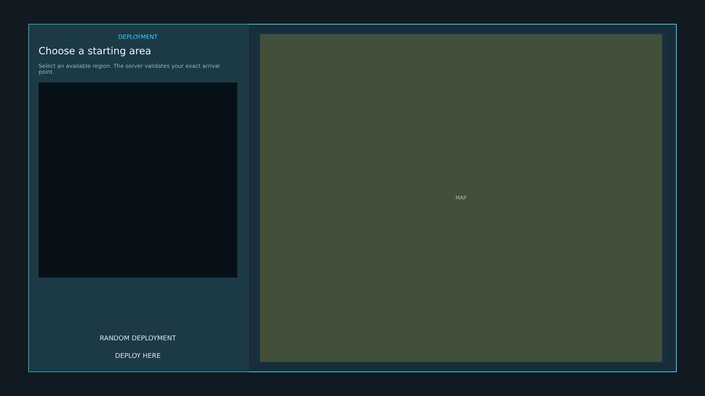


# ag_spawn_menu.layout — Spawn selection menu

**Mod:** Advanced Groups  
**File:** `AdvancedGroups/gui/layouts/hud/ag_spawn_menu.layout`  
**Root:** `PanelWidget` `"{00000000478686B2}"`, size 1 × 1  
**Widgets:** 16

Shown to fresh characters: a map with the allowed spawn points, cooldown state and a random option.

## Preview

Wireframe drawn straight from the layout file: positions, sizes, colours and default text are exact. Image widgets appear as dashed placeholders, and anything hidden at start inside the root is left out.

## Loaded by

- `AdvancedGroups/scripts/5_Mission/AdvancedGroups/GUI/AGSpawnMenu.c` line 13

## Widget tree

Positions and sizes are in pixels when the widget uses exact sizing, otherwise they are fractions of the parent (0–1).

| Widget | Type | Position | Size | Text / notes |
|---|---|---|---|---|
| `"{00000000478686B2}"` | PanelWidget | 0 0 | 1 × 1 |  |
| `"{00000000A55EA5D1}"` | PanelWidget | 0.04 0.06 | 0.92 × 0.88 | style DayZDefaultPanel |
| &nbsp;&nbsp;└ `"{00000000CD9D0295}"` | PanelWidget | 0 0 | 1 × 2 |  |
| &nbsp;&nbsp;└ `"{000000003937585C}"` | PanelWidget | 0 0 | 1 × 2 |  |
| &nbsp;&nbsp;└ `"{000000003B3CB77B}"` | PanelWidget | 0 0 | 2 × 1 |  |
| &nbsp;&nbsp;└ `"{000000000B89FDFA}"` | PanelWidget | 0 0 | 2 × 1 |  |
| &nbsp;&nbsp;└ `"{0000000074A6BE80}"` | PanelWidget | 0 0 | 0.34 × 1 | style DayZDefaultPanel |
| &nbsp;&nbsp;&nbsp;&nbsp;└ `"{000000007D2B1B07}"` | TextWidget | 28 24 | 0.9 × 24 | "DEPLOYMENT" |
| &nbsp;&nbsp;&nbsp;&nbsp;└ `"{0000000086C84BD5}"` | TextWidget | 28 50 | 0.9 × 48 | "Choose a starting area" |
| &nbsp;&nbsp;&nbsp;&nbsp;└ `"{00000000BA89BA4D}"` | TextWidget | 28 102 | 0.9 × 42 | "Select an available region. The server validates your exact arrival point." |
| &nbsp;&nbsp;&nbsp;&nbsp;└ `"{000000009C486CC4}"` | TextListboxWidget | 28 160 | 0.9 × 0.56 | style Default |
| &nbsp;&nbsp;&nbsp;&nbsp;└ `"{00000000449D300D}"` | TextWidget | 28 -126 | 0.9 × 30 | "Select a location to continue." |
| &nbsp;&nbsp;&nbsp;&nbsp;└ `"{0000000099854965}"` | ButtonWidget | 28 72 | 0.9 × 42 | "RANDOM DEPLOYMENT" |
| &nbsp;&nbsp;&nbsp;&nbsp;└ `"{00000000D7226E97}"` | ButtonWidget | 28 24 | 0.9 × 42 | "DEPLOY HERE" |
| &nbsp;&nbsp;└ `"{00000000E0AA0E89}"` | PanelWidget | 0.35 0.018 | 0.635 × 0.964 | style DayZDefaultPanel |
| &nbsp;&nbsp;&nbsp;&nbsp;└ `"{00000000B9E52D72}"` | MapWidget | 0.012 0.012 | 0.976 × 0.976 |  |


