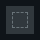


# ag_top_button.layout — Main menu tab button

**Mod:** Advanced Groups  
**File:** `AdvancedGroups/gui/layouts/hud/ag_top_button.layout`  
**Root:** `PanelWidget` `rootFrame`, size 40 × 40  
**Widgets:** 4

One tab in the top bar of the group menu (Info, Group, Markers, Settings, Admin, Zones, Public, Mailbox). Created once per tab by AGMainMenu.

## Preview

Wireframe drawn straight from the layout file: positions, sizes, colours and default text are exact. Image widgets appear as dashed placeholders, and anything hidden at start inside the root is left out.

## Loaded by

- `AdvancedGroups/scripts/5_Mission/AdvancedGroups/GUI/AGMainMenu.c` line 97

## Widget tree

Positions and sizes are in pixels when the widget uses exact sizing, otherwise they are fractions of the parent (0–1).

| Widget | Type | Position | Size | Text / notes |
|---|---|---|---|---|
| `rootFrame` | PanelWidget | 0 0 | 40 × 40 |  |
| &nbsp;&nbsp;└ `iconImage` | ImageWidget | 0 0 | 28 × 28 |  |
| &nbsp;&nbsp;└ `buttonTop` | ButtonWidget | 0 0 | 1 × 1 |  |
| &nbsp;&nbsp;└ `textTitle` | TextWidget | 0 0 | 1 × 1 |  |


