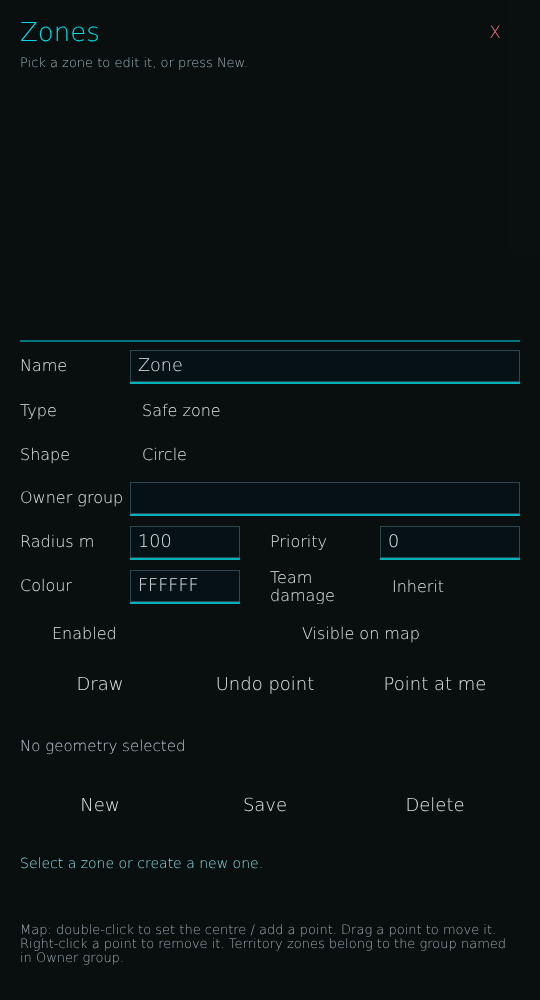


# ag_zone_editor.layout — Zone Editor (admin)

**Mod:** Advanced Groups  
**File:** `AdvancedGroups/gui/layouts/hud/ag_zone_editor.layout`  
**Root:** `PanelWidget` `ZoneEditorRoot`, size 540 × 1000  
**Widgets:** 45

Admin zone editor on the shared map: draw circle or polygon zones, set type, colour, friendly fire, owner group, and save.

## Preview

Wireframe drawn straight from the layout file: positions, sizes, colours and default text are exact. Image widgets appear as dashed placeholders, and anything hidden at start inside the root is left out.

## Loaded by

- `AdvancedGroups/scripts/5_Mission/AdvancedGroups/GUI/Pages/AGPageAdmin.c` line 159

## Widget tree

Positions and sizes are in pixels when the widget uses exact sizing, otherwise they are fractions of the parent (0–1).

| Widget | Type | Position | Size | Text / notes |
|---|---|---|---|---|
| `ZoneEditorRoot` | PanelWidget | 60 20 | 540 × 1000 | hidden at start |
| &nbsp;&nbsp;└ `ZoneEditorTitle` | TextWidget | 20 12 | 440 × 40 | "Zones" |
| &nbsp;&nbsp;└ `BtnZoneClose` | ButtonWidget | 470 14 | 50 × 36 | style Default |
| &nbsp;&nbsp;└ `TxtZoneCloseGlyph` | TextWidget | 470 14 | 50 × 36 | "X" |
| &nbsp;&nbsp;└ `ZoneListHint` | TextWidget | 20 52 | 500 × 22 | "Pick a zone to edit it, or press New." |
| &nbsp;&nbsp;└ `ZoneCardScroll` | ScrollWidget | 20 78 | 500 × 250 |  |
| &nbsp;&nbsp;&nbsp;&nbsp;└ `ZoneCardContent` | PanelWidget | 0 0 | 360 × 1 |  |
| &nbsp;&nbsp;└ `ZoneFormDivider` | PanelWidget | 20 340 | 500 × 2 |  |
| &nbsp;&nbsp;└ `ZoneNameLabel` | TextWidget | 20 350 | 110 × 32 | "Name" |
| &nbsp;&nbsp;└ `ZoneNameInput` | EditBoxWidget | 130 350 | 390 × 32 | "Zone", style ServerBrowser |
| &nbsp;&nbsp;└ `ZoneNameInputRule` | PanelWidget | 130 382 | 390 × 2 |  |
| &nbsp;&nbsp;└ `ZoneTypeLabel` | TextWidget | 20 394 | 110 × 34 | "Type" |
| &nbsp;&nbsp;└ `BtnZoneType` | ButtonWidget | 130 394 | 390 × 34 | style Default |
| &nbsp;&nbsp;└ `TxtZoneTypeValue` | TextWidget | 142 394 | 366 × 34 | "Safe zone" |
| &nbsp;&nbsp;└ `ZoneShapeLabel` | TextWidget | 20 438 | 110 × 34 | "Shape" |
| &nbsp;&nbsp;└ `BtnZoneShape` | ButtonWidget | 130 438 | 390 × 34 | style Default |
| &nbsp;&nbsp;└ `TxtZoneShapeValue` | TextWidget | 142 438 | 366 × 34 | "Circle" |
| &nbsp;&nbsp;└ `ZoneOwnerLabel` | TextWidget | 20 482 | 110 × 32 | "Owner group" |
| &nbsp;&nbsp;└ `ZoneOwnerInput` | EditBoxWidget | 130 482 | 390 × 32 | style ServerBrowser |
| &nbsp;&nbsp;└ `ZoneOwnerInputRule` | PanelWidget | 130 514 | 390 × 2 |  |
| &nbsp;&nbsp;└ `ZoneRadiusLabel` | TextWidget | 20 526 | 110 × 32 | "Radius m" |
| &nbsp;&nbsp;└ `ZoneRadiusInput` | EditBoxWidget | 130 526 | 110 × 32 | "100", style ServerBrowser |
| &nbsp;&nbsp;└ `ZoneRadiusInputRule` | PanelWidget | 130 558 | 110 × 2 |  |
| &nbsp;&nbsp;└ `ZonePriorityLabel` | TextWidget | 270 526 | 110 × 32 | "Priority" |
| &nbsp;&nbsp;└ `ZonePriorityInput` | EditBoxWidget | 380 526 | 140 × 32 | "0", style ServerBrowser |
| &nbsp;&nbsp;└ `ZonePriorityInputRule` | PanelWidget | 380 558 | 140 × 2 |  |
| &nbsp;&nbsp;└ `ZoneColorLabel` | TextWidget | 20 570 | 110 × 32 | "Colour" |
| &nbsp;&nbsp;└ `ZoneColorInput` | EditBoxWidget | 130 570 | 110 × 32 | "FFFFFF", style ServerBrowser |
| &nbsp;&nbsp;└ `ZoneColorInputRule` | PanelWidget | 130 602 | 110 × 2 |  |
| &nbsp;&nbsp;└ `ZoneFFLabel` | TextWidget | 270 570 | 110 × 34 | "Team damage" |
| &nbsp;&nbsp;└ `BtnZoneFriendlyFire` | ButtonWidget | 380 570 | 140 × 34 | style Default |
| &nbsp;&nbsp;└ `TxtZoneFriendlyFireValue` | TextWidget | 392 570 | 116 × 34 | "Inherit" |
| &nbsp;&nbsp;└ `ChkZoneEnabled` | CheckBoxWidget | 20 618 | 200 × 32 |  |
| &nbsp;&nbsp;└ `ChkZoneEnabledLabel` | TextWidget | 52 618 | 168 × 32 | "Enabled" |
| &nbsp;&nbsp;└ `ChkZoneShowMap` | CheckBoxWidget | 270 618 | 240 × 32 |  |
| &nbsp;&nbsp;└ `ChkZoneShowMapLabel` | TextWidget | 302 618 | 208 × 32 | "Visible on map" |
| &nbsp;&nbsp;└ `BtnZoneDraw` | ButtonWidget | 20 664 | 160 × 40 | "Draw", style DayZDefaultButton |
| &nbsp;&nbsp;└ `BtnZoneUndo` | ButtonWidget | 190 664 | 150 × 40 | "Undo point", style DayZDefaultButton |
| &nbsp;&nbsp;└ `BtnZoneHere` | ButtonWidget | 350 664 | 170 × 40 | "Point at me", style DayZDefaultButton |
| &nbsp;&nbsp;└ `ZoneGeometryStatus` | MultilineTextWidget | 20 714 | 500 × 64 | "No geometry selected" |
| &nbsp;&nbsp;└ `BtnZoneNew` | ButtonWidget | 20 784 | 160 × 42 | "New", style DayZDefaultButton |
| &nbsp;&nbsp;└ `BtnZoneSave` | ButtonWidget | 190 784 | 150 × 42 | "Save", style DayZDefaultButton |
| &nbsp;&nbsp;└ `BtnZoneDelete` | ButtonWidget | 350 784 | 170 × 42 | "Delete", style DayZDefaultButton |
| &nbsp;&nbsp;└ `ZoneEditorStatus` | MultilineTextWidget | 20 836 | 500 × 56 | "Select a zone or create a new one." |
| &nbsp;&nbsp;└ `ZoneHelp` | MultilineTextWidget | 20 898 | 500 × 92 | "Map: double-click to set the centre / add a point. Drag a point to move it. Right-click a point to remove it. Territory zones belong to the group named in Owner group." |


