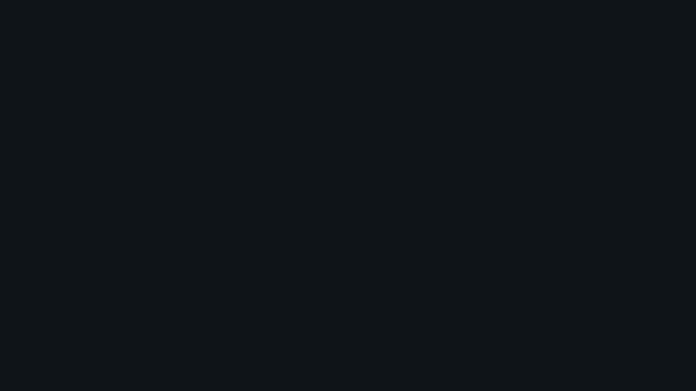


# hud_root.layout — HUD root

**Mod:** Advanced Groups  
**File:** `AdvancedGroups/gui/layouts/hud/hud_root.layout`  
**Root:** `PanelWidget` `AG_HUDRoot`, size 1 × 1  
**Widgets:** 4

Container for every Advanced Groups HUD element.

## Preview

Wireframe drawn straight from the layout file: positions, sizes, colours and default text are exact. Image widgets appear as dashed placeholders, and anything hidden at start inside the root is left out.

## Loaded by

- `AdvancedGroups/scripts/5_Mission/AdvancedGroups/Mission/MissionGameplay.c` line 29
- `AdvancedGroups/scripts/5_Mission/AdvancedGroups/Mission/MissionGameplay.c` line 34

## Widget tree

Positions and sizes are in pixels when the widget uses exact sizing, otherwise they are fractions of the parent (0–1).

| Widget | Type | Position | Size | Text / notes |
|---|---|---|---|---|
| `AG_HUDRoot` | PanelWidget | 0 0 | 1 × 1 |  |
| &nbsp;&nbsp;└ `AGNotificationToast` | PanelWidget | 24 72 | 420 × 58 | hidden at start |
| &nbsp;&nbsp;&nbsp;&nbsp;└ `AGNotificationAccent` | PanelWidget | 0 0 | 5 × 58 |  |
| &nbsp;&nbsp;&nbsp;&nbsp;└ `AGNotificationText` | TextWidget | 18 8 | 388 × 42 |  |


