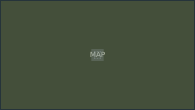


# minimap.layout — Minimap

**Mod:** Advanced Groups  
**File:** `AdvancedGroups/gui/layouts/hud/minimap.layout`  
**Root:** `PanelWidget` `Root`, size 384 × 216  
**Widgets:** 5

Corner minimap with teammates and markers (needs GPS rules in Map, GPS and markers).

## Preview

Wireframe drawn straight from the layout file: positions, sizes, colours and default text are exact. Image widgets appear as dashed placeholders, and anything hidden at start inside the root is left out.

## Loaded by

- `AdvancedGroups/scripts/4_World/AdvancedGroups/HUD/AGMinimap.c` line 27

## Widget tree

Positions and sizes are in pixels when the widget uses exact sizing, otherwise they are fractions of the parent (0–1).

| Widget | Type | Position | Size | Text / notes |
|---|---|---|---|---|
| `Root` | PanelWidget | 0 22 | 384 × 216 |  |
| &nbsp;&nbsp;└ `MinimapMap` | MapWidget | 2 2 | 380 × 212 |  |
| &nbsp;&nbsp;└ `ZoneOverlayCanvas` | CanvasWidget | 2 2 | 380 × 212 |  |
| &nbsp;&nbsp;└ `PlayerArrow` | ImageWidget |  | 24 × 24 |  |
| &nbsp;&nbsp;└ `PlayerArrowCanvas` | CanvasWidget | 2 2 | 380 × 212 |  |


