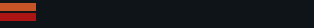


# playerlist_member_row.layout — Player list row

**Mod:** Advanced Groups  
**File:** `AdvancedGroups/gui/layouts/hud/playerlist_member_row.layout`  
**Root:** `PanelWidget` `Row`, size 314 × 28  
**Widgets:** 7

One member in the on-screen player list: name, distance, health state.

## Preview

Wireframe drawn straight from the layout file: positions, sizes, colours and default text are exact. Image widgets appear as dashed placeholders, and anything hidden at start inside the root is left out.

## Loaded by

- `AdvancedGroups/scripts/4_World/AdvancedGroups/HUD/AGPlayerList.c` line 82

## Widget tree

Positions and sizes are in pixels when the widget uses exact sizing, otherwise they are fractions of the parent (0–1).

| Widget | Type | Position | Size | Text / notes |
|---|---|---|---|---|
| `Row` | PanelWidget | 0 0 | 314 × 28 |  |
| &nbsp;&nbsp;└ `HealthBarTrack` | PanelWidget | 0 3 | 36 × 8 |  |
| &nbsp;&nbsp;&nbsp;&nbsp;└ `HealthBarFill` | PanelWidget | 0 0 | 36 × 8 |  |
| &nbsp;&nbsp;└ `BloodBarTrack` | PanelWidget | 0 13 | 36 × 8 |  |
| &nbsp;&nbsp;&nbsp;&nbsp;└ `BloodBarFill` | PanelWidget | 0 0 | 36 × 8 |  |
| &nbsp;&nbsp;└ `MemberName` | TextWidget | 44 3 | 174 × 22 |  |
| &nbsp;&nbsp;└ `MemberRank` | TextWidget | 220 3 | 90 × 22 |  |


