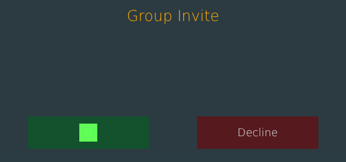


# invite_menu.layout — Group invite prompt

**Mod:** Advanced Groups  
**File:** `AdvancedGroups/gui/layouts/menu/invite_menu.layout`  
**Root:** `PanelWidget` `Root`, size 576 × 270  
**Widgets:** 7

Accept / decline prompt shown when another player invites you to a group.

## Preview

Wireframe drawn straight from the layout file: positions, sizes, colours and default text are exact. Image widgets appear as dashed placeholders, and anything hidden at start inside the root is left out.

## Loaded by

- `AdvancedGroups/scripts/5_Mission/AdvancedGroups/GUI/AGInviteMenu.c` line 31

## Widget tree

Positions and sizes are in pixels when the widget uses exact sizing, otherwise they are fractions of the parent (0–1).

| Widget | Type | Position | Size | Text / notes |
|---|---|---|---|---|
| `Root` | PanelWidget | 0 0 | 576 × 270 |  |
| &nbsp;&nbsp;└ `BG` | PanelWidget |  | 576 × 270 |  |
| &nbsp;&nbsp;└ `Title` | TextWidget | 29 11 | 518 × 32 | "Group Invite" |
| &nbsp;&nbsp;└ `InviteInfo` | MultilineTextWidget | 29 49 | 518 × 95 |  |
| &nbsp;&nbsp;└ `BtnAccept` | ButtonWidget | 46 194 | 202 × 54 | style Default |
| &nbsp;&nbsp;&nbsp;&nbsp;└ `IconAccept` | ImageWidget | 86 12 | 30 × 30 |  |
| &nbsp;&nbsp;└ `BtnDecline` | ButtonWidget | 328 194 | 202 × 54 | "Decline", style Default |


