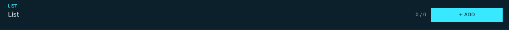


# lsc_collection_row.layout — List header

**Mod:** Advanced Groups  
**File:** `AdvancedGroups/gui/layouts/suite/lsc_collection_row.layout`  
**Root:** `PanelWidget` `row_collection`, size 1280 × 76  
**Widgets:** 20

Header of a record list (Safe zones, ATM placements...): count, REVERT LIST and + ADD.

> Advanced Banking ships an identical copy in `Advanced_Banking/gui/suite/`, used only when Advanced Groups is not loaded.

## Preview

Wireframe drawn straight from the layout file: positions, sizes, colours and default text are exact. Image widgets appear as dashed placeholders, and anything hidden at start inside the root is left out.

## Loaded by

- `AdvancedGroups/scripts/5_Mission/AdvancedGroups/SuiteConsole/LSCConsoleMenu.c` line 1059
- `AdvancedGroups/scripts/5_Mission/AdvancedGroups/SuiteConsole/LSCConsoleMenu.c` line 1060
- `Advanced_Banking/scripts/5_Mission/AdvancedBanking/SuiteConsole/LSCConsoleMenu.c` line 1066
- `Advanced_Banking/scripts/5_Mission/AdvancedBanking/SuiteConsole/LSCConsoleMenu.c` line 1067

## Widget tree

Positions and sizes are in pixels when the widget uses exact sizing, otherwise they are fractions of the parent (0–1).

| Widget | Type | Position | Size | Text / notes |
|---|---|---|---|---|
| `row_collection` | PanelWidget | 0 0 | 1280 × 76 |  |
| &nbsp;&nbsp;└ `line_bottom` | PanelWidget | 0 75 | 1280 × 1 |  |
| &nbsp;&nbsp;└ `txt_overline` | TextWidget | 20 9 | 200 × 14 | "LIST" |
| &nbsp;&nbsp;└ `txt_title` | TextWidget | 20 27 | 900 × 20 | "List" |
| &nbsp;&nbsp;└ `txt_help` | TextWidget | 20 51 | 900 × 16 |  |
| &nbsp;&nbsp;└ `btn_revert` | ButtonWidget | 864 20 | 130 × 36 | hidden at start |
| &nbsp;&nbsp;&nbsp;&nbsp;└ `panel_bg` | PanelWidget | 0 0 | 130 × 36 |  |
| &nbsp;&nbsp;&nbsp;&nbsp;└ `line_t` | PanelWidget | 0 0 | 130 × 1 |  |
| &nbsp;&nbsp;&nbsp;&nbsp;└ `line_b` | PanelWidget | 0 35 | 130 × 1 |  |
| &nbsp;&nbsp;&nbsp;&nbsp;└ `line_l` | PanelWidget | 0 0 | 1 × 36 |  |
| &nbsp;&nbsp;&nbsp;&nbsp;└ `line_r` | PanelWidget | 129 0 | 1 × 36 |  |
| &nbsp;&nbsp;&nbsp;&nbsp;└ `txt_label` | TextWidget | 0 0 | 130 × 36 | "REVERT LIST" |
| &nbsp;&nbsp;└ `txt_count` | TextWidget | 1000 20 | 72 × 36 | "0 / 0" |
| &nbsp;&nbsp;└ `btn_add` | ButtonWidget | 1084 20 | 180 × 36 |  |
| &nbsp;&nbsp;&nbsp;&nbsp;└ `panel_bg` | PanelWidget | 0 0 | 180 × 36 |  |
| &nbsp;&nbsp;&nbsp;&nbsp;└ `line_t` | PanelWidget | 0 0 | 180 × 1 |  |
| &nbsp;&nbsp;&nbsp;&nbsp;└ `line_b` | PanelWidget | 0 35 | 180 × 1 |  |
| &nbsp;&nbsp;&nbsp;&nbsp;└ `line_l` | PanelWidget | 0 0 | 1 × 36 |  |
| &nbsp;&nbsp;&nbsp;&nbsp;└ `line_r` | PanelWidget | 179 0 | 1 × 36 |  |
| &nbsp;&nbsp;&nbsp;&nbsp;└ `txt_label` | TextWidget | 0 0 | 180 × 36 | "+ ADD" |


