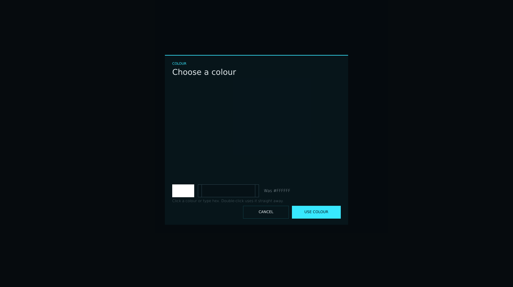


# lsc_color_modal.layout — Colour picker

**Mod:** Advanced Groups  
**File:** `AdvancedGroups/gui/layouts/suite/lsc_color_modal.layout`  
**Root:** `PanelWidget` `modal_color`, size 1680 × 940  
**Widgets:** 29

Palette dialog for colour settings: 84 swatches, hex box, preview and USE COLOUR.

> Advanced Banking ships an identical copy in `Advanced_Banking/gui/suite/`, used only when Advanced Groups is not loaded.

## Preview

Wireframe drawn straight from the layout file: positions, sizes, colours and default text are exact. Image widgets appear as dashed placeholders, and anything hidden at start inside the root is left out.

## Loaded by

- `AdvancedGroups/scripts/5_Mission/AdvancedGroups/SuiteConsole/LSCConsoleMenu.c` line 2416
- `Advanced_Banking/scripts/5_Mission/AdvancedBanking/SuiteConsole/LSCConsoleMenu.c` line 2423

## Widget tree

Positions and sizes are in pixels when the widget uses exact sizing, otherwise they are fractions of the parent (0–1).

| Widget | Type | Position | Size | Text / notes |
|---|---|---|---|---|
| `modal_color` | PanelWidget | 0 0 | 1680 × 940 | hidden at start |
| &nbsp;&nbsp;└ `modal_panel_color` | PanelWidget | 540 180 | 600 × 556 |  |
| &nbsp;&nbsp;&nbsp;&nbsp;└ `modal_edge_color` | PanelWidget | 0 0 | 600 × 2 |  |
| &nbsp;&nbsp;&nbsp;&nbsp;└ `txt_color_overline` | TextWidget | 24 22 | 552 × 14 | "COLOUR" |
| &nbsp;&nbsp;&nbsp;&nbsp;└ `txt_color_title` | TextWidget | 24 40 | 552 × 32 | "Choose a colour" |
| &nbsp;&nbsp;&nbsp;&nbsp;└ `host_color_cells` | WrapSpacerWidget | 24 86 | 552 × 322 |  |
| &nbsp;&nbsp;&nbsp;&nbsp;└ `panel_color_preview` | PanelWidget | 24 424 | 72 × 42 |  |
| &nbsp;&nbsp;&nbsp;&nbsp;└ `panel_color_hex` | PanelWidget | 108 424 | 200 × 42 |  |
| &nbsp;&nbsp;&nbsp;&nbsp;&nbsp;&nbsp;└ `line_t` | PanelWidget | 0 0 | 200 × 1 |  |
| &nbsp;&nbsp;&nbsp;&nbsp;&nbsp;&nbsp;└ `line_b` | PanelWidget | 0 41 | 200 × 1 |  |
| &nbsp;&nbsp;&nbsp;&nbsp;&nbsp;&nbsp;└ `line_l` | PanelWidget | 0 0 | 1 × 42 |  |
| &nbsp;&nbsp;&nbsp;&nbsp;&nbsp;&nbsp;└ `line_r` | PanelWidget | 199 0 | 1 × 42 |  |
| &nbsp;&nbsp;&nbsp;&nbsp;&nbsp;&nbsp;└ `edit_color_hex` | EditBoxWidget | 12 0 | 176 × 42 | style ServerBrowser |
| &nbsp;&nbsp;&nbsp;&nbsp;└ `txt_color_was` | TextWidget | 324 424 | 252 × 42 | "Was #FFFFFF" |
| &nbsp;&nbsp;&nbsp;&nbsp;└ `txt_color_hint` | TextWidget | 24 470 | 552 × 18 | "Click a colour or type hex. Double-click uses it straight away." |
| &nbsp;&nbsp;&nbsp;&nbsp;└ `btn_color_cancel` | ButtonWidget | 256 494 | 150 × 42 |  |
| &nbsp;&nbsp;&nbsp;&nbsp;&nbsp;&nbsp;└ `panel_bg` | PanelWidget | 0 0 | 150 × 42 |  |
| &nbsp;&nbsp;&nbsp;&nbsp;&nbsp;&nbsp;└ `line_t` | PanelWidget | 0 0 | 150 × 1 |  |
| &nbsp;&nbsp;&nbsp;&nbsp;&nbsp;&nbsp;└ `line_b` | PanelWidget | 0 41 | 150 × 1 |  |
| &nbsp;&nbsp;&nbsp;&nbsp;&nbsp;&nbsp;└ `line_l` | PanelWidget | 0 0 | 1 × 42 |  |
| &nbsp;&nbsp;&nbsp;&nbsp;&nbsp;&nbsp;└ `line_r` | PanelWidget | 149 0 | 1 × 42 |  |
| &nbsp;&nbsp;&nbsp;&nbsp;&nbsp;&nbsp;└ `txt_label` | TextWidget | 0 0 | 150 × 42 | "CANCEL" |
| &nbsp;&nbsp;&nbsp;&nbsp;└ `btn_color_use` | ButtonWidget | 416 494 | 160 × 42 |  |
| &nbsp;&nbsp;&nbsp;&nbsp;&nbsp;&nbsp;└ `panel_bg` | PanelWidget | 0 0 | 160 × 42 |  |
| &nbsp;&nbsp;&nbsp;&nbsp;&nbsp;&nbsp;└ `line_t` | PanelWidget | 0 0 | 160 × 1 |  |
| &nbsp;&nbsp;&nbsp;&nbsp;&nbsp;&nbsp;└ `line_b` | PanelWidget | 0 41 | 160 × 1 |  |
| &nbsp;&nbsp;&nbsp;&nbsp;&nbsp;&nbsp;└ `line_l` | PanelWidget | 0 0 | 1 × 42 |  |
| &nbsp;&nbsp;&nbsp;&nbsp;&nbsp;&nbsp;└ `line_r` | PanelWidget | 159 0 | 1 × 42 |  |
| &nbsp;&nbsp;&nbsp;&nbsp;&nbsp;&nbsp;└ `txt_label` | TextWidget | 0 0 | 160 × 42 | "USE COLOUR" |


