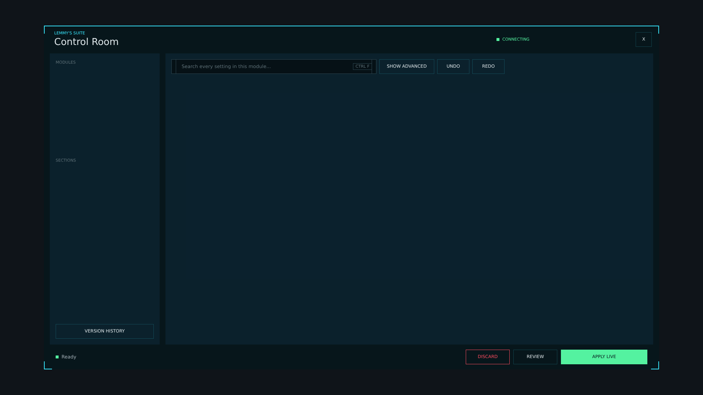


# lsc_console.layout — Control Room window

**Mod:** Advanced Groups  
**File:** `AdvancedGroups/gui/layouts/suite/lsc_console.layout`  
**Root:** `FrameWidget` `LSCRoot`, size 1 × 1  
**Widgets:** 186

The Control Room: header with connection and revision, left rail (modules, sections, version history), toolbar (search, advanced, undo/redo), the scrolling content area, the footer (status, pending count, discard/review/apply) and the review, picker and confirm dialogs.

> Advanced Banking ships an identical copy in `Advanced_Banking/gui/suite/`, used only when Advanced Groups is not loaded.

## Preview

Wireframe drawn straight from the layout file: positions, sizes, colours and default text are exact. Image widgets appear as dashed placeholders, and anything hidden at start inside the root is left out.

## Loaded by

- `AdvancedGroups/scripts/5_Mission/AdvancedGroups/SuiteConsole/LSCConsoleMenu.c` line 382
- `AdvancedGroups/scripts/5_Mission/AdvancedGroups/SuiteConsole/LSCConsoleMenu.c` line 385
- `Advanced_Banking/scripts/5_Mission/AdvancedBanking/SuiteConsole/LSCConsoleMenu.c` line 389
- `Advanced_Banking/scripts/5_Mission/AdvancedBanking/SuiteConsole/LSCConsoleMenu.c` line 392

## Widget tree

Positions and sizes are in pixels when the widget uses exact sizing, otherwise they are fractions of the parent (0–1).

| Widget | Type | Position | Size | Text / notes |
|---|---|---|---|---|
| `LSCRoot` | FrameWidget | 0 0 | 1 × 1 |  |
| &nbsp;&nbsp;└ `console_root` | PanelWidget | 0 0 | 1680 × 940 |  |
| &nbsp;&nbsp;&nbsp;&nbsp;└ `panel_ice_edge` | PanelWidget | 0 0 | 1680 × 2 |  |
| &nbsp;&nbsp;&nbsp;&nbsp;└ `panel_tick_tl_h` | PanelWidget | 0 0 | 22 × 2 |  |
| &nbsp;&nbsp;&nbsp;&nbsp;└ `panel_tick_tl_v` | PanelWidget | 0 0 | 2 × 22 |  |
| &nbsp;&nbsp;&nbsp;&nbsp;└ `panel_tick_tr_h` | PanelWidget | 1658 0 | 22 × 2 |  |
| &nbsp;&nbsp;&nbsp;&nbsp;└ `panel_tick_tr_v` | PanelWidget | 1678 0 | 2 × 22 |  |
| &nbsp;&nbsp;&nbsp;&nbsp;└ `panel_tick_bl_h` | PanelWidget | 0 938 | 22 × 2 |  |
| &nbsp;&nbsp;&nbsp;&nbsp;└ `panel_tick_bl_v` | PanelWidget | 0 918 | 2 × 22 |  |
| &nbsp;&nbsp;&nbsp;&nbsp;└ `panel_tick_br_h` | PanelWidget | 1658 938 | 22 × 2 |  |
| &nbsp;&nbsp;&nbsp;&nbsp;└ `panel_tick_br_v` | PanelWidget | 1678 918 | 2 × 22 |  |
| &nbsp;&nbsp;&nbsp;&nbsp;└ `panel_header` | FrameWidget | 0 0 | 1680 × 76 |  |
| &nbsp;&nbsp;&nbsp;&nbsp;&nbsp;&nbsp;└ `txt_overline` | TextWidget | 28 14 | 300 × 14 | "LEMMY'S SUITE" |
| &nbsp;&nbsp;&nbsp;&nbsp;&nbsp;&nbsp;└ `txt_brand` | TextWidget | 28 28 | 400 × 32 | "Control Room" |
| &nbsp;&nbsp;&nbsp;&nbsp;&nbsp;&nbsp;└ `panel_dot` | PanelWidget | 1236 34 | 8 × 8 |  |
| &nbsp;&nbsp;&nbsp;&nbsp;&nbsp;&nbsp;└ `txt_connection` | TextWidget | 1252 18 | 120 × 40 | "CONNECTING" |
| &nbsp;&nbsp;&nbsp;&nbsp;&nbsp;&nbsp;└ `txt_revision` | TextWidget | 1372 18 | 228 × 40 |  |
| &nbsp;&nbsp;&nbsp;&nbsp;&nbsp;&nbsp;└ `btn_close` | ButtonWidget | 1616 18 | 44 × 40 |  |
| &nbsp;&nbsp;&nbsp;&nbsp;&nbsp;&nbsp;&nbsp;&nbsp;└ `panel_bg` | PanelWidget | 0 0 | 44 × 40 |  |
| &nbsp;&nbsp;&nbsp;&nbsp;&nbsp;&nbsp;&nbsp;&nbsp;└ `line_t` | PanelWidget | 0 0 | 44 × 1 |  |
| &nbsp;&nbsp;&nbsp;&nbsp;&nbsp;&nbsp;&nbsp;&nbsp;└ `line_b` | PanelWidget | 0 39 | 44 × 1 |  |
| &nbsp;&nbsp;&nbsp;&nbsp;&nbsp;&nbsp;&nbsp;&nbsp;└ `line_l` | PanelWidget | 0 0 | 1 × 40 |  |
| &nbsp;&nbsp;&nbsp;&nbsp;&nbsp;&nbsp;&nbsp;&nbsp;└ `line_r` | PanelWidget | 43 0 | 1 × 40 |  |
| &nbsp;&nbsp;&nbsp;&nbsp;&nbsp;&nbsp;&nbsp;&nbsp;└ `txt_label` | TextWidget | 0 0 | 44 × 40 | "X" |
| &nbsp;&nbsp;&nbsp;&nbsp;└ `panel_rail` | PanelWidget | 16 76 | 300 × 796 |  |
| &nbsp;&nbsp;&nbsp;&nbsp;&nbsp;&nbsp;└ `txt_modules` | TextWidget | 16 18 | 268 × 14 | "MODULES" |
| &nbsp;&nbsp;&nbsp;&nbsp;&nbsp;&nbsp;└ `scroll_modules` | ScrollWidget | 16 38 | 276 × 236 |  |
| &nbsp;&nbsp;&nbsp;&nbsp;&nbsp;&nbsp;&nbsp;&nbsp;└ `host_modules` | WrapSpacerWidget | 0 0 | 1 × 0 |  |
| &nbsp;&nbsp;&nbsp;&nbsp;&nbsp;&nbsp;└ `txt_sections` | TextWidget | 16 286 | 268 × 14 | "SECTIONS" |
| &nbsp;&nbsp;&nbsp;&nbsp;&nbsp;&nbsp;└ `scroll_sections` | ScrollWidget | 16 306 | 276 × 418 |  |
| &nbsp;&nbsp;&nbsp;&nbsp;&nbsp;&nbsp;&nbsp;&nbsp;└ `host_sections` | WrapSpacerWidget | 0 0 | 1 × 0 |  |
| &nbsp;&nbsp;&nbsp;&nbsp;&nbsp;&nbsp;└ `btn_version_history` | ButtonWidget | 16 740 | 268 × 40 |  |
| &nbsp;&nbsp;&nbsp;&nbsp;&nbsp;&nbsp;&nbsp;&nbsp;└ `panel_bg` | PanelWidget | 0 0 | 268 × 40 |  |
| &nbsp;&nbsp;&nbsp;&nbsp;&nbsp;&nbsp;&nbsp;&nbsp;└ `line_t` | PanelWidget | 0 0 | 268 × 1 |  |
| &nbsp;&nbsp;&nbsp;&nbsp;&nbsp;&nbsp;&nbsp;&nbsp;└ `line_b` | PanelWidget | 0 39 | 268 × 1 |  |
| &nbsp;&nbsp;&nbsp;&nbsp;&nbsp;&nbsp;&nbsp;&nbsp;└ `line_l` | PanelWidget | 0 0 | 1 × 40 |  |
| &nbsp;&nbsp;&nbsp;&nbsp;&nbsp;&nbsp;&nbsp;&nbsp;└ `line_r` | PanelWidget | 267 0 | 1 × 40 |  |
| &nbsp;&nbsp;&nbsp;&nbsp;&nbsp;&nbsp;&nbsp;&nbsp;└ `txt_label` | TextWidget | 0 0 | 268 × 40 | "VERSION HISTORY" |
| &nbsp;&nbsp;&nbsp;&nbsp;└ `panel_main` | PanelWidget | 332 76 | 1332 × 796 |  |
| &nbsp;&nbsp;&nbsp;&nbsp;&nbsp;&nbsp;└ `panel_search` | PanelWidget | 16 16 | 560 × 40 |  |
| &nbsp;&nbsp;&nbsp;&nbsp;&nbsp;&nbsp;&nbsp;&nbsp;└ `line_t` | PanelWidget | 0 0 | 560 × 1 |  |
| &nbsp;&nbsp;&nbsp;&nbsp;&nbsp;&nbsp;&nbsp;&nbsp;└ `line_b` | PanelWidget | 0 39 | 560 × 1 |  |
| &nbsp;&nbsp;&nbsp;&nbsp;&nbsp;&nbsp;&nbsp;&nbsp;└ `line_l` | PanelWidget | 0 0 | 1 × 40 |  |
| &nbsp;&nbsp;&nbsp;&nbsp;&nbsp;&nbsp;&nbsp;&nbsp;└ `line_r` | PanelWidget | 559 0 | 1 × 40 |  |
| &nbsp;&nbsp;&nbsp;&nbsp;&nbsp;&nbsp;&nbsp;&nbsp;└ `edit_search` | EditBoxWidget | 12 0 | 536 × 40 | style ServerBrowser |
| &nbsp;&nbsp;&nbsp;&nbsp;&nbsp;&nbsp;└ `txt_search_hint` | TextWidget | 44 16 | 420 × 40 | "Search every setting in this module..." |
| &nbsp;&nbsp;&nbsp;&nbsp;&nbsp;&nbsp;└ `panel_kbd` | PanelWidget | 512 27 | 52 × 18 |  |
| &nbsp;&nbsp;&nbsp;&nbsp;&nbsp;&nbsp;&nbsp;&nbsp;└ `kline_t` | PanelWidget | 0 0 | 52 × 1 |  |
| &nbsp;&nbsp;&nbsp;&nbsp;&nbsp;&nbsp;&nbsp;&nbsp;└ `kline_b` | PanelWidget | 0 17 | 52 × 1 |  |
| &nbsp;&nbsp;&nbsp;&nbsp;&nbsp;&nbsp;&nbsp;&nbsp;└ `kline_l` | PanelWidget | 0 0 | 1 × 18 |  |
| &nbsp;&nbsp;&nbsp;&nbsp;&nbsp;&nbsp;&nbsp;&nbsp;└ `kline_r` | PanelWidget | 51 0 | 1 × 18 |  |
| &nbsp;&nbsp;&nbsp;&nbsp;&nbsp;&nbsp;&nbsp;&nbsp;└ `txt_kbd` | TextWidget | 0 0 | 52 × 18 | "CTRL F" |
| &nbsp;&nbsp;&nbsp;&nbsp;&nbsp;&nbsp;└ `btn_show_advanced` | ButtonWidget | 584 16 | 150 × 40 |  |
| &nbsp;&nbsp;&nbsp;&nbsp;&nbsp;&nbsp;&nbsp;&nbsp;└ `panel_bg` | PanelWidget | 0 0 | 150 × 40 |  |
| &nbsp;&nbsp;&nbsp;&nbsp;&nbsp;&nbsp;&nbsp;&nbsp;└ `line_t` | PanelWidget | 0 0 | 150 × 1 |  |
| &nbsp;&nbsp;&nbsp;&nbsp;&nbsp;&nbsp;&nbsp;&nbsp;└ `line_b` | PanelWidget | 0 39 | 150 × 1 |  |
| &nbsp;&nbsp;&nbsp;&nbsp;&nbsp;&nbsp;&nbsp;&nbsp;└ `line_l` | PanelWidget | 0 0 | 1 × 40 |  |
| &nbsp;&nbsp;&nbsp;&nbsp;&nbsp;&nbsp;&nbsp;&nbsp;└ `line_r` | PanelWidget | 149 0 | 1 × 40 |  |
| &nbsp;&nbsp;&nbsp;&nbsp;&nbsp;&nbsp;&nbsp;&nbsp;└ `txt_label` | TextWidget | 0 0 | 150 × 40 | "SHOW ADVANCED" |
| &nbsp;&nbsp;&nbsp;&nbsp;&nbsp;&nbsp;└ `btn_undo` | ButtonWidget | 742 16 | 88 × 40 |  |
| &nbsp;&nbsp;&nbsp;&nbsp;&nbsp;&nbsp;&nbsp;&nbsp;└ `panel_bg` | PanelWidget | 0 0 | 88 × 40 |  |
| &nbsp;&nbsp;&nbsp;&nbsp;&nbsp;&nbsp;&nbsp;&nbsp;└ `line_t` | PanelWidget | 0 0 | 88 × 1 |  |
| &nbsp;&nbsp;&nbsp;&nbsp;&nbsp;&nbsp;&nbsp;&nbsp;└ `line_b` | PanelWidget | 0 39 | 88 × 1 |  |
| &nbsp;&nbsp;&nbsp;&nbsp;&nbsp;&nbsp;&nbsp;&nbsp;└ `line_l` | PanelWidget | 0 0 | 1 × 40 |  |
| &nbsp;&nbsp;&nbsp;&nbsp;&nbsp;&nbsp;&nbsp;&nbsp;└ `line_r` | PanelWidget | 87 0 | 1 × 40 |  |
| &nbsp;&nbsp;&nbsp;&nbsp;&nbsp;&nbsp;&nbsp;&nbsp;└ `txt_label` | TextWidget | 0 0 | 88 × 40 | "UNDO" |
| &nbsp;&nbsp;&nbsp;&nbsp;&nbsp;&nbsp;└ `btn_redo` | ButtonWidget | 838 16 | 88 × 40 |  |
| &nbsp;&nbsp;&nbsp;&nbsp;&nbsp;&nbsp;&nbsp;&nbsp;└ `panel_bg` | PanelWidget | 0 0 | 88 × 40 |  |
| &nbsp;&nbsp;&nbsp;&nbsp;&nbsp;&nbsp;&nbsp;&nbsp;└ `line_t` | PanelWidget | 0 0 | 88 × 1 |  |
| &nbsp;&nbsp;&nbsp;&nbsp;&nbsp;&nbsp;&nbsp;&nbsp;└ `line_b` | PanelWidget | 0 39 | 88 × 1 |  |
| &nbsp;&nbsp;&nbsp;&nbsp;&nbsp;&nbsp;&nbsp;&nbsp;└ `line_l` | PanelWidget | 0 0 | 1 × 40 |  |
| &nbsp;&nbsp;&nbsp;&nbsp;&nbsp;&nbsp;&nbsp;&nbsp;└ `line_r` | PanelWidget | 87 0 | 1 × 40 |  |
| &nbsp;&nbsp;&nbsp;&nbsp;&nbsp;&nbsp;&nbsp;&nbsp;└ `txt_label` | TextWidget | 0 0 | 88 × 40 | "REDO" |
| &nbsp;&nbsp;&nbsp;&nbsp;&nbsp;&nbsp;└ `panel_banner` | PanelWidget | 16 68 | 1300 × 44 | hidden at start |
| &nbsp;&nbsp;&nbsp;&nbsp;&nbsp;&nbsp;&nbsp;&nbsp;└ `panel_banner_strip` | PanelWidget | 0 0 | 4 × 44 |  |
| &nbsp;&nbsp;&nbsp;&nbsp;&nbsp;&nbsp;&nbsp;&nbsp;└ `txt_banner` | TextWidget | 16 0 | 1140 × 44 |  |
| &nbsp;&nbsp;&nbsp;&nbsp;&nbsp;&nbsp;&nbsp;&nbsp;└ `btn_banner_ok` | ButtonWidget | 1176 6 | 118 × 32 |  |
| &nbsp;&nbsp;&nbsp;&nbsp;&nbsp;&nbsp;&nbsp;&nbsp;&nbsp;&nbsp;└ `panel_bg` | PanelWidget | 0 0 | 118 × 32 |  |
| &nbsp;&nbsp;&nbsp;&nbsp;&nbsp;&nbsp;&nbsp;&nbsp;&nbsp;&nbsp;└ `line_t` | PanelWidget | 0 0 | 118 × 1 |  |
| &nbsp;&nbsp;&nbsp;&nbsp;&nbsp;&nbsp;&nbsp;&nbsp;&nbsp;&nbsp;└ `line_b` | PanelWidget | 0 31 | 118 × 1 |  |
| &nbsp;&nbsp;&nbsp;&nbsp;&nbsp;&nbsp;&nbsp;&nbsp;&nbsp;&nbsp;└ `line_l` | PanelWidget | 0 0 | 1 × 32 |  |
| &nbsp;&nbsp;&nbsp;&nbsp;&nbsp;&nbsp;&nbsp;&nbsp;&nbsp;&nbsp;└ `line_r` | PanelWidget | 117 0 | 1 × 32 |  |
| &nbsp;&nbsp;&nbsp;&nbsp;&nbsp;&nbsp;&nbsp;&nbsp;&nbsp;&nbsp;└ `txt_label` | TextWidget | 0 0 | 118 × 32 | "GOT IT" |
| &nbsp;&nbsp;&nbsp;&nbsp;&nbsp;&nbsp;└ `scroll_content` | ScrollWidget | 16 124 | 1300 × 672 |  |
| &nbsp;&nbsp;&nbsp;&nbsp;&nbsp;&nbsp;&nbsp;&nbsp;└ `host_content` | WrapSpacerWidget | 0 0 | 1 × 0 |  |
| &nbsp;&nbsp;&nbsp;&nbsp;└ `panel_footer` | FrameWidget | 0 872 | 1680 × 68 |  |
| &nbsp;&nbsp;&nbsp;&nbsp;&nbsp;&nbsp;└ `panel_status_dot` | PanelWidget | 32 30 | 8 × 8 |  |
| &nbsp;&nbsp;&nbsp;&nbsp;&nbsp;&nbsp;└ `txt_status` | TextWidget | 48 14 | 900 × 40 | "Ready" |
| &nbsp;&nbsp;&nbsp;&nbsp;&nbsp;&nbsp;└ `badge_pending` | PanelWidget | 1046 24 | 96 × 20 | hidden at start |
| &nbsp;&nbsp;&nbsp;&nbsp;&nbsp;&nbsp;&nbsp;&nbsp;└ `txt_pending` | TextWidget | 0 0 | 96 × 20 | "0 PENDING" |
| &nbsp;&nbsp;&nbsp;&nbsp;&nbsp;&nbsp;└ `btn_discard` | ButtonWidget | 1152 14 | 120 × 40 |  |
| &nbsp;&nbsp;&nbsp;&nbsp;&nbsp;&nbsp;&nbsp;&nbsp;└ `panel_bg` | PanelWidget | 0 0 | 120 × 40 |  |
| &nbsp;&nbsp;&nbsp;&nbsp;&nbsp;&nbsp;&nbsp;&nbsp;└ `line_t` | PanelWidget | 0 0 | 120 × 1 |  |
| &nbsp;&nbsp;&nbsp;&nbsp;&nbsp;&nbsp;&nbsp;&nbsp;└ `line_b` | PanelWidget | 0 39 | 120 × 1 |  |
| &nbsp;&nbsp;&nbsp;&nbsp;&nbsp;&nbsp;&nbsp;&nbsp;└ `line_l` | PanelWidget | 0 0 | 1 × 40 |  |
| &nbsp;&nbsp;&nbsp;&nbsp;&nbsp;&nbsp;&nbsp;&nbsp;└ `line_r` | PanelWidget | 119 0 | 1 × 40 |  |
| &nbsp;&nbsp;&nbsp;&nbsp;&nbsp;&nbsp;&nbsp;&nbsp;└ `txt_label` | TextWidget | 0 0 | 120 × 40 | "DISCARD" |
| &nbsp;&nbsp;&nbsp;&nbsp;&nbsp;&nbsp;└ `btn_review` | ButtonWidget | 1282 14 | 120 × 40 |  |
| &nbsp;&nbsp;&nbsp;&nbsp;&nbsp;&nbsp;&nbsp;&nbsp;└ `panel_bg` | PanelWidget | 0 0 | 120 × 40 |  |
| &nbsp;&nbsp;&nbsp;&nbsp;&nbsp;&nbsp;&nbsp;&nbsp;└ `line_t` | PanelWidget | 0 0 | 120 × 1 |  |
| &nbsp;&nbsp;&nbsp;&nbsp;&nbsp;&nbsp;&nbsp;&nbsp;└ `line_b` | PanelWidget | 0 39 | 120 × 1 |  |
| &nbsp;&nbsp;&nbsp;&nbsp;&nbsp;&nbsp;&nbsp;&nbsp;└ `line_l` | PanelWidget | 0 0 | 1 × 40 |  |
| &nbsp;&nbsp;&nbsp;&nbsp;&nbsp;&nbsp;&nbsp;&nbsp;└ `line_r` | PanelWidget | 119 0 | 1 × 40 |  |
| &nbsp;&nbsp;&nbsp;&nbsp;&nbsp;&nbsp;&nbsp;&nbsp;└ `txt_label` | TextWidget | 0 0 | 120 × 40 | "REVIEW" |
| &nbsp;&nbsp;&nbsp;&nbsp;&nbsp;&nbsp;└ `btn_apply` | ButtonWidget | 1412 14 | 236 × 40 |  |
| &nbsp;&nbsp;&nbsp;&nbsp;&nbsp;&nbsp;&nbsp;&nbsp;└ `panel_bg` | PanelWidget | 0 0 | 236 × 40 |  |
| &nbsp;&nbsp;&nbsp;&nbsp;&nbsp;&nbsp;&nbsp;&nbsp;└ `line_t` | PanelWidget | 0 0 | 236 × 1 |  |
| &nbsp;&nbsp;&nbsp;&nbsp;&nbsp;&nbsp;&nbsp;&nbsp;└ `line_b` | PanelWidget | 0 39 | 236 × 1 |  |
| &nbsp;&nbsp;&nbsp;&nbsp;&nbsp;&nbsp;&nbsp;&nbsp;└ `line_l` | PanelWidget | 0 0 | 1 × 40 |  |
| &nbsp;&nbsp;&nbsp;&nbsp;&nbsp;&nbsp;&nbsp;&nbsp;└ `line_r` | PanelWidget | 235 0 | 1 × 40 |  |
| &nbsp;&nbsp;&nbsp;&nbsp;&nbsp;&nbsp;&nbsp;&nbsp;└ `txt_label` | TextWidget | 0 0 | 236 × 40 | "APPLY LIVE" |
| &nbsp;&nbsp;&nbsp;&nbsp;└ `modal_review` | PanelWidget | 0 0 | 1680 × 940 | hidden at start |
| &nbsp;&nbsp;&nbsp;&nbsp;&nbsp;&nbsp;└ `modal_panel_review` | PanelWidget | 400 200 | 880 × 540 |  |
| &nbsp;&nbsp;&nbsp;&nbsp;&nbsp;&nbsp;&nbsp;&nbsp;└ `modal_edge_review` | PanelWidget | 0 0 | 880 × 2 |  |
| &nbsp;&nbsp;&nbsp;&nbsp;&nbsp;&nbsp;&nbsp;&nbsp;└ `txt_review_overline` | TextWidget | 24 22 | 832 × 14 | "REVIEW" |
| &nbsp;&nbsp;&nbsp;&nbsp;&nbsp;&nbsp;&nbsp;&nbsp;└ `txt_review_title` | TextWidget | 24 40 | 832 × 32 | "Review changes" |
| &nbsp;&nbsp;&nbsp;&nbsp;&nbsp;&nbsp;&nbsp;&nbsp;└ `txt_review_sub` | MultilineTextWidget | 24 78 | 832 × 40 |  |
| &nbsp;&nbsp;&nbsp;&nbsp;&nbsp;&nbsp;&nbsp;&nbsp;└ `scroll_review` | ScrollWidget | 24 126 | 838 × 260 |  |
| &nbsp;&nbsp;&nbsp;&nbsp;&nbsp;&nbsp;&nbsp;&nbsp;&nbsp;&nbsp;└ `host_review` | WrapSpacerWidget | 0 0 | 1 × 0 |  |
| &nbsp;&nbsp;&nbsp;&nbsp;&nbsp;&nbsp;&nbsp;&nbsp;└ `txt_note_label` | TextWidget | 24 398 | 832 × 14 | "NOTE FOR HISTORY AND AUDIT LOG  (REQUIRED FOR RED ITEMS)" |
| &nbsp;&nbsp;&nbsp;&nbsp;&nbsp;&nbsp;&nbsp;&nbsp;└ `panel_note` | PanelWidget | 24 418 | 832 × 42 |  |
| &nbsp;&nbsp;&nbsp;&nbsp;&nbsp;&nbsp;&nbsp;&nbsp;&nbsp;&nbsp;└ `line_t` | PanelWidget | 0 0 | 832 × 1 |  |
| &nbsp;&nbsp;&nbsp;&nbsp;&nbsp;&nbsp;&nbsp;&nbsp;&nbsp;&nbsp;└ `line_b` | PanelWidget | 0 41 | 832 × 1 |  |
| &nbsp;&nbsp;&nbsp;&nbsp;&nbsp;&nbsp;&nbsp;&nbsp;&nbsp;&nbsp;└ `line_l` | PanelWidget | 0 0 | 1 × 42 |  |
| &nbsp;&nbsp;&nbsp;&nbsp;&nbsp;&nbsp;&nbsp;&nbsp;&nbsp;&nbsp;└ `line_r` | PanelWidget | 831 0 | 1 × 42 |  |
| &nbsp;&nbsp;&nbsp;&nbsp;&nbsp;&nbsp;&nbsp;&nbsp;&nbsp;&nbsp;└ `edit_note` | EditBoxWidget | 12 0 | 808 × 42 | style ServerBrowser |
| &nbsp;&nbsp;&nbsp;&nbsp;&nbsp;&nbsp;&nbsp;&nbsp;└ `btn_keep_editing` | ButtonWidget | 456 476 | 150 × 42 |  |
| &nbsp;&nbsp;&nbsp;&nbsp;&nbsp;&nbsp;&nbsp;&nbsp;&nbsp;&nbsp;└ `panel_bg` | PanelWidget | 0 0 | 150 × 42 |  |
| &nbsp;&nbsp;&nbsp;&nbsp;&nbsp;&nbsp;&nbsp;&nbsp;&nbsp;&nbsp;└ `line_t` | PanelWidget | 0 0 | 150 × 1 |  |
| &nbsp;&nbsp;&nbsp;&nbsp;&nbsp;&nbsp;&nbsp;&nbsp;&nbsp;&nbsp;└ `line_b` | PanelWidget | 0 41 | 150 × 1 |  |
| &nbsp;&nbsp;&nbsp;&nbsp;&nbsp;&nbsp;&nbsp;&nbsp;&nbsp;&nbsp;└ `line_l` | PanelWidget | 0 0 | 1 × 42 |  |
| &nbsp;&nbsp;&nbsp;&nbsp;&nbsp;&nbsp;&nbsp;&nbsp;&nbsp;&nbsp;└ `line_r` | PanelWidget | 149 0 | 1 × 42 |  |
| &nbsp;&nbsp;&nbsp;&nbsp;&nbsp;&nbsp;&nbsp;&nbsp;&nbsp;&nbsp;└ `txt_label` | TextWidget | 0 0 | 150 × 42 | "KEEP EDITING" |
| &nbsp;&nbsp;&nbsp;&nbsp;&nbsp;&nbsp;&nbsp;&nbsp;└ `btn_apply_review` | ButtonWidget | 616 476 | 240 × 42 |  |
| &nbsp;&nbsp;&nbsp;&nbsp;&nbsp;&nbsp;&nbsp;&nbsp;&nbsp;&nbsp;└ `panel_bg` | PanelWidget | 0 0 | 240 × 42 |  |
| &nbsp;&nbsp;&nbsp;&nbsp;&nbsp;&nbsp;&nbsp;&nbsp;&nbsp;&nbsp;└ `line_t` | PanelWidget | 0 0 | 240 × 1 |  |
| &nbsp;&nbsp;&nbsp;&nbsp;&nbsp;&nbsp;&nbsp;&nbsp;&nbsp;&nbsp;└ `line_b` | PanelWidget | 0 41 | 240 × 1 |  |
| &nbsp;&nbsp;&nbsp;&nbsp;&nbsp;&nbsp;&nbsp;&nbsp;&nbsp;&nbsp;└ `line_l` | PanelWidget | 0 0 | 1 × 42 |  |
| &nbsp;&nbsp;&nbsp;&nbsp;&nbsp;&nbsp;&nbsp;&nbsp;&nbsp;&nbsp;└ `line_r` | PanelWidget | 239 0 | 1 × 42 |  |
| &nbsp;&nbsp;&nbsp;&nbsp;&nbsp;&nbsp;&nbsp;&nbsp;&nbsp;&nbsp;└ `txt_label` | TextWidget | 0 0 | 240 × 42 | "APPLY LIVE" |
| &nbsp;&nbsp;&nbsp;&nbsp;└ `modal_picker` | PanelWidget | 0 0 | 1680 × 940 | hidden at start |
| &nbsp;&nbsp;&nbsp;&nbsp;&nbsp;&nbsp;└ `modal_panel_picker` | PanelWidget | 540 120 | 600 × 700 |  |
| &nbsp;&nbsp;&nbsp;&nbsp;&nbsp;&nbsp;&nbsp;&nbsp;└ `modal_edge_picker` | PanelWidget | 0 0 | 600 × 2 |  |
| &nbsp;&nbsp;&nbsp;&nbsp;&nbsp;&nbsp;&nbsp;&nbsp;└ `txt_picker_overline` | TextWidget | 24 22 | 552 × 14 | "CHOOSE" |
| &nbsp;&nbsp;&nbsp;&nbsp;&nbsp;&nbsp;&nbsp;&nbsp;└ `txt_picker_title` | TextWidget | 24 40 | 552 × 32 | "Choose" |
| &nbsp;&nbsp;&nbsp;&nbsp;&nbsp;&nbsp;&nbsp;&nbsp;└ `panel_filter` | PanelWidget | 24 86 | 552 × 42 |  |
| &nbsp;&nbsp;&nbsp;&nbsp;&nbsp;&nbsp;&nbsp;&nbsp;&nbsp;&nbsp;└ `line_t` | PanelWidget | 0 0 | 552 × 1 |  |
| &nbsp;&nbsp;&nbsp;&nbsp;&nbsp;&nbsp;&nbsp;&nbsp;&nbsp;&nbsp;└ `line_b` | PanelWidget | 0 41 | 552 × 1 |  |
| &nbsp;&nbsp;&nbsp;&nbsp;&nbsp;&nbsp;&nbsp;&nbsp;&nbsp;&nbsp;└ `line_l` | PanelWidget | 0 0 | 1 × 42 |  |
| &nbsp;&nbsp;&nbsp;&nbsp;&nbsp;&nbsp;&nbsp;&nbsp;&nbsp;&nbsp;└ `line_r` | PanelWidget | 551 0 | 1 × 42 |  |
| &nbsp;&nbsp;&nbsp;&nbsp;&nbsp;&nbsp;&nbsp;&nbsp;&nbsp;&nbsp;└ `edit_filter` | EditBoxWidget | 12 0 | 528 × 42 | style ServerBrowser |
| &nbsp;&nbsp;&nbsp;&nbsp;&nbsp;&nbsp;&nbsp;&nbsp;└ `list_options` | TextListboxWidget | 24 140 | 552 × 460 | style Default |
| &nbsp;&nbsp;&nbsp;&nbsp;&nbsp;&nbsp;&nbsp;&nbsp;└ `txt_picker_hint` | TextWidget | 24 606 | 552 × 18 | "Double-click to choose" |
| &nbsp;&nbsp;&nbsp;&nbsp;&nbsp;&nbsp;&nbsp;&nbsp;└ `btn_picker_cancel` | ButtonWidget | 256 634 | 150 × 42 |  |
| &nbsp;&nbsp;&nbsp;&nbsp;&nbsp;&nbsp;&nbsp;&nbsp;&nbsp;&nbsp;└ `panel_bg` | PanelWidget | 0 0 | 150 × 42 |  |
| &nbsp;&nbsp;&nbsp;&nbsp;&nbsp;&nbsp;&nbsp;&nbsp;&nbsp;&nbsp;└ `line_t` | PanelWidget | 0 0 | 150 × 1 |  |
| &nbsp;&nbsp;&nbsp;&nbsp;&nbsp;&nbsp;&nbsp;&nbsp;&nbsp;&nbsp;└ `line_b` | PanelWidget | 0 41 | 150 × 1 |  |
| &nbsp;&nbsp;&nbsp;&nbsp;&nbsp;&nbsp;&nbsp;&nbsp;&nbsp;&nbsp;└ `line_l` | PanelWidget | 0 0 | 1 × 42 |  |
| &nbsp;&nbsp;&nbsp;&nbsp;&nbsp;&nbsp;&nbsp;&nbsp;&nbsp;&nbsp;└ `line_r` | PanelWidget | 149 0 | 1 × 42 |  |
| &nbsp;&nbsp;&nbsp;&nbsp;&nbsp;&nbsp;&nbsp;&nbsp;&nbsp;&nbsp;└ `txt_label` | TextWidget | 0 0 | 150 × 42 | "CANCEL" |
| &nbsp;&nbsp;&nbsp;&nbsp;&nbsp;&nbsp;&nbsp;&nbsp;└ `btn_choose` | ButtonWidget | 416 634 | 160 × 42 |  |
| &nbsp;&nbsp;&nbsp;&nbsp;&nbsp;&nbsp;&nbsp;&nbsp;&nbsp;&nbsp;└ `panel_bg` | PanelWidget | 0 0 | 160 × 42 |  |
| &nbsp;&nbsp;&nbsp;&nbsp;&nbsp;&nbsp;&nbsp;&nbsp;&nbsp;&nbsp;└ `line_t` | PanelWidget | 0 0 | 160 × 1 |  |
| &nbsp;&nbsp;&nbsp;&nbsp;&nbsp;&nbsp;&nbsp;&nbsp;&nbsp;&nbsp;└ `line_b` | PanelWidget | 0 41 | 160 × 1 |  |
| &nbsp;&nbsp;&nbsp;&nbsp;&nbsp;&nbsp;&nbsp;&nbsp;&nbsp;&nbsp;└ `line_l` | PanelWidget | 0 0 | 1 × 42 |  |
| &nbsp;&nbsp;&nbsp;&nbsp;&nbsp;&nbsp;&nbsp;&nbsp;&nbsp;&nbsp;└ `line_r` | PanelWidget | 159 0 | 1 × 42 |  |
| &nbsp;&nbsp;&nbsp;&nbsp;&nbsp;&nbsp;&nbsp;&nbsp;&nbsp;&nbsp;└ `txt_label` | TextWidget | 0 0 | 160 × 42 | "CHOOSE" |
| &nbsp;&nbsp;&nbsp;&nbsp;└ `modal_confirm` | PanelWidget | 0 0 | 1680 × 940 | hidden at start |
| &nbsp;&nbsp;&nbsp;&nbsp;&nbsp;&nbsp;└ `modal_panel_confirm` | PanelWidget | 540 340 | 600 × 260 |  |
| &nbsp;&nbsp;&nbsp;&nbsp;&nbsp;&nbsp;&nbsp;&nbsp;└ `modal_edge_confirm` | PanelWidget | 0 0 | 600 × 2 |  |
| &nbsp;&nbsp;&nbsp;&nbsp;&nbsp;&nbsp;&nbsp;&nbsp;└ `txt_confirm_title` | TextWidget | 24 22 | 552 × 32 | "Please confirm" |
| &nbsp;&nbsp;&nbsp;&nbsp;&nbsp;&nbsp;&nbsp;&nbsp;└ `txt_confirm` | MultilineTextWidget | 24 66 | 552 × 110 |  |
| &nbsp;&nbsp;&nbsp;&nbsp;&nbsp;&nbsp;&nbsp;&nbsp;└ `btn_confirm_no` | ButtonWidget | 256 196 | 150 × 42 |  |
| &nbsp;&nbsp;&nbsp;&nbsp;&nbsp;&nbsp;&nbsp;&nbsp;&nbsp;&nbsp;└ `panel_bg` | PanelWidget | 0 0 | 150 × 42 |  |
| &nbsp;&nbsp;&nbsp;&nbsp;&nbsp;&nbsp;&nbsp;&nbsp;&nbsp;&nbsp;└ `line_t` | PanelWidget | 0 0 | 150 × 1 |  |
| &nbsp;&nbsp;&nbsp;&nbsp;&nbsp;&nbsp;&nbsp;&nbsp;&nbsp;&nbsp;└ `line_b` | PanelWidget | 0 41 | 150 × 1 |  |
| &nbsp;&nbsp;&nbsp;&nbsp;&nbsp;&nbsp;&nbsp;&nbsp;&nbsp;&nbsp;└ `line_l` | PanelWidget | 0 0 | 1 × 42 |  |
| &nbsp;&nbsp;&nbsp;&nbsp;&nbsp;&nbsp;&nbsp;&nbsp;&nbsp;&nbsp;└ `line_r` | PanelWidget | 149 0 | 1 × 42 |  |
| &nbsp;&nbsp;&nbsp;&nbsp;&nbsp;&nbsp;&nbsp;&nbsp;&nbsp;&nbsp;└ `txt_label` | TextWidget | 0 0 | 150 × 42 | "NO" |
| &nbsp;&nbsp;&nbsp;&nbsp;&nbsp;&nbsp;&nbsp;&nbsp;└ `btn_confirm_yes` | ButtonWidget | 416 196 | 160 × 42 |  |
| &nbsp;&nbsp;&nbsp;&nbsp;&nbsp;&nbsp;&nbsp;&nbsp;&nbsp;&nbsp;└ `panel_bg` | PanelWidget | 0 0 | 160 × 42 |  |
| &nbsp;&nbsp;&nbsp;&nbsp;&nbsp;&nbsp;&nbsp;&nbsp;&nbsp;&nbsp;└ `line_t` | PanelWidget | 0 0 | 160 × 1 |  |
| &nbsp;&nbsp;&nbsp;&nbsp;&nbsp;&nbsp;&nbsp;&nbsp;&nbsp;&nbsp;└ `line_b` | PanelWidget | 0 41 | 160 × 1 |  |
| &nbsp;&nbsp;&nbsp;&nbsp;&nbsp;&nbsp;&nbsp;&nbsp;&nbsp;&nbsp;└ `line_l` | PanelWidget | 0 0 | 1 × 42 |  |
| &nbsp;&nbsp;&nbsp;&nbsp;&nbsp;&nbsp;&nbsp;&nbsp;&nbsp;&nbsp;└ `line_r` | PanelWidget | 159 0 | 1 × 42 |  |
| &nbsp;&nbsp;&nbsp;&nbsp;&nbsp;&nbsp;&nbsp;&nbsp;&nbsp;&nbsp;└ `txt_label` | TextWidget | 0 0 | 160 × 42 | "YES" |


