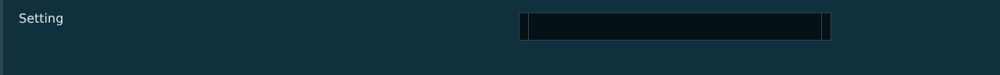


# lsc_field_row.layout — Setting row

**Mod:** Advanced Groups  
**File:** `AdvancedGroups/gui/layouts/suite/lsc_field_row.layout`  
**Root:** `PanelWidget` `row_field`, size 1280 × 96  
**Widgets:** 58

One setting: label, help text, tags (CAREFUL, RESTART, ADVANCED), and the control for its type: toggle, edit box, choice button, colour swatch, unit, action button (PICK ON MAP, MY HEADING...) and DEFAULT/REVERT.

> Advanced Banking ships an identical copy in `Advanced_Banking/gui/suite/`, used only when Advanced Groups is not loaded.

## Preview

Wireframe drawn straight from the layout file: positions, sizes, colours and default text are exact. Image widgets appear as dashed placeholders, and anything hidden at start inside the root is left out.

## Loaded by

- `AdvancedGroups/scripts/5_Mission/AdvancedGroups/SuiteConsole/LSCConsoleMenu.c` line 962
- `Advanced_Banking/scripts/5_Mission/AdvancedBanking/SuiteConsole/LSCConsoleMenu.c` line 969

## Widget tree

Positions and sizes are in pixels when the widget uses exact sizing, otherwise they are fractions of the parent (0–1).

| Widget | Type | Position | Size | Text / notes |
|---|---|---|---|---|
| `row_field` | PanelWidget | 0 0 | 1280 × 96 |  |
| &nbsp;&nbsp;└ `panel_strip` | PanelWidget | 0 0 | 4 × 96 |  |
| &nbsp;&nbsp;└ `txt_field_label` | TextWidget | 24 14 | 470 × 20 | "Setting" |
| &nbsp;&nbsp;└ `tag_1` | PanelWidget | 560 14 | 84 × 20 | hidden at start |
| &nbsp;&nbsp;&nbsp;&nbsp;└ `txt_tag` | TextWidget | 0 0 | 84 × 20 | "RESTART" |
| &nbsp;&nbsp;└ `tag_2` | PanelWidget | 470 14 | 84 × 20 | hidden at start |
| &nbsp;&nbsp;&nbsp;&nbsp;└ `txt_tag` | TextWidget | 0 0 | 84 × 20 | "RESTART" |
| &nbsp;&nbsp;└ `txt_help` | MultilineTextWidget | 24 40 | 620 × 46 |  |
| &nbsp;&nbsp;└ `btn_toggle` | ButtonWidget | 664 16 | 132 × 36 | hidden at start |
| &nbsp;&nbsp;&nbsp;&nbsp;└ `panel_track` | PanelWidget | 0 0 | 132 × 36 |  |
| &nbsp;&nbsp;&nbsp;&nbsp;└ `line_t` | PanelWidget | 0 0 | 132 × 1 |  |
| &nbsp;&nbsp;&nbsp;&nbsp;└ `line_b` | PanelWidget | 0 35 | 132 × 1 |  |
| &nbsp;&nbsp;&nbsp;&nbsp;└ `line_l` | PanelWidget | 0 0 | 1 × 36 |  |
| &nbsp;&nbsp;&nbsp;&nbsp;└ `line_r` | PanelWidget | 131 0 | 1 × 36 |  |
| &nbsp;&nbsp;&nbsp;&nbsp;└ `panel_on` | PanelWidget | 4 4 | 61 × 28 |  |
| &nbsp;&nbsp;&nbsp;&nbsp;└ `txt_on` | TextWidget | 4 4 | 61 × 28 | "ON" |
| &nbsp;&nbsp;&nbsp;&nbsp;└ `panel_off` | PanelWidget | 67 4 | 61 × 28 |  |
| &nbsp;&nbsp;&nbsp;&nbsp;└ `txt_off` | TextWidget | 67 4 | 61 × 28 | "OFF" |
| &nbsp;&nbsp;└ `panel_edit` | PanelWidget | 664 16 | 400 × 36 |  |
| &nbsp;&nbsp;&nbsp;&nbsp;└ `line_t` | PanelWidget | 0 0 | 400 × 1 |  |
| &nbsp;&nbsp;&nbsp;&nbsp;└ `line_b` | PanelWidget | 0 35 | 400 × 1 |  |
| &nbsp;&nbsp;&nbsp;&nbsp;└ `line_l` | PanelWidget | 0 0 | 1 × 36 |  |
| &nbsp;&nbsp;&nbsp;&nbsp;└ `line_r` | PanelWidget | 399 0 | 1 × 36 |  |
| &nbsp;&nbsp;&nbsp;&nbsp;└ `edit_value` | EditBoxWidget | 12 0 | 376 × 36 | style ServerBrowser |
| &nbsp;&nbsp;└ `txt_unit` | TextWidget | 852 16 | 96 × 36 |  |
| &nbsp;&nbsp;└ `panel_swatch` | PanelWidget | 852 16 | 36 × 36 | hidden at start |
| &nbsp;&nbsp;&nbsp;&nbsp;└ `line_t` | PanelWidget | 0 0 | 36 × 1 |  |
| &nbsp;&nbsp;&nbsp;&nbsp;└ `line_b` | PanelWidget | 0 35 | 36 × 1 |  |
| &nbsp;&nbsp;&nbsp;&nbsp;└ `line_l` | PanelWidget | 0 0 | 1 × 36 |  |
| &nbsp;&nbsp;&nbsp;&nbsp;└ `line_r` | PanelWidget | 35 0 | 1 × 36 |  |
| &nbsp;&nbsp;&nbsp;&nbsp;└ `btn_swatch` | ButtonWidget | 0 0 | 36 × 36 |  |
| &nbsp;&nbsp;└ `btn_choice` | ButtonWidget | 664 16 | 400 × 36 | hidden at start |
| &nbsp;&nbsp;&nbsp;&nbsp;└ `panel_bg` | PanelWidget | 0 0 | 400 × 36 |  |
| &nbsp;&nbsp;&nbsp;&nbsp;└ `line_t` | PanelWidget | 0 0 | 400 × 1 |  |
| &nbsp;&nbsp;&nbsp;&nbsp;└ `line_b` | PanelWidget | 0 35 | 400 × 1 |  |
| &nbsp;&nbsp;&nbsp;&nbsp;└ `line_l` | PanelWidget | 0 0 | 1 × 36 |  |
| &nbsp;&nbsp;&nbsp;&nbsp;└ `line_r` | PanelWidget | 399 0 | 1 × 36 |  |
| &nbsp;&nbsp;&nbsp;&nbsp;└ `txt_choice` | TextWidget | 13 0 | 350 × 36 |  |
| &nbsp;&nbsp;&nbsp;&nbsp;└ `img_chevron` | FrameWidget | 374 14 | 12 × 8 |  |
| &nbsp;&nbsp;&nbsp;&nbsp;&nbsp;&nbsp;└ `chev_1` | PanelWidget | 0 0 | 12 × 2 |  |
| &nbsp;&nbsp;&nbsp;&nbsp;&nbsp;&nbsp;└ `chev_2` | PanelWidget | 2 2 | 8 × 2 |  |
| &nbsp;&nbsp;&nbsp;&nbsp;&nbsp;&nbsp;└ `chev_3` | PanelWidget | 4 4 | 4 × 2 |  |
| &nbsp;&nbsp;&nbsp;&nbsp;&nbsp;&nbsp;└ `chev_4` | PanelWidget | 5 6 | 2 × 2 |  |
| &nbsp;&nbsp;└ `btn_action` | ButtonWidget | 1072 16 | 120 × 36 | hidden at start |
| &nbsp;&nbsp;&nbsp;&nbsp;└ `panel_bg` | PanelWidget | 0 0 | 120 × 36 |  |
| &nbsp;&nbsp;&nbsp;&nbsp;└ `line_t` | PanelWidget | 0 0 | 120 × 1 |  |
| &nbsp;&nbsp;&nbsp;&nbsp;└ `line_b` | PanelWidget | 0 35 | 120 × 1 |  |
| &nbsp;&nbsp;&nbsp;&nbsp;└ `line_l` | PanelWidget | 0 0 | 1 × 36 |  |
| &nbsp;&nbsp;&nbsp;&nbsp;└ `line_r` | PanelWidget | 119 0 | 1 × 36 |  |
| &nbsp;&nbsp;&nbsp;&nbsp;└ `txt_label` | TextWidget | 0 0 | 120 × 36 | "MY POSITION" |
| &nbsp;&nbsp;└ `btn_reset` | ButtonWidget | 1140 16 | 120 × 30 | hidden at start |
| &nbsp;&nbsp;&nbsp;&nbsp;└ `panel_bg` | PanelWidget | 0 0 | 120 × 30 |  |
| &nbsp;&nbsp;&nbsp;&nbsp;└ `line_t` | PanelWidget | 0 0 | 120 × 1 |  |
| &nbsp;&nbsp;&nbsp;&nbsp;└ `line_b` | PanelWidget | 0 29 | 120 × 1 |  |
| &nbsp;&nbsp;&nbsp;&nbsp;└ `line_l` | PanelWidget | 0 0 | 1 × 30 |  |
| &nbsp;&nbsp;&nbsp;&nbsp;└ `line_r` | PanelWidget | 119 0 | 1 × 30 |  |
| &nbsp;&nbsp;&nbsp;&nbsp;└ `txt_label` | TextWidget | 0 0 | 120 × 30 | "REVERT" |
| &nbsp;&nbsp;└ `txt_meta` | TextWidget | 664 60 | 596 × 16 |  |


