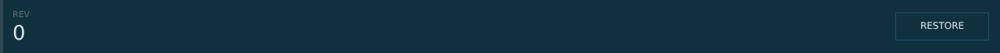


# lsc_history_row.layout — Version history row

**Mod:** Advanced Groups  
**File:** `AdvancedGroups/gui/layouts/suite/lsc_history_row.layout`  
**Root:** `PanelWidget` `row_history`, size 1280 × 68  
**Widgets:** 19

One saved version: revision, who, when, summary and RESTORE.

> Advanced Banking ships an identical copy in `Advanced_Banking/gui/suite/`, used only when Advanced Groups is not loaded.

## Preview

Wireframe drawn straight from the layout file: positions, sizes, colours and default text are exact. Image widgets appear as dashed placeholders, and anything hidden at start inside the root is left out.

## Loaded by

- `AdvancedGroups/scripts/5_Mission/AdvancedGroups/SuiteConsole/LSCConsoleMenu.c` line 1156
- `AdvancedGroups/scripts/5_Mission/AdvancedGroups/SuiteConsole/LSCConsoleMenu.c` line 1157
- `Advanced_Banking/scripts/5_Mission/AdvancedBanking/SuiteConsole/LSCConsoleMenu.c` line 1163
- `Advanced_Banking/scripts/5_Mission/AdvancedBanking/SuiteConsole/LSCConsoleMenu.c` line 1164

## Widget tree

Positions and sizes are in pixels when the widget uses exact sizing, otherwise they are fractions of the parent (0–1).

| Widget | Type | Position | Size | Text / notes |
|---|---|---|---|---|
| `row_history` | PanelWidget | 0 0 | 1280 × 68 |  |
| &nbsp;&nbsp;└ `panel_strip` | PanelWidget | 0 0 | 4 × 68 |  |
| &nbsp;&nbsp;└ `txt_rev_label` | TextWidget | 16 12 | 70 × 14 | "REV" |
| &nbsp;&nbsp;└ `txt_rev` | TextWidget | 16 26 | 70 × 32 | "0" |
| &nbsp;&nbsp;└ `txt_title` | TextWidget | 100 14 | 980 × 20 |  |
| &nbsp;&nbsp;└ `txt_sub` | TextWidget | 100 38 | 980 × 18 |  |
| &nbsp;&nbsp;└ `panel_live` | PanelWidget | 1172 23 | 94 × 22 | hidden at start |
| &nbsp;&nbsp;&nbsp;&nbsp;└ `tline_t` | PanelWidget | 0 0 | 94 × 1 |  |
| &nbsp;&nbsp;&nbsp;&nbsp;└ `tline_b` | PanelWidget | 0 21 | 94 × 1 |  |
| &nbsp;&nbsp;&nbsp;&nbsp;└ `tline_l` | PanelWidget | 0 0 | 1 × 22 |  |
| &nbsp;&nbsp;&nbsp;&nbsp;└ `tline_r` | PanelWidget | 93 0 | 1 × 22 |  |
| &nbsp;&nbsp;&nbsp;&nbsp;└ `txt_live` | TextWidget | 0 0 | 94 × 22 | "LIVE NOW" |
| &nbsp;&nbsp;└ `btn_restore` | ButtonWidget | 1146 16 | 120 × 36 |  |
| &nbsp;&nbsp;&nbsp;&nbsp;└ `panel_bg` | PanelWidget | 0 0 | 120 × 36 |  |
| &nbsp;&nbsp;&nbsp;&nbsp;└ `line_t` | PanelWidget | 0 0 | 120 × 1 |  |
| &nbsp;&nbsp;&nbsp;&nbsp;└ `line_b` | PanelWidget | 0 35 | 120 × 1 |  |
| &nbsp;&nbsp;&nbsp;&nbsp;└ `line_l` | PanelWidget | 0 0 | 1 × 36 |  |
| &nbsp;&nbsp;&nbsp;&nbsp;└ `line_r` | PanelWidget | 119 0 | 1 × 36 |  |
| &nbsp;&nbsp;&nbsp;&nbsp;└ `txt_label` | TextWidget | 0 0 | 120 × 36 | "RESTORE" |


