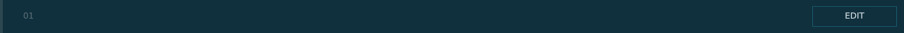


# lsc_item_row.layout — Record row

**Mod:** Advanced Groups  
**File:** `AdvancedGroups/gui/layouts/suite/lsc_item_row.layout`  
**Root:** `PanelWidget` `row_item`, size 1280 × 48  
**Widgets:** 41

One record in a list: number, title, subtitle, UP/DOWN/COPY/DELETE and OPEN/CLOSE.

> Advanced Banking ships an identical copy in `Advanced_Banking/gui/suite/`, used only when Advanced Groups is not loaded.

## Preview

Wireframe drawn straight from the layout file: positions, sizes, colours and default text are exact. Image widgets appear as dashed placeholders, and anything hidden at start inside the root is left out.

## Loaded by

- `AdvancedGroups/scripts/5_Mission/AdvancedGroups/SuiteConsole/LSCConsoleMenu.c` line 1102
- `AdvancedGroups/scripts/5_Mission/AdvancedGroups/SuiteConsole/LSCConsoleMenu.c` line 1103
- `Advanced_Banking/scripts/5_Mission/AdvancedBanking/SuiteConsole/LSCConsoleMenu.c` line 1109
- `Advanced_Banking/scripts/5_Mission/AdvancedBanking/SuiteConsole/LSCConsoleMenu.c` line 1110

## Widget tree

Positions and sizes are in pixels when the widget uses exact sizing, otherwise they are fractions of the parent (0–1).

| Widget | Type | Position | Size | Text / notes |
|---|---|---|---|---|
| `row_item` | PanelWidget | 0 0 | 1280 × 48 |  |
| &nbsp;&nbsp;└ `btn_hit` | ButtonWidget | 0 0 | 1280 × 48 |  |
| &nbsp;&nbsp;└ `panel_strip` | PanelWidget | 0 0 | 4 × 48 |  |
| &nbsp;&nbsp;└ `txt_index` | TextWidget | 4 0 | 44 × 48 | "01" |
| &nbsp;&nbsp;└ `txt_title` | TextWidget | 66 0 | 420 × 48 |  |
| &nbsp;&nbsp;└ `txt_sub` | TextWidget | 486 0 | 150 × 48 |  |
| &nbsp;&nbsp;└ `btn_up` | ButtonWidget | 646 9 | 120 × 30 | hidden at start |
| &nbsp;&nbsp;&nbsp;&nbsp;└ `panel_bg` | PanelWidget | 0 0 | 120 × 30 |  |
| &nbsp;&nbsp;&nbsp;&nbsp;└ `line_t` | PanelWidget | 0 0 | 120 × 1 |  |
| &nbsp;&nbsp;&nbsp;&nbsp;└ `line_b` | PanelWidget | 0 29 | 120 × 1 |  |
| &nbsp;&nbsp;&nbsp;&nbsp;└ `line_l` | PanelWidget | 0 0 | 1 × 30 |  |
| &nbsp;&nbsp;&nbsp;&nbsp;└ `line_r` | PanelWidget | 119 0 | 1 × 30 |  |
| &nbsp;&nbsp;&nbsp;&nbsp;└ `txt_label` | TextWidget | 0 0 | 120 × 30 | "UP" |
| &nbsp;&nbsp;└ `btn_down` | ButtonWidget | 772 9 | 120 × 30 | hidden at start |
| &nbsp;&nbsp;&nbsp;&nbsp;└ `panel_bg` | PanelWidget | 0 0 | 120 × 30 |  |
| &nbsp;&nbsp;&nbsp;&nbsp;└ `line_t` | PanelWidget | 0 0 | 120 × 1 |  |
| &nbsp;&nbsp;&nbsp;&nbsp;└ `line_b` | PanelWidget | 0 29 | 120 × 1 |  |
| &nbsp;&nbsp;&nbsp;&nbsp;└ `line_l` | PanelWidget | 0 0 | 1 × 30 |  |
| &nbsp;&nbsp;&nbsp;&nbsp;└ `line_r` | PanelWidget | 119 0 | 1 × 30 |  |
| &nbsp;&nbsp;&nbsp;&nbsp;└ `txt_label` | TextWidget | 0 0 | 120 × 30 | "DOWN" |
| &nbsp;&nbsp;└ `btn_copy` | ButtonWidget | 898 9 | 120 × 30 | hidden at start |
| &nbsp;&nbsp;&nbsp;&nbsp;└ `panel_bg` | PanelWidget | 0 0 | 120 × 30 |  |
| &nbsp;&nbsp;&nbsp;&nbsp;└ `line_t` | PanelWidget | 0 0 | 120 × 1 |  |
| &nbsp;&nbsp;&nbsp;&nbsp;└ `line_b` | PanelWidget | 0 29 | 120 × 1 |  |
| &nbsp;&nbsp;&nbsp;&nbsp;└ `line_l` | PanelWidget | 0 0 | 1 × 30 |  |
| &nbsp;&nbsp;&nbsp;&nbsp;└ `line_r` | PanelWidget | 119 0 | 1 × 30 |  |
| &nbsp;&nbsp;&nbsp;&nbsp;└ `txt_label` | TextWidget | 0 0 | 120 × 30 | "COPY" |
| &nbsp;&nbsp;└ `btn_delete` | ButtonWidget | 1024 9 | 120 × 30 | hidden at start |
| &nbsp;&nbsp;&nbsp;&nbsp;└ `panel_bg` | PanelWidget | 0 0 | 120 × 30 |  |
| &nbsp;&nbsp;&nbsp;&nbsp;└ `line_t` | PanelWidget | 0 0 | 120 × 1 |  |
| &nbsp;&nbsp;&nbsp;&nbsp;└ `line_b` | PanelWidget | 0 29 | 120 × 1 |  |
| &nbsp;&nbsp;&nbsp;&nbsp;└ `line_l` | PanelWidget | 0 0 | 1 × 30 |  |
| &nbsp;&nbsp;&nbsp;&nbsp;└ `line_r` | PanelWidget | 119 0 | 1 × 30 |  |
| &nbsp;&nbsp;&nbsp;&nbsp;└ `txt_label` | TextWidget | 0 0 | 120 × 30 | "DELETE" |
| &nbsp;&nbsp;└ `btn_edit` | ButtonWidget | 1150 9 | 120 × 30 |  |
| &nbsp;&nbsp;&nbsp;&nbsp;└ `panel_bg` | PanelWidget | 0 0 | 120 × 30 |  |
| &nbsp;&nbsp;&nbsp;&nbsp;└ `line_t` | PanelWidget | 0 0 | 120 × 1 |  |
| &nbsp;&nbsp;&nbsp;&nbsp;└ `line_b` | PanelWidget | 0 29 | 120 × 1 |  |
| &nbsp;&nbsp;&nbsp;&nbsp;└ `line_l` | PanelWidget | 0 0 | 1 × 30 |  |
| &nbsp;&nbsp;&nbsp;&nbsp;└ `line_r` | PanelWidget | 119 0 | 1 × 30 |  |
| &nbsp;&nbsp;&nbsp;&nbsp;└ `txt_label` | TextWidget | 0 0 | 120 × 30 | "EDIT" |


