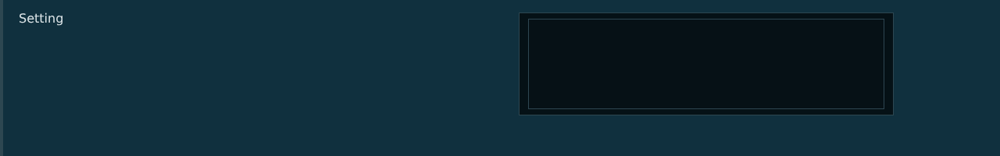


# lsc_lines_row.layout — List setting row

**Mod:** Advanced Groups  
**File:** `AdvancedGroups/gui/layouts/suite/lsc_lines_row.layout`  
**Root:** `PanelWidget` `row_lines`, size 1280 × 200  
**Widgets:** 29

A setting that holds several lines: class names, word lists, SteamIDs, positions. Multi-line box plus action button (ADD CLASS, ADD ON MAP).

> Advanced Banking ships an identical copy in `Advanced_Banking/gui/suite/`, used only when Advanced Groups is not loaded.

## Preview

Wireframe drawn straight from the layout file: positions, sizes, colours and default text are exact. Image widgets appear as dashed placeholders, and anything hidden at start inside the root is left out.

## Loaded by

- `AdvancedGroups/scripts/5_Mission/AdvancedGroups/SuiteConsole/LSCConsoleMenu.c` line 961
- `Advanced_Banking/scripts/5_Mission/AdvancedBanking/SuiteConsole/LSCConsoleMenu.c` line 968

## Widget tree

Positions and sizes are in pixels when the widget uses exact sizing, otherwise they are fractions of the parent (0–1).

| Widget | Type | Position | Size | Text / notes |
|---|---|---|---|---|
| `row_lines` | PanelWidget | 0 0 | 1280 × 200 |  |
| &nbsp;&nbsp;└ `panel_strip` | PanelWidget | 0 0 | 4 × 200 |  |
| &nbsp;&nbsp;└ `txt_field_label` | TextWidget | 24 14 | 470 × 20 | "Setting" |
| &nbsp;&nbsp;└ `tag_1` | PanelWidget | 560 14 | 84 × 20 | hidden at start |
| &nbsp;&nbsp;&nbsp;&nbsp;└ `txt_tag` | TextWidget | 0 0 | 84 × 20 | "RESTART" |
| &nbsp;&nbsp;└ `tag_2` | PanelWidget | 470 14 | 84 × 20 | hidden at start |
| &nbsp;&nbsp;&nbsp;&nbsp;└ `txt_tag` | TextWidget | 0 0 | 84 × 20 | "RESTART" |
| &nbsp;&nbsp;└ `txt_help` | MultilineTextWidget | 24 40 | 620 × 150 |  |
| &nbsp;&nbsp;└ `panel_edit` | PanelWidget | 664 16 | 480 × 132 |  |
| &nbsp;&nbsp;&nbsp;&nbsp;└ `line_t` | PanelWidget | 0 0 | 480 × 1 |  |
| &nbsp;&nbsp;&nbsp;&nbsp;└ `line_b` | PanelWidget | 0 131 | 480 × 1 |  |
| &nbsp;&nbsp;&nbsp;&nbsp;└ `line_l` | PanelWidget | 0 0 | 1 × 132 |  |
| &nbsp;&nbsp;&nbsp;&nbsp;└ `line_r` | PanelWidget | 479 0 | 1 × 132 |  |
| &nbsp;&nbsp;&nbsp;&nbsp;└ `edit_lines` | MultilineEditBoxWidget | 12 8 | 456 × 116 | style ServerBrowser |
| &nbsp;&nbsp;└ `btn_action` | ButtonWidget | 1152 16 | 108 × 36 | hidden at start |
| &nbsp;&nbsp;&nbsp;&nbsp;└ `panel_bg` | PanelWidget | 0 0 | 108 × 36 |  |
| &nbsp;&nbsp;&nbsp;&nbsp;└ `line_t` | PanelWidget | 0 0 | 108 × 1 |  |
| &nbsp;&nbsp;&nbsp;&nbsp;└ `line_b` | PanelWidget | 0 35 | 108 × 1 |  |
| &nbsp;&nbsp;&nbsp;&nbsp;└ `line_l` | PanelWidget | 0 0 | 1 × 36 |  |
| &nbsp;&nbsp;&nbsp;&nbsp;└ `line_r` | PanelWidget | 107 0 | 1 × 36 |  |
| &nbsp;&nbsp;&nbsp;&nbsp;└ `txt_label` | TextWidget | 0 0 | 108 × 36 | "ADD MY POS" |
| &nbsp;&nbsp;└ `btn_reset` | ButtonWidget | 1152 60 | 108 × 30 | hidden at start |
| &nbsp;&nbsp;&nbsp;&nbsp;└ `panel_bg` | PanelWidget | 0 0 | 108 × 30 |  |
| &nbsp;&nbsp;&nbsp;&nbsp;└ `line_t` | PanelWidget | 0 0 | 108 × 1 |  |
| &nbsp;&nbsp;&nbsp;&nbsp;└ `line_b` | PanelWidget | 0 29 | 108 × 1 |  |
| &nbsp;&nbsp;&nbsp;&nbsp;└ `line_l` | PanelWidget | 0 0 | 1 × 30 |  |
| &nbsp;&nbsp;&nbsp;&nbsp;└ `line_r` | PanelWidget | 107 0 | 1 × 30 |  |
| &nbsp;&nbsp;&nbsp;&nbsp;└ `txt_label` | TextWidget | 0 0 | 108 × 30 | "REVERT" |
| &nbsp;&nbsp;└ `txt_meta` | TextWidget | 664 156 | 596 × 16 |  |


