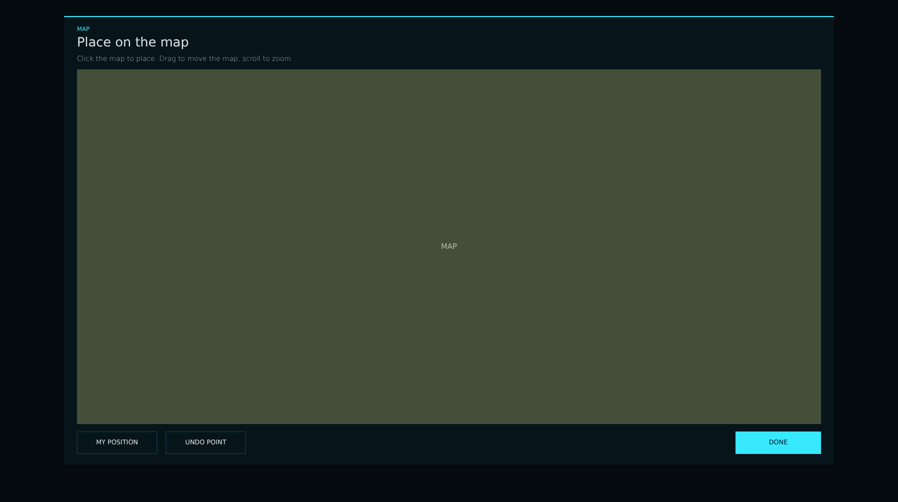


# lsc_map_modal.layout — Map picker

**Mod:** Advanced Groups  
**File:** `AdvancedGroups/gui/layouts/suite/lsc_map_modal.layout`  
**Root:** `PanelWidget` `modal_map`, size 1680 × 940  
**Widgets:** 30

Map dialog for anything with a position: click to place, MY POSITION, UNDO POINT for polygons, radius circles and polygon outlines of every record.

> Advanced Banking ships an identical copy in `Advanced_Banking/gui/suite/`, used only when Advanced Groups is not loaded.

## Preview

Wireframe drawn straight from the layout file: positions, sizes, colours and default text are exact. Image widgets appear as dashed placeholders, and anything hidden at start inside the root is left out.

## Loaded by

- `AdvancedGroups/scripts/5_Mission/AdvancedGroups/SuiteConsole/LSCConsoleMenu.c` line 1954
- `Advanced_Banking/scripts/5_Mission/AdvancedBanking/SuiteConsole/LSCConsoleMenu.c` line 1961

## Widget tree

Positions and sizes are in pixels when the widget uses exact sizing, otherwise they are fractions of the parent (0–1).

| Widget | Type | Position | Size | Text / notes |
|---|---|---|---|---|
| `modal_map` | PanelWidget | 0 0 | 1680 × 940 | hidden at start |
| &nbsp;&nbsp;└ `modal_panel_map` | PanelWidget | 120 30 | 1440 × 840 |  |
| &nbsp;&nbsp;&nbsp;&nbsp;└ `modal_edge_map` | PanelWidget | 0 0 | 1440 × 2 |  |
| &nbsp;&nbsp;&nbsp;&nbsp;└ `txt_map_overline` | TextWidget | 24 18 | 1392 × 14 | "MAP" |
| &nbsp;&nbsp;&nbsp;&nbsp;└ `txt_map_title` | TextWidget | 24 34 | 1392 × 30 | "Place on the map" |
| &nbsp;&nbsp;&nbsp;&nbsp;└ `txt_map_hint` | TextWidget | 24 70 | 1392 × 20 | "Click the map to place. Drag to move the map, scroll to zoom." |
| &nbsp;&nbsp;&nbsp;&nbsp;└ `map_view` | MapWidget | 24 100 | 1392 × 664 |  |
| &nbsp;&nbsp;&nbsp;&nbsp;└ `map_canvas` | CanvasWidget | 24 100 | 1392 × 664 |  |
| &nbsp;&nbsp;&nbsp;&nbsp;└ `txt_map_coords` | TextWidget | 360 778 | 880 × 42 |  |
| &nbsp;&nbsp;&nbsp;&nbsp;└ `btn_map_mine` | ButtonWidget | 24 778 | 150 × 42 |  |
| &nbsp;&nbsp;&nbsp;&nbsp;&nbsp;&nbsp;└ `panel_bg` | PanelWidget | 0 0 | 150 × 42 |  |
| &nbsp;&nbsp;&nbsp;&nbsp;&nbsp;&nbsp;└ `line_t` | PanelWidget | 0 0 | 150 × 1 |  |
| &nbsp;&nbsp;&nbsp;&nbsp;&nbsp;&nbsp;└ `line_b` | PanelWidget | 0 41 | 150 × 1 |  |
| &nbsp;&nbsp;&nbsp;&nbsp;&nbsp;&nbsp;└ `line_l` | PanelWidget | 0 0 | 1 × 42 |  |
| &nbsp;&nbsp;&nbsp;&nbsp;&nbsp;&nbsp;└ `line_r` | PanelWidget | 149 0 | 1 × 42 |  |
| &nbsp;&nbsp;&nbsp;&nbsp;&nbsp;&nbsp;└ `txt_label` | TextWidget | 0 0 | 150 × 42 | "MY POSITION" |
| &nbsp;&nbsp;&nbsp;&nbsp;└ `btn_map_undo` | ButtonWidget | 190 778 | 150 × 42 |  |
| &nbsp;&nbsp;&nbsp;&nbsp;&nbsp;&nbsp;└ `panel_bg` | PanelWidget | 0 0 | 150 × 42 |  |
| &nbsp;&nbsp;&nbsp;&nbsp;&nbsp;&nbsp;└ `line_t` | PanelWidget | 0 0 | 150 × 1 |  |
| &nbsp;&nbsp;&nbsp;&nbsp;&nbsp;&nbsp;└ `line_b` | PanelWidget | 0 41 | 150 × 1 |  |
| &nbsp;&nbsp;&nbsp;&nbsp;&nbsp;&nbsp;└ `line_l` | PanelWidget | 0 0 | 1 × 42 |  |
| &nbsp;&nbsp;&nbsp;&nbsp;&nbsp;&nbsp;└ `line_r` | PanelWidget | 149 0 | 1 × 42 |  |
| &nbsp;&nbsp;&nbsp;&nbsp;&nbsp;&nbsp;└ `txt_label` | TextWidget | 0 0 | 150 × 42 | "UNDO POINT" |
| &nbsp;&nbsp;&nbsp;&nbsp;└ `btn_map_done` | ButtonWidget | 1256 778 | 160 × 42 |  |
| &nbsp;&nbsp;&nbsp;&nbsp;&nbsp;&nbsp;└ `panel_bg` | PanelWidget | 0 0 | 160 × 42 |  |
| &nbsp;&nbsp;&nbsp;&nbsp;&nbsp;&nbsp;└ `line_t` | PanelWidget | 0 0 | 160 × 1 |  |
| &nbsp;&nbsp;&nbsp;&nbsp;&nbsp;&nbsp;└ `line_b` | PanelWidget | 0 41 | 160 × 1 |  |
| &nbsp;&nbsp;&nbsp;&nbsp;&nbsp;&nbsp;└ `line_l` | PanelWidget | 0 0 | 1 × 42 |  |
| &nbsp;&nbsp;&nbsp;&nbsp;&nbsp;&nbsp;└ `line_r` | PanelWidget | 159 0 | 1 × 42 |  |
| &nbsp;&nbsp;&nbsp;&nbsp;&nbsp;&nbsp;└ `txt_label` | TextWidget | 0 0 | 160 × 42 | "DONE" |


